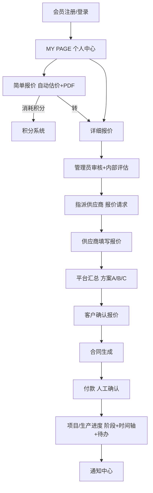

# MASS CONNECTED 平台改版规划

## 一、已确认的方向决策

- 供应商协作模式：**对齐需求文档**。管理员创建供应商账号（不开放自助注册）、把报价请求指派给指定供应商、供应商仅见被指派项目、平台审核后向客户展示方案 A/B/C；公开需求大厅降级为内部/可选，不再作为供应商自由抢单入口。
- 商城模块：**保留为独立业务线**（`/shop` 商品+购物车+下单现状不动）。

## 二、现状 vs 愿景：保留 / 改版 / 新建

### 可直接保留（吻合度高）
- 会员体系：个人/企业 + JWT 登录 + 会话持久化（[backend/apps/accounts/models.py](backend/apps/accounts/models.py)、[frontend/src/stores/auth.js](frontend/src/stores/auth.js)）。
- RFQ 创建与附件上传（[backend/apps/rfq/models.py](backend/apps/rfq/models.py) 的 `RFQ`/`RFQAttachment`、[frontend/src/views/rfq/RfqCreateView.vue](frontend/src/views/rfq/RfqCreateView.vue)）。
- 管理后台工厂/企业审核（[admin/src/views/FactoriesView.vue](admin/src/views/FactoriesView.vue)）。
- 官网 CMS + 询盘 + 多语言 i18n JSON 骨架（`apps/content`、`apps/inquiry`、[backend/apps/i18n/fields.py](backend/apps/i18n/fields.py)，前端 ko/zh/en/ja）。
- 商城全链路（`apps/catalog`、`apps/order`、`frontend/src/views/shop/*`）。

### 需改版扩展
- **供应商协作**：现为"自助注册→审核→需求大厅抢单"，改为"管理员建号→指派报价请求→供应商仅见被指派"。停用 [FactoryRFQQuoteCreateView](backend/apps/rfq/views.py) 的公开抢单路径；`DemandHall` 前台降级（[frontend/src/views/factory/DemandHallView.vue](frontend/src/views/factory/DemandHallView.vue)）。
- **报价体系**：现单层 RFQ→Quote 演进为**详细报价**（补齐分类字段、9.6 状态机、加价规则、多供应商比较）。当前 `Quote` 对客户直接可见，改为经平台汇总后以方案 A/B/C 展示。
- **生产订单→项目**：当前 `ProductionOrder` 偏薄，升级为 `Project` + 阶段/时间轴/待办体系（见需求第 10 章）。

### 完全缺失、需新建（愿景中的 P0/核心）
- **简单报价引擎**：注塑模具/3D打印/PCB/软件/IC 自动估价 + 参数后台 + PDF（需求第 8 章）。
- **积分系统**：注册赠送、报价消耗、余额/流水、充值（第 12 章）。
- **MY PAGE 个人中心**：聚合报价/项目/文件/合同/付款/积分/通知/企业资料/账户设置（第 11 章）——当前前端完全没有个人中心与退出登录 UI。
- **通知中心**、**合同**、**付款（V1 人工确认）**、**PDF 生成**（当前后端无任何 PDF 依赖）、**统一文件中心**。

## 三、目标业务闭环

## 四、后端数据模型改造要点

- accounts：`User` 保留；新增供应商体系（对齐 13.28）——独立 `Supplier` + `SupplierUser`（管理员建号）、`SupplierCategory`/`SupplierTag`，与现 `FactoryProfile`（企业自助）区分或迁移。
- rfq 拆分与扩展：
  - 保留 `RFQ` 作为**详细报价**主体，扩展分类专用字段与 9.6 状态机；`Quote` 增加"是否对客户可见/方案标签"，新增 `QuoteRequest`（指派记录，对齐 13.28.5）。
  - 新增 `SimpleQuote` + `QuoteParam`（后台可维护材料/机时/模具等级单价）。
- 新增 app：`points`（`PointWallet`/`PointTransaction`/`PointRule`/`RechargeOrder`）、`project`（`Project`/`ProjectStage`/`ProjectUpdate`/`ProjectTodo`/`ProjectIssue`）、`notification`（`Notification`）、`contract`（`Contract`）、`payment`（`Payment`）。
- 编号规则统一：`MC-QT` / `MC-DQ` / `MC-PRJ` / `MC-SUP` / `MC-CT` / `MC-PAY`。
- 引入 PDF 生成依赖（如 weasyprint/reportlab），落在报价单/合同导出。

## 五、分阶段路线（建议按此顺序推进）

- **P0（打通核心闭环）**：积分系统 + MY PAGE 个人中心 + 简单报价（注塑/3D 先行）+ PDF 报价书 + 通知中心基础 + 供应商指派制改造 + 详细报价状态机 + 项目/进度可视化。
- **P1（协作与运营）**：多供应商比较与方案 A/B/C、加价规则、合同生成、人工付款确认、供应商进度更新与审核、积分充值（人工确认）、邮件通知、PCB/软件/IC 简单报价。
- **P2（智能与扩展）**：AI 估价、STP 解析、支付网关、Kakao/第三方登录、推荐佣金/Manager、供应商评分、App 推送。

## 六、范围边界与风险

- 本轮不动商城业务逻辑；供应商模式改造涉及现有 `FactoryProfile`/需求大厅数据，需评估存量企业会员的过渡（保留其买方能力，供应商能力改由管理员建号承接）。
- 改造点多、跨前后端与 admin，建议每个模块独立方案+迁移+自检后再合入，避免"修一处炸一片"。
- 积分/付款涉及韩国税务与 PG，V1 仅做人工确认，接口预留。