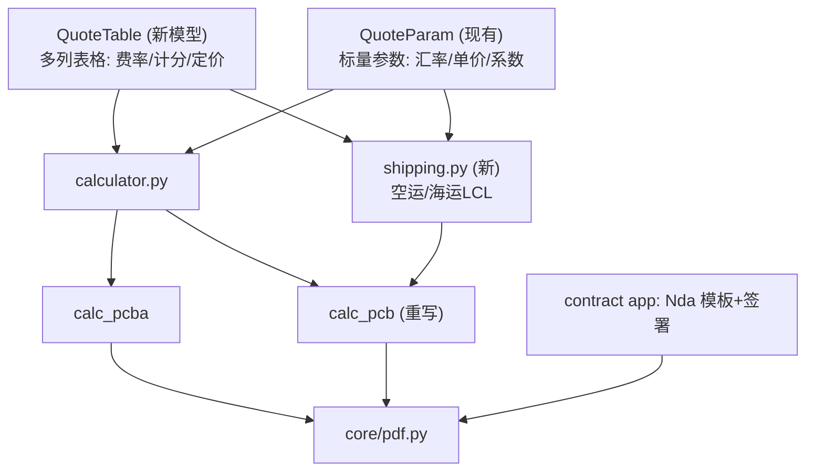

## 目标与范围

对齐 `project/new` 下 4 份需求（[README.md](project/new/README.md)、[02-制造成本.md](project/new/02-制造成本.md)、[03-PCB开发成本.md](project/new/03-PCB开发成本.md)、[06-运输费基准资料.md](project/new/06-运输费基准资料.md)、[01-保密协议.md](project/new/01-保密协议.md)）。

做：
- PCBA 加工费计分制计算器（新 `quote_type=pcba`）
- PCB 开发成本清单 A/B 报价（重写 `calc_pcb`，`quote_type=pcb`）
- 运输费计算器：空运 + 海运 LCL 无电池/含电池（可复用服务），FCL 预留占位
- NDA 在线签署流程（模板 + 签署实例 + 1 年留存删除标记）
- 新增 `QuoteTable` 模型承载费率/计分/定价等多列表格 + 后台维护 + seed
- 前端表单、报价单 PDF（韩语）、i18n

不做（本轮）：
- FCL 正式费率算法（仅留接口与占位，待客户补费率表）
- 注塑报价的「生产费/运输费」自动回填（保持现状留空，仅在方案中标注可后续接入 shipping）
- BOM 文件解析上传（PCBA 先支持结构化行录入，Excel/BOM 导入列为后续）
- 基于历史数据的材料/价格训练模型

## 架构总览

关键决策：新增 `QuoteTable(quote_type, table_key, rows JSONField, is_active)` 统一存储所有多列表格（空运阶梯、CBM 区间、PCBA 计分、PCB 定价行、服务费、权重）；标量参数（汇率、每分单价、利润率、MOQ）仍走现有 `QuoteParam`。这样避免为每张表建模型，且后台可统一维护。

**汇率分域（已对齐 project/new，互不混用）**：

| quote_type | 参数键 | 默认值 | 用途 |
|---|---|---|---|
| `pcba` | `rmb_to_krw` | 226 | PCBA 加工费 RMB→KRW 展示 |
| `shipping` | `usd_to_krw` | 1580 | 海运 LCL 无电池 USD 项 |
| `shipping` | `cny_to_krw` | 232.4 | 海运 LCL 提货/C/O 等 CNY 项 |
| `shipping` | `usd_to_krw_battery` | 1500 | 含电池 LCL 示例汇率（可后台改） |
| `injection` | `rmb_to_krw` | 190 | **已有**，本方案不改 |

> 注塑 190、PCBA 226、shipping 1580/232.4 为独立配置，禁止共用同一 param_key。

## 实现步骤（建议按依赖顺序）

### 步骤 0 — 数据模型与后台（先行，其余都依赖它）
- 在 [backend/apps/simplequote/models.py](backend/apps/simplequote/models.py) 新增 `QuoteTable`：`quote_type`、`table_key`、`rows`(JSONField)、`is_active`、时间戳，`unique_together=(quote_type, table_key)`。参照 `backend-migration-and-model` 生成迁移。
- 后台 CRUD：在 [backend/apps/simplequote/views.py](backend/apps/simplequote/views.py) 增 `AdminQuoteTableView`（列表/新增/改），[urls.py](backend/apps/simplequote/urls.py) 加 `admin/quote-tables`；序列化器加 `QuoteTableSerializer`。
- seed：新增 `seed_quote_tables` 幂等命令（参考现有 `seed_demo_data`），写入 06/02/03 各表默认数据；同时 seed `QuoteParam(quote_type='shipping')` 的 `usd_to_krw`/`cny_to_krw`/`usd_to_krw_battery`，以及 `QuoteParam(quote_type='pcba')` 的 `rmb_to_krw=226`。

### 步骤 1 — 运输费计算器（基础，被 PCB 开发复用）
- 新建 [backend/apps/simplequote/shipping.py](backend/apps/simplequote/shipping.py)：
  - `calc_air(weight_kg, l, w, h)`：体积重=L×W×H/6000，计费重=max(实重,体积重)，查空运阶梯表返回韩元。
  - `calc_lcl(cbm, weight_kg, has_battery, service_days)`：无电池 R/T=ceil(max(cbm, kg/250),0.1)×单价+区间国内费；含电池 max(最低CBM,cbm)×$/CBM + 超重 kg 加收 + BILL/CBM 固定费。
  - 汇率走 `QuoteParam(quote_type='shipping')`：`usd_to_krw`(1580)、`cny_to_krw`(232.4)、`usd_to_krw_battery`(1500)；阶梯/区间走 `QuoteTable`。
- 接口：`POST /api/member/simple-quotes/shipping-estimate`（`shippingEstimate`），返回明细 breakdown + 合计（KRW），4 日/5 日对比。错误码 `SHIPPING_INPUT_INVALID`。
- **配送费简化规则**（供 PCB 开发默认使用，与完整空运阶梯并存）：
  - `calc_pcb_shipping_simple(weight_kg)`：≤1kg → 24,000 韩元；≥2kg → 重量 × 11,600 韩元；1~2kg 区间按文档未定义，实现时取 ≥2kg 规则或向上取整到 2kg（seed 注释说明，后台可配）。
  - 完整空运阶梯 `calc_air` 作为**可选精算**入口（运输小计算器、独立估算页），不强制 PCB 开发报价走阶梯表。

### 步骤 2 — PCBA 计分制计算器（新 quote_type=pcba）
- [calculator.py](backend/apps/simplequote/calculator.py)：新增 `calc_pcba(inputs, params)`，注册进 `CALCULATORS`。
  - 输入：元件行数组 `[{package, qty, tech: smt|dip}]` + PCB 订单数量。
  - 每行加工费=计分×每分单价（SMT 默认 0.01、DIP 0.03，`QuoteParam`），计分表查 `QuoteTable(pcba, component_scores)`（按封装匹配）。
  - 基础固定费：钢网、SMT 测试(×PCB 数)、包装(×array)。合计 RMB，按 `QuoteParam(pcba, rmb_to_krw)` 默认 **226** 展示 KRW（与注塑 `injection.rmb_to_krw=190` 独立）。
  - 不含物料费/开机费/钢网另计等——明确列 breakdown 且标注「不含」。
- [SimpleQuote.TYPE_CHOICES](backend/apps/simplequote/models.py) 与 [SimpleQuoteCreateSerializer](backend/apps/simplequote/serializers.py) choices 增 `pcba`；`TYPE_LABELS`/PDF 分支增 PCBA。

### 步骤 3 — PCB 开发成本（重写 calc_pcb）
- 重写 [calc_pcb](backend/apps/simplequote/calculator.py)：
  - 输入：开发项编号（A 类 1–8 或 B 类 9/10，互斥，二选一分组校验）、服务费多选、样品权重项（生产/PCB 种类/数量/尺寸）、广告同意、配送重量。
  - 定价行/服务费/权重表走 `QuoteTable(pcb, base_pricing|services|weights)`。
  - 公式：`开发费 = 选中基础项 × 权重合计 + 服务费合计`；广告同意则 ×0.9；**配送费默认走简化规则** `calc_pcb_shipping_simple(weight_kg)`（≤1kg=24,000 / ≥2kg=×11,600），非 `calc_air` 阶梯表；VAT 不含（单列标注）。
  - A/B 互斥校验失败抛 `PcbQuoteError` → `SIMPLE_QUOTE_INPUT_INVALID`。
  - 03 文档示例 335,000×2=670,000 与报价单 603,000 存在文档内部矛盾，实现以公式为准，验收不硬编码某一总额。
- 币种 KRW，有效期沿用（可后台配）。

### 步骤 4 — 报价单 PDF（韩语）
- [backend/core/pdf.py](backend/core/pdf.py) 复用 CID 字体，新增 `build_pcba_quotation_pdf` 与 `build_pcb_dev_quotation_pdf`；在 [views.render_pdf](backend/apps/simplequote/views.py) 增分支。

### 步骤 5 — NDA 在线签署（contract app）
- [backend/apps/contract/models.py](backend/apps/contract/models.py) 新增 `NdaTemplate`(version, body, effective_date, is_active) 与 `NdaSignature`(buyer, template, company_name, status, signed_at, pdf, retention_delete_at=signed_at+1年)。迁移走 `backend-migration-and-model`。
- 接口：`GET /member/nda/template`（取当前模板并回填客户公司名占位）、`POST /member/nda/sign`（生成签署 + PDF）、`GET /member/nda`（我的签署记录）。占位符「客户公司名称」由 `buyer.company` 自动替换。
- PDF：`build_nda_pdf`。留存删除：新增管理命令/定时任务清理 `retention_delete_at` 到期的 pdf（本轮先落字段与命令，不接调度器）。

### 步骤 6 — 前端与 i18n
- [frontend/src/views/quote/SimpleQuoteView.vue](frontend/src/views/quote/SimpleQuoteView.vue)：增 `pcba`、`pcb`(开发清单) 表单与类型入口；**独立运输费小计算器**（调用 `shippingEstimate`，空运阶梯 + 海运 LCL 双方案）；PCB 开发表单内配送费用简化规则自动算，与运输计算器分离展示。
- 新增 NDA 签署页（mypage 下），[frontend/src/api/index.js](frontend/src/api/index.js) 增 `shippingEstimate`、`ndaTemplate`、`ndaSign`、`ndaList` 方法（统一走封装请求层）。
- [admin/src/views/QuoteParamsView.vue](admin/src/views/QuoteParamsView.vue)：`quote_type` 选项增 `pcba/pcb/shipping`；新增 QuoteTable 维护入口（JSON 行编辑）。
- [frontend/src/i18n/index.js](frontend/src/i18n/index.js) 与 admin i18n 补齐所有可见文案 key，禁止硬编码。

## 风险与缓解

- 表格数据不完整（空运仅节选阶梯、FCL 占位、CBM 中间区间 ±10%）：seed 用文档节选，明确 FCL 返回「待补费率」，前端标注「参考值/约 80% 精度」；空运补齐 0.5kg 全阶梯需向客户要完整 Excel。
- 多币种混算（RMB/USD/KRW）：所有原始费率按文档币种存 `QuoteTable`，`QuoteParam` **按 quote_type 分域存汇率**（pcba 226 / shipping 1580+232.4 / injection 190 互不共用），结果统一换算 KRW 展示并保留原币值；结算汇率后台可配。
- PCB 配送费双口径：开发报价默认简化规则（24,000 / ×11,600），完整空运阶梯仅作运输计算器精算；前端须标注口径差异，避免用户混淆。
- `QuoteParam.value` 为 Decimal 装不下表格：由新 `QuoteTable.rows(JSON)` 承载，避免污染现有标量参数。
- PCBA 计分表庞大：本轮 seed 覆盖文档典型封装，未命中封装回退默认计分并提示「按默认计分，如需精确请人工确认」。
- 迁移风险：仅新增模型/字段，不改既有列；`makemigrations` 后本地 `migrate` 验证，遵循 `backend-migration-and-model`。
- 权限与数据边界：会员接口 `IsBuyerRole`、后台 `IsAdminRole`；查询按 `buyer=request.user` 隔离，沿用现有模式。
- 破坏性：`calc_pcb` 语义变更，检查历史 `quote_type='pcb'` 数据的 `inputs/result` 展示是否报错（旧记录只读展示，不重算）。

## 验收标准

1. `POST /shipping-estimate` 用 06 文档示例（0.6kg/20×20×10 → 21,000 韩元；3CBM/250kg/4 日有提货有 C/O → ≈731,818 韩元）结果误差在文档标注范围内。
2. `pcba` 报价：给定元件行 + PCB 数量，返回 SMT/DIP 计分明细、基础固定费、RMB 合计与 KRW 换算；未知封装有回退与提示。
3. `pcb` 开发报价：A/B 同选时返回 `SIMPLE_QUOTE_INPUT_INVALID`；广告同意使开发费部分 ×0.9；权重乘算与服务费累加逻辑正确（**不硬编码文档示例总额 603,000/670,000**）；配送费按简化规则（≤1kg=24,000、≥2kg=×11,600）计算，与 `shipping-estimate` 空运阶梯结果可不同但各自自洽。
4. 三类报价均能生成韩语 PDF 且中韩文不乱码。
5. NDA：`sign` 后生成含客户公司名替换的 PDF，记录 `status=signed`、`retention_delete_at=签署日+1年`；`GET /member/nda` 只返回本人记录。
6. 后台可对 `pcba/pcb/shipping` 的 `QuoteParam` 与 `QuoteTable` 增改并即时影响下次报价。
7. 前端所有新可见文案有 i18n key；请求走封装层；`npm run build` 通过；后端 `migrate` 与冒烟通过。

## 建议的下一步

确认本方案后，按「步骤 0 → 1 → 2 → 3 → 4 → 5 → 6」进入 `feature-implementation`；涉及模型处组合 `backend-migration-and-model`、`backend-feature-guide`，收尾用 `self-check-after-change`。若需要，我可以先只做步骤 0+1+2（报价核心）作为第一批交付，NDA 作为第二批。

需你补充的口径（不阻塞开始，但影响精度）：完整空运 0.5kg 阶梯表、FCL 正式费率、PCBA 完整封装计分表（Excel 原表）。
