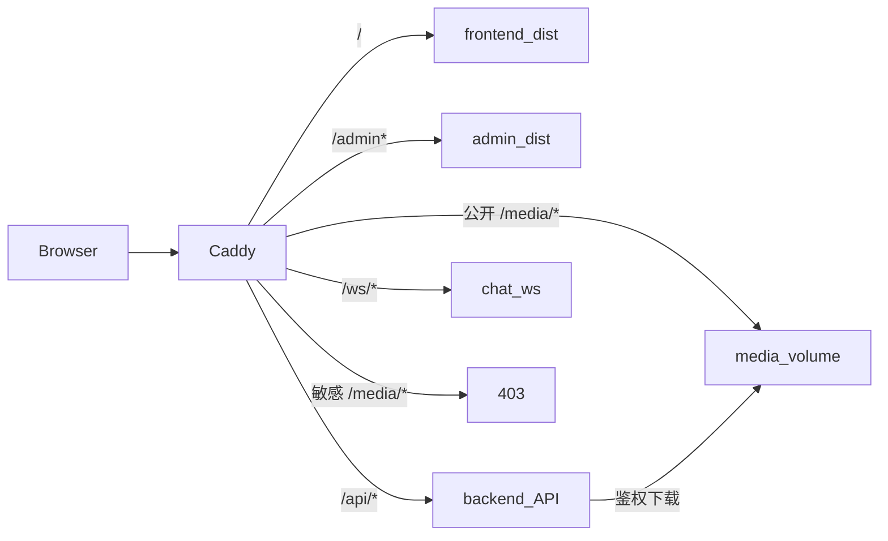

# P0：上线安全与交付基线

## 目标与范围

**做（对应评估 H1–H6）：**
- H1：Compose 默认 `vite build` + Caddy 静态托管；`profile=dev` 保留热更新
- H2：生产态强制强 `SECRET_KEY`、默认关闭 DEBUG、弱配置启动失败
- H3：敏感 `/media` 前缀一律 403；补齐付款凭证等鉴权下载，并改前端打开方式
- H4：DRF 默认 `IsAuthenticated`；公开接口显式 `AllowAny`
- H5：登录/注册/询盘/AI 翻译限流
- H6：Caddy 安全响应头 + 压缩；Django `SECURE_*` 由环境开关控制（**本地继续 HTTP**）

**不做（留给 P1+）：**
- JWT 迁 httpOnly Cookie、token blacklist、WS query token 改造
- 管理员项目文件 `role=="admin"` 热修、异步化重任务、DB 索引/N+1
- 真实域名证书 / 强制全站 HTTPS（避免打断现有局域网 `http://本机IP` 联调）

**已拍板默认：**
1. 传输：局域网 HTTP 保留；安全头照加；`DJANGO_SECURE_SSL=true` 时才启用 Django SSL/HSTS。
2. 前端：无 profile = 生产静态；`docker compose --profile dev up` = Vite 热更新。



---

## 实现步骤

### 1. H1 — 生产静态交付 + dev profile

**Dockerfile（多阶段）：**
- 改写 [`frontend/Dockerfile`](frontend/Dockerfile)、[`admin/Dockerfile`](admin/Dockerfile)：
  - build 阶段：`npm ci` + `npm run build`
  - runtime：仅拷贝 `dist`，用轻量 `nginx:alpine` **或** 直接由 Caddy 挂卷/镜像内静态目录（优先 **Caddy 托管**，少一层服务）
- 推荐结构：构建产物输出到命名卷或 image 内 `/srv/frontend`、`/srv/admin`，Caddy `file_server`；去掉生产路径上的 `npm run dev` 与源码 bind-mount。

**Compose：**
- 改 [`docker-compose.yml`](docker-compose.yml)：
  - 默认 `frontend`/`admin`：build 静态产物服务（或合并为仅构建、由 caddy 消费）
  - 增加 `frontend-dev` / `admin-dev`（`profiles: ["dev"]`）保留现有 Vite 命令与挂载
  - Caddy 默认反代静态；`dev` profile 时可用 overlay/`caddy/Caddyfile.dev` 指回 5173/5174（二选一写死一种，避免双配置漂移——**采用独立 `Caddyfile.dev` + compose 按 profile 挂载**）
- 同步 [`README.md`](README.md)：默认启动命令、`--profile dev` 说明、构建更新方式
- 删除或停用易误用的 [`caddy/Caddyfile.json`](caddy/Caddyfile.json)（与文本版分叉），避免媒体鉴权漂移

### 2. H2 — DEBUG / SECRET_KEY 门禁

改 [`backend/config/settings.py`](backend/config/settings.py) + [`.env.example`](.env.example)：
- `DJANGO_DEBUG` 默认改为 `false`（本地 `.env` 可显式 `true`）
- 当 `DEBUG=False` 且 `SECRET_KEY` 为空/等于 `dev-insecure-change-me`/`change-me-in-production` → **启动 raise**
- `.env.example` 注明生产必须替换密钥；示例 `DJANGO_DEBUG=false`

### 3. H3 — 敏感媒体鉴权

**Caddy**（[`caddy/Caddyfile`](caddy/Caddyfile)）对以下前缀 `respond 403`（在公开 `file_server` 之前）：
- 已有：`project/`、`chat/`
- 新增：`payment/`、`contract/`、`nda/`、`supplier/`、`recharge/`、`rfq/`、`quote/`

**仍允许静态直出（公开/半公开）：** `products/`、`downloads/`、`simple_quote/`、`dieline_*`、`print3d_slice/` 等。

**后端补鉴权下载（缺则补）：**
- [`payment`](backend/apps/payment/)：新增 buyer/admin/supplier（按既有角色边界）`.../payments/<pk>/proof/download`，`FileResponse` + 归属校验；序列化 `proof_url` 改为 API 路径（或前端弃用直链）
- 核对 contract/nda/supplier/recharge：若前端仍用 `/media/...` 直链，同样改为已有或新增 download API（对齐 project/chat 模式）
- DEBUG 下 [`core/urls.py`](backend/core/urls.py) 的 `static(MEDIA)` 保留开发便利，但 **生产 DEBUG=False 不挂载**；敏感文件仍以 Caddy 拦截为准

**前端/后台调用方：**
- [`admin/src/views/PaymentsView.vue`](admin/src/views/PaymentsView.vue) 等：去掉 `<el-link :href="proof_url">`，改为鉴权 blob 下载/预览（复用或抽取类似 [`frontend/src/utils/downloadAuthedFile.js`](frontend/src/utils/downloadAuthedFile.js)）
- [`frontend/src/components/FulfillmentHub.vue`](frontend/src/components/FulfillmentHub.vue) 等消费 `proof_url` 处同步

### 4. H4 — DRF 默认鉴权

[`settings.py`](backend/config/settings.py)：
```python
"DEFAULT_PERMISSION_CLASSES": ("rest_framework.permissions.IsAuthenticated",),
```

对公开/匿名接口 **显式** `permission_classes = [AllowAny]`（并视情况 `authentication_classes` 保持 JWT 可选）：
- Health：[`core/urls.py`](backend/core/urls.py) `HealthView`（已空权限，改为显式 `AllowAny`）
- 登录/注册：`MemberLoginView` / `AdminLoginView` / `MemberRegisterView` / `FactoryRegisterView`
- JWT refresh：包装 `TokenRefreshView` 或子类设 `AllowAny`（[`accounts/urls.py`](backend/apps/accounts/urls.py)）
- 全部 `Public*`：content / catalog / inquiry / rfq demand hall / partners / FEFCO（`permission_classes = []` → `AllowAny`）

验收时用匿名请求扫一遍：公开页应 200，业务接口应 401。

### 5. H5 — 关键接口限流

在 `REST_FRAMEWORK` 增加默认 + 作用域节流（Redis cache 已具备）：
- 全局 anon/user 基础限流（温和）
- 作用域：`login`、`register`、`inquiry`、`ai_translate`（chat/project 翻译视图挂 `throttle_classes` / `throttle_scope`）
- 阈值放 [`settings.py`](backend/config/settings.py) 环境变量（如 `THROTTLE_LOGIN_PER_MIN`），`.env.example` 给默认

超限返回统一错误包（走现有 `custom_exception_handler`），稳定错误码如 `RATE_LIMIT_EXCEEDED`。

### 6. H6 — 安全头（HTTP 友好）+ SSL 开关

**Caddy**（生产 `Caddyfile`）：
- `encode gzip zstd`
- 头：`X-Content-Type-Options nosniff`、`X-Frame-Options SAMEORIGIN`、`Referrer-Policy`、`Permissions-Policy`（CSP 本轮仅基础/可延后，避免误伤 wangeditor 内联）
- 继续 `:80`；**去掉空挂的无意义 443 映射**，或注释说明「有域名后再开」

**Django**（仅当 `DJANGO_SECURE_SSL=true`）：
- `SECURE_SSL_REDIRECT`、`SESSION_COOKIE_SECURE`、`CSRF_COOKIE_SECURE`、`SECURE_HSTS_*`、`SECURE_PROXY_SSL_HEADER`
- 本地默认 false，不破坏局域网 HTTP

### 7. 验证与文档

- 按 [`self-check-after-change`](.cursor/skills/self-check-after-change/SKILL.md) + [`docker-deploy`](.cursor/skills/docker-deploy/SKILL.md)：重建静态、重启 backend/caddy，打 `/api/health`、首页、后台、登录限流、敏感 media 403、鉴权下载 200
- 更新 README 启动/联调说明

---

## 风险与缓解

| 风险 | 缓解 |
|------|------|
| 默认 `IsAuthenticated` 漏标公开接口 → 官网 401 | 实现前列出 Public/Auth 清单；改完匿名冒烟 |
| 拦截 media 后凭证/合同打不开 | 先补 download API 与前端改动，再开 Caddy 403 |
| 静态构建后改前端需 rebuild | README 写清；`profile=dev` 保留热更新 |
| 限流误伤正常用户 | 阈值可配；先偏松（如登录 10/min、AI 20/min） |
| `Caddyfile` / `Caddyfile.dev` 再分叉 | 公共片段最小化；文档写明挂载关系；删除 JSON 版 |

---

## 验收标准

1. `docker compose up --build`（无 profile）：浏览器打开站点/后台为静态资源，进程中无 Vite `npm run dev`
2. `docker compose --profile dev up`：前端可热更新
3. `DEBUG=False` + 弱 `SECRET_KEY` → backend 容器启动失败并有明确日志
4. 未登录访问 `/media/payment/...`（或任意敏感前缀）→ **403**；公开 `/media/products/...` 仍可 200（若有样例）
5. 登录用户经 API 下载付款凭证成功；admin 付款页不再依赖裸 media 直链
6. 匿名：公开内容/登录/注册/refresh/health → 200；会员订单等 → 401
7. 连续超限登录或询盘 → 429 + 统一错误包含稳定 `code`
8. 响应含安全头（至少 nosniff / frame-options）；局域网 HTTP 访问仍可用
9. 未改业务功能语义；不引入 P1 范围改动

---

## 建议的下一步

确认本方案后进入 `feature-implementation`，按 **H2 → H4 → H5 → H3（API+前端）→ H1/H6（Compose+Caddy）→ 联调自检** 顺序落地（先收紧后端权限与限流，再切静态与媒体拦截，降低联调中断面）。
