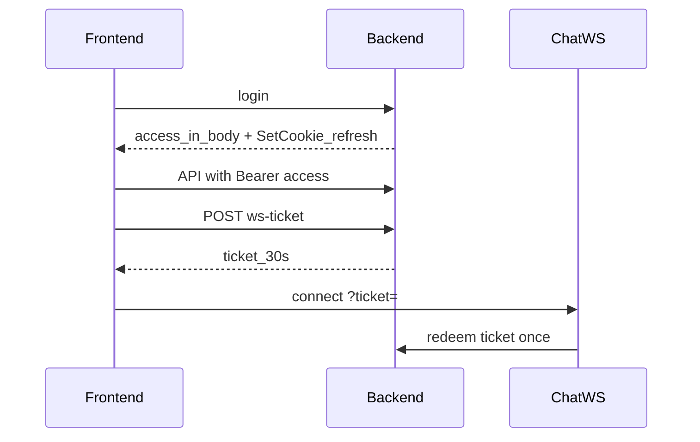

# P1：会话安全与正确性热修

## 目标与范围

**依赖：** 建议先完成 [P0 安全交付基线](C:\Users\ROG STRIX\.cursor\plans\p0安全交付基线_3ca33e56.plan.md)（默认鉴权、限流、敏感 media）。本阶段可与 P0 尾声并行的仅有 **M1/M2**（纯后端小修）。

**做（评估 H7、M1、M2、M6、M7）：**
- M1：修复 `_user_can_access_project_file` 管理员角色判定
- M2：付款凭证上传走 `validate_upload_file`
- M6：启用 JWT blacklist；Logout 真正失效 refresh
- H7：去掉 `window.__*AccessToken`；access 仅 Pinia 内存；refresh 改 httpOnly Cookie（`Secure` 随 `DJANGO_SECURE_SSL`；本地 HTTP 用 `Secure=False`）
- M7：WebSocket 握手改为一次性 ticket（短 TTL），禁止长期 JWT 放 query

**不做：**
- 全站强制 HTTPS、CSP 严化（P0/后续）
- 重任务异步、DB 索引、聊天虚拟化（P2）
- 大文件拆分、补全主流程测试（P3）

**H7 已拍板方案（SPA 常见折中）：**
- access：内存（Pinia），不写 localStorage、不挂 window
- refresh：httpOnly + SameSite=Lax Cookie；登录/注册/refresh 接口 Set-Cookie
- 刷新页：启动时调 refresh（凭 Cookie）换 access；失败则登出
- axios：`withCredentials: true`；请求头仍带 `Authorization: Bearer <access>`

---

## 实现步骤

### 1. M1 — 管理员项目文件 403

文件：[`backend/apps/project/views.py`](backend/apps/project/views.py) `_user_can_access_project_file`（约 L481–489）

- 将 `role == "admin"` 改为与 [`core/permissions.py`](backend/core/permissions.py) `IsAdminRole` 一致：`role in {"super_admin", "operator", "sales"}`
- 补一条管理员下载/预览回归测试（可放 `apps/project/tests/`）

### 2. M2 — 付款凭证上传校验

文件：[`backend/apps/payment/views.py`](backend/apps/payment/views.py) `MemberPaymentProofView`

- 上传前调用 [`core/file_validation.py`](backend/core/file_validation.py) `validate_upload_file`（扩展名/大小白名单与 RFQ 附件对齐；图片+PDF）
- 校验失败返回统一错误码（如 `PAYMENT_PROOF_INVALID`）
- 若 P0 已加 proof download，本步只补校验，不重复造下载 API

### 3. M6 — JWT blacklist + 真登出

- `INSTALLED_APPS` 增加 `rest_framework_simplejwt.token_blacklist`；`SIMPLE_JWT["BLACKLIST_AFTER_ROTATION"] = True`
- 迁移：`migrate token_blacklist`
- [`LogoutView`](backend/apps/accounts/views.py)：读 refresh（Cookie 优先，兼容 body）、`RefreshToken(...).blacklist()`、清 Cookie
- 会员/管理两端登出前端改为必调 logout API

### 4. H7 — 令牌存储硬化

**后端**
- 登录/注册成功：`access` 仍在 JSON `data`；`refresh` 写入 httpOnly Cookie（名如 `oem_refresh` / `oem_admin_refresh`，路径区分 member/admin）
- 自定义 `CookieTokenRefreshView`：从 Cookie 取 refresh，轮换后写新 Cookie，响应只回 `access`（统一 `{code,data}`，消掉 P0 提到的 `body.access` vs `body.data.access` 分叉——**M13 中 refresh 契约部分提前在此收口**）
- CORS：已有 `CORS_ALLOW_CREDENTIALS`；确认 `CORS_ALLOWED_ORIGINS` 含实际前端源（局域网 IP 场景若走 Caddy 同源则无额外 CORS）

**前端** [`frontend/src/stores/auth.js`](frontend/src/stores/auth.js)、[`admin/src/stores/auth.js`](admin/src/stores/auth.js)、http 封装
- 删除 `window.__memberAccessToken` / `__adminAccessToken`；拦截器从 Pinia/闭包读 access
- 不再 persist refresh 到 localStorage；可选仅 persist非敏感 `user` 摘要或整段登录态去掉 token
- `http`/`axios`：`withCredentials: true`；401 时凭 Cookie 静默 refresh
- 启动 bootstrap：尝试 refresh → 失败清用户态

### 5. M7 — WebSocket 一次性 ticket

- 新增 API：`POST /api/member/chat/ws-ticket`（及 supplier/admin 对等），`IsAuthenticated` + 短限流；Redis 存 `chat:ws_ticket:{id}` → user_id，TTL 30–60s，单次核销
- 改 [`apps/chat/middleware.py`](backend/apps/chat/middleware.py)：只接受 `?ticket=`，兑换后删 key；拒绝长期 JWT query
- 前端 [`ChatPanel`](frontend/src/components/ChatPanel.vue) / WS 连接处：连前取 ticket 再连

### 6. 验证

- 管理员可下载项目文件；非参与方仍 403
- 非法扩展名/超大凭证上传失败
- 登出后旧 refresh 再刷 → 401/黑名单错误
- 刷新页面仍可静默恢复登录；DevTools 看不到 localStorage 中的 refresh；无 `window.__*Token`
- WS：无 ticket / 复用 ticket → 拒绝；正常聊天收发成功

---

## 风险与缓解

| 风险 | 缓解 |
|------|------|
| Cookie 跨端口（5173↔API）在纯 dev 直连失败 | 继续经 Caddy 同源 `/api`；dev profile 也走同源 |
| 刷新丢 Cookie 导致全员掉线 | 先双读一段（Cookie 优先，body refresh 兼容）再删 body |
| WS 改造漏改管理端纠纷连接 | 全局搜 `token=` WS URL |

---

## 验收标准

1. `role=super_admin|operator|sales` 可下载/预览项目文件；`role=="admin"` 字符串依赖消除
2. 付款凭证非白名单文件 → 4xx + 稳定错误码
3. blacklist 表存在；logout 后 refresh 失效
4. 无 `window.__memberAccessToken` / `__adminAccessToken`；localStorage 无 refresh
5. WS URL 不含 JWT；ticket 单次有效
6. 会员/管理登录、刷新、登出、聊天主路径冒烟通过

---

## 建议下一步

确认后按 **M1 → M2 → M6 → H7 → M7** 实施；完成后进入 P2。
