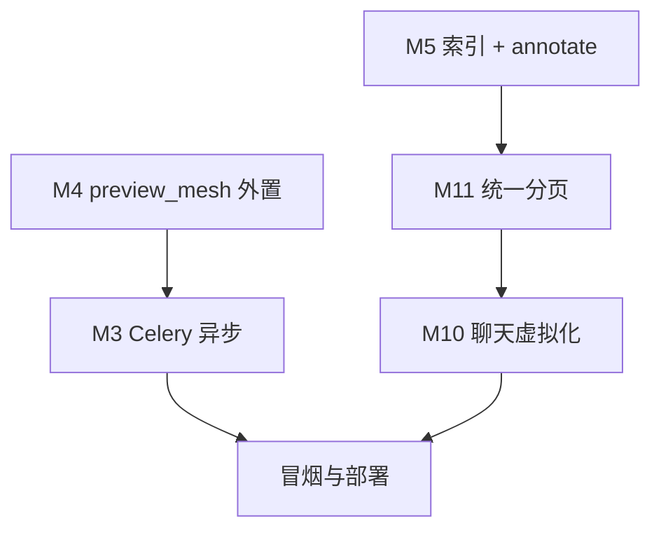

# P2：性能与数据层

## 目标与范围

**依赖：** [P0 安全交付基线](p0安全交付基线_2026.7.28.plan.md)、[P1 会话与热修](p1会话与热修_2026.7.28.plan.md) 已完成。

**做（架构评估 P2：M3 / M4 / M5 / M10 / M11）：**

| ID | 主题 | 要点 |
|----|------|------|
| M4 | `preview_mesh` 外置 | 大 base64 JSON 出库 → media 文件 + 短 URL |
| M5 | 索引 + N+1 | RFQ/指派列表复合索引；`quotes_count` 改 `annotate` |
| M3 | 重任务异步 | STP 解析、工程图 OCR、**LibreOffice 预览（必做）**、邮件发信迁 Celery |
| M11 | 统一分页 | 增长型全量 `{items}` 列表改 `StandardPagination`；类目/导航保留全量 |
| M10 | 聊天前端性能 | 虚拟列表；`before_id` 上拉；会话列表本地增量，少全量重拉 |

**不做（P3 或更后）：**

- Compose healthcheck / 资源限制（评估 M8）
- 商城库存 `select_for_update`（M12）
- 大模块文件拆分、主流程集成测补全（L 级）
- 强制全站 HTTPS / CSP 严化
- 聊天 AI 翻译整段异步化（已有限流；本轮保持同步短请求，仅保证不拖垮 worker 的超时边界）
- **类目树 / 导航项分页**（已拍板：保留全量）

**已拍板（2026-07-28，不可再议除非改方案）：**

1. **异步契约：同意。** 提交后立即返回 `job_id` + `status=pending`；前端短轮询（对齐现有 slice-job）；失败稳定错误码；超时可提示手动填写。
2. **分页范围：同意。** 管理端及公开侧**增长型**资源（FAQ / 下载 / 资讯 / ContentPages 等）统一 `StandardPagination`；**工艺类目、导航保留全量**（`is_active` + 合理 `order`；体量告警阈值如 >500）。
3. **LibreOffice 预览：纳入 M3。** 首次转换必须离开请求线程；缓存命中可同步短路径返回。
4. **聊天（沿用原默认）：** 复用后端已有 `after_id` / `before_id`；本轮以前端为主，不改 WS 协议。

建议实施顺序：**M4 → M5 → M3 → M11 → M10 → 验证**（M4 小而独立且立刻减压 DB；M3 依赖 Celery/worker 习惯，放中间；M10 依赖消息 cursor 已就绪）。

---

## 实现步骤

### 1. M4 — `preview_mesh` 外置

**现状：** [`Print3dSliceJob.preview_mesh`](backend/apps/simplequote/models.py) JSONField；[`tasks.py`](backend/apps/simplequote/tasks.py) 将 ≤8MB STL base64 写入 DB；[`Print3dSliceJobSerializer`](backend/apps/simplequote/serializers.py) 每次详情/轮询带回整包。

**动作：**

- 新增 `FileField`（如 `preview_file`，`upload_to=print3d/preview/%Y/%m/`）或复用 media 路径写 `.stl`
- 切片任务成功后写文件；`preview_mesh` JSON 停止写入新数据；迁移可选清空历史 JSON（或惰性忽略）
- Serializer：增加 `preview_url`（鉴权下载或短期可访问 URL，对齐 P0 敏感 media 策略）；**列表/轮询默认不返回 mesh 二进制**
- 前端 3D 预览改为按 URL 拉取（若已有 blob 逻辑则改 fetch）
- 数据迁移：`backend-migration-and-model` 规范；兼容字段过渡一期后删 `preview_mesh`（可本轮标 deprecated，下轮再删）

### 2. M5 — RFQ 索引 + `quotes_count` annotate

**现状：** [`RFQ.Meta`](backend/apps/rfq/models.py) 仅 `ordering`，无 `(buyer, status)` / 大厅常用过滤索引；[`serializers` `get_quotes_count`](backend/apps/rfq/serializers.py) 对每行 `count()`/`exists()`。

**动作：**

- 模型 `Meta.indexes`：至少
  - `RFQ (buyer, -created_at)`、`(status, scope, -created_at)`（按实际大厅/我的询价过滤再微调）
  - `QuoteRequest (supplier, status, -created_at)`、`(rfq, status)`
- 列表 View queryset：`annotate(quotes_count=Count("quotes", distinct=True))`（或等价 relation 名）
- Serializer：优先读 annotate 属性，避免 MethodField 再查库
- 补 1～2 条列表查询回归测（断言查询次数或 annotate 字段存在）

### 3. M3 — 重任务异步

**同步阻塞热点（优先迁出请求线程）：**

| 能力 | 落点 | 策略 |
|------|------|------|
| STP/STEP 几何解析 | [`StpParseView`](backend/apps/simplequote/views.py) | Celery task + `job` 表或 Redis 短任务状态；`POST` 返回 `job_id`，`GET` 取结果 |
| 工程图 OCR | [`DrawingParseView`](backend/apps/simplequote/views.py) | 同上；限并发（worker concurrency / 信号量） |
| 文档预览 PDF（**必做**） | [`core/document_preview`](backend/core/document_preview.py) + project 预览 API | **LibreOffice 首次转换**走 Celery/`heavy` 队列，API 返回 job 或「转换中」可轮询；**缓存命中**可同步直接吐 PDF |
| 邮件 | [`notification.services.notify`](backend/apps/notification/services.py) `send_mail` | `send_email=True` 时 `delay`；站内通知仍同步写库 |

**不做本轮：** 聊天消息翻译、整页 Gemini 长链路全面 job 化（保持现有 throttle）。

**契约（已拍板）：** 统一 `{code,data:{job_id,status,result?}}`；错误码如 `PARSE_JOB_PENDING` / `PARSE_JOB_FAILED` / `PREVIEW_JOB_PENDING`；前端 SimpleQuote / 预览改短轮询（超时提示手动填写或重试）。

队列：优先独立 `heavy`（LibreOffice / OCR / STP）与切片隔离；若暂单 worker，则 `concurrency=1～2` + `soft_time_limit` / `task_time_limit`。

### 4. M11 — 增长型列表统一分页

**优先改造（全量 `{items}`、会随数据涨）：**

- Admin：FAQ / Downloads / ContentPages / 同类未分页列表（对照 [`content/views.py`](backend/apps/content/views.py)、[`catalog/views.py`](backend/apps/catalog/views.py)）
- 已用 `StandardPagination` 的保持；**禁止**再手写绕过分页的大列表

**保留全量（已拍板）：** 工艺类目树、导航项——不加分页；须 `is_active` 过滤 + 合理 `order`；条数 >500 打日志告警。

前端/admin 对应**已改分页**的列表页接 `page` / `page_size`（Element Plus 已有分页组件则对齐）。

### 5. M10 — 聊天虚拟化与增量

**现状：** [`ChatPanel.vue`](frontend/src/components/ChatPanel.vue) `v-for` 全量消息；后端已支持 `after_id`/`before_id`；WS 事件仍常触发 `loadConversations()` 全量。

**动作：**

- 引入 `@tanstack/vue-virtual`（或项目已有等价库则复用）
- 消息区虚拟列表：动态高度 `measureElement`；发送/收新消息 `scrollToIndex` 见底
- 上拉历史：用当前最小 `id` 调 `before_id`；prepend 保位
- 会话侧：WS `message` 时本地更新对应会话 `last_message`/`unread`，**禁止**每条消息全表 `loadConversations`；仅 dispute/成员变更等再全量刷新
- 不改 admin 纠纷页除非同样卡顿（可选跟做，默认不做）

### 6. 验证与部署

- M4：切片任务完成后 DB 行无大 JSON；轮询 payload 体积显著下降；预览可显示
- M5：`EXPLAIN` / Django Debug 查询次数；大厅/我的 RFQ 列表无 N+1
- M3：并发 STP/OCR 时 API `/health` 与其它接口仍响应；job 失败有错误码
- M11：admin FAQ 等第二页可取；超大页不一次打满
- M10：500+ 消息会话滚动流畅；上拉不跳底；收消息不闪整表
- `docker compose` 重建 backend / slicer-worker / frontend（及若改 admin 则 admin）

---

## 风险与缓解

| 风险 | 缓解 |
|------|------|
| 异步改契约导致前端表单回填失败 | 保留「超时后可手动填写」；旧同步接口可短期双路径或明确版本切换日 |
| LibreOffice/OCR 占满 Celery | 独立队列 `heavy` + concurrency=1～2；`soft_time_limit` |
| `preview_url` 与 P0 媒体鉴权冲突 | 走鉴权下载 API 或同域 cookie/Bearer blob，禁止裸挂敏感目录 |
| 索引迁移锁表 | 低峰执行；MySQL 8 即时算法优先；先加索引后改代码 |
| 虚拟列表动态高度跳动 | `measureElement` + prepend 锚点；冒烟必测图文混合气泡 |
| 分页破坏管理端「一次导出全部」习惯 | 导出另走专用接口（本轮不做则文档声明） |

---

## 验收标准

1. 新完成的 `Print3dSliceJob` **不再**把 ≥1MB mesh 写入 JSONField；详情/轮询响应含 `preview_url`（或等价）且默认无 base64 大字段。
2. RFQ / QuoteRequest 列表相关复合索引存在于迁移中；列表序列化 `quotes_count` 不触发逐行 `COUNT` 查询。
3. `StpParse` / `DrawingParse` / **LibreOffice 首次预览转换** / 邮件发信：请求线程在提交后 **&lt;2s** 返回 job（或等价 pending）；结果经短轮询取得；缓存命中的预览可同步返回。
4. 增长型 Admin/Public 列表走 `StandardPagination`；**类目/导航仍为全量**且含 `is_active` 过滤。
5. 会员聊天：长会话虚拟滚动可用；`before_id` 上拉成功；单条 WS 消息不强制全量重拉会话列表。
6. 部署后 `/api/health`、切片主路径、RFQ 列表、预览转换、聊天收发冒烟通过。

---

## 建议下一步

三项拍板已写入方案。按 **M4 → M5 → M3 → M11 → M10 → 验证** 进入 `feature-implementation`（说「按 P2 实施」即可开工）。
