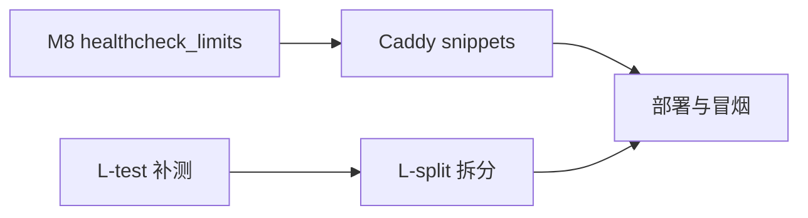

# P3：健康检查 / Caddy 统一 / 拆分与补测

## 目标与范围

**依赖：** P0 / P1 / P2 已完成。

**做（已拍板 1A / 2A）：**

| ID | 主题 | 要点 |
|----|------|------|
| M8 | Compose 健康检查与资源限制 | 应用服务补 `healthcheck`；关键服务补内存/CPU 上限；`depends_on` 尽量 `service_healthy` |
| Caddy | prod/dev 统一 | 抽公共片段（headers / 敏感 media / api·ws·media 路由）；两份入口只保留前端目标差异；**不**强制 HTTPS、**不**加严 CSP |
| L-split | 大模块拆分（第一批） | 后端超大文件按职责拆包；前端超大视图抽子组件；对外 import 路径尽量兼容 |
| L-test | 主流程与缺测补全 | 补 accounts / order 烟雾测；RFQ 履约链路集成测；拆分前后用既有 simplequote 测护航 |

**不做：**

- 商城库存 `select_for_update`（M12）
- 强制全站 HTTPS / HSTS / CSP 严化
- 聊天 AI 翻译整段异步化
- 一次性拆完所有超大文件（本轮只做第一批；i18n 巨型 locale 文件不拆）
- 删除残留 [`caddy/Caddyfile.json`](caddy/Caddyfile.json) 以外的无关清理（若该文件已无引用则本轮顺手删除）

建议实施顺序：**M8 → Caddy → 补测 → 拆分 → 验证**（先补测再拆分，用测试护航重构）。

---

## 实现步骤

### 1. M8 — Compose healthcheck + 资源限制

文件：[`docker-compose.yml`](docker-compose.yml)

**现状：** 仅 `mysql` / `redis` 有 healthcheck；应用服务均无；全体无 `mem_limit`/`cpus`；仅 `frontend`/`admin` 有 `restart: unless-stopped`。

**动作：**

- **healthcheck（可执行探针）：**
  - `backend`：`curl -f http://127.0.0.1:8000/api/health`（镜像需已有 `curl`，否则用 `python -c` 打 health；与 [`start_api.sh`](backend/scripts/start_api.sh) 端口一致）
  - `chat-ws`：对 `8001` 做 TCP/HTTP 探测（若无 HTTP health，用 `python` 短连或 `wget`；必要时在 chat 启动脚本旁加极轻量 `/healthz`，避免改业务协议）
  - `frontend` / `admin`：`wget -qO- http://127.0.0.1/` 或 nginx 默认页
  - `slicer-worker` / `heavy-worker`：`celery -A config inspect ping -d celery@$HOSTNAME`（或 `celery status` 等价轻量命令；失败时降级为进程存活检查并在注释标明局限）
  - `caddy`：`wget`/`curl` 本机 `:80/api/health`（依赖 backend 已 healthy）
- **depends_on：** `caddy` 对 `backend`/`frontend`/`admin`/`chat-ws` 改为 `condition: service_healthy`（在探针稳定后）；worker 继续依赖 `backend` started + db/redis healthy
- **资源限制（Docker Compose 非 Swarm 字段）：** 使用服务级 `mem_limit` + `cpus`（避免仅写 Swarm 才生效的 `deploy.resources`）
  - 建议量级（可按本机 16GB+ 微调，写入注释）：`backend` 1g/1.5cpu；`chat-ws` 512m/1；`heavy-worker` 1.5g/2；`slicer-worker` 2g/2；`mysql` 1g；`redis` 256m；`frontend`/`admin`/`caddy` 256m
- 全应用服务统一 `restart: unless-stopped`（与 frontend/admin 对齐）

### 2. Caddy 统一（2A）

文件：[`caddy/Caddyfile`](caddy/Caddyfile)、[`caddy/Caddyfile.dev`](caddy/Caddyfile.dev)、新建共享片段（如 `caddy/snippets/common.caddy`）

**动作：**

- 抽出命名 snippet / `import`：
  - `(security_headers)`：现有 5 项头 + `encode` 可放 site 级
  - `(sensitive_media)`：11 个 `/media/...` 403 块
  - `(api_ws_media)`：`/ws`、`/api`、公开 `handle_path /media/*`
- [`Caddyfile`](caddy/Caddyfile) / [`Caddyfile.dev`](caddy/Caddyfile.dev) 仅保留差异：`admin`→`admin:80` vs `admin-dev:5174`；默认站→`frontend:80` vs `frontend-dev:5173`
- compose 为 `caddy` / `caddy-dev` **额外挂载** snippets 目录（只挂单文件不够 import）
- **不**加 CSP、**不**开 443/自动 HTTPS
- 若 [`caddy/Caddyfile.json`](caddy/Caddyfile.json) 未被 compose 引用则删除，避免双源

### 3. L-test — 补测（拆分前落地）

优先补「零覆盖 / 主链路」：

| 文件 | 覆盖 |
|------|------|
| `backend/apps/accounts/tests/test_auth_session.py` | 注册或登录、refresh Cookie、logout 黑名单后 refresh 失败（对齐 P1） |
| `backend/apps/order/tests/test_checkout_flow.py` | 加购 → 结账成功路径与库存不足失败码（**不改**结账锁逻辑，只测现状契约） |
| `backend/apps/rfq/tests/test_fulfillment_flow.py` | 最小集成：创建 RFQ → 指派/报价请求 → 供应商报价 → 会员可见或接受（按现有 API，能跑通即止；不做全链路合同付款除非工厂函数已齐） |

拆分护航：跑既有 [`simplequote/tests/`](backend/apps/simplequote/tests/)（injection/pcb/packaging/print3d）确保 calculator 拆包不破导出。

### 4. L-split — 大模块第一批

**后端（优先）：**

1. [`backend/apps/simplequote/calculator.py`](backend/apps/simplequote/calculator.py)（~1.6k 行）→ `simplequote/calculator/` 包：`injection.py` / `print3d.py` / `pcba.py` / `pcb.py` / 公共 `utils.py`；根级 `calculator/__init__.py` **再导出**原公开符号（`calc_injection`、`calc_pcb` 等），调用方少改或不改。
2. [`backend/apps/simplequote/table_data.py`](backend/apps/simplequote/table_data.py)（~1.4k）→ `table_data/` 按品类数据模块 + `__init__` 聚合导出。
3. [`backend/apps/rfq/views.py`](backend/apps/rfq/views.py)（~1.1k）→ `rfq/views/`：`member.py` / `supplier.py` / `admin.py` / `public.py` / `production.py`；[`urls.py`](backend/apps/rfq/urls.py) 改 import；可保留薄 `views/__init__.py` 兼容。

**前端（本轮各抽一层，不做大改版）：**

1. [`frontend/src/components/ChatPanel.vue`](frontend/src/components/ChatPanel.vue)（~874，P2 已虚拟化）→ 抽出 `ChatMessageList.vue`（虚拟列表）+ `ChatComposer.vue`（输入/附件），面板保留会话状态与 WS。
2. [`admin/src/views/DielineTemplatesView.vue`](admin/src/views/DielineTemplatesView.vue)（~1.5k）→ 列表区与编辑抽屉/参数面板子组件（2～3 个 SFC），行为与路由不变。

第二批（本轮不做）：`rfq/serializers.py`、`accounts/views`、`BoxGeneratorView`、巨型 i18n。

### 5. 验证与部署

- `docker compose config` 校验；`up -d` 后 `ps` 显示 healthy
- 故意停 `backend` 确认 `caddy`/`depends_on` 行为符合预期（文档化即可）
- `manage.py test`：accounts / order / rfq fulfillment + simplequote 原套件
- 浏览器：首页、admin、聊天入口、简单报价一页冒烟
- 按 [`docker-deploy`](.cursor/skills/docker-deploy/SKILL.md) 重建相关服务

---

## 风险与缓解

| 风险 | 缓解 |
|------|------|
| worker Celery ping healthcheck 误杀 | 加长 `start_period`/`retries`；探针失败则改进程级检查并注明 |
| 资源 limit 过紧导致 OOM（切片/LibreOffice） | heavy/slicer 限额偏高；本地可经 `.env` 文档说明如何调大 |
| Caddy `import` 路径在容器内不对 | compose 挂载整个 `caddy/` 或 `snippets/`；部署后 `caddy validate` |
| calculator 拆包漏导出 | `__init__.py` 显式再导出 + 跑全量 simplequote tests |
| rfq views 拆分改坏 urls | 保持类名不变；urls 只改模块路径；跑 fulfillment 集成测 |
| ChatPanel 拆分破坏虚拟列表滚动 | 子组件接收同一 `messages`/`virtualizer` 边界；冒烟上拉/见底 |

---

## 验收标准

1. `docker compose ps` 中 `backend`/`frontend`/`admin`/`caddy`（及已加探针的 worker）为 **healthy**（或明确记录 worker 降级探针）。
2. 关键服务具备 `mem_limit`/`cpus`；重启策略统一；compose 可正常 `up`。
3. prod 与 dev Caddyfile 共享同一套 headers + 敏感 media 片段；差异仅前端 upstream；**仍为 :80、无 CSP**。
4. `calculator` / `table_data` / `rfq.views` 主文件行数显著下降（单文件目标大致 &lt;600 行或按包拆开）；公开 API/报价结果不变（既有测试绿）。
5. 新增 accounts / order / rfq 履约相关测试可在 CI/容器内 `manage.py test` 通过。
6. ChatPanel、DielineTemplates 功能冒烟通过（发消息、刀版列表编辑）。

---

## 建议下一步

拍板已写入本方案（1A / 2A）。确认后说「按 P3 实施」进入 `feature-implementation`。
