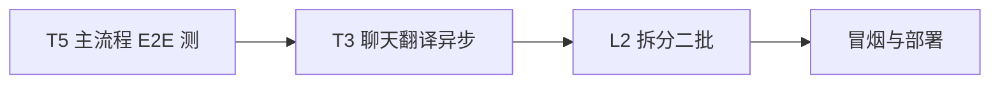

# P4：翻译异步 / 拆分二批 / 主流程补测

## 目标与范围

**依赖：** P0–P3 已完成（含 `core/async_jobs`、`heavy` 队列、[`pollJob.js`](frontend/src/utils/pollJob.js)）。

**做（对应此前遗留项 3 / 4 / 5）：**

| ID | 主题 | 要点 |
|----|------|------|
| T3 | 聊天消息 AI 翻译异步 | 缓存命中仍同步返回；未命中入 `heavy` 队列，返回 `job_id`，前端短轮询；限流保留 |
| L2 | 大模块拆分第二批 | 后端包 + `__init__` 门面；前端按区块/composable 抽离；不改 URL/API 契约 |
| T5 | 主流程集成测 | 一条可跑通的 E2E：接受报价 → 合同签署 → 付款凭证 → 确认收款建项目 |

**不做：**

- 商城库存 `select_for_update`（M12）
- 强制 HTTPS / CSP 严化
- RFQ/项目附件翻译、刀版等非聊天翻译的异步化（本轮仅聊天消息）
- i18n 巨型 locale 拆分、`accounts` 视图/序列化拆分（留更后）
- 真实支付网关、LibreOffice、Gemini 真调用（测试侧 mock）

建议顺序：**T5 → T3 → L2 → 验证**（先补测护航后续拆分；翻译契约独立，放中间）。

**拍板默认（本方案直接采用，不再二选一）：**

1. 翻译：缓存命中同步；未命中 `202` + `job_id`；队列 `heavy`；轮询走聊天自有 `GET .../translate-jobs/<id>`（复用 `get_job`，不与 simplequote parse-jobs 混路由）。
2. 拆分二批固定 4 项：`rfq/serializers`、`simplequote/views`、`MyPageView`、`BoxGeneratorView`。
3. E2E 走「供应商确认收款」建 `Project` 分支；Gemini 在翻译测中 mock。

---

## 实现步骤

### 1. T5 — 主流程集成测

新建 [`backend/apps/rfq/tests/test_main_flow_e2e.py`](backend/apps/rfq/tests/test_main_flow_e2e.py)。

复用 [`test_fulfillment_flow.py`](backend/apps/rfq/tests/test_fulfillment_flow.py) 的买家/供应商/`ServiceCategory` 脚手架；合同签章小图复用 [`test_contract_nda_sign.py`](backend/apps/contract/tests/test_contract_nda_sign.py) 的 `_tiny_png`；付款凭证写法对齐 [`test_payment_confirm.py`](backend/apps/payment/tests/test_payment_confirm.py)。

**推荐 API 顺序（全程 APIClient，无外部依赖）：**

1. 会员创建公开 RFQ  
2. 供应商需求大厅抢单  
3. 供应商提交报价  
4. 会员 `POST /api/member/rfqs/{id}/quotes/{qid}/accept`（[`MemberQuoteAcceptView`](backend/apps/rfq/views/member.py)）— 断言生成生产订单 + 合同 + 付款单  
5. 供应商确认接单（现有 confirm API）  
6. 买家签署合同  
7. 买家上传付款凭证  
8. 供应商确认收款（`confirm_payment`）  
9. 断言 `Project` 存在且阶段初始化  

本步不改业务代码；若 accept 链路有环境前置（如模板），在 setUp 内用工厂最小补齐。

### 2. T3 — 聊天消息翻译异步

**现状：** [`chat/views.py`](backend/apps/chat/views.py) `_message_translate_response` 同步调 [`translate_text`](backend/apps/project/translation.py)（Gemini 最长约 30s）；前端 [`TextTranslateBlock.vue`](frontend/src/components/TextTranslateBlock.vue) 一次 await；[`pollJob.js`](frontend/src/utils/pollJob.js) 已可复用模式。

**后端：**

- 新增 `backend/apps/chat/heavy_tasks.py`：`run_message_translate(job_id, message_id, target_lang, user_id)`，`queue=heavy`，`soft_time_limit≈45` / `time_limit≈60`；任务内读/写现有缓存键 `chat:msg_tr:{id}:{lang}`；成功 `update_job(done, result={translated_text})`；`TranslationError` → `failed` + 原错误码。
- POST `.../messages/<id>/translate`：缓存命中 → **200** 仍直接返回 `translated_text`；未命中 → `create_job("chat_translate", ...)` + `.delay` → **202** `{job_id, status:"pending"}`。保留 `throttle_scope="ai_translate"`。
- 新增 `GET .../translate-jobs/<job_id>`（member/supplier/admin 各一条或共用基类）：仅 `job.user_id == request.user.id`；pending/running → 202；done/failed → 200（字段对齐 P2：`status/result/error_code/error_message`）。
- [`settings.py`](backend/config/settings.py) `CELERY_TASK_ROUTES` 增加 `chat.run_message_translate` → `heavy`。

**前端：**

- [`api/index.js`](frontend/src/api/index.js)：`translateChatMessage` 允许 202；新增 `fetchChatTranslateJob(role, jobId)`。
- 将 [`pollJob.js`](frontend/src/utils/pollJob.js) 泛化为可传入 `fetchFn`（或新增 `pollChatTranslateJob`），超时错误码如 `CHAT_TRANSLATE_JOB_TIMEOUT`。
- [`TextTranslateBlock.vue`](frontend/src/components/TextTranslateBlock.vue) chat 分支：有 `translated_text` 直接展示；有 `job_id` 则短轮询；失败展示既有错误文案 key。

**测试：** `backend/apps/chat/tests/` 增用例：缓存命中同步；未命中返回 job 且 mock task 写 done 后轮询得译文；非所有者 403。不真实调 Gemini。

### 3. L2 — 大模块拆分第二批

| 目标 | 策略 |
|------|------|
| [`backend/apps/rfq/serializers.py`](backend/apps/rfq/serializers.py) | → `rfq/serializers/`：`base` / `attachments` / `quotes` / `rfq` / `orders` + `__init__` 全量重导出；urls/views 导入路径不变 |
| [`backend/apps/simplequote/views.py`](backend/apps/simplequote/views.py) | → `simplequote/views/`：`member` / `parse` / `admin_params` / `admin_dieline` / `_helpers` + `__init__` 门面；[`urls`](backend/apps/simplequote/urls.py) 可不改 |
| [`frontend/src/views/mypage/MyPageView.vue`](frontend/src/views/mypage/MyPageView.vue) | 按 `activeTab` 抽 `mypage/sections/*`；父级保留 tab 与加载调度 |
| [`frontend/src/views/packaging/BoxGeneratorView.vue`](frontend/src/views/packaging/BoxGeneratorView.vue) | `useBoxGenerator` composable + `BoxParamForm` / `BoxPreviewPanel` / `BoxQuoteResult`；不改报价 API |

每拆一项后跑对应既有测（`apps.rfq.tests`、`apps.simplequote.tests` 关键子集）或前端 build。

### 4. 验证与部署

- `manage.py test`：`test_main_flow_e2e` + chat 翻译异步测 + rfq/simplequote 回归  
- 手工：聊天点翻译（冷缓存见 pending→译文；热缓存秒回）  
- `docker compose up -d --build` 含 `backend` / `heavy-worker` / `frontend`（及若动 admin 则 admin）

---

## 风险与缓解

| 风险 | 缓解 |
|------|------|
| 前端未适配 202 导致翻译空白 | TextTranslateBlock 双路径；旧同步响应字段仍兼容 |
| heavy 队列积压拖慢 OCR/预览 | 翻译 `time_limit` 封顶；限流 20/min 不变；可后续独立队列（本轮不做） |
| E2E accept 依赖未 seed 的模板/状态 | setUp 最小工厂；失败时断言信息指向缺前置 |
| serializers/views 漏导出 | `__init__.__all__` 对照旧文件符号；import 冒烟 + 全量 rfq/simplequote 测 |
| BoxGenerator 拆后预览状态不同步 | composable 单源状态；冒烟导出与提交报价 |

---

## 验收标准

1. 聊天翻译：缓存命中 POST 直接返回 `translated_text`；未命中返回 `job_id`，轮询可得译文；请求线程不因 Gemini 阻塞超过约 2s（提交入队）。  
2. 非任务所有者轮询 translate-job → 403；失败带稳定 `error_code`。  
3. `rfq.serializers` / `simplequote.views` 以包形式存在且旧 import 可用；MyPage / BoxGenerator 行为冒烟通过。  
4. `test_main_flow_e2e` 绿：accept 后经合同与付款确认得到 `Project`。  
5. 部署后 `/api/health`、聊天翻译、会员中心 tab、刀版/盒子页无回归。

---

## 建议下一步

确认本方案后说「按 P4 实施」进入 `feature-implementation`。
