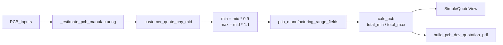
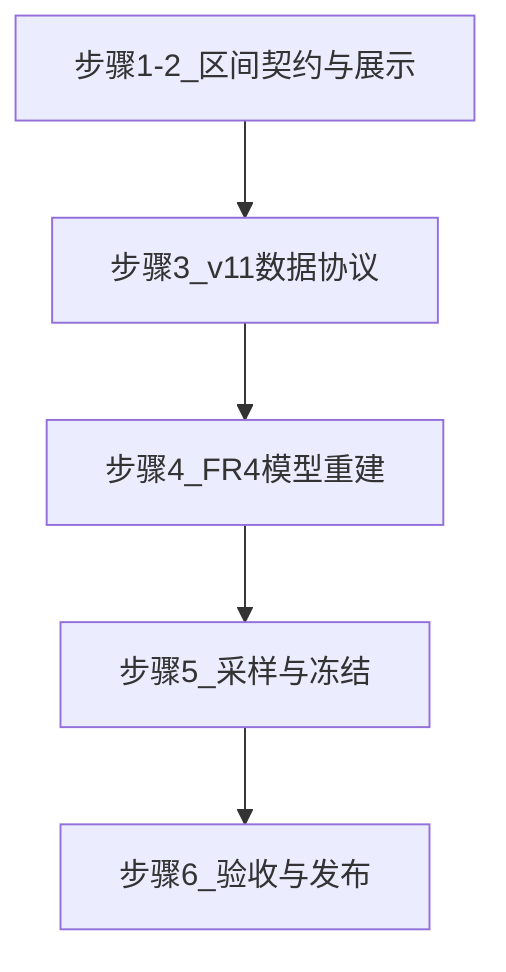

# PCB 制造费精确报价第十一版（V11 · 范围报价）

## 目标与范围

### 做
- **产品变更**：简单报价 PCB 开发中，凡自动报价（含 `exact_lookup` 与 `verified_estimate`）的制造费与**订单总价**均展示 **±10% 区间**（例：中位 168 元 → `151 ~ 185` CNY；KRW 同步区间）。
- **模型变更**：解决 v10 失败根因——FR-4 仍为 v9 对数插值（`fr4|L2|medium|high` maxErr 88%）；FPC 临界段补强；铝基防回归。
- **数据协议**：全新 v11 验收集 + 一次性指纹；`V10-ACC` / `fnvish_4e2e1389` 仅 diagnostic，禁止进入 fit/tuning/final。
- **发布**：全门禁通过后由 [`scripts/jlc-cn-pcb-sync-table-data.mjs`](scripts/jlc-cn-pcb-sync-table-data.mjs) 原子切换；失败保持 [`backend/apps/simplequote/table_data.py`](backend/apps/simplequote/table_data.py) 活动版本 `jlc-cn-pcb-v6-20260712`。

### 不做
- 不改数据库结构、不改对外 API 路由；仅在 `pcb_manufacturing` / `calc_pcb` 结果 JSON 中**追加**区间字段（向后兼容）。
- 不重跑/复用 v10 已消费指纹 `fnvish_4e2e1389`。
- 不做购物车/下单扣款逻辑改造（简单报价仍为参考价；区间仅展示）。
- 不将区间幅度做成用户可配（v11 固定 `quote_range_rate = 0.10`）。

---

## 产品口径（已确认）

| 项 | 口径 |
|---|---|
| 区间幅度 | **±10%**（相对 `customer_quote_cny` 中位值） |
| 适用范围 | **所有自动报价**（精确查表 + 估算 + 工艺调整后自动价） |
| 总价 | **同步区间**：`total_min` / `total_max` = 固定项（开发费、服务、运费）+ 制造费 min/max |
| 人工复核 | 不展示区间；`requires_manual_review=true` 时制造费与总价制造分量仍为 0 |

---

## v10 失败摘要（v11 输入）

来源：[`docs/pcb-quote-v10-accuracy-test-report.md`](docs/pcb-quote-v10-accuracy-test-report.md)、[`scripts/jlc-cn-pcb-v10-acceptance-report.json`](scripts/jlc-cn-pcb-v10-acceptance-report.json)

| 材料 | Hit@20 | maxErr | 结论 |
|---|---|---|---|
| FR-4 | 59% | **88%** | 主失败源；L2 medium/high 段 |
| FPC | 91% | 35% | 临界；L2 medium/medium |
| 铝基 | 100% | 13% | 达标 |

机制：v10 仅 FPC 换模（[`scripts/jlc-cn-pcb-v10-model.mjs`](scripts/jlc-cn-pcb-v10-model.mjs) `fpc_layered_floor_area_quantity`），FR-4 仍走 v9 `local_log` 对数插值，与 JLC 阶梯价不匹配。

---

## 实现步骤

### 1. 范围报价契约与计算层

在 [`backend/apps/simplequote/calculator.py`](backend/apps/simplequote/calculator.py) 新增统一区间 helper（建议 `_pcb_quote_range(mid_cny, mid_krw, rate=0.10)`）：

**`pcb_manufacturing` 追加字段**（中位值保留，不破坏现有调用方）：
- `quote_range_rate`: `0.10`
- `pricing_display_mode`: `"range"` | `"manual"`
- `customer_quote_cny_min` / `customer_quote_cny_max`
- `customer_quote_krw_min` / `customer_quote_krw_max`
- `jlc_estimate_cny_min` / `jlc_estimate_cny_max`（由 JLC 中位价同比例展开，供验收对拍）

**`calc_pcb` 追加字段**：
- `pcb_manufacturing_fee_min` / `pcb_manufacturing_fee_max`
- `total_min` / `total_max`
- `breakdown` 制造费行增加 `amount_min` / `amount_max`（可选，便于 PDF/前端复用）

应用点：在 `_estimate_pcb_manufacturing` 成功返回前（`requires_manual_review=false`）统一套区间；`calc_pcb` 用固定项 + 制造费 min/max 汇总总价区间。

### 2. 前端与 PDF 展示

- [`frontend/src/views/quote/SimpleQuoteView.vue`](frontend/src/views/quote/SimpleQuoteView.vue)（约 L485–545）：制造费由单值改为 `CNY min ~ max` / `KRW min ~ max`；总价区域同步区间；保留 `mfgExact`/`mfgEstimated` 标签但补充区间说明。
- [`frontend/src/i18n/index.js`](frontend/src/i18n/index.js)：新增 `pcbDev.mfgQuoteRange`、`pcbDev.totalRange`、`pcbDev.mfgRangeNote`（zh/ko/en/ja 四语）。
- [`backend/core/pdf.py`](backend/core/pdf.py) `build_pcb_dev_quotation_pdf`：制造费与 Total 行改为区间；脚注说明 ±10% 参考区间。

### 3. v11 数据协议（复制 v10 骨架并升级防泄漏）

以 v10 脚本为模板新建 v11 系列（路径模式 `scripts/jlc-cn-pcb-v11-*.mjs|py`）：

| 脚本 | 要点 |
|---|---|
| `v11-spec-key.mjs` | 拒绝 `V(?:7\|8\|9\|10)-ACC`、`v10_final_acceptance_do_not_train`、`samplingVersion='v10-acceptance'` |
| `v11-generate-splits.mjs` | 新 acceptance 48×3 材料；v10 全量 markDiagnostic；FR-4 新 fit 锚点覆盖 L2/L4 medium·large 段 |
| `v11-assert-split.mjs` | 互斥 + `runtimePreflightReport`（镜像 [`calculator.py`](backend/apps/simplequote/calculator.py)） |
| `v11-build-model.mjs` / `v11-model.mjs` | 见步骤 4 |
| `v11-freeze-model.mjs` | 模型 sha256 绑定新指纹；一次性消费 |
| `v11-acceptance-score.py` | **新增 BandHit 门禁**（见验收标准） |
| `v11-build-diagnostics.mjs` | 固化 v10 分段误差为 v11 diagnostic |

### 4. v11 模型：FR-4 重建 + FPC/铝基补强

在 `v11-model.mjs`：

- **FR-4（核心）**：新增 `fr4_layered_floor_area_quantity`（对齐 v10 FPC 思路：按层数 → 面积带 → 数量阶梯 → 地板价 + 线性/阶梯增长），**废弃** FR-4 的 `local_log` 主路径；单调性、倍率上限、局部残差护栏与 FPC v10 同级。
- **FPC**：保留 `fpc_layered_floor_area_quantity`，针对 `L2|medium|medium`、`L1|medium|high` 扩 fit 锚点并独立 tuning。
- **铝基**：保留 `aluminum_floor_area_quantity`；修复 v10 中 `processOk:false` 的 3 组工艺采样。
- **区间诚实护栏**：按 holdout 分段 `maxRelativeError` 配置 `risk_zones`——分段误差 >10% 的规格**不进自动区间**，转 `manual_review`（避免展示虚假 ±10%）。

镜像实现：[`backend/apps/simplequote/calculator.py`](backend/apps/simplequote/calculator.py) Python 侧与 `v11-model.mjs` 对拍（延续 v9/v10 测试模式）。

### 5. 采样与冻结

复用 [`scripts/jlc-cn-browser-sample.mjs`](scripts/jlc-cn-browser-sample.mjs) + `v11-sample-stage.mjs`：

1. FR-4 fit（优先 L2/L4 中大面积边界）+ FR-4 tuning
2. FPC 边界补采 + tuning 回归
3. 三材料 process holdout 回归
4. 模型冻结 + runtime preflight 144/144 可运行
5. final acceptance 三采（≥432 行目标，CV≤2%）

临时 profile/批次收尾：`v11-clean-temp.mjs`。

### 6. 验收、发布与回归

- 跑 `v11-acceptance-score.py` → `docs/pcb-quote-v11-accuracy-test-report.md`
- 通过则 `jlc-cn-pcb-sync-table-data.mjs` 原子发布；失败拒绝发布
- 扩展 [`backend/apps/simplequote/tests/test_pcb_manufacturing_quote.py`](backend/apps/simplequote/tests/test_pcb_manufacturing_quote.py)：`PcbManufacturingQuoteV11Tests`（区间字段、总价 min/max、超护栏 manual、精确查表也有区间、失败回退）
- 前端 build、Django check、Compose `/api/health` 冒烟

---

## 验收标准

### 产品（范围报价）
1. 自动报价时 `customer_quote_cny_min/max` 相对中位值严格 ±10%（四舍五入规则单测锁定）。
2. 精确查表与估算均返回 `pricing_display_mode="range"`；人工复核为 `"manual"` 且无区间。
3. `total_min` ≤ 固定项 + 制造费中位 ≤ `total_max`，且区间宽度仅来自制造费 ±10%。
4. 前端与 PDF 均展示制造费区间与总价区间；i18n 四语齐全。

### 模型与数据（v11 发布门禁）
5. v10 验收集零泄漏（split 断言硬失败）。
6. 每材料稳定规格 ≥40；自动报价覆盖率 ≥90%（总体及分材料）。
7. **BandHit ≥95%**（总体及分材料）：真实 JLC 价（含 margin 后 customer 价）落在展示 ±10% 区间内。
8. 总体 maxErr ≤20%；分段 `maxRelativeError > 0.10` 的规格须进入 manual_review，不得计入 BandHit 分母外的「假自动报价」。
9. 模型哈希、指纹一次性消费、runtime preflight 全通过；未通过前活动版本保持 v6。

### 工程回归
10. PCB 制造费测试全绿；`manage.py check` 无告警；前端 `yarn build` 通过。

---

## 风险与缓解

| 风险 | 缓解 |
|---|---|
| FR-4 阶梯模型仍欠拟合，±10% 区间不诚实 | 分段 holdout 护栏 + 超 10% 段强制 manual；验收以 BandHit 为主门禁 |
| 精确查表也展示 ±10% 可能被认为「不够精确」 | 文案标明「参考区间」；精确查表仍保留 `pricing_mode=exact_lookup` 标签 |
| 总价区间与历史单值 `total` 字段并存引起混淆 | 保留 `total` 为中位值（兼容）；UI/PDF 主展示 `total_min~max` |
| v11 采样成本高 | 分阶段 resume；仅补 FR-4/FPC 薄弱段，铝基最小回归集 |
| 前后端算法漂移 | freeze 前 runtime preflight + Python/Node 对拍测试 |

---

## 建议的下一步

确认本方案后进入 `feature-implementation`：建议实施顺序为 **区间契约（步骤 1–2）→ v11 脚本骨架（步骤 3）→ FR-4 模型（步骤 4）→ 采样/验收/发布（步骤 5–6）**。

