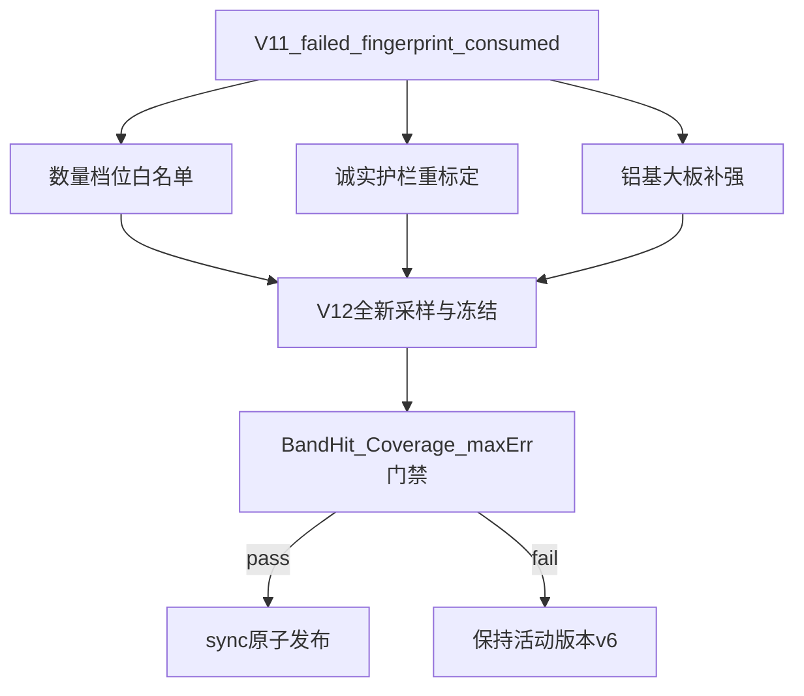

# PCB 制造费精确报价第十二版（V12 · 模型迭代）

## 结论：可以做，且应当做

| 事实 | 含义 |
|---|---|
| V11 产品侧（±10% 区间、`total_min/max`、前端/PDF）已落地 | V12 **默认不改产品口径** |
| V11 验收 `failed`，指纹 `fnvish_a82311bc` 已消费 | **禁止**用同一指纹重调参/重验收/重发布 |
| 活动版本仍为 `jlc-cn-pcb-v6-20260712` | 线上仍跑 v6；V12 通过后才可切换 |
| V11 脚本骨架完整 | 复制为 `v12-*` 即可，工程成本可控 |

**本方案默认范围：只做模型/数据迭代**，产品区间保持 ±10%。若后续希望放宽区间或改精确查表展示规则，需另开产品变更，不在本 V12 内。

---

## 目标与范围

### 做
- 新建 **v12 验收集 + 一次性指纹**；`V11-ACC` / `fnvish_a82311bc` 及更早 ACC **一律 diagnostic-only**，禁止进入 fit/tuning/final。
- 修复 V11 三大失败源：
  1. **数量档位非法**：验收/拟合目标只使用嘉立创页面真实存在的数量选项，消除 `quantity option not found`。
  2. **诚实护栏错位**：按 V11 holdout 重标定 `risk_zones`——把真实高误差段（如 `fr4|L4|medium|high` maxErr≈32%）拦进 manual；放宽被误拦但误差可控的段，拉高 FR-4/FPC 覆盖率。
  3. **铝基 BandHit**：补强 `aluminum|L1|large|high` 等大板高量段拟合/地板价，使真实价落入 ±10% 区间的比例达标。
- 门禁全过后再经 [`scripts/jlc-cn-pcb-sync-table-data.mjs`](scripts/jlc-cn-pcb-sync-table-data.mjs) 原子发布；失败保持 v6。

### 不做
- 不改 ±10% 产品口径、不改对外 API 路由、不改库表。
- 不复用/重跑 V11 已消费指纹。
- 不做购物车/下单扣款改造。
- 不改前端/PDF 区间展示逻辑（除非发布后冒烟发现展示与字段不一致）。

---

## V11 失败输入（V12 必须对准）

来源：[docs/pcb-quote-v11-accuracy-test-report.md](docs/pcb-quote-v11-accuracy-test-report.md)

| 门禁 | V11 结果 | 要求 |
|---|---|---|
| 每材料稳定规格 ≥40 | 通过（42/40/45） | 保持 |
| 自动覆盖率 ≥90% | **81.10%**（FR-4 66.67%） | 必须过 |
| BandHit ≥95% | **73.79%**（铝基 66.67%） | 必须过 |
| maxErr ≤20% | **31.70%** | 必须过 |
| Hit@20 ≥95% | 99.03% | 保持 |

根因优先级：数量档位非法 → honesty 护栏误拦导致覆盖率低 → 铝基大板 BandHit / FR-4 残余高误差段。

---

## 实现步骤

### 1. V12 数据协议（复制 V11 骨架并升级防泄漏）

以 `scripts/jlc-cn-pcb-v11-*.mjs|py` 为模板新建 `v12-*`：

- [`scripts/jlc-cn-pcb-v12-spec-key.mjs`](scripts/jlc-cn-pcb-v12-spec-key.mjs)：diagnostic 正则扩展到 `V(7|8|9|10|11)-ACC`；拒绝 `v11_final_acceptance_do_not_train` / `samplingVersion='v11-acceptance'`。
- `v12-generate-splits.mjs` / `v12-assert-split.mjs`：新 acceptance 目标；**数量仅从页面可选项白名单采样**（先探测或复用 [`scripts/jlc-cn-pcb-v6-options-freeze.json`](scripts/jlc-cn-pcb-v6-options-freeze.json) / probe 结果，按材料过滤）。
- `v12-build-model.mjs` / `v12-model.mjs` / `v12-freeze-model.mjs` / `v12-sample-stage.mjs` / `v12-acceptance-score.py` / `v12-build-diagnostics.py` / `v12-clean-temp.mjs`。
- 更新 [`scripts/jlc-cn-pcb-sync-table-data.mjs`](scripts/jlc-cn-pcb-sync-table-data.mjs)：优先读 v12；`status===passed` 才发布；否则保持 v6。

### 2. 模型与护栏（对准 V11 失败段）

在 `v12-model.mjs`（并镜像 [`backend/apps/simplequote/calculator.py`](backend/apps/simplequote/calculator.py) 中与 price-list 相关的估算路径，保持 Node/Python 对拍）：

- **数量白名单**：fit/tuning/acceptance 目标生成阶段强制过滤非法 qty，避免采样失败拖垮覆盖率。
- **FR-4**：保留 `fr4_layered_floor_area_quantity`；针对 `L4|medium|high` 等 maxErr 超标段补锚点或分段地板；将分段 holdout `maxRelativeError > 0.10` 的区写入 `risk_zones` → manual。
- **FPC**：保留分层模型；复查 V11 被 honesty 清零的 `L2 large/medium` 段——能拟合则放开自动，不能则保持 manual。
- **铝基**：重点补 `L1|large|high` 数量阶梯，优先抬 BandHit 而非盲目扩覆盖（覆盖已 100%）。
- **诚实护栏原则**：宁可覆盖率略紧，也不展示虚假 ±10%；但必须用 **V12 自己的 tuning/process holdout** 重算分区，禁止照搬 V11 过严分区表。

### 3. 采样与冻结

复用 [`scripts/jlc-cn-browser-sample.mjs`](scripts/jlc-cn-browser-sample.mjs) + `v12-sample-stage.mjs`：

1. 数量选项探测/冻结（若白名单过期）
2. FR-4 / FPC / 铝基 薄弱段 fit + tuning
3. process holdout 回归
4. 冻结模型 + runtime preflight 全量可运行
5. **全新** final acceptance 三采（每材料稳定规格 ≥40）
6. `v12-clean-temp.mjs` 收尾

采样开始后禁止 rebuild/retune（与 V11 相同硬约束）。

### 4. 验收、发布与回归

- 跑 `v12-acceptance-score.py` → [`docs/pcb-quote-v12-accuracy-test-report.md`](docs/pcb-quote-v12-accuracy-test-report.md)
- 通过：`node scripts/jlc-cn-pcb-sync-table-data.mjs` 原子切换活动版本
- 失败：保持 `jlc-cn-pcb-v6-20260712`，consumption `published:false`
- 扩展 [`backend/apps/simplequote/tests/test_pcb_manufacturing_quote.py`](backend/apps/simplequote/tests/test_pcb_manufacturing_quote.py)：V12 发布后若活动版本变更，补 Python/估算对拍；区间契约沿用现有 V11Tests，无需重复造轮子
- Compose：`manage.py check`、`/api/health`、前端简单报价 PCB 页冒烟（区间展示仍在）

---

## 验收标准

1. V11 及更早 ACC 零泄漏（split 断言硬失败）。
2. 每材料稳定规格 ≥40；总体及分材料自动覆盖率 ≥90%。
3. 总体及分材料 **BandHit ≥95%**（真实价落在展示 ±10% 区间）。
4. 总体及分材料 maxRelErr ≤20%；Hit@20 ≥95%。
5. 模型哈希与新指纹一次性消费；runtime preflight 全通过。
6. 未通过前活动版本保持 v6；通过后 `table_data.py` 活动版本为 v12 且 sync 可幂等拒绝二次发布。
7. PCB 制造费相关单测全绿；健康检查通过。

---

## 风险与缓解

| 风险 | 缓解 |
|---|---|
| ±10% 对铝基大板仍过窄，BandHit 难达 95% | 优先抬中位拟合；仍不够则该段进 manual（保诚实），不靠私下加宽区间 |
| 护栏过严再次拖垮覆盖率 | 用 holdout 分段误差闭环标定；覆盖率与 BandHit 同步看，禁止只盯一个 |
| 数量白名单与页面季节性变化 | acceptance 前再 probe 一次；失败行不得 silently 当 fresh |
| 采样成本高 | 只补 V11 薄弱段 + 最小铝基回归；分批 resume |
| Node/Python 漂移 | freeze 前 runtime preflight + 既有对拍测试 |

---

## 建议的下一步

确认本方案后进入 `feature-implementation`，顺序：**协议骨架（含数量白名单与 V11 防泄漏）→ 护栏/铝基/FR-4 模型 → 采样冻结 → 验收发布**。

若你希望 V12 同时**放宽区间幅度**（例如 ±15%）或**精确查表不展示区间**，请先说明，需另改产品契约，不在本默认范围内。
