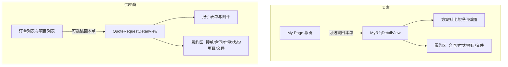

# 详细报价一站式履约枢纽（买卖双方）

## 目标与范围

**做：**
- 买家在 [MyRfqDetailView.vue](frontend/src/views/rfq/MyRfqDetailView.vue) 内，以本 RFQ 为中心贯穿：方案对比/详情 → 合同 → 付款 → 项目进度 → 文件（先 RFQ/报价附件，后各阶段履约文件）。
- 供应商在 [QuoteRequestDetailView.vue](frontend/src/views/supplier/QuoteRequestDetailView.vue) 内，以本报价请求为中心贯穿：报价 → 接单状态 → 合同 → 付款状态 → 项目进度 → 文件。
- My Page 的合同/付款/项目/文件，以及供应商的订单列表/项目列表，**保留为全局总览**；本单详情内提供跳转与内嵌操作，避免再「分别寻找」。

**不做：**
- 不改 My Page Tab 结构、不删全局列表。
- 不做供应商付款凭证上传（仍仅买家上传、管理员确认）。
- 不在报价详情弹窗内塞满履约区块（弹窗继续只做方案/企业资料/附件）。
- 不改合同模板、加价规则、五阶段定义本身。

## 产品形态

确认方案后：
- 买家**不再**默认跳到 `/my/production-orders`，而是留在本 RFQ 详情并滚动到「履约」区（成功提示仍显示生产订单号）。
- 供应商在报价请求变为 `adopted` / RFQ `won` 后，同一页展开履约区；接单动作可在本页完成（复用现有 confirm/reject API）。

金额与隐私：
- 买家履约区只展示客户价；供应商只展示底价/供应商侧合同额。
- 供应商付款区仅展示**状态与金额摘要**（如 unpaid / pending_confirm / confirmed），不展示买家凭证文件与管理员内部备注。

## 实现步骤

### 1. 后端：按本单聚合履约接口

在 [backend/apps/rfq/](backend/apps/rfq/) 增加轻量聚合，避免前端串打四个列表再自行拼装：

- 买家：`GET /member/rfqs/{pk}/fulfillment`  
  校验 `rfq.buyer == request.user`。  
  返回结构示例：`production_order`、`contract`、`payment`、`project`（含 `stages`/`current_stage`/`progress_percent`）、`files`（`rfq_attachments` + 已采纳报价附件 + `project_files`，统一鉴权 `file_url`）。未确认方案时各字段为 `null`/`[]`，页面仍可用。

- 供应商：`GET /supplier/quote-requests/{pk}/fulfillment`  
  校验报价请求归属当前供应商。经 `quote → production_order` 反查合同、付款、项目、文件；无生产订单时返回空履约。  
  付款序列化使用供应商只读摘要（status、amount 用供应商侧金额口径、currency、updated_at），不含 `proof`。

复用现有序列化器片段（合同 PDF、项目阶段、鉴权文件 URL），在 [serializers.py](backend/apps/rfq/serializers.py) 新增聚合 Serializer，在 [views.py](backend/apps/rfq/views.py) / [urls.py](backend/apps/rfq/urls.py) 挂路由。

可选增强（同一步内完成，便于总览跳转）：全局列表项补 `rfq_no` / `rfq_id` / `quote_request_id`（合同、付款、项目列表序列化），**不做按 RFQ 过滤 query 也可先过验收**，前端从总览链到本单详情即可。

### 2. 后端：供应商付款只读能力

现无 `/supplier/payments`。本方案**不单独做付款列表页**，付款信息只嵌在 fulfillment 聚合中。若需供应商 My Page 后续扩展，可另开需求。

合同侧：已有 `/supplier/contracts`，履约区内签署状态以只读展示为主（买家签署；供应商无需二次签则不开放写接口）。

### 3. 前端 API 封装

在 [frontend/src/api/index.js](frontend/src/api/index.js) 增加：
- `fetchMyRfqFulfillment(rfqId)`
- `fetchSupplierQuoteRequestFulfillment(qrId)`

确认方案成功后的跳转改为**留在本页并 `loadFulfillment()`**（改 [MyRfqDetailView.vue](frontend/src/views/rfq/MyRfqDetailView.vue) 的 `onAccept`）。

### 4. 买家 UI：询价详情履约区

在 `MyRfqDetailView` 底部（方案区之后）增加「本单履约」分区，按状态渐进展示：

1. **合同**：合同号、金额、状态、下载 PDF、待签时「确认签署」（复用 `signContract`）。
2. **付款**：付款单号、金额、状态、上传凭证（复用 `uploadPaymentProof`）。
3. **我的项目**：无项目时提示「付款确认后启动」；有项目时展示五阶段进度条、当前阶段、链到 `/my/projects/:id`（详细操作仍可进详情，但本页已能看懂进度）。
4. **文件中心（本单）**：合并 RFQ 附件、报价附件、项目阶段文件；复用 `FilePreviewModal` + 鉴权下载工具 [downloadAuthedFile.js](frontend/src/utils/downloadAuthedFile.js)。

报价卡片/「查看详情」逻辑保持现状（`QuoteDetailModal`）。

### 5. 供应商 UI：报价请求详情履约区

在 `QuoteRequestDetailView` 于报价锁定后展开同构分区：

1. **接单**：若存在 `pending_confirm` 生产订单，本页提供确认/拒绝（复用现有 API）。
2. **合同**：只读合同信息与 PDF。
3. **付款状态**：只读摘要。
4. **项目**：进度条 + 链到 `/supplier/projects/:id`；可在本页只读看阶段与文件列表，上传/改阶段仍以项目详情为主（避免一页职责过重），但文件列表必须在本页可见。
5. **文件**：RFQ 附件 + 己方报价附件 + 项目阶段文件。

### 6. 总览保留与互链

- My Page 合同/付款/项目/文件保持；有 `rfq_id` 时增加「查看本单」链到 `/my/rfqs/:id`（或现有询价详情路由）。
- 供应商订单列表项链回对应 `quote-request` 详情（若订单能反查 `quote_request_id`）；项目详情保留，并增加「返回本单报价请求」链接（有则显示）。

### 7. i18n 与验证

- 中/韩/英/日补齐履约区文案 key。
- 权限冒烟：跨买家/跨供应商访问 fulfillment 返回 403/404；供应商付款摘要无 proof；买家不回底价。
- 前端 build；Docker 重启 backend/frontend；`/api/health`。

## 风险与缓解

- **信息过载**：履约区用折叠分区 + 状态空态文案；弹窗不承担履约。
- **项目尚未创建**：付款未确认前项目为空，明确提示下一步，避免误以为丢单。
- **供应商见付款**：仅状态/金额摘要，禁止凭证直链。
- **双入口数据不一致**：履约读写仍走原有合同/付款/接单 API，聚合接口只读拼装。

## 验收标准

1. 买家确认方案后留在询价详情，可见合同与付款并可签署/上传凭证，无需先去 My Page。
2. 管理员确认付款并生成项目后，刷新同一询价页可见项目进度与阶段文件；RFQ/报价附件始终在本单文件区。
3. 供应商在已采纳的报价请求详情可见接单、合同、付款状态、项目进度与文件；可在本页接单。
4. My Page / 供应商列表仍可用，且能跳回对应本单详情。
5. 越权与敏感字段（底价、买家凭证对供应商、联系方式）不泄露；构建与健康检查通过。
