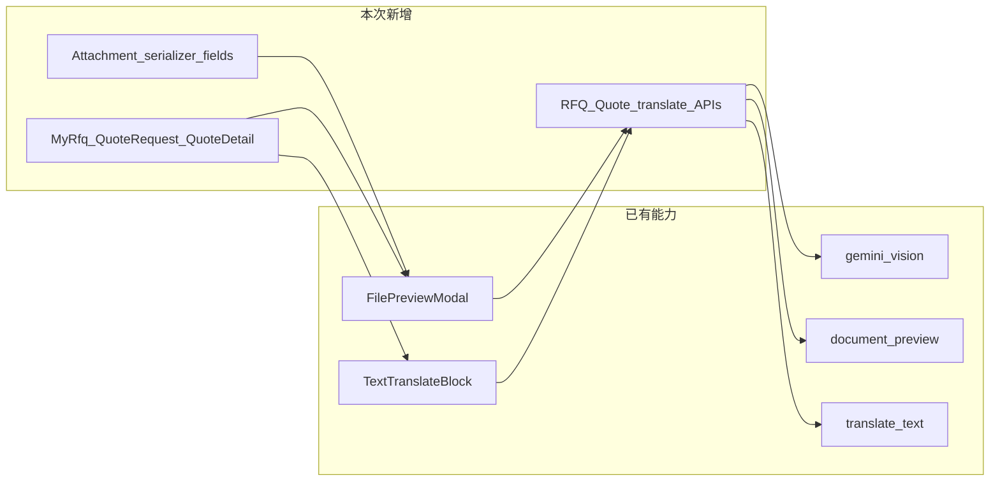

# RFQ / 报价 AI 翻译扩展

## 目标与范围

**做：**
- 文字翻译：RFQ `remark`、派单 `admin_note`、报价 `note`、报价 `payment_terms`
- 附件翻译：RFQ 附件、报价附件（复用 LibreOffice 转 PDF + 文本抽文 + 无文本层 Gemini 多模态）
- 角色：买家（member）与供应商（supplier）；目标语言沿用 `zh/ko/en/ja`，随当前界面语言

**不做：**
- 生产订单（无自由文本，继续用 i18n）
- NDA / 合同正文对照翻译（下期）
- RFQ 短规格字段（`material` / `tolerance` / `surface_finish`）单独翻译
- 管理员后台翻译入口

## 现状与复用点

- 文字服务：[backend/apps/project/translation.py](backend/apps/project/translation.py) 的 `translate_text` 可直接复用
- 文件抽文/多模态：同文件的 `translate_project_pdf_file` / `translate_project_file_text` 与 [backend/core/document_preview.py](backend/core/document_preview.py)；文件翻译需抽一层与「project」解耦的通用函数（按 `file_id` + 路径缓存，不绑定 ProjectFile）
- UI：`TextTranslateBlock`、`FilePreviewModal`（当前强绑 `projectId`，需泛化）
- 报价附件已有鉴权下载与基础预览；RFQ 附件目前仅公开/直链下载、无预览字段与翻译

## 实现步骤

### 1. 后端：抽出通用文件翻译 + RFQ/报价文字 API

- 在 [backend/apps/project/translation.py](backend/apps/project/translation.py)（或新建 `backend/core/ai_translate.py` 再由 project 转发）增加与资源无关的 `translate_file_by_path(cache_ns, file_id, path, ext, target_lang)`，内部继续走 PDF 分流 / 抽文 / vision；缓存键用 `cache_ns`（如 `rfq_att` / `quote_att`）避免与项目文件冲突
- 在 [backend/apps/rfq/views.py](backend/apps/rfq/views.py) + [backend/apps/rfq/urls.py](backend/apps/rfq/urls.py) 新增：
  - `POST /api/member/rfqs/<pk>/translate`、`POST /api/supplier/quote-requests/<pk>/translate`（body: `text` + `target_lang`；供应商侧校验该 QuoteRequest 归属）
  - 买家报价文字：`POST /api/member/quotes/<pk>/translate`（仅 `is_customer_visible` 或已公开方案可访问的 quote）
  - 供应商报价文字：`POST /api/supplier/quotes/<pk>/translate`（仅本人 quote）
- 权限边界：买家只能访问自己的 RFQ / 可见报价；供应商只能访问被派单 RFQ 与自己的 quote；错误码沿用 `TRANSLATE_*` / 统一响应包

### 2. 后端：附件 preview-pdf + translate + serializer

- 扩展 [backend/apps/rfq/serializers.py](backend/apps/rfq/serializers.py)：
  - `RFQAttachmentSerializer`：补 `file_ext`、`is_previewable`、`preview_mode`、`preview_pdf_url`、`is_translatable`、鉴权 `file_url`（对齐项目文件，避免裸 `/media`）
  - `QuoteAttachmentSerializer`：补 `preview_mode`、`preview_pdf_url`、`is_translatable`
- 新增下载/预览/翻译路由（member + supplier）：
  - RFQ：`.../rfqs/<pk>/attachments/<id>/download|preview-pdf|translate`
  - Quote：`.../quotes/<quote_id>/attachments/<id>/preview-pdf|translate`（download 已存在则只补后两者）
- 实现复用 `get_or_create_preview_pdf`、`cleanup_preview_cache`（缓存目录按 `rfq_att/{id}` / `quote_att/{id}` 隔离）；删除附件时清理缓存

### 3. 前端：泛化组件与 API

- [frontend/src/api/index.js](frontend/src/api/index.js)：增加 RFQ/报价文字与附件翻译、RFQ 附件鉴权下载相关方法
- [frontend/src/components/TextTranslateBlock.vue](frontend/src/components/TextTranslateBlock.vue)：由固定 project API 改为 props `translateFn`（或 `contextType` + `contextId` + `role`），项目页保持兼容
- [frontend/src/components/FilePreviewModal.vue](frontend/src/components/FilePreviewModal.vue)：将 `projectId` 泛化为 `contextType`（`project|rfq|quote`）+ `contextId` + `role`；`showTranslatePanel` 与翻译 API 按 context 分发；项目页传参向后兼容
- 挂载点：
  - [frontend/src/views/rfq/MyRfqDetailView.vue](frontend/src/views/rfq/MyRfqDetailView.vue)：`remark` + RFQ 附件预览/翻译
  - [frontend/src/views/supplier/QuoteRequestDetailView.vue](frontend/src/views/supplier/QuoteRequestDetailView.vue)：`admin_note`、`rfq_detail.remark`、RFQ 附件、报价 `note`/`payment_terms`、报价附件翻译
  - [frontend/src/components/QuoteDetailModal.vue](frontend/src/components/QuoteDetailModal.vue)：`note`、`payment_terms`、报价附件翻译
- 四语 i18n：仅补缺省 key（若复用 `aiTranslate.*` / `filePreview.*` 则尽量不加新文案）

### 4. 测试与验收联调

- 后端：文字翻译权限（跨买家/跨供应商 403）、空文本、未配置 Gemini
- 附件：有文本 PDF / 纯图 PDF（vision）/ docx|xlsx 转 PDF；`is_translatable` 标志；缓存命中
- 前端：买家 RFQ 详情、供应商报价请求详情、买家方案弹窗手测；`npm run build`
- 部署：`docker compose restart frontend backend`

## 风险与缓解

- **FilePreviewModal 改动影响项目页**：保持 `contextType=project` 默认行为与旧 props 兼容，项目页回归点一次翻译按钮
- **RFQ 附件原为直链 `/media`**：改为鉴权下载后，旧书签失效可接受；序列化统一走 API
- **报价 office 预览此前可能走前端 SheetJS**：补 `preview_pdf_url` 后与项目一致，避免格式错乱
- **费用与耗时**：vision 仅无文本层 PDF、最多 5 页；文件结果 Redis 缓存 7 天
- **合同法律歧义**：本期不做合同/NDA，避免误用译文当法律文本

## 验收标准

1. 买家在 RFQ 详情可翻译 `remark`；供应商在报价请求详情可翻译 `admin_note` 与 RFQ `remark`
2. 买卖双方在报价详情可翻译 `note`、`payment_terms`，结果为目标界面语言
3. RFQ/报价的 pdf/docx/xlsx/csv 附件可预览；可翻译；纯图 PDF 走 `gemini_vision` 并显示原文/译文对照
4. 越权访问返回 403；空文本/无可抽文返回稳定错误码；Gemini 未配置返回 `TRANSLATE_NOT_CONFIGURED`
5. 项目页既有文字/文件翻译行为不回归
6. 后端相关测试通过，前端 build 通过

## 建议的下一步

确认本方案后进入 `feature-implementation`，严格按步骤 1→4 编码，不做合同/NDA 与订单扩展。
