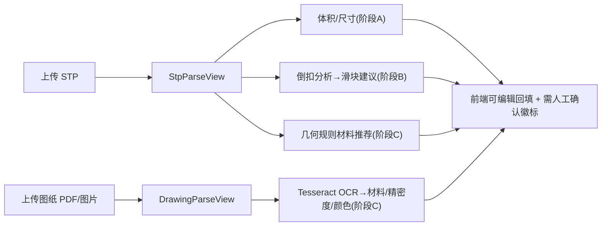

## 阶段 B + C：滑块推断与图纸 OCR

延续阶段 A（[backend/apps/simplequote/geometry.py](backend/apps/simplequote/geometry.py) / [backend/apps/simplequote/views.py](backend/apps/simplequote/views.py) 的 `StpParseView`）：**不落库、不存原文件**，识别结果作为**可编辑建议值 + 置信度**返回，前端标注"需人工确认"，报价仍以 `inputs` 为准。

### 关键决策（已确认）
- 阶段 B：启发式建议值 + 置信度，不直接定终价。
- 阶段 C：几何规则材料推荐（零依赖，低置信度）+ 离线 Tesseract OCR 抽取工程图材料/精密度/颜色。
- 图纸支持 PDF + PNG/JPG；PDF 用 PyMuPDF 光栅化；OCR 语言 `eng+kor+chi_sim`。

### 数据流

### 后端
- 依赖与镜像 [backend/Dockerfile](backend/Dockerfile) / [backend/requirements.txt](backend/requirements.txt)：
  - apt 增 `tesseract-ocr tesseract-ocr-kor tesseract-ocr-chi-sim`。
  - requirements 增 `pytesseract`、`pymupdf`（PDF 光栅化，自带 wheel）。
  - 重建镜像验证 `tesseract --version`、`import fitz`、`import pytesseract`。
- 阶段 B 倒扣分析 [backend/apps/simplequote/geometry.py](backend/apps/simplequote/geometry.py)：
  - 新增 `analyze_undercut(shape)`：遍历面 `TopExp_Explorer(shape, TopAbs_FACE)`，用 `GeomLProp_SLProps` 取面中点法向（按 `TopAbs_REVERSED` 翻转），面积用 `GProp`。对 6 个主拔模方向(±X/±Y/±Z)统计"倒扣面积"（法向与拔模方向夹角超阈值且朝内），选倒扣面积最小的方向为主拔模方向；残余倒扣面积占比超阈值→`suggested_sliders`（按倒扣法向聚类计数），输出 `{draw_direction, undercut_area_ratio, suggested_sliders, confidence}`。
  - best-effort：异常/超时返回 `undercut=null` 不影响体积解析；仍复用现有子进程 + 20s 超时。
- 阶段 C 几何规则推荐 `geometry.py` 新增 `recommend_material_by_geometry(volume_cm3, bbox_mm, surface_area_cm2)`：按壁厚代理(表面积/体积)、尺寸段给低置信度材料建议，输出 `{material, source:"geometry_rule", confidence:"low", reason}`。
  - 两者并入 `_parse_step_sync` 返回，随 `geometry` 一起出。
- 阶段 C OCR 服务 [backend/apps/simplequote/ocr.py](backend/apps/simplequote/ocr.py)（新增）：`parse_drawing(path, kind)`：图片直接 `pytesseract`，PDF 先 `fitz` 光栅化首页；对 OCR 文本做关键字抽取——材料(`ABS/ABS+GF/PC/PA66/PP`)、精密度(`±?0.\d+` 就近取最严)、颜色(透明/半透明/PANTONE 码)；返回各字段 `{value, confidence}` + `raw_text_excerpt`。子进程 + 超时保护，`tesseract` 不可用时返回 `OCR_UNAVAILABLE`。
- 接口 [backend/apps/simplequote/views.py](backend/apps/simplequote/views.py) / [backend/apps/simplequote/urls.py](backend/apps/simplequote/urls.py)：
  - `StpParseView` 响应 `geometry` 增 `undercut`、`material_suggestion`（前端把 `suggested_sliders` 回填 `part.slider_count`、材料建议在未选时预填，均可改）。
  - 新增 `DrawingParseView` → `POST /api/member/simple-quotes/parse-drawing`（`IsBuyerRole`，multipart，字段 `file`；扩展名 `.pdf/.png/.jpg/.jpeg`、大小上限 15MB、魔数校验；临时文件解析后删除）。
  - 错误码：`DRAWING_FILE_INVALID` / `DRAWING_PARSE_FAILED` / `DRAWING_PARSE_TIMEOUT` / `OCR_UNAVAILABLE`（400）。

### 前端
- [frontend/src/api/index.js](frontend/src/api/index.js)：新增 `drawingParse(formData)`（multipart）。
- [frontend/src/views/quote/SimpleQuoteView.vue](frontend/src/views/quote/SimpleQuoteView.vue)：
  - STP 解析结果新增展示：主拔模方向、滑块建议（回填 `slider_count`，带"建议·需人工确认"徽标）、材料建议（未选时预填）。
  - 新增"上传图纸(OCR)"入口 → 调 `drawingParse` → 把材料/精密度/颜色作为可编辑建议回填，标注置信度与"需人工确认"；OCR 不可用/失败时提示手动填写。
- [frontend/src/i18n/index.js](frontend/src/i18n/index.js)：补 `simpleQuote.*` 新 key（拔模方向/滑块建议/需人工确认/上传图纸/OCR 解析中/精密度建议/置信度/OCR 失败等）ko/zh/en/ja。

### 文档 & 自检
- 更新 [project/注塑模具自动报价需求.md](project/注塑模具自动报价需求.md) §8.2/8.3、[project/注塑自动报价二期技术方案.md](project/注塑自动报价二期技术方案.md) 阶段 B/C 标记完成、[MASS CONNECTED 平台文档.md](MASS%20CONNECTED%20平台文档.md) 与 [MASS CONNECTED 三端角色功能说明.md](MASS%20CONNECTED%20三端角色功能说明.md) 简单报价段。
- 自检（self-check-after-change）：`manage.py check`；重建 backend 验证 tesseract/fitz/pytesseract；无倒扣标准盒 `suggested_sliders=0`、带侧向孔洞件能检出倒扣；对一张含"ABS/±0.1"的样图 OCR 抽取正确；`OCR_UNAVAILABLE` 分支；一期与阶段 A 路径回归；frontend build。

### 不做（本轮外）
- OCR 训练/云 API；基于历史成交数据的材料模型（无数据）；FAMILY 智能判定；3D 在线预览；结果落库与原文件持久化。

### 主要风险
- 倒扣启发式对复杂件/多向倒扣误差大 → 定位建议值 + 置信度 + 人工复核；异常不阻断体积解析。
- 工程图 OCR 精度有限 → 仅抽取关键字段作建议，UI 强提示可改；失败回退手动。
- tesseract 语言包使镜像继续变大 → 仅装必要语言包；OCR 走子进程 + 超时。