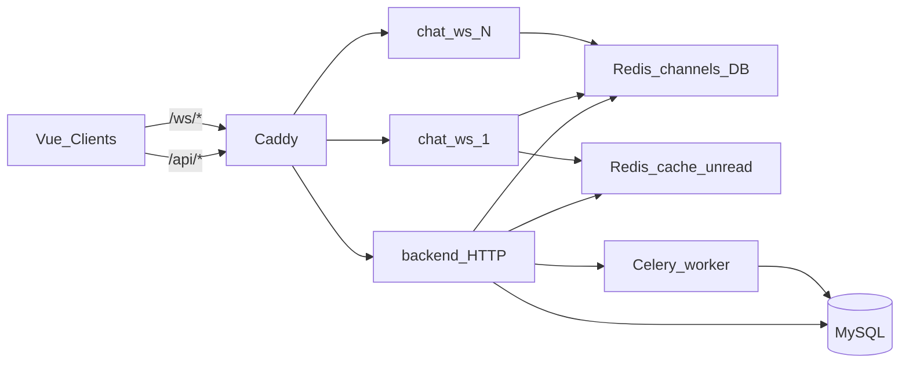
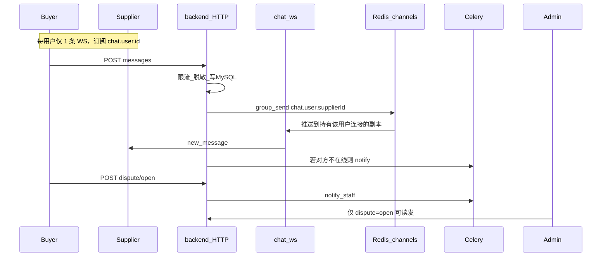

# 供应商-买家实时聊天方案（含万级并发）

## 已确认产品口径

- **开聊时机**：报价阶段即可。会话按 [`QuoteRequest`](backend/apps/rfq/models.py) 一对一绑定（同一 RFQ 下不同供应商互不串会话）；成单后把同一会话关联到 `ProductionOrder`/`Project`，线程连续不重建。
- **管理员**：默认不可读会话；任一方发起「申请平台介入」后，管理员可只读/回复该会话；纠纷关闭后恢复不可读。
- **体验**：类微信实时（WebSocket 推送 + REST 历史/补发）。
- **防绕单**：发送时脱敏联系方式；会话顶栏常驻软提示（不硬拦截发送）。
- **容量目标**：**同时在线聊天连接 1 万级可水平扩到数万**（并发 WebSocket，而非日活注册用户数）。业务模型为一对一会话，天然利于扩展。

### 软提示文案（定稿，四语 i18n）

- **zh**：为保证交易安全，请通过本平台会话沟通。请勿私下交换微信、电话、邮箱等联系方式，或引导至站外交易。平台外沟通产生的风险与纠纷，平台无法保障。
- **ko / en / ja**：实现时按同语义写入 [`frontend/src/i18n/index.js`](frontend/src/i18n/index.js)（及 admin 侧如需要）。

---

## 目标与范围

### 做

- 新建 `backend/apps/chat`：`Conversation` / `Message` / 可选 `ChatAttachment`，REST + WebSocket。
- **HTTP API 与 WebSocket 进程分离**；Channels + Redis channel layer；`chat-ws` 服务可多副本水平扩展。
- 买家/供应商：会话列表、聊天窗、未读角标、从报价请求/项目详情进入会话。
- 管理端：仅「纠纷中」会话列表与介入回复。
- 新消息离线提醒经 Celery 异步调用 [`notify()`](backend/apps/notification/services.py)，不阻塞发送路径。
- 发送限流、消息表索引、Redis 未读/在线态、前端断线指数退避重连。

### 不做

- Kakao/微信外部 IM 对接、Chatbot。
- 群聊、语音/视频通话、已读回执精细到「双蓝勾」（首版：未读计数 + 进会话标记已读）。
- 管理员默认旁听全量会话。
- RFQ 未指派供应商前的「无对象」空聊。
- 首版不上独立消息中间件（Kafka/RabbitMQ）；万级一对一推送以 Redis pub/sub + 水平扩 WS 副本满足。百万级广播再评估拆分。

---

## 容量与扩展模型

**容量口径**：同时保持的 WebSocket 连接数 ≈ 在线用户数（每用户 1 条长连接，不按会话数乘）。

| 层级 | 设计 |
|------|------|
| 单 `chat-ws` 进程 | 目标按约 **2k～5k** 空闲/轻流量长连接预留（受机器 fd/内存约束，以压测为准） |
| 1 万在线 | **3～6** 个 `chat-ws` 副本 + 独立 Redis（channels 库）即可起步 |
| 数万在线 | 继续加副本；Caddy/上游对 `chat-ws` 做负载均衡；MySQL 仅承担写消息与分页读 |

**为何一对一可撑万级**：推送目标始终是「对方用户频道」或「当前打开会话的 2～3 人」，**禁止**全站广播与超大 Group；Redis 扇出扇入与连接数近似线性，瓶颈在连接数与写库 QPS，可用副本与限流消化。

---

## 架构（业务 + 实时）

**会话绑定**：`Conversation.quote_request` 唯一；冗余 `buyer`/`supplier`；可空 `production_order`/`project` 在确认方案创建订单时回填。

**实时推送模型（定稿）**：

- 每用户 **一条** WebSocket：`/ws/chat/?token=<access_jwt>`，只加入 `chat.user.{userId}`。
- 发消息走 REST（鉴权、限流、脱敏、落库）；成功后 `channel_layer.group_send("chat.user.{peerId}", ...)`，payload 保持小（消息 id、会话 id、摘要、时间）。
- **不**为每个会话长期占一个巨大 Redis group；打开某会话时前端用 REST 拉历史，实时仍靠用户频道投递（用户只对自己的会话有权限，客户端按 `conversation_id` 过滤展示）。
- 断线重连：指数退避 + REST `GET messages?after_id=` 补洞。

**进程拆分（定稿）**：

- [`backend`](docker-compose.yml)：继续承担 `/api/*`（ASGI 或 Daphne/uvicorn 跑 Django，但 **不承载海量 WS**）。
- 新增 **`chat-ws`** 服务：同一镜像/代码，`daphne`/`uvicorn` 只挂 WebSocket URLConf；Compose 支持 `deploy.replicas` / `scale chat-ws=N`。
- [`caddy/Caddyfile`](caddy/Caddyfile)：`/api/*` → `backend`；`/ws/*` → `chat-ws`（多实例时 Caddy 上游列表或内部 LB）。

**Redis 分库（定稿）**：

- DB0：现有 cache（可保持）。
- DB1：Celery broker/result（与现网对齐后固化）。
- DB2：Channels layer（`CHANNEL_LAYERS` 独立 URL）。
- 未读数、在线心跳：cache Redis 键（如 `chat:unread:{userId}`、`chat:online:{userId}` TTL 60s），避免高频 `COUNT(*)`。

---

## 实现步骤

1. **基础设施：HTTP/WS 分离 + Channels**
   - 新增 [`backend/config/asgi.py`](backend/config/asgi.py)；`INSTALLED_APPS` 加 `channels`、`apps.chat`；`CHANNEL_LAYERS` 指向 Redis DB2，连接池参数按副本数预留。
   - [`backend/requirements.txt`](backend/requirements.txt) 增加 `channels`、`channels-redis`、`daphne`（或 `uvicorn[standard]`）。
   - [`docker-compose.yml`](docker-compose.yml)：保留 `backend` 做 API + migrate；新增 `chat-ws`（同 build，command 仅起 ASGI WS）；本地默认 1 副本，文档写明生产 `scale` 与 fd/内存建议。
   - Caddy：`/ws/*` 反代 `chat-ws:8001`（端口与 backend 错开，避免单容器混部）。
   - 系统与容器：提高 `nofile`；健康检查区分 API 与 WS。

2. **模型与迁移（对照 backend-migration-and-model）**
   - `Conversation`：`quote_request` OneToOne；`buyer`/`supplier`；可空 `project`/`production_order`；`dispute_status`=`none|open|resolved`；`disputed_by`、`disputed_at`、`dispute_reason`；`last_message_at`。
   - `Message`：`conversation`、`sender`、`sender_role`；`body` / `body_original`；`has_contact_hint`；`created_at`。
   - **索引（必做）**：`(conversation_id, id)`、`(buyer_id, last_message_at)`、`(supplier_id, last_message_at)`、`dispute_status` 部分查询索引。
   - 未读：Redis 计数 + 进会话时清零；MySQL 不作为角标主路径。
   - `ChatAttachment`：鉴权下载，禁止公开 `/media` 直链。
   - 确认方案创建订单/项目时回填会话外键（[`backend/apps/rfq`](backend/apps/rfq)、[`backend/apps/project/services.py`](backend/apps/project/services.py)）。

3. **脱敏、限流与软提示**
   - 脱敏：手机号、邮箱、微信/WeChat/카카오/Kakao + 账号片段、裸外链 → `body` 用 `***`，原文 `body_original`。
   - **发送限流**：每用户例如 30 条/分钟（Redis 滑动窗口）；超限 `CHAT_RATE_LIMITED`。
   - 顶栏常驻软提示；`has_contact_hint` 时气泡轻提示「已自动隐藏疑似联系方式」。

4. **REST API**
   - 买家 `/api/member/chat/...`、供应商 `/api/supplier/chat/...`、管理 `/api/admin/chat/disputes`（规则同前一版：get_or_create、分页消息、read、dispute open/resolve、管理员仅 open 可读发且可见 `body_original`）。
   - 列表接口按 `last_message_at` 排序并分页，禁止一次拉全量会话消息。
   - 错误码：`CHAT_FORBIDDEN`、`CHAT_DISPUTE_REQUIRED`、`CHAT_NOT_PARTICIPANT`、`CHAT_RATE_LIMITED`。

5. **WebSocket（可扩展）**
   - Consumer：JWT 鉴权；入组 `chat.user.{id}`；心跳刷新 `chat:online:{id}`。
   - 单用户重复连接：新连接顶替旧连接（或拒绝第二连接），避免同一账号占多条连接放大容量。
   - 事件：`new_message` / `conversation_updated` / `dispute_updated` / `unread_updated`。
   - 推送失败不影响已落库；对端重连靠 REST 补拉。

6. **前端**
   - [`frontend/src/api/index.js`](frontend/src/api/index.js) + WS 客户端（心跳、指数退避重连、`after_id` 补历史）。
   - 会话列表 + 聊天窗；[`MainLayout.vue`](frontend/src/layouts/MainLayout.vue) 入口与未读角标。
   - 入口：RFQ/方案页、供应商报价请求、项目详情。
   - 四语软提示齐全。

7. **管理端**
   - 仅纠纷中会话列表与平台回复；无全站聊天浏览。

8. **验证与容量基线**
   - 功能：越权、一对一隔离、成单会话连续、脱敏、纠纷权限、WS 推送与补拉、Compose HTTP+WS 冒烟、lint/build。
   - **容量**：提供可重复脚本（如 k6/websocket 压测）验证单副本连接数与多副本线性扩展；验收门槛定为 **架构与配置可支撑 1 万在线**（CI/本地用较小 N 冒烟，生产前跑满目标）。记录：连接数、消息 RPS、p95 推送延迟、Redis/CPU/MySQL。

---

## 风险与缓解

| 风险 | 缓解 |
|------|------|
| 单进程扛满连接导致 API 一起挂 | HTTP/`chat-ws` 进程分离；只扩 `chat-ws` |
| Redis 与 Celery 键冲突或打满 | channels/cache/celery 分 DB；生产可为 channels 独立 Redis 实例 |
| MySQL 成为写热点 | 消息仅追加写 + 复合索引；列表分页；角标走 Redis；附件异步 |
| 发送路径同步发邮件拖垮延迟 | 离线 `notify` 一律 Celery |
| 恶意刷屏 | 用户级限流 + 内容长度上限 |
| JWT 出现在 WS query | 仅短时 access；HTTPS；禁止 refresh 上 WS |
| 压测数字与生产机型差异 | 方案以「可水平扩展」为承诺；上线前按目标机型跑满 1 万连接标定副本数 |
| 脱敏误伤型号数字 | 规则偏联系方式/IM；保留 `body_original` 供纠纷审计 |

---

## 验收标准

1. 指派 `QuoteRequest` 后双方可唯一会话实时收发；其他供应商不可见。
2. 成单后原会话连续且外键回填，无平行会话。
3. 联系方式类文本双方见脱敏正文；顶栏始终有安全软提示。
4. 无纠纷时管理员不可读；纠纷开启后可读并发平台消息。
5. 对端在线经 WS 可见新消息；离线有站内通知；重连后 `after_id` 不丢消息。
6. 越权失败；附件不可公开直链；超限返回 `CHAT_RATE_LIMITED`。
7. 四语文案齐全；Compose 下 API+WS 冒烟通过。
8. **容量**：文档给出副本估算公式；压测证明多副本下连接数近似线性扩展，且设计目标明确为 **≥1 万并发 WebSocket 在线**（按标定机型配置副本后达标）。

---

## 建议的下一步

确认本方案后进入 `feature-implementation`。交付顺序：**HTTP/WS 分离与 Redis 分库 → 模型/索引/REST/限流/脱敏/纠纷 → 用户频道 WS → 前端重连与 UI → 管理端纠纷 → 功能冒烟 + 并发基线压测**。
