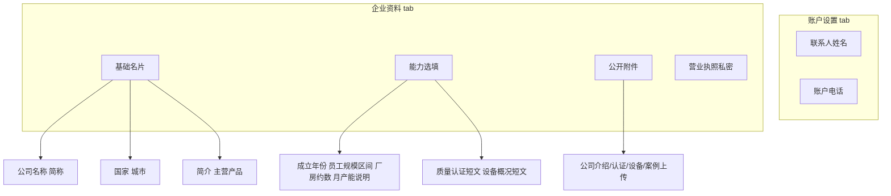

# 供应商企业资料整理 + 付款条件按平台

## 决策锁定

- **付款条件**：企业资料与**供应商报价提交表单**均剔除；展示/合同占位统一为平台默认文案「按平台确认」（与现有 [`backend/apps/contract/services.py`](backend/apps/contract/services.py) 回退一致）。
- **数据库字段暂不删除**（`FactoryProfile.payment_terms`、`Quote.payment_terms` 保留列），避免大迁移；改为前端不采集、接口忽略供应商写入、展示用平台默认。
- **本轮不做**认证多选勾选系统（改动大）；认证/设备仍以「选填短文 + 公开附件上传」为主。

## 表单信息架构（供应商 · 企业资料）

改造主文件：[`frontend/src/views/mypage/MyPageView.vue`](frontend/src/views/mypage/MyPageView.vue)

### A. 账户设置（`settings`）

- 仅保留：**联系人姓名**、**账户电话**（现有 `name` / `phone`）。
- 企业资料 tab 不再混排这两项，避免「姓名是公司还是联系人」困惑。

### B. 企业资料 · 基础名片（买家可见核心）

| 字段 | 处理 |
|------|------|
| 公司名称 | 保留；前端标必填提示（提交仍可 partial，但空公司名给出校验提示） |
| 简称 | 保留，选填 |
| 国家 + 城市 | 保留；**隐藏「地区」输入框**（保存时 `region` 置空或与 country 对齐，兼容旧数据读） |
| 简介 | 保留，选填；placeholder 引导写擅长工艺 |
| 主营产品 | 保留，选填但文案强调「建议填写」 |
| 联系电话 `contact_phone` | **UI 去掉**；保存时自动同步为账户 `phone`（私密字段仍可由后端持有） |

### C. 企业资料 · 能力选填（全选填，降门槛）

| 字段 | 处理 |
|------|------|
| 成立年份 | 保留 number，选填 |
| 员工规模 | 改为**区间下拉**：如 `<20` / `20-50` / `50-100` / `100-300` / `300+` / 不填写 |
| 厂房面积 | 保留；label/hint 改为「约数㎡，可不填」 |
| 月产能 | 保留；hint「按你们习惯描述即可，可不填」 |
| 质量认证 / 设备概况 | 保留短 textarea；hint 引导「也可在下方上传证书/设备资料」 |
| **付款条件** | **删除输入框**；`profileForm` / `onSaveProfile` 不再读写 `payment_terms` |

### D. 公开附件 + 执照

- 强化 hint：文字填不全可用附件；买家可见说明保持「不含联系方式与营业执照」。
- 营业执照上传逻辑不变（私密）。

分组 UI：用 `h3` 小节标题 + 短说明（i18n），不做营销化卡片堆叠；保持现有 `form-box` 风格。

## 付款条件 · 平台为准（全链路）

### 1. 企业资料

- 前端：去掉 [`MyPageView.vue`](frontend/src/views/mypage/MyPageView.vue) 中付款条件控件与 payload。
- 后端：[`SupplierProfileUpdateSerializer`](backend/apps/accounts/serializers.py) **从 writable fields 移除** `payment_terms`（读 serializer 可仍带字段但前端不展示；或读侧固定不返回——优先写侧拒绝更新即可）。
- 管理后台：[`admin/src/views/SuppliersView.vue`](admin/src/views/SuppliersView.vue) 编辑表单去掉付款条件项。

### 2. 供应商报价提交

- [`frontend/src/views/supplier/QuoteRequestDetailView.vue`](frontend/src/views/supplier/QuoteRequestDetailView.vue)：去掉付款条件输入；提交时不传或传空。
- 后端报价创建/更新：忽略客户端 `payment_terms`，**服务端写入平台默认**（常量如 `按平台确认`，或空字符串 + 展示层统一文案）。优先：**存库为「按平台确认」**，展示与合同一致。
- 买家侧 [`QuoteDetailModal.vue`](frontend/src/components/QuoteDetailModal.vue)、[`MyRfqDetailView.vue`](frontend/src/views/rfq/MyRfqDetailView.vue)：空值时显示「按平台确认」；已有值历史数据仍显示原文，新单均为平台文案。
- 管理后台 [`admin/src/views/RfqsView.vue`](admin/src/views/RfqsView.vue) 代填报价：付款条件改为只读展示「按平台确认」，或隐藏输入自动带默认值。

### 3. 合同

- [`contract/services.py`](backend/apps/contract/services.py) 已有 `quote.payment_terms or "按平台确认"`；在报价落库默认后可简化为直接取 `quote.payment_terms`（仍保留 or 兜底）。

## i18n

在 [`frontend/src/i18n/index.js`](frontend/src/i18n/index.js)（及 admin 对应文案）补充：

- 分组标题：`mypage.profileSectionBasic` / `profileSectionCapability` / `profileSectionAttachments`
- 选填 hint、员工规模选项、`paymentTermsPlatform`（按平台确认）
- 联系人姓名可用现有 `account.name`，必要时改为「联系人姓名」文案（四语）

## 验收标准

1. 供应商企业资料页无「付款条件」；无重复「联系电话」；地区栏隐藏；字段按基础/能力/附件分组。
2. 供应商提交/修改报价无付款条件输入；新报价详情与合同占位为「按平台确认」。
3. 账户设置仅姓名+电话；企业资料保存成功，公开附件与执照流程无回归。
4. Admin 供应商编辑与代报价不再手填工厂/报价付款条件。
5. 不删 DB 列；旧 `payment_terms` 数据不强制清洗。

## 实施顺序

1. 后端：报价写入平台默认；`SupplierProfileUpdateSerializer` 去掉 `payment_terms`
2. 前端供应商企业资料：分组重构 + 剔除付款条件/联系电话/地区 + 员工规模下拉
3. 前端报价页与买家展示：去掉输入、统一平台文案
4. Admin 两处表单同步
5. i18n + 构建/冒烟
