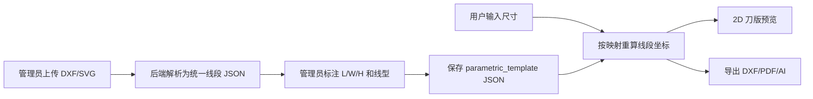

# 刀版半自动参数化导入器方案

## 目标与范围

目标：解决“盒型太多，不能逐个写专属公式”的问题。把真实 DXF/SVG 刀版导入为可参数化模板，管理员人工标注 L/W/H/厚度相关映射，系统保存为内部 JSON，用户输入尺寸后按映射重算线段并导出。

本期做：
- 支持 DXF、SVG 作为主解析格式。
- 支持 AI/PDF 作为附件保存和下载，不作为主解析格式。
- 后端解析 DXF/SVG 为统一线段 JSON。
- 管理端提供人工标注 L/W/H 映射、线型语义、基准尺寸的界面。
- 用户端优先使用映射模板生成预览和 DXF/PDF/AI 导出；无映射时回退现有 `engine_key` 公式。
- 保留现有 0201/0210/0427/0713/0716 引擎作为基础兜底。

本期不做：
- 不做 AI 私有格式深度解析。
- 不做完整 CAD 编辑器。
- 不做任意拓扑自由表达式编辑器。
- 不做 artwork 贴合。
- 不做 3D 预览。
- 不承诺“无需盒厂确认即可投产”，仍标注为生产参考级。

## 推荐技术路线

后端优先：
- `ezdxf`：解析和生成 DXF。
- `svgpathtools`：解析 SVG path、line、polyline。
- `shapely`：做线段包围盒、交点、几何归类和容差判断。

前端优先：
- 继续使用 SVG 渲染现有刀版预览。
- 管理端标注界面先用 SVG + 原生鼠标事件实现 MVP；如果交互复杂，再引入 `konva`。
- 暂不引入大型 CAD 前端库，避免复杂度失控。

## 架构流程

## 数据结构设计

1. 新增刀版资产版本模型
- 新建 `DielineTemplateAsset`，不要继续把所有字段塞进 `DielineTemplate`。
- 字段建议：`template`、`source_file`、`source_format`、`parsed_geometry`、`mapping_schema`、`base_dimensions`、`mapping_status`、`parse_errors`、`is_active`、`version`、`created_at`、`updated_at`。
- `DielineTemplate` 保留现有 `engine_key` 与 `production_asset`，新增一个“当前启用参数化资产”的关联或通过 `DielineTemplateAsset.is_active` 查询。

2. 统一线段 JSON
- 基础字段：单位、画布 bbox、线段列表、图层、颜色、线型。
- 线段实体：`line`、`polyline`、`arc`、`path_segment`。
- 每条线生成稳定 `entity_id`，供人工标注保存。
- 线型语义：`cut`、`crease`、`bleed`、`dimension`、`ignore`。

3. 参数映射 JSON
- `base_dimensions`：导入时的基准 L/W/H/T。
- `dimension_refs`：管理员选择哪些两条线或两个点代表 L/W/H。
- `entity_roles`：每条线的 cut/crease/bleed/ignore。
- `transform_rules`：每组点随 L/W/H 如何移动。
- MVP 只支持水平/垂直正交刀版，复杂斜线和曲线先按所属点组跟随移动。

## 实现步骤

1. 后端依赖与解析服务
- 在后端依赖文件中增加 `ezdxf`、`svgpathtools`、`shapely`。
- 新建解析模块，例如 `[backend/apps/simplequote/dieline_import.py](backend/apps/simplequote/dieline_import.py)`。
- 实现 `parse_dxf(file)`、`parse_svg(file)`，输出统一 `parsed_geometry`。
- 对 AI/PDF 返回明确错误：只保存附件，不进入参数映射解析。

2. 模型与迁移
- 新增 `DielineTemplateAsset` 模型和迁移。
- 所有新字段必须 `null=True` 或有默认值，符合迁移规范。
- 已有 `production_asset` 不删除，作为兼容字段保留。

3. 管理端 API
- 新增管理员接口：上传资产、查看解析结果、保存映射、启用资产版本、删除资产版本。
- 路由保持资源语义，例如：`admin/dieline-templates/<id>/assets`。
- 权限沿用当前管理员权限类，不对普通用户开放写操作。
- 返回结构包含稳定 `code/message/data`，错误包含可读 `message` 与结构化 `errors`。

4. 管理端标注界面
- 在 `[admin/src/views/DielineTemplatesView.vue](admin/src/views/DielineTemplatesView.vue)` 中增加“参数化资产”区域，或拆成独立组件。
- 上传 DXF/SVG 后显示解析线稿。
- 管理员完成四类标注：线型语义、基准 L/W/H、控制点/控制线、默认尺寸。
- MVP 交互先做“点选线段 + 表单选择角色”，不做拖拽 CAD 编辑。

5. 用户端生成逻辑
- 扩展 `[frontend/src/lib/packaging/fefcoCatalog.ts](frontend/src/lib/packaging/fefcoCatalog.ts)`，接收 `parametric_asset_status` 和当前资产摘要。
- 新增前端变换模块，例如 `[frontend/src/lib/packaging/parametricTemplate.ts](frontend/src/lib/packaging/parametricTemplate.ts)`。
- `BoxGeneratorView` 判断：有已启用映射资产时走 `parametricTemplate`，否则走现有 `boxEngine`。
- 导出 DXF/PDF/AI 使用同一套变换后的线段，避免预览和导出不一致。

6. 后端计算口径同步
- 新增后端 `render_parametric_dieline(template_asset, L/W/H/T)` 服务，输出线段和面积。
- 报价面积以后端重算结果为准。
- 前端预览可先本地计算，但要用同一份 mapping schema，避免前后端公式分叉。

7. 测试与验收
- 准备两个最小样例：一个 DXF、一个 SVG。
- 后端测试覆盖：解析成功、AI/PDF 拒绝解析、无效文件错误、保存映射、按尺寸重算 bbox。
- 前端测试覆盖：映射模板优先级、无映射回退 `engine_key`、导出包含 cut/crease。
- 构建验证：backend check、frontend packaging test、admin build、frontend build。

## 风险与缓解

- AI 解析不稳定：AI 只作为附件，要求生产参数化源文件使用 DXF/SVG。
- 不同 DXF 图层命名不统一：解析时保留 layer/color/linetype，管理员人工确认线型语义。
- 任意拓扑变形复杂：MVP 限定正交刀版和点组平移，复杂结构标记为需人工复核。
- 前后端计算不一致：后端作为报价权威，前端只做预览；两端共用同一 JSON schema。
- 盒型数量大导致配置成本高：通过资产版本复制、模板克隆、批量导入降低重复标注成本。
- 文件安全风险：限制文件类型和大小，解析过程不执行外部脚本，失败返回结构化错误。

## 验收标准

1. 管理员可上传一个 DXF 或 SVG，系统能显示解析后的线稿。
2. 管理员可把线段标记为 cut/crease/bleed/ignore。
3. 管理员可标注 L/W/H 基准映射并保存。
4. 用户选择有映射资产的盒型时，预览不再走简化公式，而是根据导入模板变尺寸。
5. 同一模板输入不同 L/W/H 时，导出的 DXF/PDF/AI 与预览线段一致。
6. 上传 AI/PDF 时系统不会假装可参数化解析，只提示“可保存为附件，需 DXF/SVG 才能参数化”。
7. 没有映射资产的旧模板继续按现有 `engine_key` 正常预览与报价。

## 分阶段建议

第一阶段 MVP：DXF/SVG 解析、线型标注、L/W/H 基准标注、用户端按映射重算。

第二阶段增强：自动识别图层语义、批量导入、模板克隆、映射复制、曲线/圆弧更精细变形。

第三阶段再考虑：AI/PDF 辅助提取、复杂表达式、3D 预览、artwork 贴合。