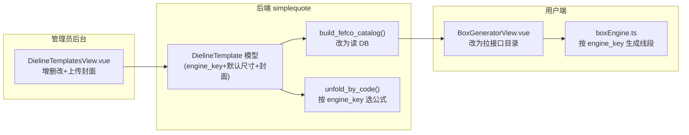

# 刀版参数化模板库（阶段一）

## 背景与结论（已与用户澄清）

- 现状：盒型目录**硬编码**在 [`backend/apps/simplequote/fefco_catalog.py`](backend/apps/simplequote/fefco_catalog.py) 与 [`frontend/src/lib/packaging/fefcoCatalog.ts`](frontend/src/lib/packaging/fefcoCatalog.ts)；刀版线段由 [`frontend/src/lib/packaging/boxEngine.ts`](frontend/src/lib/packaging/boxEngine.ts) 按 `boxCode` 实时生成，不落库。
- 目标：建「刀版模板库」，管理员可维护、用户可选并按 **制造/内/外 L/W/H** 调整导出。
- 关键事实（Pacdora 研究印证）：专业平台都是「策展式**参数化模板库** + 选型调尺寸导出」，不做「上传成品死图自动参数化」。因此本期**上传文件仅作模板参考封面图**，几何仍由参数化引擎生成。
- 范围：**阶段一**。全新拓扑的表达式引擎/半自动 DXF 导入器属阶段二，明确不做。

## 架构

## 后端改动（`backend/apps/simplequote`）

### 1. 新模型 `DielineTemplate`（[`models.py`](backend/apps/simplequote/models.py)）

字段：`code`(唯一, 如 `0201`)、`category_code`、`engine_key`(枚举: `slotted_rsc`/`mailer_folder`/`tuck_end`/`auto_lock_bottom`)、`name_i18n`(JSONField 多语)、`desc_i18n`(JSON)、`default_length_mm/width_mm/height_mm/thickness_mm`、`default_glue_tab_mm`、`allowances`(JSON, 可空覆盖板厚容差)、`priority`、`quote_enabled`、`preview_enabled`、`sort_order`、`is_active`、`thumbnail`(ImageField `upload_to="dieline_template/%Y/%m/"`)、`created_at`/`updated_at`。

### 2. 迁移 + 数据回填

- `makemigrations` 生成建表迁移。
- 数据迁移：把现有 `FEFCO_BOX_TEMPLATES` 4 条（0201/0427/0713/0716）+ 默认参考尺寸（复用 [`boxPresets`](frontend/src/lib/packaging/boxPresets.ts) 的参考值）写入 DB，保证升级后不空库。
- 遵循 [`.cursor/skills/backend-migration-and-model/SKILL.md`](.cursor/skills/backend-migration-and-model/SKILL.md)。

### 3. 目录改为 DB 驱动（[`fefco_catalog.py`](backend/apps/simplequote/fefco_catalog.py)）

- `build_fefco_catalog()`：查询 `DielineTemplate.objects.filter(is_active=True)` 组装 `categories/templates/by_category`，模板项附 `thumbnail_url`。DB 为空时回退现有硬编码常量（安全兜底）。
- `get_box_template(code)`：改查 DB。

### 4. 展开公式按 engine_key 路由（[`packaging.py`](backend/apps/simplequote/packaging.py)）

- `unfold_by_code`：由模板的 `engine_key` 选择 `UNFOLD_HANDLERS`，`glue_tab_mm`/`allowances` 优先取模板配置，回退默认。
- `UNFOLD_HANDLERS` 键从盒型码改为 `engine_key`（4 个公式函数不变）。

### 5. 序列化器 + 管理员 CRUD（[`serializers.py`](backend/apps/simplequote/serializers.py) / [`views.py`](backend/apps/simplequote/views.py) / [`urls.py`](backend/apps/simplequote/urls.py)）

- `DielineTemplateSerializer`（含 `thumbnail` 只读 URL）。
- `AdminDielineTemplateView`(GET 列表/POST 创建, `MultiPartParser`)、`AdminDielineTemplateDetailView`(PATCH/DELETE)，`permission_classes=[IsAdminRole]`，仿现有 `AdminQuoteParamView`。
- 路由：`admin/dieline-templates`、`admin/dieline-templates/<int:pk>`。
- `FefcoCatalogView` 无需改签名（`build_fefco_catalog()` 内部已改 DB）。

## 管理员前端（`admin/src`）

- 新增 [`admin/src/views/DielineTemplatesView.vue`](admin/src/views/DielineTemplatesView.vue)：仿 [`QuoteParamsView.vue`](admin/src/views/QuoteParamsView.vue) 的 el-table + 创建/编辑弹窗；字段含 code、category、engine 下拉、默认 L/W/H/厚度、glue tab、启用开关、封面 `el-upload`（multipart），支持删除。
- [`admin/src/api/index.js`](admin/src/api/index.js)：`fetchDielineTemplates` / `saveDielineTemplate`(FormData) / `updateDielineTemplate` / `deleteDielineTemplate`。
- [`admin/src/router/index.js`](admin/src/router/index.js) + [`admin/src/layouts/AdminLayout.vue`](admin/src/layouts/AdminLayout.vue) 菜单项 + [`admin/src/i18n/index.js`](admin/src/i18n/index.js) 文案。

## 用户前端（`frontend/src`）

- [`BoxGeneratorView.vue`](frontend/src/views/packaging/BoxGeneratorView.vue)：`onMounted` 调用已存在的 [`fetchFefcoCatalog`](frontend/src/api/index.js)（DB 驱动），用响应替换当前本地 `categoriesWithTemplates()`；盒型库卡片展示 `thumbnail`；选中模板时用后端 `default_*` 预填 L/W/H/厚度。
- [`boxEngine.ts`](frontend/src/lib/packaging/boxEngine.ts) `buildPreview`：分支由 `boxCode` 改为按模板 `engineKey` 选 `build0201Segments`/`build0427Segments`/展开轮廓，使**新增同族盒型码**也能正确渲染。
- [`fefcoCatalog.ts`](frontend/src/lib/packaging/fefcoCatalog.ts)：保留类型定义与离线兜底，运行时以接口数据为准。
- 导出 PDF/AI/DXF 已具备，无需改。

## 测试与自检

- 后端：`DielineTemplate` 单测 + `unfold_by_code` 按 engine_key 回归（扩展 [`tests/test_packaging.py`](backend/apps/simplequote/tests/test_packaging.py)）。
- 前端：`npm run test:packaging` 保持通过；`npm run build`。
- 按 [`.cursor/skills/self-check-after-change/SKILL.md`](.cursor/skills/self-check-after-change/SKILL.md) 自检；部署 `docker compose restart backend frontend admin caddy`。

## 文档同步

- [`project/纸盒包装生成器方案书 V1.0.md`](project/纸盒包装生成器方案书 V1.0.md) §13、[`project/简单报价系统.md`](project/简单报价系统.md) §8.12、[`MASS CONNECTED 平台文档.md`](MASS CONNECTED 平台文档.md)、[`OEM-平台开发完成清单.md`](OEM-平台开发完成清单.md)：补充「刀版模板库（DB 驱动，管理员可维护）」。

## 明确不做（阶段二/后续）

- 上传 DXF/CF2/SVG **半自动参数化导入器**（解析线段+人工标注 L/W/H 映射）。
- 全新拓扑的 L/W/H 表达式引擎与管理员图形化模板编辑器。
- artwork（图案）贴合与 3D 预览。
- 上传成品图**自动**转参数化（技术不可靠，业内也不做）。
