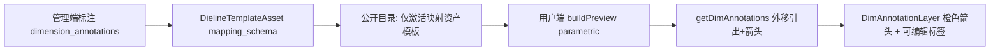

# 参数化尺寸箭头 + 内置模板清理

## 背景与根因

- 现状数据库 6 个模板：`01`、`0201` 有已激活映射资产（保留）；`0210`/`0427`/`0713`/`0716` 无任何资产（纯内置 engine 模板，删除）。
- 参数化尺寸「只有数字没箭头」根因：尺寸线颜色 `DIM_COLOR='#2563eb'` 与裁切线 `cut='#2563eb'` 同色，且参数化标注按管理员标注坐标**原样画线**（常压在裁切线上），于是箭头被裁切线吞没，只剩带底色的数字可见。
- 内置模板由 migrations `0003`~`0006` 的 `RunPython` 生成，无显式 builtin 字段，通过 `assets` 是否存在区分。

## 目标与范围

做：
1. 参数化模板尺寸改为工程制图风格：尺寸线**外移到图形外侧** + **引出线** + 双端箭头，用醒目颜色（橙 `#f59e0b`）区分裁切线，标签仍可点击编辑。
2. 公开盒型库只展示「有激活映射资产」的模板（内置/无资产模板对用户不可见）。
3. 新增数据迁移，删除无参数化资产的模板（当前删 4 个；新库部署后同样只保留带资产模板）。

不做：
- 不删除后端 `packaging.py` engine 展开公式与前端 engine 绘制代码（保留为休眠代码，避免大范围重构风险）。
- 不改管理端模板增删流程（管理端仍可管理全部模板；`engine_key` 字段保留）。
- 不做 OCR、不改 `mapping_schema` 数据结构。

## 数据流

## 实现步骤

### 步骤 1 - 参数化尺寸箭头（工程制图风格）

主改 [`frontend/src/lib/packaging/boxEngine.ts`](frontend/src/lib/packaging/boxEngine.ts)：

- 新增 `PARAM_DIM_COLOR = '#f59e0b'` 与对应线样式常量（含 `marker-start/marker-end`）。
- 重写 `makeConfiguredDimAnnotation`：入参增加内容 bbox（来自 `preview` 的线稿范围）。逻辑：
  - 水平标注：尺寸线 Y 外移到 bbox 上/下缘外侧（按标注中点靠近哪侧决定方向），从原标注两端点画**引出线**到外移尺寸线，再画带箭头的尺寸线；`labelX/Y` 落在外移尺寸线中点。
  - 垂直标注：同理沿 X 方向外移 + 水平引出线。
  - `arrowSvg` 输出「两条引出线（细）+ 一条带双箭头尺寸线」，均用橙色。
- `getDimAnnotations`：解析 `preview.viewBox`（或由 `segments` 计算）得到内容 bbox，传入 `makeConfiguredDimAnnotation`。

[`frontend/src/lib/packaging/parametricTemplate.ts`](frontend/src/lib/packaging/parametricTemplate.ts)：`TransformedDimensionAnnotation` 已有 `x1..y2`，无需改；如需外移方向可复用 `viewBoxFromSegments` 的 bbox。

### 步骤 2 - viewBox 扩展，避免外移箭头被裁剪

外移尺寸线会超出现有 `viewBoxFromSegments` 的 padding。为保证线稿层与标注层对齐且不裁剪：

- [`frontend/src/lib/packaging/boxEngine.ts`](frontend/src/lib/packaging/boxEngine.ts)：`renderPreviewLinesSvg(preview, overrideViewBox?)` 支持传入覆盖 viewBox。
- [`frontend/src/views/packaging/BoxGeneratorView.vue`](frontend/src/views/packaging/BoxGeneratorView.vue)：新增 `dimViewBox` computed = `preview.viewBox` 与所有 `dimAnnotations` 几何（引出线端点 + 标签框）的并集 bbox；`previewLinesSvg` 与 `<DimAnnotationLayer :view-box>` 统一使用 `dimViewBox`，保证坐标系一致。

### 步骤 3 - 尺寸叠加层配色

[`frontend/src/components/packaging/DimAnnotationLayer.vue`](frontend/src/components/packaging/DimAnnotationLayer.vue)：

- `DIM_COLOR` 及 `#dim-arrow` marker `fill` 改为橙 `#f59e0b`；标签按钮/输入框文字与描边同步改橙，保留白色底 + hover 逻辑（`pointer-events` 不变，仍可点击编辑）。

### 步骤 4 - 公开目录仅展示带资产模板

[`backend/apps/simplequote/fefco_catalog.py`](backend/apps/simplequote/fefco_catalog.py) 的 `build_fefco_catalog`：

- `tpl_qs` 增加过滤：仅保留存在 `assets(is_active=True, mapping_status='mapped')` 的模板（例如 `.filter(assets__is_active=True, assets__mapping_status='mapped').distinct()`）。
- 组装 `by_category` 后**剔除无模板的空分类**，避免前端出现空分类。
- `get_box_template` 保持按 code 查询（用户端报价/预览依赖），但因 catalog 已过滤，用户不会选到无资产模板。

前端 [`frontend/src/lib/packaging/fefcoCatalog.ts`](frontend/src/lib/packaging/fefcoCatalog.ts) 的 `categoriesWithTemplates` 复核：确保按后端返回渲染，空分类不显示。

### 步骤 5 - 删除内置模板（数据迁移）

在 [`backend/apps/simplequote/migrations/`](backend/apps/simplequote/migrations/) 新增迁移（依赖当前最新迁移），`RunPython`：

- 正向：删除 `DielineTemplate.objects.filter(assets__isnull=True)`（无任何资产的模板），级联删除无。反向 `noop`。
- 效果：当前库删除 `0210/0427/0713/0716`，保留 `01/0201`。
- 新库部署顺序：seed 迁移先建内置模板 → 本迁移在其后执行，因新库无资产而将其全部删除 → 空目录，符合「仅上传资产才生成模板」策略。

### 步骤 6 - 验证与部署

- 前端：`cd frontend && npm run test:packaging`（更新/复核参数化箭头断言）、`npm run build`。
- 后端：`docker compose exec backend python manage.py migrate`，再次查询确认仅 `01/0201` 保留。
- 重启：`docker compose restart frontend backend`。
- 人工验收：用户端选 `0201`，尺寸线在图形外侧、橙色双箭头、含引出线，点击数字可编辑并联动重算；目录中不再出现 `0210/0427/0713/0716`。

## 风险与缓解

- 外移方向对非常规布局可能不理想：按标注中点相对 bbox 中心选择外移侧，必要时给最小外移间距；先在 `0201` 验证。
- viewBox 扩展导致线稿变小：仅按需扩展（并集 bbox），并复用同一 viewBox 保证对齐。
- 新库空目录：属预期策略结果，管理端上传并激活映射后即出现，需在交付说明中提示。
- 目录过滤误伤 draft 资产模板：仅隐藏于用户端，管理端仍可见并继续完成映射/激活。

## 验收标准

1. 用户端参数化模板尺寸显示为「外移尺寸线 + 引出线 + 双端箭头（橙色）」，清晰可辨起止范围。
2. 尺寸数字仍可点击编辑并触发尺寸联动重算。
3. 公开盒型库仅出现带激活映射资产的模板；空分类不显示。
4. 迁移执行后当前库仅剩 `01`、`0201`。
5. `npm run test:packaging` 与前端 `build` 通过；后端 `migrate` 成功。

## 涉及文件

- 前端：[`frontend/src/lib/packaging/boxEngine.ts`](frontend/src/lib/packaging/boxEngine.ts)、[`frontend/src/views/packaging/BoxGeneratorView.vue`](frontend/src/views/packaging/BoxGeneratorView.vue)、[`frontend/src/components/packaging/DimAnnotationLayer.vue`](frontend/src/components/packaging/DimAnnotationLayer.vue)、[`frontend/src/lib/packaging/dielineAssertions.ts`](frontend/src/lib/packaging/dielineAssertions.ts)（断言）
- 后端：[`backend/apps/simplequote/fefco_catalog.py`](backend/apps/simplequote/fefco_catalog.py)、`backend/apps/simplequote/migrations/`（新增数据迁移）
