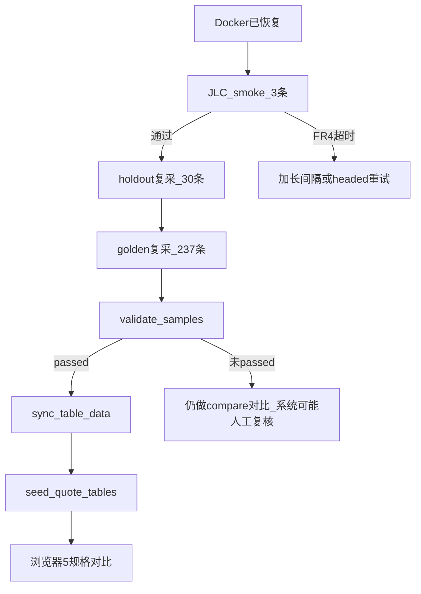

# JLC 复采与浏览器价格对比

## 当前状态与目标

| 项 | 现状 | 目标 |
|---|---|---|
| Docker | **已恢复**（2026-07-10 用户重启；6 服务 Up，mysql/redis healthy） | 保持 running，E2E 前确认 `:80` 可访问 |
| Live 样本 | golden=25 dom / holdout=4 dom（门槛 60/20） | 达标并完成验证 |
| 验证状态 | [`scripts/jlc-cn-pcb-validation-report.json`](scripts/jlc-cn-pcb-validation-report.json) `pending_live_resample` | `passed` 或明确 `validation_failed` |
| 自动报价 | [`backend/apps/simplequote/table_data.py`](backend/apps/simplequote/table_data.py) 全部 `enabled=False` | 通过材料启用精确查表 |

复采脚本 [`scripts/jlc-cn-browser-sample.mjs`](scripts/jlc-cn-browser-sample.mjs) 已具备 DOM 优先、`freshContextPerSample`、2 次重试；**整批结束后才写文件**，中途 kill 会丢失进度，需一次性跑完或改成分批 targets JSON。



---

## 阶段 1：Docker 环境（已完成）

用户已手动重启 Docker Desktop。当前 `docker compose ps` 结果：

- `mysql`、`redis`：healthy
- `backend`、`frontend`、`caddy`、`admin`：Up（约 6 分钟）
- 入口：`http://localhost/`（caddy `:80`）

**实施前快速确认**（若服务已 Up 可跳过 rebuild）：

```powershell
docker compose ps
curl -s -o NUL -w "%{http_code}" http://localhost/
```

若需拉最新代码后重启：

```powershell
cd "c:\Users\ROG STRIX\Desktop\OEM.co"
docker compose up -d --build
```

---

## 阶段 2：JLC 复采（当前主任务）

> Docker 已就绪，可直接开始本阶段；与阶段 3/4 无并行依赖。

### 2.1 预检 smoke（约 2–5 分钟）— **下一步**

确认 JLC 页面可加载（上次失败：`button:has-text("FR-4")` 90s 超时）：

```powershell
node scripts/jlc-cn-browser-sample.mjs smoke scripts/jlc-cn-browser-smoke-v2.json
```

- **通过**：3 条均有 `priceSource: "dom"` 且无 error → 继续全量。
- **失败**：先排查网络/JLC 限流；可将 [`scripts/jlc-cn-browser-sample.mjs`](scripts/jlc-cn-browser-sample.mjs) 中 `await sleep(2500)` 临时改为 `5000`，或改用 `headless: false` 再试 smoke；仍失败则暂停全量，避免再写半成品 JSON。

### 2.2 Holdout 复采（30 条，约 20–40 分钟）

```powershell
node scripts/jlc-cn-browser-sample.mjs pcb-holdout scripts/jlc-cn-pcb-holdout-samples.json
```

输出写入 [`scripts/jlc-cn-pcb-holdout-samples.json`](scripts/jlc-cn-pcb-holdout-samples.json)。门禁需 **≥20 条** `priceSource === "dom"` 且 notes 不含 `legacy`。

> 建议先跑 holdout（样本少、更快验证门禁下限），再跑 golden 长跑。

### 2.3 Golden 全量复采（237 条，约 2–4 小时）

```powershell
node scripts/jlc-cn-browser-sample.mjs pcb-golden scripts/jlc-cn-pcb-golden-samples.json
```

- 样本规模：FR-4 70×3 + FPC 9×3 = **237**（`buildPcbGoldenSamples()` + `repeatSamples(..., 3)`）。
- **后台长跑**：勿中断进程；完成后文件应含 237 条（含 error 条目需统计成功 dom 数）。
- 若多次超时，可拆批：用 [`scripts/jlc-cn-pcb-golden-targets.json`](scripts/jlc-cn-pcb-golden-targets.json) 分段运行后手动合并 JSON（当前脚本无 resume，拆批需小改或手工 merge）。

### 2.4 验证与价格表生成

```powershell
node scripts/jlc-cn-pcb-validate-samples.mjs
```

检查 [`scripts/jlc-cn-pcb-validation-report.json`](scripts/jlc-cn-pcb-validation-report.json)：

- **硬门槛**：`liveGolden >= 60` 且 `liveHoldout >= 20`
- **精度门槛**：整体 / FR-4 / FPC 的 Hit@20% ≥ 80%，`maxRelativeError <= 100%`
- **`status === "passed"`** 时才会在 [`scripts/jlc-cn-pcb-manufacturing-price-list.json`](scripts/jlc-cn-pcb-manufacturing-price-list.json) 中 `enabled=true`

若未 passed：记录 `reason` 与 holdout 明细（尤其 **FR-4 4层 100×150 qty5** 的 212.5 vs 265 分歧），仍进入阶段 4 做 compare，但系统可能继续人工复核。

---

## 阶段 3：同步后端并 seed（仅验证 passed 时启用自动报价）

```powershell
node scripts/jlc-cn-pcb-sync-table-data.mjs
docker compose exec backend python manage.py seed_quote_tables
cd frontend && npm run build && cd ..
docker compose restart caddy frontend backend
```

回归测试（本地或容器内）：

```powershell
docker compose exec backend python -m pytest apps/simplequote/tests/test_pcb_manufacturing_quote.py -q
```

确认 DB 中 `manufacturing_price_meta.validation_status` 与 seed 一致。

---

## 阶段 4：浏览器端到端价格对比

### 4.1 JLC 侧基准价（5 规格）

使用已有对比集 [`scripts/jlc-cn-browser-compare-targets.json`](scripts/jlc-cn-browser-compare-targets.json)：

```powershell
node scripts/jlc-cn-browser-sample.mjs scripts/jlc-cn-browser-compare-targets.json scripts/jlc-cn-browser-compare-live.json
```

| ID | 规格 | 历史关注点 |
|---|---|---|
| COMPARE-001 | FR-4 2L 100×100 qty5 | 基准 ¥30 |
| COMPARE-002 | FR-4 2L 100×150 qty10 | 基准 ¥70.5 |
| COMPARE-003 | FR-4 4L 100×150 qty5 | **212.5 vs 265 待确认** |
| COMPARE-004 | FR-4 4L 100×100 qty5 | 基准 ¥60 |
| COMPARE-005 | FPC 2L 100×150 qty20 | DOM 应为 ¥406 |

### 4.2 OEM 系统侧（`/simple-quote`）

1. 登录：路由需 `requiresAuth` + `requiresBuyer`（[`frontend/src/router/index.js`](frontend/src/router/index.js)）；使用已有 member 账号，或注册新 buyer。
2. 打开 `http://localhost/simple-quote`，选择 **PCB 开发** 报价类型。
3. 勾选 **包含 PCB 制造费**，逐条输入上表 5 个规格，提交预览/创建报价。
4. 记录 API 返回 [`backend/apps/simplequote/calculator.py`](backend/apps/simplequote/calculator.py) 中的 **`jlc_estimate_cny`**（JLC 原价，非含 margin 的 `customer_quote_cny`）。
5. 核对 UI：[`SimpleQuoteView.vue`](frontend/src/views/quote/SimpleQuoteView.vue) 的 `validation_status`、是否 `requires_manual_review`。

### 4.3 对比判定

对每个规格：

- **一致**：`|系统 jlc_estimate_cny - JLC domPriceCny| / JLC domPriceCny <= 20%`（与 Hit@20% 口径一致）
- **不一致**：记录规格、系统价、JLC DOM 价、`validation_status`、是否命中价格表

产出简短对比表（5 行 + 总结），作为验收结论。

---

## 风险与回退

- **JLC 限流/页面改版**：smoke 失败则不跑 237 条；优先 holdout + compare 5 条完成浏览器对比。
- **验证未 passed**：不强行启用 `enabled=True`；浏览器对比仍可做，预期制造费走人工复核（[`calculator.py`](backend/apps/simplequote/calculator.py) 中 `validation_status != "passed"` 逻辑）。
- **Docker 再次异常**：复采与 validate 可独立完成；E2E 阻塞直至引擎恢复。
- **复采进程被 kill**：输出文件可能只剩少量条目；需整批重跑 golden。

---

## 验收标准

1. ~~`docker compose ps` 正常~~（已完成）；`:80` 可访问。
2. `liveGolden >= 60` 且 `liveHoldout >= 20`；验证报告非 `pending_live_resample`。
3. 若 `passed`：5 个 compare 规格在 `/simple-quote` 的 `jlc_estimate_cny` 与 JLC DOM 价逐项一致（±20% 内）。
4. FPC 100×150 qty20 必须为 **¥406**；FR-4 4L 100×150 qty5 以本次 live DOM 为准更新表或保持人工复核。
5. 单测 6/6 通过；关闭制造费开关时总额行为不变。
