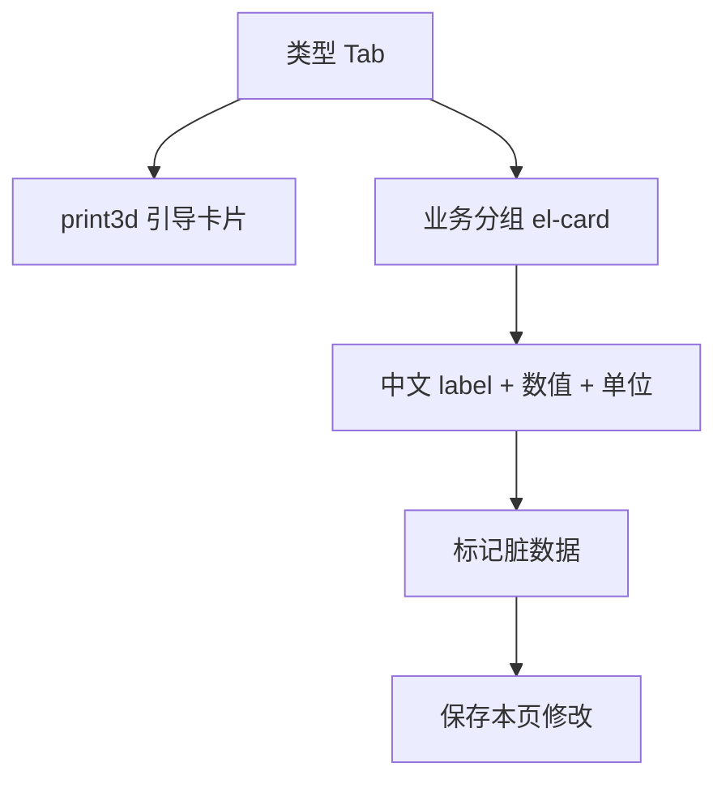

# 报价参数 · 业务分组配置台

## 目标

让管理员按「业务含义」改数值，而不是扫英文 `param_key` 表。保留类型 Tab；本轮不做各类型完全独立的试算台。

## 主改文件

- [`admin/src/views/QuoteParamsView.vue`](admin/src/views/QuoteParamsView.vue)：主 UI 重构
- 新建 [`admin/src/utils/quoteParamGroups.js`](admin/src/utils/quoteParamGroups.js)：分组规则 + 中文 meta 兜底
- [`admin/src/i18n/index.js`](admin/src/i18n/index.js)：分组标题、保存提示、3D 引导文案

后端 API 不变：继续 `GET/PATCH /admin/quote-params`。

## 交互结构

1. **顶部**：类型 Tab（已有）+ 搜索（过滤字段，跨组）+ 「保存本页修改」主按钮（有脏数据时高亮）
2. **print3d Tab**：顶部 `el-alert` 说明日常请用「3D 打印报价」专用页，按钮跳转 `/print3d-config`；本页仍可改底层数值参数（兼容）
3. **主体**：按组渲染 `el-card`，卡片内为表单项列表（非大表格）
4. **每项展示**：主文案 = `row.label` 或 meta 兜底中文；右侧 `el-input-number` + 单位；`param_key` 以小字次要信息显示
5. **高级**：保留「新建参数」入口（折叠或工具栏次要按钮），归属当前类型 + 落入「其他」组

## 分组规则（`quoteParamGroups.js`）

按 `param_key` 前缀/名单归组，未匹配进 `other`：

| 类型 | 分组示例 |
|------|----------|
| injection | `mold_base_*` 模具基础价；`unit_price_kg_*` 材料单价；`unit_base_*` 基础件价；`density_*` 密度；`slider_/precision_/loss_/color_/packaging_/profit_` 附加规则；`rmb_to_krw`/`moq_kg` 汇率与 MOQ |
| print3d | 成本/计价、材料兼容价、后处理、切片限制（按现有 `PRINT3D_PARAM_META` 键划分） |
| shipping | 汇率、LCL 无电池、LCL 含电池、PCB 配送 |
| pcba | 计分单价、附加费、默认计分、汇率 |
| pcb | 折扣/有效期/制造 margin |
| software / ic / paper_box | 无专用规则时整页一组「通用参数」，有 key 再按前缀扩展 |

每组含：`id`、`titleKey`（i18n）、`match(param_key) => boolean`。

## 中文说明兜底

在 `quoteParamGroups.js` 内嵌各类型 `META[param_key] = { label, unit }`：

- shipping / pcba / pcb / print3d：对齐后端已有 `*_PARAM_META`（[`table_data.py`](backend/apps/simplequote/table_data.py)、[`print3d_config.py`](backend/apps/simplequote/print3d_config.py)）
- injection：按 [`calculator.py`](backend/apps/simplequote/calculator.py) 注释补中文（如「ABS 模具基础价」「透明色加价率」）

展示优先级：`row.label` → meta.label → `param_key`；单位：`row.unit` → meta.unit。

本轮**不写库回填** label（避免无意覆盖运营自定义说明）。

## 脏数据与批量保存

- 加载后缓存 `originalValues[id] = value`
- 修改数值时若与 original 不同，记入 `dirtyIds`
- 「保存本页修改」：对 dirty 行 `Promise.all` 调现有 `updateQuoteParam(id, { value })`
- 成功后刷新 original、清空 dirty；失败提示条数
- 去掉每行单独「保存」按钮（避免双模式）

搜索：仅影响展示列表，不改变脏数据集合。

## i18n（ko/zh/en）

补充例如：
- `quoteParams.savePage` / `savePageHint` / `noDirty` / `savedCount`
- `quoteParams.print3dGuide` / `print3dGuideAction`
- 各 `groupMold` / `groupMaterialPrice` / … 分组标题

## 验收

1. 注塑等类型以分组卡片展示，中文说明可读，不必先懂 `param_key`
2. 改多项后一次「保存本页修改」全部生效
3. 进入 print3d Tab 可见专用配置引导与跳转
4. 搜索仍可用；新建参数仍可用
5. 无后端变更，admin 构建/重启后即可验证

## 不做

- 各类型独立试算页（注塑试算等）
- 删除 print3d 底层参数或合并两个后台页
- 数据库批量改写 label
