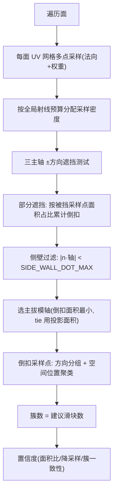

# 提升 STP 滑块推断准确度（3D 模型）

## 目标与范围

只改后端几何分析 [`backend/apps/simplequote/geometry.py`](backend/apps/simplequote/geometry.py) 的倒扣/滑块推断，使 `suggested_sliders`、`draw_direction` 更准；保持"建议值·需人工确认"的定位与现有返回字段兼容。

不改：计价公式、STP 解析主流程（体积/包围盒/重量）、前端计价链路。

## 当前算法的准确度短板（已核对代码）

```41:67:backend/apps/simplequote/geometry.py
def _face_props(face):
    ...
    u = (umin + umax) / 2.0
    v = (vmin + vmax) / 2.0
    props = GeomLProp_SLProps(surface, u, v, 1, 1e-6)
    ...
    return ((com.X(), com.Y(), com.Z()), (nx, ny, nz), area)
```

- **单点定生死**：每面仅取 UV 中点一个法向 + 质心，`_blocked` 只射两条线判定整面倒扣，曲面/大面误判高。
- **整面二值**：面要么全算倒扣要么不算，无部分遮挡概念。
- **滑块计数过粗**：`_cluster_slider_count` 仅按法向符号去重（≤6），同向但位置分离的多个倒扣被并成 1 个滑块 → 低估。
- **`SIDE_WALL_DOT_MAX=0.5` 定义未用**：顶底面噪声没过滤。
- **>800 面直接 skip**：复杂件无结果。

## 改进设计



### 1. 面上多点采样（替代单点）

新增 `_sample_face(face, n_pts)`：在有效 UV 范围网格采样多个点，逐点求法向与近似局部面积权重，返回 `[(point, normal, weight), ...]` 与总面积。用 `BRepClass_FaceClassifier`/UV 内点判定跳过裁剪孔外的点。

倒扣面积按**被两向遮挡的采样点权重占比 × 面积**累计，实现"部分倒扣"。

### 2. 固定射线预算 + 降采样（复杂件也出结果，保 20s）

新增常量：

```python
UNDERCUT_RAY_BUDGET = 60000        # 总射线次数上限(面×点×2向×3轴)
UNDERCUT_FACE_SAMPLE_MAX = 9       # 每面最多采样点(3x3)
UNDERCUT_FACE_SAMPLE_MIN = 1       # 面很多时降到质心单点
```

按 `face_count` 动态定每面采样点数：`pts = clamp(RAY_BUDGET / (face_count*6), MIN, MAX)`。面数超大时用面积排序取 Top-K 主要面 + 单点，其余忽略小面；返回 `sampling: {faces_used, pts_per_face, downsampled: bool}`。移除"直接 skip"，`too_many_faces` 改为 `downsampled`。

### 3. 启用侧壁过滤

仅当倒扣面法向与主拔模轴近似垂直（`abs(n·axis) < SIDE_WALL_DOT_MAX`）才纳入滑块候选，过滤顶/底面误判。

### 4. 滑块空间聚类（方向 + 位置）

替换 `_cluster_slider_count`，新增 `_cluster_sliders_spatial(undercut_samples, diag)`：

1. 先按侧向法向主方向分组（x±/y±/z±）。
2. 组内对采样点质心做距离阈值聚类（阈值 `= diag * 0.15`，简单并查集/贪心邻接）。
3. 每个空间簇 = 1 个滑块。总簇数即 `suggested_sliders`（用户已确认接受更贴近真实、可能比现在多）。

返回新增 `undercut_clusters: [{axis_side, centroid, area_ratio}]`，供前端未来可视化（本期前端可先不展示）。

### 5. 拔模轴选择改进

三主轴仍为候选；选倒扣面积最小者，若接近则用**沿该轴投影面积最大**tie-break（更符合实际开模面）。

### 6. 置信度细化

综合：倒扣面积占比、簇内采样一致性、是否 `downsampled`，输出 `high/medium/low` + `skipped_reason` 兼容字段。

## 返回结构（向后兼容）

```python
{
  "draw_direction": "Z",
  "undercut_area_ratio": 0.0731,
  "suggested_sliders": 3,          # 现字段, 语义更准
  "confidence": "medium",
  "undercut_clusters": [...],      # 新增, 可选消费
  "sampling": {"faces_used": 512, "pts_per_face": 4, "downsampled": true},  # 新增
}
```

前端 [`InjectionQuoteSheet.vue`](frontend/src/components/quote/InjectionQuoteSheet.vue) 现有展示（`draw_direction`/`suggested_sliders`/needReview）与回填逻辑 [`useInjectionQuote.ts`](frontend/src/composables/useInjectionQuote.ts) `applyStpSuggestions` **无需改动**即可工作；可选加一行小字显示置信度/是否降采样（轻量）。

## 文件改动清单

- [`geometry.py`](backend/apps/simplequote/geometry.py)：新增 `_sample_face`、`_cluster_sliders_spatial`、射线预算常量；重写 `analyze_undercut`；启用 `SIDE_WALL_DOT_MAX`；`_parse_step_sync` 传入 `face_count` 以定采样密度。
- [`backend/apps/simplequote/tests/test_geometry.py`](backend/apps/simplequote/tests/test_geometry.py)：新增用例（无倒扣 box → 0 滑块；带 2 个分离侧向凹槽 → ≥2 滑块；降采样路径不报错）。OCP 缺失时 skip。
- （可选轻量）前端加置信度/降采样小字提示 + i18n key。

## 性能与超时

- 全流程仍在既有 20s 子进程预算内（射线预算封顶）。
- 多点采样只增射线次数，`IntCurvesFace_ShapeIntersector` 复用同一 loaded shape，开销可控。

## 验收标准

1. 无倒扣件（纯拔模件）→ `suggested_sliders = 0`。
2. 单侧凹槽 → 1；两个分离侧向凹槽 → 2（空间聚类生效）。
3. 复杂件（>800 面）不再返回 skipped，而是 `downsampled` 且给出估算。
4. 曲面外壳误判明显下降（多点采样，人工抽检）。
5. 解析总耗时仍 < 20s；`test_geometry.py` 与 `manage.py check` 通过。
6. 前端上传 STP 后滑块建议自动回填，标注需确认。
