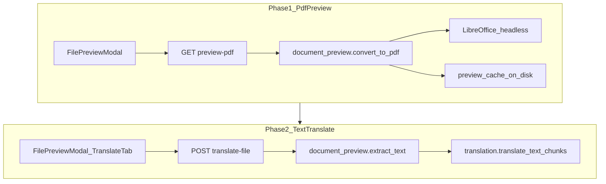

# 项目文件：转 PDF 预览 + AI 翻译面板

## 目标与范围

**做（首期 / 二期）**
- **一期**：项目文件（`ProjectFile`）支持 xlsx/xls/docx/doc/csv 转 PDF 后在 [`FilePreviewModal.vue`](frontend/src/components/FilePreviewModal.vue) 内 iframe 预览；docx 显示「预览」按钮。
- **二期**：同一预览弹窗增加「翻译全文」面板：服务端抽文 → 分块 Gemini 翻译 → 展示纯文本译文（非排版 PDF）。
- 买卖双方项目详情页生效：[`MyProjectDetailView.vue`](frontend/src/views/mypage/MyProjectDetailView.vue)、[`SupplierProjectDetailView.vue`](frontend/src/views/supplier/SupplierProjectDetailView.vue)。

**不做**
- 报价附件、履约区 RFQ 附件、付款凭证（后续可复用同一 `core` 服务扩展路由）。
- 生成「带译文排版的新 PDF」、在线编辑、译文落库。
- OnlyOffice / Collabora 独立文档服务（部署成本过高，首期不引入）。

---

## 现状依据

| 模块 | 现状 | 问题 |
|------|------|------|
| Excel 预览 | 前端 SheetJS → HTML 表格 | 采购单/发票类排版丢失 |
| docx | 可上传，但不在 `PREVIEWABLE_EXTS` | 无预览按钮 |
| PDF/图片 | iframe / img 直连鉴权下载 | 正常 |
| AI 翻译 | [`translation.py`](backend/apps/project/translation.py) 纯文本 ≤8000 字 | 未接文件 |
| OCR | [`ocr.py`](backend/apps/simplequote/ocr.py) 已有 PyMuPDF + Tesseract | 可复用于扫描 PDF |

```14:14:backend/apps/project/serializers.py
PREVIEWABLE_EXTS = {"xlsx", "xls", "csv", "jpg", "jpeg", "png", "gif", "webp", "pdf"}
```

---

## 总体架构



---

## 一期：转 PDF 预览

### 1. 后端转换服务

新增 [`backend/core/document_preview.py`](backend/core/document_preview.py)（与业务域解耦，便于后续扩展到报价附件）：

- **`CONVERT_TO_PDF_EXTS`**：`xlsx`, `xls`, `docx`, `doc`, `csv`
- **`convert_to_pdf(source_path, out_dir) -> Path`**
  - 调用 `libreoffice --headless --convert-to pdf --outdir {tmpdir} {source}`
  - 子进程 + 超时（建议 60s）、临时目录清理
  - 失败抛稳定错误码：`PREVIEW_CONVERT_FAILED`、`PREVIEW_CONVERT_TIMEOUT`
- **`get_or_create_preview_pdf(file_field, cache_key) -> bytes`**
  - 缓存路径：`media/preview_cache/project/{file_id}/{source_mtime_hash}.pdf`
  - 源文件变更（mtime/size）自动失效；删除 `ProjectFile` 时清理对应缓存

**Docker**：在 [`backend/Dockerfile`](backend/Dockerfile) 增加 `libreoffice-writer`、`libreoffice-calc`（及中文字体包 `fonts-noto-cjk` 或等价，避免中韩文乱码）。

### 2. 项目文件预览 API

在 [`backend/apps/project/views.py`](backend/apps/project/views.py) 新增（复用 `_user_can_access_project_file`）：

| 路由 | 权限 |
|------|------|
| `GET /member/projects/{pk}/files/{file_id}/preview-pdf` | 买家 + 项目归属 |
| `GET /supplier/projects/{pk}/files/{file_id}/preview-pdf` | 供应商 + 项目归属 |

行为：
- 若原文件已是 `pdf` → 直接流式返回原文件（或 302 到 download，统一走 preview 接口亦可）
- 若 `jpg/png/...` → 返回 `415` + `PREVIEW_PDF_NOT_APPLICABLE`，前端走现有图片预览
- 若 `xlsx/docx/...` → 转换后 `FileResponse(application/pdf, inline)`
- 响应头：`Content-Disposition: inline`；不暴露 `/media` 直链

挂路由：[`backend/apps/project/urls.py`](backend/apps/project/urls.py)

### 3. 序列化器扩展

更新 [`backend/apps/project/serializers.py`](backend/apps/project/serializers.py)：

- `PREVIEWABLE_EXTS` 增加 `docx`, `doc`
- 新增只读字段：
  - `preview_mode`: `direct` | `pdf_convert`（xlsx/docx 等为后者）
  - `preview_pdf_url`: 上述 preview-pdf 鉴权 URL（仅 `preview_mode=pdf_convert` 或 pdf 本身时填充）

### 4. 前端 FilePreviewModal 改造

改 [`frontend/src/components/FilePreviewModal.vue`](frontend/src/components/FilePreviewModal.vue)：

| 文件类型 | 预览方式 |
|----------|----------|
| pdf | 现有 iframe（可用 `preview_pdf_url` 或原 download URL） |
| xlsx/xls/docx/doc/csv | 调 `preview_pdf_url` blob → iframe（**移除** SheetJS 表格渲染） |
| 图片 | 现有 img |
| 其他 | unsupported + 下载原件 |

- API 封装：[`frontend/src/api/index.js`](frontend/src/api/index.js) 增加 `fetchProjectFilePreviewPdf(projectId, fileId, role)`
- 加载态：转换可能 5–30s，弹窗内显示「正在生成预览…」
- 失败时：提示「复杂文件请下载原件查看」，保留下载按钮
- **SheetJS 依赖可保留**（二期 csv 简单兜底可选），一期 xlsx 不再走客户端解析

### 5. 一期 i18n

在 [`frontend/src/i18n/index.js`](frontend/src/i18n/index.js) 补齐：
- `filePreview.converting` / `convertFailed` / `complexFormatHint`
- 四语（中/韩/英/日）

### 6. 一期验收

1. 项目详情中 xlsx 采购单预览版式与原件基本一致（合并单元格、表格布局可见）。
2. docx 文件显示「预览」按钮，弹窗内 PDF 可读。
3. pdf/图片预览行为不变。
4. 越权访问 preview-pdf 返回 403/404；缓存不暴露公开 URL。
5. Docker 重建 backend 后 `manage.py check`、前端 build、手测买卖双方项目页。

---

## 二期：文件抽文 + AI 翻译面板

### 1. 文本抽取服务

扩展 [`backend/core/document_preview.py`](backend/core/document_preview.py)：

| 扩展名 | 抽取方式 | 备注 |
|--------|----------|------|
| docx | `python-docx` 段落 + 表格单元格 | 新增依赖 |
| xlsx/xls | `openpyxl` 按 sheet 逐行 `\t` 拼接 | 新增依赖 |
| pdf | PyMuPDF `page.get_text()` | 已安装 |
| pdf（无文本层） | Tesseract OCR 分页 | 复用 [`ocr.py`](backend/apps/simplequote/ocr.py) 思路，限制最多 N 页（如 20） |
| doc/csv | doc 走 LibreOffice→pdf→抽文；csv 直接读文本 | csv 简单 |

输出统一结构：
```json
{
  "text": "...",
  "truncated": false,
  "page_count": 3,
  "extraction_method": "docx_parser|xlsx_parser|pdf_text|pdf_ocr"
}
```
- 单次抽取上限建议 **50,000 字符**，超出截断并 `truncated: true`

### 2. 分块翻译

扩展 [`backend/apps/project/translation.py`](backend/apps/project/translation.py)：

- 新增 `translate_text_chunks(chunks: list[str], target_lang) -> str`
  - 每块 ≤ 6000 字符（低于现有 8000 上限留余量）
  - 顺序调用 Gemini，块间用 `\n\n` 拼接
  - 失败返回 `TRANSLATE_FAILED`，不部分 silently drop

**缓存（不落库）**：Redis 键 `file_translate:{file_id}:{target_lang}:{content_hash}`，TTL 7 天；与现有「翻译结果不落库」口径一致。

### 3. 文件翻译 API

新增（同样校验项目文件归属）：

| 路由 | 请求 | 响应 |
|------|------|------|
| `POST /member/projects/{pk}/files/{file_id}/translate` | `{ target_lang }` | `{ translated_text, truncated, extraction_method, char_count }` |
| `POST /supplier/projects/{pk}/files/{file_id}/translate` | 同上 | 同上 |

- 不在响应中返回完整原文（防泄露扩大面）；可选返回 `char_count` 供 UI 提示
- 未配置 `GEMINI_API_KEY` → `TRANSLATE_NOT_CONFIGURED`（与现有一致）

### 4. 前端翻译面板

在 [`FilePreviewModal.vue`](frontend/src/components/FilePreviewModal.vue) 增加分区（不新建页面）：

```
┌─────────────────────────────────────┐
│ 文件名                    [下载][关闭] │
├─────────────────────────────────────┤
│ [原件预览] PDF iframe（一期能力）      │
├─────────────────────────────────────┤
│ [翻译全文] 按钮（复用 aiTranslate 文案）│
│ 译文区（pre-wrap，可滚动）             │
│ 提示：译文为 AI 生成，复杂排版请对照原件  │
└─────────────────────────────────────┘
```

- 复用 [`TextTranslateBlock.vue`](frontend/src/components/TextTranslateBlock.vue) 交互模式，或抽轻量 `FileTranslatePanel` 组件
- `target_lang` 取自当前 `vue-i18n` locale
- 大文件翻译显示 loading（可能 10–60s），支持再次点击重译
- 仅对 `preview_mode in (pdf_convert, direct)` 且可抽取文本的文件显示翻译按钮；纯图片可选隐藏或 OCR 后翻译（二期可选）

传入 `projectId` + `role`：Modal 新增可选 props，项目页打开时传入；其他场景（未来报价附件）不传则隐藏翻译区。

### 5. 二期 i18n

补充：
- `filePreview.translateFile` / `translateFileHint` / `translateTruncated` / `translateScannedHint`
- 四语

### 6. 二期验收

1. xlsx/docx/pdf 项目文件可一键翻译到当前站点语言。
2. 扫描 PDF 在无文本层时走 OCR，有明确「识别可能不完整」提示。
3. 超长文件截断有提示；翻译失败不阻断预览与下载。
4. 买卖双方仅能翻译自己项目文件；Redis 缓存命中时响应更快。
5. 密钥仅服务端；日志不打印全文。

---

## 风险与缓解

| 风险 | 缓解 |
|------|------|
| LibreOffice 镜像体积增大 | 仅 backend 镜像安装；缓存 PDF 减少重复转换 |
| 转换耗时阻塞请求 | 60s 超时 + 前端 loading；必要时三期改 Celery 异步 |
| 中韩字体 PDF 乱码 | Docker 安装 CJK 字体；用真实采购单样件回归 |
| 抽文顺序乱（复杂 Excel） | 译文定位为「看懂内容」；UI 提示对照原件 PDF |
| Gemini 配额/成本 | 分块上限 + Redis 缓存 + 仅按需点击翻译 |
| Windows 本地 dev 无 LibreOffice | 文档说明：完整预览需 Docker backend；本地可降级为「仅下载」 |

---

## 建议实施顺序

1. **一期**：Docker + `document_preview` + preview-pdf API + serializer + FilePreviewModal + 项目页联调
2. **二期**：extract_text + translate chunks + translate API + 弹窗翻译面板 + Redis 缓存
3. **后续（不在本方案）**：报价附件复用 `core/document_preview`，挂 RFQ 路由即可

---

## 关键文件清单

| 阶段 | 文件 |
|------|------|
| 一期 | [`backend/Dockerfile`](backend/Dockerfile), [`backend/core/document_preview.py`](backend/core/document_preview.py), [`backend/apps/project/views.py`](backend/apps/project/views.py), [`backend/apps/project/urls.py`](backend/apps/project/urls.py), [`backend/apps/project/serializers.py`](backend/apps/project/serializers.py), [`frontend/src/components/FilePreviewModal.vue`](frontend/src/components/FilePreviewModal.vue), [`frontend/src/api/index.js`](frontend/src/api/index.js) |
| 二期 | [`backend/core/document_preview.py`](backend/core/document_preview.py), [`backend/apps/project/translation.py`](backend/apps/project/translation.py), [`backend/requirements.txt`](backend/requirements.txt), [`frontend/src/components/FilePreviewModal.vue`](frontend/src/components/FilePreviewModal.vue), [`frontend/src/i18n/index.js`](frontend/src/i18n/index.js) |
