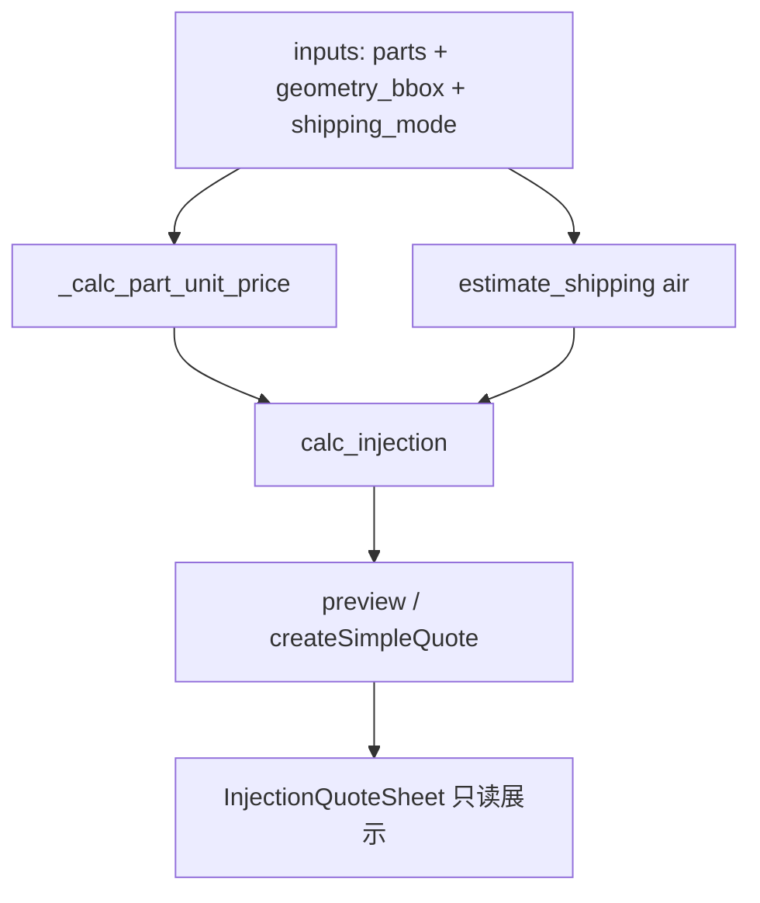

# 注塑生产费与运输费自动计算方案

## 背景与现状

你提供的两张图对应 [project/注塑模具自动报价需求.md](project/注塑模具自动报价需求.md) §3（模具费）与 §4（制品单价），**核心公式已在** [`backend/apps/simplequote/calculator.py`](backend/apps/simplequote/calculator.py) 实现：

- 模具费：`(mold_base + 滑块×1000 + 精密度2000) × 1.2`
- 制品单价：材料费 → 基本合计 → 颜色 → 包装 3% → 利润 20%

仍存在的缺口：

| 项 | 现状 | 目标 |
|---|---|---|
| ≤1g 基本报价规则 | 始终算材料费，与图例 0.8g 不符 | `weight ≤ 1g` 时材料费=0，仅用 `unit_base` |
| 报价单「3. 生产费用」 | 手动输入 | 自动展示（见下方映射） |
| 报价单「5. 运输费用」 | 手动输入 | 默认空运基准自动估算（你已确认） |
| 运输基准代码 | [`shipping.py`](backend/apps/simplequote/shipping.py) 已有，仅 PCB/其他页使用 | 接入 `calc_injection` |
| 合计 | `mold_fee + product_total` | 加入整单运输费（不重复计生产费） |



---

## 一、制品单价公式修正（对齐图示）

修改 [`_calc_part_unit_price`](backend/apps/simplequote/calculator.py)：

```python
# 图示：1g 以下仅用基本报价，不计重量材料费
if weight <= 1:
    material_cost = 0
else:
    material_cost = unit_price_kg * (weight * loss) / 1000
```

验收用例（与图一致）：

- ABS 透明 0.8g → `0.14 × 1.10 × 1.03 × 1.20 ≈ 0.19`
- PC 透明 5.8g → `≈ 0.53`

扩展 `part` 返回结构，供前端/PDF 分项展示：

| 字段 | 含义 | 对应图示步骤 |
|---|---|---|
| `material_cost` | 材料费 | 步骤 1 |
| `unit_base` | 基本报价(≤1g) | 步骤 2 前半 |
| `base_sum` | 基本合计 | 步骤 2 |
| `after_color` | 颜色加成后 | 步骤 3 |
| `after_packaging` | 包装加成后 | 步骤 4 |
| `unit_price` | 利润后单价 | 步骤 5 |

---

## 二、「生产费用」自动映射（报价单第 3 行）

报价单区块 2 中各行含义与计算结果对齐：

| 行 | 展示值 | 说明 |
|---|---|---|
| 1. 单个单价 | `unit_price` | 已有，含利润 |
| 3. 生产费用 | **`after_color`（单件）** | 材料+基本+颜色后、包装前的单件生产成本；**不再手动填** |
| 4. 包装 | `after_packaging`（单件） | 已有 `packagingAmount`，保持 |
| 5. 运输费用 | **`shipping_fee`（整单）** | 见第三节 |

`production_fee` **不是**额外加价项，已从 `unit_price` 链路中体现，仅作报价单分项展示；**不重复加入 total**。

`calc_injection` 返回：

```python
"production_fee": part_results[0]["after_color"],  # 首件展示；FAMILY 可在 parts 内各自带
"production_fee_note": "per_unit_before_packaging",
```

PDF [`backend/core/pdf.py`](backend/core/pdf.py) 区块 3 明细扩展为 6 行（对齐 [02-制造成本.md](project/new/02-制造成本.md)）：

1. 材料费 → `material_cost`
2. 基础费用 → `unit_base`
3. 生产成本 → `after_color`（或 `base_sum`，与行 3 一致）
4. 特殊费用 → `after_color - base_sum`（颜色加价额）
5. 包装费 → `after_packaging - after_color`
6. 运输费 → `shipping_fee`（整单）

---

## 三、运输费自动计算（06 空运基准，默认）

你已确认：**默认空运阶梯**，有 STP 时用包围盒算体积重。

### 3.1 输入来源

在 `calc_injection(inputs, params)` 增加可选字段（由前端 `buildInputs` 传入）：

```typescript
{
  shipping_mode: 'air',           // 默认 air；后续可扩展 lcl
  bbox_mm: [L, W, H] | null,      // STP geometry.bbox_mm
}
```

### 3.2 重量与尺寸

| 参数 | 计算方式 |
|---|---|
| `weight_kg` | `Σ(part.weight_g × part.quantity) / 1000` |
| `length/width/height_cm` | 有 `bbox_mm` 时各边 `/10`；无 STP 时仅用实重（体积重=0） |

调用已有：

```python
from apps.simplequote.shipping import estimate_shipping
# mode='air' → calc_air：计费重=max(实重, 长×宽×高/6000)
```

费率表：`QuoteTable` 中 `air_freight_tiers`（[`table_data.py`](backend/apps/simplequote/table_data.py) 已 seed）。

### 3.3 币种换算

- 运输基准输出 **KRW**（`fee_krw`）
- 注塑报价币种 **CNY**：`shipping_fee_cny = round(fee_krw / rmb_to_krw, 2)`
- 响应附带 `shipping: { mode, fee_krw, fee_cny, chargeable_weight_kg, breakdown }` 供前端说明

### 3.4 合计更新

```python
total = round(mold_fee + product_total + shipping_fee_cny)
```

`product_total` 仍为 `Σ(unit_price × quantity)`；运输费整单加一次。

无重量/尺寸时：`shipping_fee = None`，前端显示「待上传 STP 或填写重量后估算」。

---

## 四、后端改动清单

| 文件 | 改动 |
|---|---|
| [`calculator.py`](backend/apps/simplequote/calculator.py) | ≤1g 规则；扩展 part 字段；`_estimate_injection_shipping()`；填充 `production_fee`/`shipping_fee`；更新 `total` |
| [`views.py`](backend/apps/simplequote/views.py) | `SimpleQuotePreviewView` / 正式报价共用 `calc_injection`，无需新路由 |
| [`pdf.py`](backend/core/pdf.py) | 生产/运输不再留空；区块 3 六行明细 |
| 新增 `tests/test_injection_quote.py` | 0.8g/5.8g 单价、空运换算、无 bbox 降级 |

`shipping.py` **不改动逻辑**，仅复用。

---

## 五、前端改动清单

| 文件 | 改动 |
|---|---|
| [`useInjectionQuote.ts`](frontend/src/composables/useInjectionQuote.ts) | `buildInputs` 增加 `bbox_mm: geometry.value?.bbox_mm`、`shipping_mode: 'air'`；移除 `production_fee`/`shipping_fee` 手填状态 |
| [`InjectionQuoteSheet.vue`](frontend/src/components/quote/InjectionQuoteSheet.vue) | 第 3/5 行改为只读展示 `preview.production_fee`、`preview.shipping_fee`；可选一行小字显示计费重/空运明细；去掉 `manualFill` placeholder |
| [`i18n/index.js`](frontend/src/i18n/index.js) | 补充 `shippingAutoHint`、`shippingPending` 等 key |

正式「生成报价」时 `createSimpleQuote` 走同一 `calc_injection`，结果 JSON 自动带新字段，MY PAGE / PDF 一致。

---

## 六、不在本期范围

- 海运 LCL/FCL 切换 UI（已预留 `shipping_mode`，默认 air）
- VAT 自动计算（仍 `null`）
- 修改模具费/单价表参数值（仍走 `QuoteParam` 后台）
- 更新 [注塑模具自动报价需求.md](project/注塑模具自动报价需求.md) 中「一期留空手动填」描述（实现后可另开文档同步）

---

## 七、验收标准

1. 上传 STP 后，「3. 生产费用」「5. 运输费用」自动有值，无需手填
2. 0.8g ABS 透明单价 ≈ 0.19；5.8g PC 透明 ≈ 0.53
3. 有 `bbox_mm` 时空运按体积重/实重取大；仅重量时按实重阶梯
4. 运输费以 CNY 显示，KRW 明细可在 hover/小字查看
5. `total` = 模具费 + 制品合计 + 运输费
6. PDF 中生产/运输/明细 6 行均有值
7. 单元测试 + `manage.py check` + 前端 build 通过
