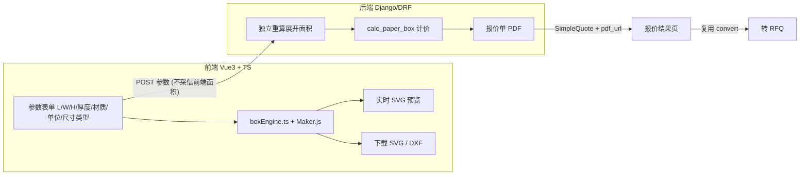

# 纸盒包装生成器（C 方案：前端实时编辑器 + 后端权威计价）

## 目标与范围

做到参考图那种「边输尺寸边实时刷新刀版」的编辑器体验，同时保证报价/文件由后端权威把控。

**做（V1）**
- 前端 TypeScript + Maker.js 参数化刀版引擎：FEFCO 0201，实时 SVG 预览、mm/in 单位切换、内/外/制造尺寸换算、压线/割线分色标注
- 前端客户端导出 SVG / DXF（Maker.js 直出，下载按钮）
- 后端新增 `paper_box` 报价类型：独立重算展开面积（权威、防篡改）→ 计价 → 报价单 PDF
- 复用现有创建流程（扣积分、出 PDF）与「转 RFQ」链路
- i18n 四语（ko/zh/en/ja）、买方权限、导航入口
- 纸板单价/工艺费率走 `QuoteParam` 后台可维护

**不做（后置）**
- 其余盒型 0427/0713/0716（引擎模板化后增量加）
- 后端持久化/校验 DXF、把刀版图嵌入报价单 PDF、随 RFQ 附件流转（V1 DXF 为客户端导出）
- 3D 预览、Logo/文字排版、复杂设计工具

## 架构与数据流

关键原则：**几何真相源在前端**（画图/导出），**计价真相源在后端**（按 L/W/H 参数独立重算面积，绝不采信前端传入的面积/金额）。两处逻辑不共享，但后端只需极简面积公式，非完整刀版几何。

## 后端改动

1. 报价类型注册
- [backend/apps/simplequote/models.py](backend/apps/simplequote/models.py) `TYPE_CHOICES` 增 `("paper_box", "Paper Box")`
- [backend/apps/simplequote/serializers.py](backend/apps/simplequote/serializers.py) `SimpleQuoteCreateSerializer.quote_type` choices 增 `paper_box`

2. 面积几何（新增，权威）
- 新增 `backend/apps/simplequote/packaging.py`：`unfold_size_0201(L, W, H, thickness)` 返回展开宽高（含开槽/接头舌/压线余量）与 `unfold_area_m2`；纯 2D 确定性公式，**不用** `geometry.py`（那是 3D OCP）
- 单测覆盖已知算例（如 200×150×100 E 楞）

3. 计价接入
- [backend/apps/simplequote/calculator.py](backend/apps/simplequote/calculator.py)：`DEFAULT_PARAMS["paper_box"]`（`board_price_E/B/...` 元/m²、`loss_factor`、`print_setup`、`print_per_color`、`die_cut_fee`、`glue_per_unit`、`profit_rate`、`rmb_to_krw`）；新增 `PaperBoxQuoteError`、`calc_paper_box(inputs, params)`（面积×单价×(1+损耗)×数量 + 印刷 + 刀版费 + 粘盒 → ×(1+利润) → CNY，附 KRW 换算 + `breakdown`）；注册进 `CALCULATORS`
- 计价内部调用 `packaging.unfold_size_0201`，忽略前端传来的面积字段

4. 报价单 PDF
- [backend/core/pdf.py](backend/core/pdf.py) 新增 `build_paper_box_quotation_pdf(...)`，参照 `build_quotation_pdf`/`build_injection_quotation_pdf` 风格（展开尺寸、面积、费用明细、CNY+KRW）

5. 视图分支
- [backend/apps/simplequote/views.py](backend/apps/simplequote/views.py)：`TYPE_LABELS` 增 `paper_box`；`render_pdf` 增 `paper_box` 分支调 `build_paper_box_quotation_pdf`；`post` 币种分支设 `paper_box` → `currency="CNY"`、`valid_days=14`。创建主流程/扣积分/转 RFQ 已通用，无需改
- 转 RFQ 复用 [MemberSimpleQuoteConvertView](backend/apps/simplequote/views.py)

6. 迁移评估
- `quote_type` 为 `CharField(choices=...)`，仅改 choices，**无需数据库迁移**；不新增模型字段

## 前端改动

1. 依赖与 TS
- [frontend/package.json](frontend/package.json) 加 `makerjs`、devDep `typescript`；新增最小 `frontend/tsconfig.json`（仅供编辑器提示，Vite/esbuild 原生转译 `.ts`，不做全量迁移）

2. 几何引擎（TypeScript）
- 新增 `frontend/src/lib/packaging/boxEngine.ts`：0201 参数化模型（Maker.js），含 mm/in 换算、内/外/制造尺寸↔制造展开换算（按板厚）、压线/割线分层、尺寸标注、`toSVG()`、`exportDXF()`、`exportSVG()`、`unfoldAreaM2()`
- `frontend/src/lib/packaging/types.ts` 参数/结果类型

3. 页面
- 新增 `frontend/src/views/packaging/BoxGeneratorView.vue`：左侧参数表单（盒型、L/W/H、厚度、材质、单位切换、尺寸类型切换、数量、印刷色数）+ 右侧实时 SVG 预览（`v-html` 引擎输出，watch 输入即时重绘，debounce 可选）；`生成报价` 调 `createSimpleQuote`；结果区展示费用明细/CNY+KRW/`pdf_url`；`下载 SVG`、`下载 DXF`（客户端）、`转 RFQ`（`convertSimpleQuote`）
- 交互与结果区复用 [frontend/src/views/quote/SimpleQuoteView.vue](frontend/src/views/quote/SimpleQuoteView.vue) 既有模式

4. 路由与请求层
- [frontend/src/router/index.js](frontend/src/router/index.js) 增 `/packaging/box`（`requiresAuth: true, requiresBuyer: true`）
- 请求层复用 `createSimpleQuote`/`convertSimpleQuote`（[frontend/src/api/index.js](frontend/src/api/index.js)），无需新端点（预览纯前端）

5. i18n 与入口
- [frontend/src/i18n/index.js](frontend/src/i18n/index.js) 补 `packaging.*`（ko/zh/en/ja），禁硬编码文案
- 在 MY PAGE / 主导航加入口链接

## 后台（admin）

- `QuoteParam` 后台已按 `quote_type` 通用维护，确认 `admin/src/views/QuoteParamsView.vue` 的类型下拉含 `paper_box`（若硬编码则补选项），使纸板单价/工艺费率可后台调整

## 风险与缓解

- 0201 展开公式（开槽/接头舌/压线余量）算错致工厂出错盒（高）→ 标准算例单测 + 首版由懂纸箱工艺者核对刀版图
- 前后端「双份几何」偏差（中）→ 后端只重算面积（简单公式），刀版图由前端唯一产出；面积做前后端一致性校验并记录告警
- 前端传面积/金额被篡改（中）→ 后端一律按 L/W/H 参数重算，忽略前端面积/金额
- 费率无权威数据（中）→ 全放 `QuoteParam` 后台可调，先占位默认值，上线前业务填真实值
- 引入 TS 破坏现有 JS 构建（低）→ 仅新增 `.ts` 模块，Vite 原生转译，不改现有文件类型；本地 `build` 验证

## 验收标准

1. `/packaging/box` 选 0201、改 L/W/H/单位/尺寸类型时刀版实时刷新，压线/割线分色且标注尺寸
2. mm/in 与内/外/制造尺寸切换后展开尺寸换算正确
3. `下载 SVG`、`下载 DXF` 可导出且能被设计软件打开
4. `生成报价` 返回报价号、展开面积、费用明细、CNY+KRW 合计；给定标准算例面积误差 < 0.5%
5. 报价单 PDF 可下载；创建正确扣 `SIMPLE_QUOTE` 积分；数据按 `buyer` 隔离
6. 篡改前端面积/金额不影响后端计价（后端重算）
7. `转 RFQ` 生成 RFQ 且 `converted_rfq` 关联正确
8. 后台可增改 `paper_box` 费率并即时生效
9. 四语文案齐全无硬编码；错误响应符合 `{code, message, errors, request_id}`（尺寸非法返回 `SIMPLE_QUOTE_INPUT_INVALID`）
10. `npm run build`（frontend）通过，后端冒烟通过

## 默认取舍（如需调整请提出）

- 币种：CNY + KRW 换算（与 injection/pcba 一致，中国纸板计价）
- V1 仅 0201 单盒型；DXF 为客户端导出、不落库/不随 RFQ 附件（后置到二期）

## 建议下一步

确认后切到 `feature-implementation`，按「后端面积/计价 → PDF/视图 → 前端引擎 → 页面/路由/i18n」顺序实现；收尾用 `self-check-after-change` 跑 build 与后端冒烟。