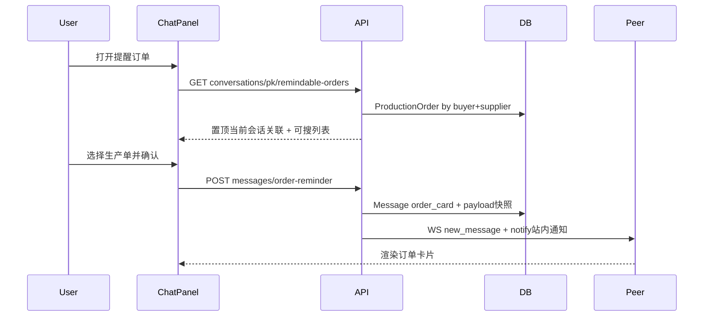

# 聊天订单提醒卡片（完整版选择器）

## 已确认口径

- 提醒对象：**生产单 / 项目**（不以商城 `Order` 为目标）
- 权限：**买家与供应商均可发送**
- 首版形态：**订单卡片消息** + **完整版选择器**（本会话关联置顶 + 双方全部相关单可搜可选）
- 点击跳转：**有 `project_id` 则跳项目详情**（买家 `/my/projects/:id`，供应商 `/supplier/projects/:id`）；否则跳生产单详情（买家 `/my/production-orders/:id`）
- 通知：**聊天卡片 + 站内通知**（`type=production_order` 或 `project`，带 `related_id`）

## 目标与范围

### 做

- 会话内「提醒订单」→ 完整选择器 → 发送 `order_card` 消息
- 列表接口按会话的 `buyer`+`supplier` 过滤生产单，附带关联项目信息
- 卡片渲染、WS 实时同步、离线站内通知
- 四语文案（前端 i18n）

### 不做

- 商城订单提醒、附件、管理员代发订单卡片
- Kakao/短信等外部渠道
- 自动催单调度（仅用户主动发送）

## 数据流



## 实现步骤

### 1. 模型与迁移

改 [`backend/apps/chat/models.py`](backend/apps/chat/models.py) 的 `Message`：

- `message_type`：`text` | `order_card`（默认 `text`）
- `payload`：`JSONField` 可空，存卡片快照（避免订单后续变更导致历史气泡漂移）

建议 `payload` 形状：

```json
{
  "production_order_id": 1,
  "order_no": "PO-...",
  "status": "in_production",
  "project_id": 2,
  "project_title": "...",
  "quote_request_id": 3,
  "quote_request_no": "QR-..."
}
```

`body` 仍必填：默认短文案（如「提醒关注此订单」）+ 可选用户备注；继续走现有脱敏逻辑。按 [`backend-migration-and-model`](.cursor/skills/backend-migration-and-model/SKILL.md) 出迁移。

### 2. 后端服务与 API

扩展 [`backend/apps/chat/services.py`](backend/apps/chat/services.py)：

- `send_message` 支持 `message_type` / `payload`（默认兼容纯文本）
- `serialize_message_brief` 带上 `message_type`、`payload`（WS 必需）
- 新增 `list_remindable_orders(conversation, *, q, status, page)`：
  - 过滤 `ProductionOrder.objects.filter(buyer_id=..., supplier_id=...)`
  - `is_current`：`id == conversation.production_order_id`，或同 `quote_request` 链路；置顶
  - 搜索：`order_no`、关联 `project` 标题、`quote.request_no`（按现有关联字段实现）
  - 状态筛选：生产单 `status`
- 新增 `send_order_reminder(conversation, sender, sender_role, production_order_id, note="")`：
  - 校验订单属于该会话买卖双方
  - 组装 payload 快照并落库
  - `after_message_sent` 后对对方 `notify(...)`（优先 `related_type=project`，否则 `production_order`）

路由（挂现有 chat urls，member/supplier 对称）：

- `GET /api/{member|supplier}/chat/conversations/{pk}/remindable-orders`
- `POST /api/{member|supplier}/chat/conversations/{pk}/messages/order-reminder`  
  请求体：`{ "production_order_id": number, "note"?: string }`

序列化：[`MessageSerializer`](backend/apps/chat/serializers.py) 增加 `message_type`、`payload`；会话 `last_message_preview` 对卡片显示订单号摘要（如 `[订单] PO-xxx`）。

权限：复用参与者校验（与现有发消息一致）；越权生产单返回 403/404。

### 3. 前端 ChatPanel

改 [`frontend/src/components/ChatPanel.vue`](frontend/src/components/ChatPanel.vue) + [`frontend/src/api/index.js`](frontend/src/api/index.js)：

- 工具栏增加「提醒订单」按钮
- 选择器面板（完整版）：
  - 打开时拉 `remindable-orders`
  - 当前会话关联置顶并标记
  - 搜索框 + 状态筛选 + 分页/加载更多
  - 选中预览 → 可选备注 → 发送
- 消息气泡：`message_type === 'order_card'` 时渲染卡片组件（订单号、状态、项目名、备注文案）；点击按角色跳转项目/生产单
- WS `new_message` 已推全量 brief 时直接入列（含 payload）

新增小组件（可同文件或 `OrderReminderCard.vue` / `OrderPickerSheet.vue`），保持与现有聊天视觉一致（紧凑、非营销风）。

i18n：在既有 `chat.*` 下补齐四语 key（按钮、选择器空态、发送失败、卡片标签等）。

### 4. 管理端纠纷页（只读兼容）

[`admin/src/views/ChatDisputesView.vue`](admin/src/views/ChatDisputesView.vue)：若消息含 `order_card`，只读展示卡片摘要（可不做选择器）。避免纠纷介入时只看到空/乱码。

### 5. 验证

- 双方均可列出彼此全部生产单；本会话关联置顶
- 只能提醒「同 buyer+supplier」的单，跨对 403/404
- 发送后双方聊天出现卡片；对方通知中心有对应条目
- 有项目跳项目，无项目买家跳生产单
- 前端 `npm run build` 冒烟；迁移可 apply

## 风险与缓解

| 风险 | 缓解 |
|---|---|
| 历史消息无 `message_type` | 默认 `text`，序列化兜底 |
| 订单删除后卡片失效 | 用 `payload` 快照展示；跳转 404 时提示 |
| 列表过大 | 分页 + 搜索/状态筛选；默认 page_size=20 |
| WS brief 缺字段导致卡片空白 | `serialize_message_brief` 与 REST 字段对齐 |

## 验收标准

1. 会话内可打开完整选择器，当前关联单置顶，可搜索/筛选双方其他生产单并发送。
2. 发出的消息为订单卡片（非纯大按钮样式），含订单号与状态；备注可选。
3. 买卖双方均可发送；不能提醒非本对买卖双方的订单。
4. 对方实时可见卡片；离线有站内通知且 `related` 可追溯。
5. 点击卡片：有项目进项目详情，否则买家进生产单详情。
6. 既有纯文本聊天、翻译、纠纷流程不受影响。

## 建议下一步

确认本方案后进入实现（`feature-implementation` + 涉及迁移时遵循 `backend-migration-and-model`）。