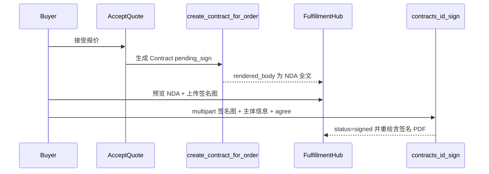

# 详细报价合同替换为 NDA 在线签署

## 已锁定口径

- **替换成交合同**：Tab 展示与签署对象改为保密协议（来源：[`project/new/01-保密协议.md`](project/new/01-保密协议.md) / docx），不再使用生产合同条款文案。
- **签署时机不变**：仍在接受报价 → 生成履约记录 → `pending_sign` 后，在详细报价「合同」Tab（及个人中心合同入口）签署。
- **签名图必填**：先「上传」签名图片，再点「签署」；未上传不可签。

## 技术策略（默认）

**不拆掉 `Contract` 模型**，避免打断 [`Payment.contract`](backend/apps/payment/models.py) 与生产订单一对一链路。做法是：

- 继续在接受报价时调用 [`create_contract_for_order`](backend/apps/contract/services.py)；
- 将 [`ContractTemplate`](backend/apps/contract/models.py) 默认正文换成完整 NDA；
- UI/文案改为「保密协议」；金额字段仍写入模型供付款单创建，但合同 Tab **不再展示成交金额/生产合同语义**。

独立页面 [`/my/nda`](frontend/src/views/mypage/NdaSignView.vue) 本轮不改（仍为用户级 NDA）；详细报价链路自洽。

## 实现步骤

### 1. 模型与迁移

在 [`backend/apps/contract/models.py`](backend/apps/contract/models.py) 的 `Contract` 增加：

- `signature_image`：`ImageField`/`FileField`（`upload_to=contract/signatures/%Y/%m/`）
- `company_name`、`business_reg_no`、`company_address`、`signer_name`：签署主体（对应协议落款栏）
- `agree_at`：勾选同意时间（可选但建议有，便于审计）

`ContractTemplate.body` 占位符扩展为 NDA 用：`{{company_name}}`、`{{business_reg_no}}`、`{{company_address}}`、`{{signer_name}}`、`{{date}}` 等；供方 CONNECTED 信息写死在模板正文（与 md/docx 一致）。

### 2. 模板与生成逻辑

- 用 [`project/new/01-保密协议.md`](project/new/01-保密协议.md) 全文替换 [`DEFAULT_CONTRACT_BODY`](backend/apps/contract/services.py)；`ensure_default_contract_template` 的 `title` 改为「保密协议」，`version` 升级（如 `nda-v1`），幂等更新激活模板。
- [`create_contract_for_order`](backend/apps/contract/services.py)：签发时用买家资料预填公司名（有则写入 context）；`rendered_body` 固化 NDA 文本；**生成时可不强制 PDF**，或只生成无签名预览版。
- 签署成功后：把签名图与落款信息写入 PDF（复用/扩展 [`build_nda_pdf`](backend/core/pdf.py) 或合同 PDF 管线），再 `contract.pdf.save(...)`。

### 3. 签署 API

改造 [`MemberContractSignView`](backend/apps/contract/views.py)：

- 接受 `multipart/form-data`：`signature_image`（必填）、`company_name`（必填）、`business_reg_no` / `company_address` / `signer_name`（按协议落款必填）、`agree=true`。
- 校验：`status == pending_sign`；未同意 → `CONTRACT_AGREE_REQUIRED`；无签名图 → `CONTRACT_SIGNATURE_REQUIRED`。
- 成功：存字段、`status=signed`、`signed_at`、重绘 PDF；响应仍走现有 `ContractSerializer`（增返回 `signature_image_url`、`rendered_body`、主体字段）。

同步更新 [`frontend/src/api/index.js`](frontend/src/api/index.js) 的 `signContract` 为 FormData 上传。

### 4. 前端在线签署（主路径）

改造 [`frontend/src/components/FulfillmentHub.vue`](frontend/src/components/FulfillmentHub.vue) 合同区：

- 页内展示 `rendered_body`（`<pre>`/滚动区，参考 `NdaSignView`）。
- 表单：公司名、事业者号、地址、签署人姓名。
- **上传**按钮选签名图片 → 本地预览。
- 勾选同意后启用 **签署**；调用新 `signContract`。
- 去掉「以下载为主」：下载链接降为次要或签署后可选「查看已签文件」；空态/按钮文案改为保密协议语义。

同步 [`frontend/src/views/mypage/MyPageView.vue`](frontend/src/views/mypage/MyPageView.vue) 合同签署入口，避免仍走无签名图的旧 POST。

供应商侧合同区只读展示协议状态/正文摘要即可（不传签）。

### 5. i18n

在 [`frontend/src/i18n/index.js`](frontend/src/i18n/index.js)（zh/en/ko/ja）更新/新增：

- `fulfillment.tabContract` → 保密协议
- `mypage.signContract`、上传签名、同意条款、主体字段标签、校验提示等

禁止硬编码用户可见文案。

### 6. 测试与回归

- 扩展合同/履约相关测试：未上传签名不可签；上传后可签；付款仍可通过 `contract` 关联创建/确认。
- 冒烟：接受报价 → 合同 Tab 见 NDA → 上传签名并签署 → 付款 Tab 仍可用。

## 范围边界

**做**：详细报价履约「合同」= NDA 在线签 + 签名图；模板全文替换；签署后 PDF 含签名归档。

**不做**：第三方电子签章；手写 canvas；改 `/my/nda`；把 Payment 改挂 ProductionOrder；删除 Contract 表。

## 风险与缓解

| 风险 | 缓解 |
|------|------|
| 去掉成交合同文案后金额无处展示 | 金额保留在报价/订单/付款 Tab；合同 Tab 只做 NDA |
| 旧待签合同仍是生产合同正文 | 新模板 `nda-v1` 仅对新生成生效；或管理端可作废重发（本轮不强制迁移历史） |
| 大图上传 | 限制类型 jpg/png/webp、大小（如 2MB） |

## 验收标准

1. 接受报价后，详细报价「合同」Tab 页内可读完整保密协议，无需先下载。
2. 未上传签名图或未勾选同意时，「签署」不可用或返回明确错误码。
3. 上传签名图并填写落款信息后可签署；状态变为 `signed`，可看到签名预览或已签状态。
4. 付款/项目履约链路不因合同内容替换而中断。
5. 四语言 i18n key 齐全，无硬编码签署文案。
