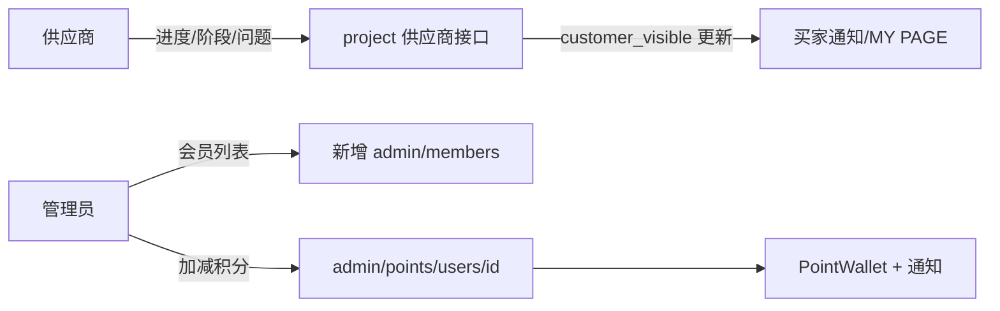

# 迭代 1：供应商项目页 + Admin 会员/积分调整 UI + 端到端联调

## 背景（已核实的现状）
- 供应商项目**后端已完备**：[backend/apps/project/views.py](backend/apps/project/views.py) 已有 `SupplierProjectListView`、`SupplierProjectDetailView`、`SupplierProjectUpdateCreateView`、`SupplierProjectStageUpdateView`、`SupplierProjectIssueCreateView`；序列化器见 [backend/apps/project/serializers.py](backend/apps/project/serializers.py)。
- 前端 API 函数**已存在**：[frontend/src/api/index.js](frontend/src/api/index.js) 的 `fetchSupplierProjects` / `fetchSupplierProject` / `addSupplierProjectUpdate` / `updateSupplierProjectStage`（缺 issue 上报函数，需补）。
- 供应商前台**缺页面/路由/导航**（当前只有 `supplier/quote-requests`、`supplier/orders`）。
- 管理端积分调整**后端已有** `AdminUserPointAdjustView`（`GET/POST /admin/points/users/{id}`），admin 有 `adjustUserPoints`，但**无会员列表接口、无后台会员页、无 `fetchUserPoints`**。

## 数据流

## 任务 A：供应商项目进度前台
- 新增 [frontend/src/views/supplier/SupplierProjectsView.vue](frontend/src/views/supplier/SupplierProjectsView.vue)：项目列表，仿 [frontend/src/views/supplier/QuoteRequestsView.vue](frontend/src/views/supplier/QuoteRequestsView.vue) 的表格与样式；列展示 `project_no`、`title`、`status`、`progress_percent`、`expected_delivery_date`，行内链接到详情。
- 新增 [frontend/src/views/supplier/SupplierProjectDetailView.vue](frontend/src/views/supplier/SupplierProjectDetailView.vue)：仿 [frontend/src/views/mypage/MyProjectDetailView.vue](frontend/src/views/mypage/MyProjectDetailView.vue) 的进度条/阶段/时间线，并增加供应商可操作区：
  - 阶段状态切换（`pending/in_progress/completed`）→ `updateSupplierProjectStage`。
  - 提交进度更新（`content` + `is_customer_visible` 勾选）→ `addSupplierProjectUpdate`。
  - 上报问题（`title/description/severity`）→ 需在 API 新增 `addSupplierProjectIssue(id, data)`（`POST /supplier/projects/{id}/issues`）。
- 路由：[frontend/src/router/index.js](frontend/src/router/index.js) 在供应商段新增 `supplier/projects` 与 `supplier/projects/:id`，`meta: { requiresAuth: true, requiresSupplier: true }`。
- 导航：[frontend/src/layouts/MainLayout.vue](frontend/src/layouts/MainLayout.vue) 在 `auth.isSupplier` 分支（约 122 行桌面、190 行移动）新增「我的项目」链接指向 `/supplier/projects`。
- i18n：[frontend/src/i18n/index.js](frontend/src/i18n/index.js) 新增 `supplierProject` 命名空间键（zh/ko/en 三语），并补 `nav.supplierProjects`。

## 任务 B：Admin 会员管理 + 积分手动调整
- 后端会员列表：在 [backend/apps/accounts/views.py](backend/apps/accounts/views.py) 新增 `AdminMemberListView`（`IsAdminRole`，`User.objects.filter(role="member")`，支持 `search`（email/name）分页），新增 `AdminMemberSerializer`（含 `id/email/name/phone/member_type/created_at` 及钱包余额）于 [backend/apps/accounts/serializers.py](backend/apps/accounts/serializers.py)；在 [backend/apps/accounts/urls.py](backend/apps/accounts/urls.py) 注册 `admin/members`。余额通过 `points.services.ensure_wallet` 或查询 `PointWallet` 获取。
- admin API：[admin/src/api/index.js](admin/src/api/index.js) 新增 `fetchMembers(params)`（`GET /admin/members`）与 `fetchUserPoints(userId)`（`GET /admin/points/users/{id}`），复用已有 `adjustUserPoints`。
- 新增 [admin/src/views/MembersView.vue](admin/src/views/MembersView.vue)：会员表格（邮箱/姓名/类型/余额/注册时间）+ 搜索；「调整积分」按钮打开对话框，展示钱包余额与最近流水，表单含 `amount`（正加负减）与 `description`，提交 `adjustUserPoints`。
- 路由/菜单/文案：[admin/src/router/index.js](admin/src/router/index.js) 新增 `members` 路由；[admin/src/layouts/AdminLayout.vue](admin/src/layouts/AdminLayout.vue) 在 `/points` 附近加菜单项；[admin/src/i18n/index.js](admin/src/i18n/index.js) 新增 `nav.members` 及 `common` 中 balance/adjustPoints/reason 等键（zh/ko/en）。

## 任务 C：更新部署 + 端到端联调冒烟
- 按 `.cursor/skills/docker-deploy` 与 `.cursor/skills/self-check-after-change`：后端无迁移（不新增模型），重建前端与 admin 镜像并重启；健康检查后走一条链路：买家发 RFQ → 管理员指派供应商 → 供应商报价 → 买家采纳生成合同/支付 → 管理员确认支付生成项目 → 供应商在新页更新进度 → 买家 MY PAGE 可见；再验证 admin 会员页加/减积分并核对买家钱包与通知。

## 范围边界（本次不做）
- MY PAGE 文件中心/待办聚合、企业资料完善、详细报价 9.6 全状态机与对比 PDF、供应商 Supplier/标签/附件体系、项目文件 `ProjectFile`、邮件通知等（属迭代 2/P1）。

## 验收标准
- 供应商登录后可见「我的项目」，进入详情能切换阶段、发进度、上报问题；买家在 MY PAGE 能看到 `is_customer_visible` 的进度。
- 管理员可在会员页搜索会员、查看余额与流水，加/减积分后余额与流水实时更新，且买家收到积分变动通知。
- 前端与 admin `npm run build` 通过；后端 `python manage.py check` 通过；三语文案无缺失 key。