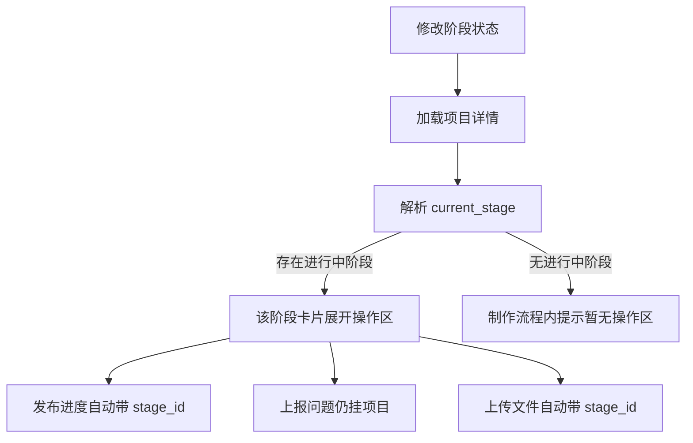

# 制作流程内嵌阶段操作区

## 目标与范围

**做**
- 供应商项目详情页：进度更新与文件上传不再手选阶段，自动绑定 `project.current_stage`。
- 「发布进度 / 上报问题 / 上传项目文件」从页面下方独立区块移入「制作流程」中**当前进行中**阶段卡片内展开。
- 切换阶段状态后，展开区跟随新的 `current_stage` 移动。

**不做**
- 不改买家项目只读页 [`MyProjectDetailView.vue`](frontend/src/views/mypage/MyProjectDetailView.vue)。
- 不为 `ProjectIssue` 新增 `stage` 字段/迁移（问题仍属项目级；表单仅放在当前阶段面板内提交）。
- 不改阶段状态机、不新增多阶段同时操作。

## 交互约定（默认）

- 仅 `project.current_stage` 对应卡片展开操作区（与图二高亮一致）。
- 已完成 / 待开始阶段只保留名称 + 状态下拉，不展开表单。
- 无当前阶段时（例如全部完成或异常空）：制作流程下显示一句提示，不展示三个表单。

## 实现步骤

1. **前端：重构供应商项目详情布局**
   - 主改 [`frontend/src/views/supplier/SupplierProjectDetailView.vue`](frontend/src/views/supplier/SupplierProjectDetailView.vue)。
   - 制作流程 `ol.workflow-steps` 中，对 `s.id === project.current_stage?.id` 的 `<li>` 增加展开面板，内含：
     - 发布进度（内容 +「对客户可见」+ 提交；去掉阶段下拉）
     - 上报问题（标题/描述/严重度 + 提交）
     - 上传文件（文件分类 + 选文件 + 上传 + 不良报告模板下载；去掉阶段下拉）
   - 删除页面下方原先三块独立 `h2` 表单区。
   - 保留下方「时间线 / 问题列表 / 按阶段文件列表」作为历史查阅（文件列表可继续按阶段分组展示）。

2. **前端：提交逻辑绑定当前阶段**
   - `onSubmitUpdate`：始终传 `stage: project.current_stage.id`；无当前阶段则禁用提交并提示。
   - `onUploadFile`：始终传当前阶段 id；去掉 `stageRequired` 手选校验，改为「无当前阶段不可上传」。
   - `updateForm` / `uploadForm` 移除 `stage` 字段；加载时不再预填阶段下拉。
   - 阶段状态变更 `onStageChange` → `load()` 后，展开区自然跟随新 `current_stage`。

3. **后端轻量兜底（无迁移）**
   - 在 [`backend/apps/project/views.py`](backend/apps/project/views.py) 的供应商进度创建、文件上传中：若请求未带 `stage`，则回退为项目 `current_stage`（与现有 `get_current_stage` 逻辑一致）。
   - 文件上传仍要求最终能解析出合法阶段；否则返回现有风格业务错误（如 `PROJECT_STAGE_REQUIRED`）。
   - 问题创建接口保持现状（无 stage）。

4. **文案与验收**
   - [`frontend/src/i18n/index.js`](frontend/src/i18n/index.js) 四语补充「当前阶段自动关联」「暂无进行中阶段」等提示（复用已有 key 优先）。
   - 自检：前端 build；供应商项目页手测展开、提交、换阶段后展开区迁移。

## 风险与缓解

- **无当前阶段仍提交**：前端禁用 + 后端兜底/报错双保险。
- **问题无阶段字段**：列表仍在页底；若后续要「按阶段看问题」再单独加字段，本轮不做。
- **布局变长**：操作区仅嵌在一个当前阶段卡片，避免五个阶段同时展开。

## 验收标准

1. 供应商项目详情页不再出现进度/文件的阶段下拉。
2. 当前进行中阶段（如「订单」）卡片内可见发布进度、上报问题、上传文件三块；其他阶段不展开。
3. 提交进度/上传文件后，数据关联到当前阶段（详情刷新后文件出现在该阶段分组下；进度带 stage）。
4. 将当前阶段改为已完成并推进下一阶段后，操作区出现在新的进行中阶段。
5. 无进行中阶段时不展示三块表单，仅提示。
6. 买家项目页与管理员流程不受影响。

## 建议下一步

确认本方案后进入 `feature-implementation`，仅改上述供应商页与进度/文件上传兜底逻辑。