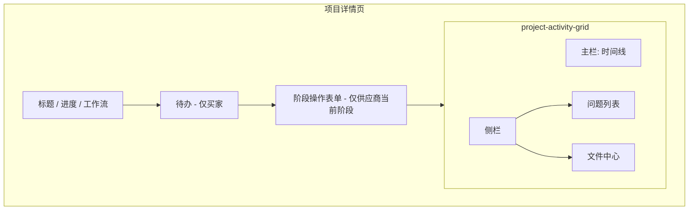
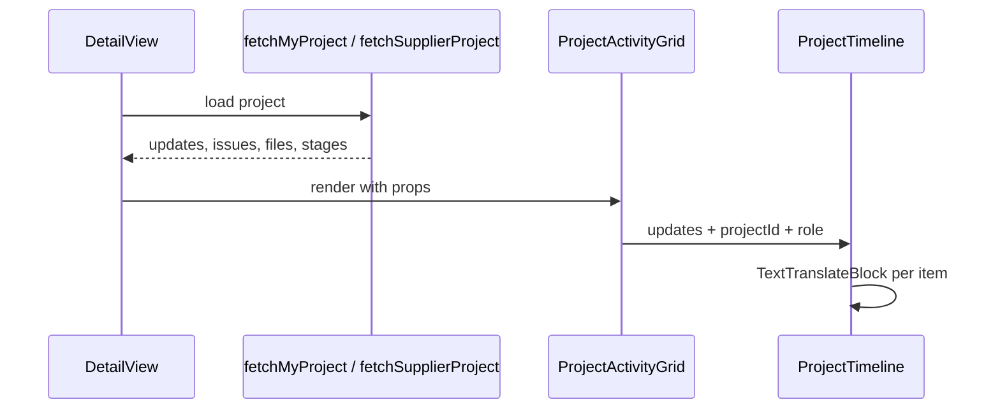

# 项目详情 — 时间线 / 问题 / 文件 布局优化

## 任务类型判断

- **界面类型**：混合型产品界面（客户/供应商工作台），以**信息清晰度与扫描效率**为主，不做营销化装饰。
- **改动范围**：仅前端布局与展示组件，**不涉及 API / 后端**。
- **目标页面**：
  - 买家：[`frontend/src/views/mypage/MyProjectDetailView.vue`](frontend/src/views/mypage/MyProjectDetailView.vue)
  - 供应商：[`frontend/src/views/supplier/SupplierProjectDetailView.vue`](frontend/src/views/supplier/SupplierProjectDetailView.vue)

## 现状问题

| 问题 | 买家端 | 供应商端 |
|------|--------|----------|
| 三块内容纵向堆叠，滚动长 | 时间线 → 问题 → 文件依次排列 | 时间线/问题嵌在阶段面板内，文件又在页面底部重复出现 |
| 视觉层级弱 | 仅 `h2 + ul`，无卡片边界与计数 | `panel-block` 与底部文件区样式不统一 |
| 代码重复 | 与供应商端各写一套 timeline/issue/file  markup + SCSS | 同上 |

与产品汇报中「时间线和问题列表放在更醒目位置」「文件按履约阶段归档」一致：主栏突出进度叙事，侧栏集中异常与资料。

## 目标布局



**响应式规则**（[`PageShell`](frontend/src/components/PageShell.vue) 默认 container 宽度）：

- `≥ 960px`：`grid-template-columns: minmax(0, 1.45fr) minmax(280px, 1fr)`，侧栏 `position: sticky; top: ...` 便于长时间线滚动时问题/文件仍可见。
- `< 960px`：单列，顺序为 时间线 → 问题 → 文件。

## 实现方案

### 1. 抽取共享组件（新建目录 `frontend/src/components/project/`）

避免两侧继续复制 markup/样式：

| 组件 | 职责 | 主要 props |
|------|------|------------|
| `ProjectActivityGrid.vue` | 分栏容器 + 响应式 | 默认 slot：`main` / `side` |
| `ProjectActivitySection.vue` | 统一卡片区块（标题、计数 badge、空态） | `title`, `count`, `emptyText` |
| `ProjectTimeline.vue` | 时间线列表 + `TextTranslateBlock` | `updates`, `projectId`, `role`, `showStage` |
| `ProjectIssueList.vue` | 问题列表 + 严重度/状态徽章 | `issues`, `projectId`, `role` + 复用现有 `issueSeverityLabel` 等映射逻辑 |
| `ProjectFileCenter.vue` | 按阶段分组文件，阶段可折叠 | `files`, `stages`, `role`, `onPreview`, `onDelete?` |

**视觉规范**（沿用现有 CSS 变量，不新增依赖）：

- 区块：`border: 1px solid var(--color-border)`、`border-radius: var(--radius-md)`、内边距 `var(--space-md)`。
- 标题行：左侧标题 + 右侧 `(N)` 计数；空列表用现有 `.page-empty`。
- **时间线**：保留左侧竖线，增加圆点节点（`:before` 伪元素）；时间戳与「内部」标签同一行；供应商端可选 `showStage` 在每条进度旁显示阶段名 badge。
- **问题列表**：严重度（低/中/高）与状态用小型 pill badge（颜色沿用 workflow 语义色，如 high → 警示色）。
- **文件中心**：每个阶段为可折叠 `<details>`（默认展开当前阶段 / 有文件的阶段）；行内：文件名 + 分类 meta + 操作按钮右对齐。

### 2. 买家端改造 — `MyProjectDetailView.vue`

**保留不变**：标题、进度条、工作流步骤、待办。

**替换** 原 L118–179 的三段 `h2 + ul` 为：

```vue
<ProjectActivityGrid>
  <template #main>
    <ProjectActivitySection :title="t('mypage.timeline')" :count="project.updates?.length">
      <ProjectTimeline :updates="project.updates" :project-id="project.id" role="member" />
    </ProjectActivitySection>
  </template>
  <template #side>
    <ProjectActivitySection :title="t('mypage.issues')" :count="project.issues?.length">
      <ProjectIssueList ... />
    </ProjectActivitySection>
    <ProjectActivitySection :title="t('mypage.files')" :count="project.files?.length">
      <ProjectFileCenter :files="project.files" :stages="project.stages" role="member" @preview="openPreview" />
    </ProjectActivitySection>
  </template>
</ProjectActivityGrid>
```

删除本文件中 `.timeline` / `.issue-list` / `.file-list` / `.stage-file-title` 等重复 SCSS，仅保留页面级样式（`.proj-no`、`.workflow-steps` 等）。

### 3. 供应商端改造 — `SupplierProjectDetailView.vue`

**阶段面板精简**（L267–383）：当前阶段展开区**仅保留操作表单**：

- 发布进度（`postUpdate`）
- 上报问题（`reportIssue`）
- 上传文件（`upload` + 模板下载）

**移除** 面板内重复的只读时间线、问题列表（避免与下方活动区重复，缩短面板高度）。

**页面级活动区**（工作流下方、原底部文件区位置）：与买家端相同的 `ProjectActivityGrid` 结构。

**时间线数据**：由当前 `panelUpdates`（仅当前阶段）改为展示**全部** `project.updates`，并通过 `ProjectTimeline` 的 `showStage` 标注所属阶段；这样与买家端信息范围一致，也更符合「项目全貌」查看习惯。若单条 update 无 `stage` 字段则隐藏 badge（兼容旧数据）。

**文件中心**：删除 L389–416 的重复 markup，统一用 `ProjectFileCenter`（含删除按钮、`deletingFileId` loading 态）；上传仍只在阶段面板，列表只在侧栏文件区 —— 职责分离清晰。

### 4. i18n（最小增量）

在 [`frontend/src/i18n/index.js`](frontend/src/i18n/index.js) 补充（若尚无）：

- `projectActivity.itemCount`：`共 {n} 条` / EN / KO / JA 对应翻译
- `projectActivity.collapseStage` / `expandStage`（可选，用于折叠无障碍 label）

优先复用已有 `mypage.empty`、`workflow.unassignedFiles` 等 key，避免硬编码可见文案。

### 5. 标签映射逻辑

`stageLabel`、`issueSeverityLabel` 等函数目前在两个 view 中重复。实现时：

- **方案 A（推荐，改动小）**：各 view 继续保留映射函数，通过 props 传入子组件；或
- **方案 B**：抽到 `frontend/src/utils/projectLabels.js` 供两侧 import。

优先 A，除非抽取后代码明显更短。

## 数据流（不变）



无新接口；`filesByStage` 分组逻辑移入 `ProjectFileCenter.vue` 内部 computed。

## 验收标准

1. **买家** `/my/projects/:id`：宽屏下时间线在左、问题+文件在右；窄屏单列顺序正确。
2. **供应商** `/supplier/projects/:id`：阶段面板仅含表单；下方活动区布局与买家视觉一致。
3. 空数据、单条数据、多阶段多文件均正常；预览 / 删除 / 翻译功能无回归。
4. 侧栏 sticky 在长页面滚动时不遮挡 header（top offset 与 `--header-height` 协调）。
5. 不引入新 npm 依赖；scoped 样式 + 共享组件，lint/build 通过。

## 风险与注意

- 供应商时间线从「当前阶段过滤」改为「全部 + 阶段 badge」属于**信息范围扩大**，与买家对齐；若后续需要「仅看当前阶段」，可在 `ProjectTimeline` 增加可选 `stageFilter` prop（本次不做，除非验收时提出）。
- 供应商阶段面板变短后，用户需向下滚动查看历史进度 —— 通过主栏时间线 + sticky 侧栏问题/文件缓解。
- 两侧共用组件时，供应商专有 UI（内部标签、删除文件）通过 props/slot 控制，避免 if-else 散落。

## 建议实施顺序

1. 新建 `ProjectActivitySection` + `ProjectActivityGrid`（纯布局）
2. 新建 `ProjectTimeline` / `ProjectIssueList` / `ProjectFileCenter`（从买家页迁移 markup）
3. 接入买家页并目视验证
4. 精简供应商阶段面板 + 接入同一套组件
5. 补 i18n、移动端与 sticky 微调
6. 按 [`self-check-after-change`](.cursor/skills/self-check-after-change/SKILL.md) 跑前端 lint/build
