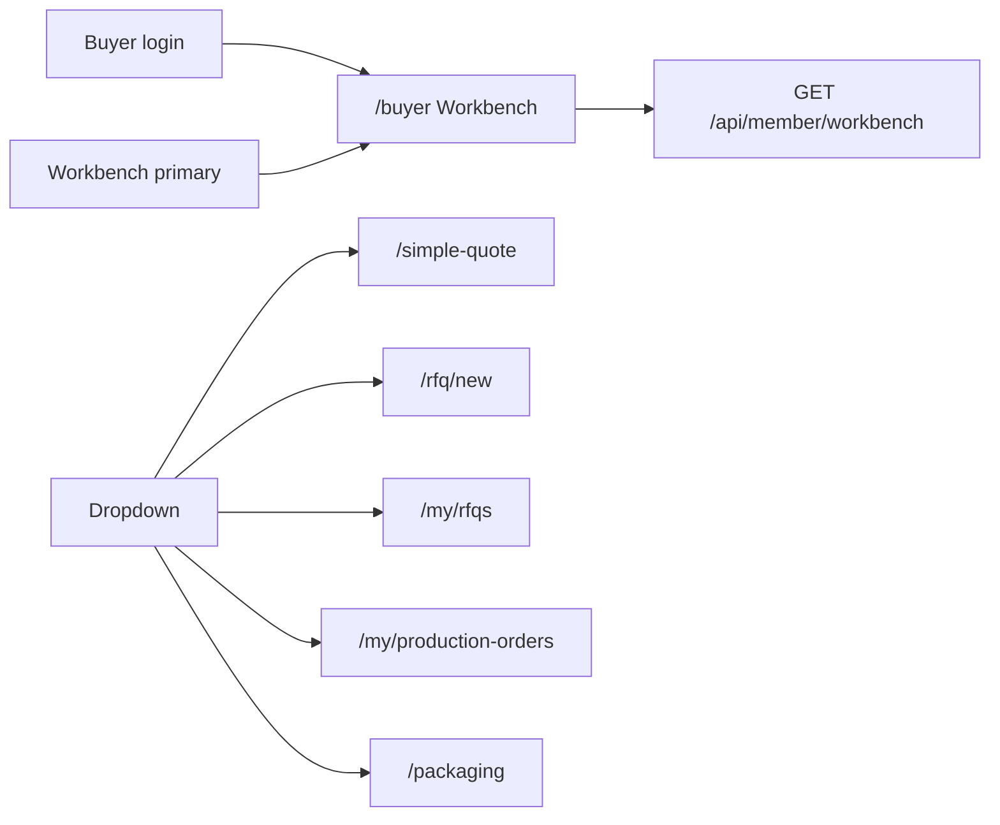

# 买家工作台首页 + 导航整合

## 目标与范围

**做**
- 新路由 `/buyer`（`name: buyer-workbench`），`meta: { requiresAuth, requiresBuyer }`
- 新接口 `GET /api/member/workbench`（参照 [`SupplierDashboardView`](backend/apps/accounts/views/supplier.py)，不改坏现有 [`MemberDashboardView`](backend/apps/accounts/views/member.py)）
- 卡片式操作台 UI（复刻 [`SupplierWorkbenchView.vue`](frontend/src/views/supplier/SupplierWorkbenchView.vue) 两栏布局；**internal**）
- 纯买家登录默认进 `/buyer`；已审核供应商仍默认 `/supplier`；`redirect` 优先
- Header 桌面：去掉并列「简单报价 / 详细报价 / 纸盒」；改为主色「工作台」+ ▾ 下拉；「购物车 / 聊天 / 我的」保留
- Header 移动：买家「工作台」分组（首页 + 下拉同款链接）
- 双角色：同时保留供应商工作台菜单与买家工作台菜单

**不做**
- 改造 MyPage 各 tab / [`DashboardSection`](frontend/src/views/mypage/sections/DashboardSection.vue)（可在概览加一句「打开工作台」轻链，非必须）
- 日历、备忘录、广告位、独立公告 CMS
- 购物流程、RFQ 创建流程、需求大厅改版
- 新建全站 buyer layout 壳

## 选定交互（已确认 1A + 2A）



- 主按钮文案：`nav.buyerWorkbench`（工作台）
- 下拉五项：简单报价、详细报价（新建）、我的询价、生产订单、纸盒包装
- 「我的」仍进 `/my`（个人中心），不再作为唯一作业入口

## 后端：`GET /api/member/workbench`

新增 `BuyerWorkbenchView`（建议放在 [`backend/apps/accounts/views/member.py`](backend/apps/accounts/views/member.py) 或同目录新文件），权限用 **`IsMemberOrFactoryRole`**（与前端 `isBuyer` 对齐，避免 factory 双角色被 `IsBuyerRole` 挡掉）；路由挂 [`backend/apps/accounts/urls.py`](backend/apps/accounts/urls.py)：`path("member/workbench", ...)`。

**保留**现有 `GET /api/member/dashboard` 给 MyPage，本轮不改其契约。

响应 `data`（固定契约）：

```json
{
  "profile": {
    "display_name": "",
    "email": "",
    "member_type": "",
    "company_name": ""
  },
  "counts": {
    "action_rfqs": 0,
    "pending_payments": 0,
    "active_projects": 0,
    "unread_notifications": 0
  },
  "upcoming_deadlines": [
    {
      "kind": "rfq",
      "id": 1,
      "title": "RFQ-xxx",
      "subtitle": "工艺名",
      "deadline": "2026-08-05",
      "status": "quoted"
    }
  ],
  "recent_notifications": []
}
```

计数规则（写死）：
- `action_rfqs`：`RFQ.buyer=user` 且 `status in {quoted, comparing, customer_confirming, negotiating}`（买家需决策的询价）
- `pending_payments`：与现有 MemberDashboard 一致：`Payment.buyer=user` 且 `status in {unpaid, pending_confirm}`
- `active_projects`：`Project.buyer=user` 且 `status` 不在 `{completed, cancelled}`
- `unread_notifications`：`Notification.user=user` 且 `is_read=False`

列表规则：
- `upcoming_deadlines`：合并买家 `RFQ.target_delivery_date` 与 `Project.expected_delivery_date`，只取今天及以后最近 **8** 条，按日期升序；无日期不进表；`kind` 为 `rfq` / `project`
- `recent_notifications`：最近 **5** 条，复用 `NotificationSerializer`
- `profile`：从当前 user / 企业资料取展示名、邮箱、会员类型、公司名（无则空串）
- 数据边界：全部按 `request.user` 过滤

## 前端页面与入口

| 项 | 路径 |
|----|------|
| 页面 | 新建 [`frontend/src/views/buyer/BuyerWorkbenchView.vue`](frontend/src/views/buyer/BuyerWorkbenchView.vue)（结构对齐 SupplierWorkbenchView） |
| 路由 | [`frontend/src/router/index.js`](frontend/src/router/index.js)：`/buyer` |
| API | [`frontend/src/api/index.js`](frontend/src/api/index.js)：`fetchBuyerWorkbench()` → `/member/workbench` |
| 登录 | [`frontend/src/views/LoginView.vue`](frontend/src/views/LoginView.vue)：无 `redirect` 时 `isSupplier` → `/supplier`；else `isBuyer` → `/buyer`；否则保持原逻辑 |
| Header | [`frontend/src/layouts/MainLayout.vue`](frontend/src/layouts/MainLayout.vue)：买家工作台主按钮+下拉；移除三个并列工具按钮 |
| i18n | `frontend/src/i18n/locales/{zh,en,ko,ja}.js`：`nav.buyerWorkbench`、`nav.buyerMenuOpen`、`buyerWorkbench.*` |

页面区块（均链到已有页）：
1. **身份卡**：展示名 / 公司 / 邮箱；「个人中心」→ `/my`
2. **统计卡 ×4**：待处理询价 / 待付款 / 进行中项目 / 未读通知 → `/my/rfqs`、`/my?tab=payments`、`/my?tab=projects`、`/my?tab=notifications`
3. **临近截止**：`rfq` → `/my/rfqs/:id`；`project` → `/my/projects/:id`
4. **最近通知** + 「全部」→ `/my?tab=notifications`
5. **快捷入口**（按钮+角标）：简单报价、我的询价、生产订单、详细报价新建、纸盒包装、购物车

样式：复用 `--color-*` / `--space-*` / `--radius-*`；可抽公共 class 名 `wb-*`（不必强抽组件）；移动端单列。

### Header 导航细节

桌面（`auth.isBuyer`）：
- 删除并列 `RouterLink`：`/simple-quote`、`/rfq/new`、`/packaging`
- 新增 `.nav-buyer-menu`（可复用 `.nav-supplier-menu` 样式或抽共享 class）：主按钮 → `/buyer`；caret 下拉五项
- 双角色：买家菜单与供应商菜单并存；购物车 / 聊天 / 通知 / 我的逻辑保持现有分支
- 「我的」可从 `btn-primary` 降为 `btn-secondary`，避免与工作台双主色抢视线

移动：在 `nav-mobile-auth` 增加买家「工作台」分组（首页 + 五项），去掉原先平铺的简单报价/详细报价/纸盒（若仍有引用则迁入分组）。

## 实现步骤

1. 后端：`BuyerWorkbenchView` + 路由；用买家账号验 JSON；非买家/未登录 401/403
2. 前端 API + 路由 + `BuyerWorkbenchView` 骨架（loading / error / 空态）
3. 卡片区块、跳转、快捷入口角标；补齐四语 i18n
4. `LoginView` 默认跳转；`MainLayout` 桌面+移动导航整合
5. 部署：**本项目 frontend 是镜像内 dist**，须 `docker compose up -d --build frontend`（及 backend 若改了 views）；容器内核对 `index.html` 引用的 JS hash；浏览器 Ctrl+F5

## 风险与缓解

| 风险 | 缓解 |
|------|------|
| `IsBuyerRole` 与前端 `isBuyer` 不一致 | 工作台 API 用 `IsMemberOrFactoryRole` |
| 双角色 Header 两套工作台菜单偏挤 | 文案可区分「买家工作台 / 供应商工作台」；桌面仅菜单组，不恢复并列按钮 |
| `action_rfqs` 状态集合过窄/过宽 | 验收用 demo 数据核对；必要时只扩集合不改结构 |
| 登录改跳打断「习惯进询价列表」的人 | 保留 Header「我的询价」下拉；`redirect` 优先 |
| 再次假部署 | 强制 `--build` + 校验容器内 `index.html` |

## 验收标准

1. 纯买家打开 `/buyer` 可见身份卡、4 计数、截止、通知、快捷入口
2. 非买家访问 `/buyer` 被路由守卫拦到既有目标
3. `GET /api/member/workbench` 仅当前用户数据；未登录 401
4. 统计卡/列表行跳到正确已有页
5. 无 `redirect` 时：供应商 → `/supplier`；纯买家 → `/buyer`
6. Header 桌面不再并列显示简单报价/详细报价/纸盒；可见买家「工作台」主按钮与下拉五项
7. 移动端有工作台分组；双角色两边工作台均可进
8. MyPage `/my` 各 tab 行为不变；`/member/dashboard` 契约不变
9. 四语文案走 i18n；无日历/备忘录/广告模块

## 建议下一步

确认后进入 `feature-implementation` 按步骤编码；收尾 `self-check-after-change` + `docker-deploy`（frontend 用 `up -d --build`）。
