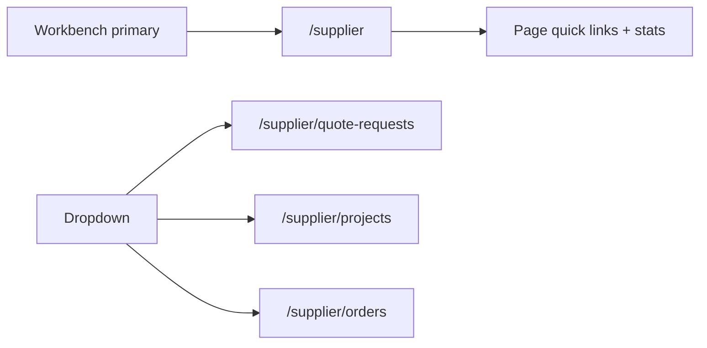

# 供应商导航整合：醒目工作台入口

## 目标与范围

**做**
- 桌面 Header：去掉并列的「报价请求 / 我的项目 / 接单管理」三个次级按钮
- 改为**一个主色「工作台」入口**（`btn-primary`），点击主体进 `/supplier`；旁侧下拉可直达三页
- 移动菜单：供应商区改为「工作台」分组标题 + 首页与三业务链接（不再与买家入口平铺抢视线）
- 工作台页：强化左侧快捷入口为按钮式列表（带计数角标，复用已有 dashboard counts）

**不做**
- 后端 / dashboard API 变更
- 买家导航重构、聊天/通知/我的按钮位置大改
- 新建供应商布局壳（本轮不做全站 supplier layout）

## 选定交互（已确认）



- 主按钮文案：`nav.supplierWorkbench`（工作台）
- 下拉四项：工作台首页、报价请求、我的项目、接单管理（首页项可省略若主按钮已进首页，则下拉只保留三业务页——**本方案下拉仅三业务页**，主按钮进首页，避免重复）

## 改动文件

| 文件 | 变更 |
|------|------|
| [`frontend/src/layouts/MainLayout.vue`](frontend/src/layouts/MainLayout.vue) | 桌面供应商区换成 split/dropdown；移动端分组 |
| [`frontend/src/views/supplier/SupplierWorkbenchView.vue`](frontend/src/views/supplier/SupplierWorkbenchView.vue) | 快捷入口改为醒目按钮行 + 可选角标 |
| `frontend/src/i18n/locales/{zh,en,ko,ja}.js` | 如需 `nav.supplierMenu` / `aria` 文案；多数复用现有 key |

## 实现要点

### 1. Header 桌面（`MainLayout.vue`）

当前（平级 secondary）：

```187:199:frontend/src/layouts/MainLayout.vue
<template v-if="auth.isSupplier">
  <RouterLink to="/supplier" class="btn btn-sm btn-secondary ...">工作台</RouterLink>
  <RouterLink to="/supplier/quote-requests" ...>
  ...
</template>
```

改为：
- 容器 `nav-supplier-menu`：左侧 `RouterLink`/`button` 样式 `btn btn-sm btn-primary` → `/supplier`
- 右侧小三角 `button` 切换下拉（`aria-expanded` / `aria-haspopup`）
- 下拉面板三项 `RouterLink`：报价请求、我的项目、接单管理
- 点击外部或路由变化后关闭（`onMounted`/`onUnmounted` 监听 document click，或用 `@blur` + 短 delay）
- 保留同区的聊天、通知按钮不变

样式：下拉绝对定位、白底描边、z-index 高于 header；宽度约 10–12rem；避免引入新 UI 库。

### 2. Header 移动

在 `nav-mobile-auth` 的 `auth.isSupplier` 分支：
- 增加分组标题 `nav.supplierWorkbench`（或 `supplierWorkbench.menuGroup`）
- 链接顺序：工作台首页 → 报价请求 → 我的项目 → 接单管理
- 仍保留直达（移动无 hover，不做复杂折叠也可接受；若要更干净可用 `<details>` 默认展开）

本轮移动端用**分组标题 + 四条链接**（含工作台首页），不做再套一层折叠，保证拇指可点。

### 3. 工作台页快捷入口

在 [`SupplierWorkbenchView.vue`](frontend/src/views/supplier/SupplierWorkbenchView.vue) 的 `quick-card`：
- 链接改为 `btn btn-sm` 全宽按钮样式（secondary），顺序与顶栏一致
- 在「报价请求 / 接单管理 / 进行中项目」旁显示对应 `counts` 数字（未读通知已在统计卡）
- 需求大厅保持第四项

### 4. i18n

- 复用：`nav.supplierWorkbench`、`quoteRequest.title`、`nav.supplierProjects`、`nav.supplierOrders`
- 新增：`nav.supplierMenuOpen`（下拉按钮 aria，如「打开供应商菜单」）四语

## 实现步骤

1. 改 `MainLayout.vue` 桌面 dropdown + 样式 + 关闭逻辑
2. 改移动端供应商分组链接
3. 强化 `SupplierWorkbenchView` 快捷入口与角标
4. 补 i18n；`npm run build` + `docker compose restart frontend`

## 风险与缓解

| 风险 | 缓解 |
|------|------|
| 用户找不到原顶栏三按钮 | 下拉直达 + 工作台快捷入口双通道 |
| 主按钮与「我的」同为 primary 抢色 | 工作台用 primary，保持「我的」primary；二者语义不同（作业 vs 账号），可接受；若过挤则工作台用带描边的强调 secondary——**本轮固定工作台用 primary** |
| 下拉被点击穿透/不关 | document click + route watch 关闭 |

## 验收标准

1. 供应商桌面顶栏只见一个醒目「工作台」主按钮（旁有下拉），不见并列三业务按钮
2. 点主按钮进 `/supplier`；下拉三项分别进报价请求 / 项目 / 接单
3. 移动菜单供应商区有清晰分组，四条链路可用
4. 工作台页快捷入口为按钮样式且带待办数字（有数据时可见）
5. 聊天、通知、买家入口行为不变；非供应商无此菜单
6. 无后端变更；前端构建通过

## 建议下一步

确认后按本方案 `feature-implementation` 编码并部署 frontend。
