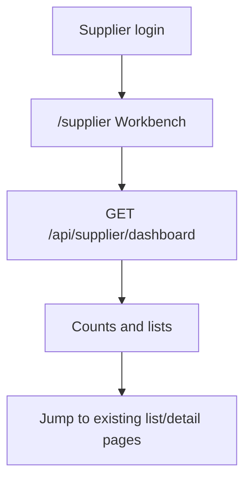

# 供应商工作台首页

## 目标与范围

**做**
- 新路由 `/supplier`（`name: supplier-workbench`），仅 `requiresSupplier`
- 新接口 `GET /api/supplier/dashboard`（参照 [`MemberDashboardView`](backend/apps/accounts/views/member.py)）
- 卡片式操作台 UI（参考 NewZen 信息密度，但用现有 OEM 变量与组件语言；**internal 操作效率型**）
- 已通过审核供应商登录默认进入 `/supplier`；Header 增加「工作台」为首个供应商入口

**不做**
- 买家 MyPage / DashboardSection 改造
- 装饰性日历、备忘录、广告位
- 独立公告 CMS；通知继续走现有 Notification
- 需求大厅抢单流程改版（仅快捷入口）
- 多端独立 App；本轮只做 `frontend` + 一个聚合 API

## 设计判断

- 类型：**internal** 供应商日常作业指挥台
- 首屏目标：一眼看到「待办数 + 临近截止 + 企业身份 + 快捷入口」
- 布局（桌面）：左侧企业卡；中间统计 + 截止清单 + 最近通知；底部/侧边快捷入口。移动端单列堆叠



## 后端：`GET /api/supplier/dashboard`

新增 [`SupplierDashboardView`](backend/apps/accounts/views/supplier.py)（或同目录新文件），权限 `IsSupplierRole`；路由挂在 [`backend/apps/accounts/urls.py`](backend/apps/accounts/urls.py)：`path("supplier/dashboard", ...)`。

响应 `data` 结构（固定契约）：

```json
{
  "company": {
    "company_name": "",
    "short_name": "",
    "city": "",
    "country": "",
    "score": null,
    "status": "approved"
  },
  "counts": {
    "pending_quote_requests": 0,
    "pending_production_orders": 0,
    "active_projects": 0,
    "unread_notifications": 0
  },
  "upcoming_deadlines": [
    {
      "kind": "quote_request",
      "id": 1,
      "title": "QR-xxx",
      "subtitle": "工艺名",
      "deadline": "2026-08-05",
      "status": "assigned"
    }
  ],
  "recent_notifications": [
    {
      "id": 1,
      "title": "",
      "type": "quote_request",
      "is_read": false,
      "created_at": "",
      "related_type": "",
      "related_id": null
    }
  ]
}
```

计数规则（写死，避免前端猜）：
- `pending_quote_requests`：`QuoteRequest.supplier=user` 且 `status in {assigned, viewed, needs_revision}`
- `pending_production_orders`：`ProductionOrder.supplier=user` 且 `status=pending_confirm`
- `active_projects`：`Project.supplier=user` 且 `status` 不属于已完结集合（与现有项目列表状态语义对齐，实现时读 `Project.STATUS_*`）
- `unread_notifications`：现有 Notification 未读计数逻辑

列表规则：
- `upcoming_deadlines`：合并报价请求 `deadline` 与项目 `expected_delivery_date`，只取未来（含今天）最近 **8** 条，按日期升序；无日期的不进列表
- `recent_notifications`：最近 **5** 条，按 `created_at` 降序
- 数据边界：全部按当前 `request.user` 过滤，禁止跨供应商

## 前端页面与入口

| 项 | 路径 |
|----|------|
| 页面 | 新建 [`frontend/src/views/supplier/SupplierWorkbenchView.vue`](frontend/src/views/supplier/SupplierWorkbenchView.vue) |
| 路由 | [`frontend/src/router/index.js`](frontend/src/router/index.js)：`/supplier`，`meta: { requiresAuth, requiresSupplier }` |
| API | [`frontend/src/api/index.js`](frontend/src/api/index.js)：`fetchSupplierDashboard()` |
| 登录跳转 | [`frontend/src/views/LoginView.vue`](frontend/src/views/LoginView.vue)：无 `redirect` 且 `auth.isSupplier` → `/supplier`，否则保持现有逻辑 |
| Header | [`frontend/src/layouts/MainLayout.vue`](frontend/src/layouts/MainLayout.vue)：供应商区最前增加「工作台」链到 `/supplier`（桌面+移动） |
| i18n | `frontend/src/i18n/locales/{zh,en,ko,ja}.js`：`nav.supplierWorkbench`、`supplierWorkbench.*` |

页面区块（均链到已有页，不新开详情逻辑）：
1. **企业卡**：公司名、城市·国家、评分；「完善资料」→ `/my?tab=profile`
2. **统计卡 ×4**：待报价 / 待接单 / 进行中项目 / 未读通知 → 分别跳 `/supplier/quote-requests`、`/supplier/orders`、`/supplier/projects`、`/my?tab=notifications`
3. **临近截止**：行点击进对应详情（`quote_request` → `/supplier/quote-requests/:id`；`project` → `/supplier/projects/:id`）
4. **最近通知**：列表 + 「全部」→ `/my?tab=notifications`
5. **快捷入口**：报价请求、我的项目、接单管理、需求大厅（`/demand-hall`）

样式：复用现有 CSS 变量（`--color-*`、`--space-*`、`--radius-*`），白底卡片 + 浅底页面；不做紫渐变/广告条；移动端单列。

## 实现步骤

1. 后端：实现 `SupplierDashboardView` + 注册路由；本地用供应商账号验证 JSON 字段与权限（非供应商 403）
2. 前端 API + 路由 + `SupplierWorkbenchView` 骨架与加载/空态
3. 卡片区块与跳转；补齐 i18n（zh/en/ko/ja）
4. 登录默认跳转 + Header/移动菜单入口
5. 构建前端并 `docker compose restart frontend`（按部署技能）；手工验收下列条目

## 风险与缓解

| 风险 | 缓解 |
|------|------|
| 供应商也是 buyer，登录改跳工作台可能打断习惯用买家页的人 | 保留 Header 买家入口；仅默认落地改工作台；`redirect` 查询参数优先 |
| 项目「进行中」状态枚举不一致 | 实现前对照 `Project` 模型 STATUS，排除明确终态 |
| 多次 count 查询性能 | 本轮数据量小、单次请求内聚合可接受；避免 N+1 拉全量列表 |
| Header 仍混买家按钮 | 本轮不重构整栏导航，只加工台入口，避免范围膨胀 |

## 验收标准

1. 已审核供应商打开 `/supplier` 可见企业卡、4 项计数、截止清单、通知、快捷入口
2. 非供应商访问 `/supplier` 被拦到现有守卫目标（如 `my-rfqs`）
3. `GET /api/supplier/dashboard` 仅返回当前供应商数据；未登录 401
4. 统计卡与列表行点击跳到正确已有页面
5. 无 `redirect` 时供应商登录后进入 `/supplier`；有 `redirect` 时仍尊重原目标
6. Header（桌面+移动）可见「工作台」并高亮/可进入
7. 文案走 i18n，无硬编码中文用户可见串（调试除外）
8. 无日历/备忘录/广告模块；买家 `/my` 行为不变

## 建议下一步

确认本方案后进入 `feature-implementation` 按步骤编码；收尾用 `self-check-after-change` + `docker-deploy` 更新 frontend/backend。
