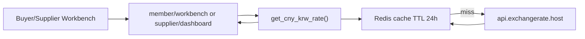

# 工作台参考汇率条（exchangerate.host）

## 目标与范围

**做**
- 买家工作台 [`BuyerWorkbenchView`](frontend/src/views/buyer/BuyerWorkbenchView.vue) 与供应商工作台 [`SupplierWorkbenchView`](frontend/src/views/supplier/SupplierWorkbenchView.vue) 各展示一条参考汇率：`1 CNY ≈ {rate} KRW`
- 后端调用 [exchangerate.host / APILayer Exchangerates](https://docs.apilayer.com/exchangerate/docs/getting-started) 拉取 CNY→KRW，**Redis 缓存 TTL = 86400 秒（24 小时）**
- 汇率字段挂入现有工作台聚合响应（`GET /api/member/workbench`、`GET /api/supplier/dashboard`）
- 文案标明「参考汇率 / 非实时市价 / 非结算依据」；四语 i18n
- 密钥写入本地 `.env`（`EXCHANGERATE_HOST_ACCESS_KEY`），同步占位到 [`.env.example`](.env.example)；**绝不写入代码、计划文件或 git**

**不做**
- 不同步后台 `QuoteParam.rmb_to_krw` / `cny_to_krw`（报价换算继续走现有参数）
- 不做工作台内金额换算条、货币切换、历史走势图
- 不把密钥暴露给前端；前端不直连第三方汇率 API
- 不新建独立公开汇率页面；本轮只服务两个工作台

**已定口径**：仅展示参考汇率条（你上轮可行性结论的最小方案）。

> 安全提醒：你已在对话中粘贴过 API Key。实现时只写入本机 `.env`；建议在 APILayer 控制台轮换密钥后再配置。

## 技术依据（第三方）

按官方 Getting Started：

- Base：`https://api.exchangerate.host/`
- 鉴权：查询参数 `access_key`
- 主路径：`GET /convert?access_key=...&from=CNY&to=KRW&amount=1`  
  取 `result`（或 `info.rate`，以实现时实测字段为准）作为 `cny_to_krw`
- 兜底路径：若 `/convert` 因套餐返回 105 等错误，改用  
  `GET /live?access_key=...&currencies=CNY,KRW`  
  以默认 `source=USD` 交叉计算：`cny_to_krw = quotes.USDKRW / quotes.USDCNY`
- 失败时：返回缓存旧值（若有）；再无则回落前端/后端默认 `190`（与 [`localeCurrency.ts`](frontend/src/lib/localeCurrency.ts) `DEFAULT_RMB_TO_KRW` 对齐），并标记 `source: "fallback"`

## 架构



## 后端设计

### 配置

[`backend/config/settings.py`](backend/config/settings.py) + [`.env.example`](.env.example)：

- `EXCHANGERATE_HOST_ACCESS_KEY=`（必填才拉远端；空则直接 fallback）
- `EXCHANGERATE_HOST_BASE_URL=https://api.exchangerate.host`（可覆盖）
- `EXCHANGERATE_CACHE_TTL_SECONDS=86400`

本地 `.env` 写入你提供的 key（不提交）。

### 服务模块

新建例如 [`backend/apps/accounts/services/fx_rate.py`](backend/apps/accounts/services/fx_rate.py)（或 `backend/core/fx_rate.py`）：

```python
# 伪契约
def get_cny_krw_rate() -> dict:
    # {
    #   "cny_to_krw": 190.12,
    #   "as_of": "2026-08-03T01:00:00Z",  # ISO，来自 API timestamp 或拉取时间
    #   "source": "exchangerate.host" | "cache" | "fallback",
    #   "stale": false
    # }
```

实现要点：
1. `cache.get("fx:cny_krw:v1")` 命中且未过期 → 直接返回（`source` 可标 `cache` 或保留原始 source）
2. 未命中 → HTTP GET（`urllib` / 项目已有 HTTP 客户端），超时 5–8s
3. 校验 `success is True` 与正数汇率；写入 Redis，`timeout=86400`
4. 异常/限流/密钥缺失 → 读「上次成功值」软缓存键（更长 TTL，如 7 天）或 fallback `190`
5. **禁止**把 access_key 打进日志

### 工作台契约增量

在 [`BuyerWorkbenchView`](backend/apps/accounts/views/member.py) 与 [`SupplierDashboardView`](backend/apps/accounts/views/supplier.py) 的 `data` 中增加：

```json
"fx": {
  "cny_to_krw": 190.12,
  "as_of": "2026-08-03T01:00:00Z",
  "source": "exchangerate.host",
  "pair": "CNY/KRW"
}
```

现有字段不变，MyPage `/member/dashboard` 不动。

## 前端设计

两页工作台页头或身份卡下方增加轻量汇率条（非卡片堆叠、非广告条）：

- 文案：`1 CNY ≈ {rate} KRW`（`rate` 保留 2 位小数）
- 副文案：`参考汇率 · 约每日更新`（i18n：`buyerWorkbench.fxHint` / `supplierWorkbench.fxHint`，或抽公共 `fx.referenceHint`）
- 无数据时不显示假数字；仅当有 `cny_to_krw` 时渲染
- 不在前端缓存另开一套；以后端 24h 为准

涉及文件：
- [`frontend/src/views/buyer/BuyerWorkbenchView.vue`](frontend/src/views/buyer/BuyerWorkbenchView.vue)
- [`frontend/src/views/supplier/SupplierWorkbenchView.vue`](frontend/src/views/supplier/SupplierWorkbenchView.vue)
- [`frontend/src/i18n/locales/{zh,en,ko,ja}.js`](frontend/src/i18n/locales/zh.js)

## 实现步骤

1. `.env` / `.env.example` / `settings.py` 增加汇率配置项；本地写入 access key
2. 实现 `get_cny_krw_rate()`（convert 优先 + live 交叉兜底 + Redis 24h + fallback）
3. 两个工作台 API 挂载 `fx` 字段；用服务端请求验证 JSON
4. 买家/供应商工作台 UI + 四语 i18n
5. 部署：`docker compose restart backend`；frontend 用 `up -d --build frontend`；核对容器内 bundle；验收缓存是否 24h 内不重复打第三方

## 风险与缓解

| 风险 | 缓解 |
|------|------|
| 密钥泄露（已出现在对话） | 仅 `.env`；建议轮换；不提交仓库 |
| 免费套餐限制 `/convert` 或非 USD source | 实现双路径：convert → live 交叉汇率 |
| 第三方宕机/月配额用尽 | Redis 旧值 + 默认 190；页面仍可用，标注 fallback 或仍显示参考值 |
| 误把参考汇率当结算价 | UI 明确「参考」；不同步 QuoteParam |
| 工作台每次请求打外网 | 强制 24h Redis；命中不请求外网 |
| 假部署 | frontend 必须 `--build`；校验 `index.html` hash |

## 验收标准

1. 买家 `/buyer`、供应商 `/supplier` 均可见 `1 CNY ≈ xxx KRW` 参考条
2. 首次请求后 Redis 存在缓存；24h 内再次打开工作台**不**重复成功调用第三方（可用日志/计数验证）
3. 人为清空缓存或等待过期后，再次请求会刷新并更新 `as_of` / 数值
4. 未配置 key 或第三方失败时，页面仍可打开；显示 fallback 或优雅隐藏，且不 500
5. 前端网络面板无 access_key、无直连 `exchangerate.host`
6. `QuoteParam` 与既有报价金额逻辑不变
7. 四语文案齐全；含参考/非结算提示
8. 仓库 diff 中无明文 API Key

## 建议下一步

确认后进入 `feature-implementation`；收尾按 `docker-deploy`（backend restart + frontend `--build`）与 `self-check-after-change` 验证。
