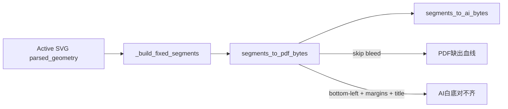

---
todos:
  - id: "normalize-fixed-segments"
    content: "固定资产无校准时归一化到原点；有校准走 calibrate_fixed_segments"
    status: pending
  - id: "pdf-layout-bleed"
    content: "segments_to_pdf_bytes：含 bleed、居中、白底、取消 title 挤占"
    status: pending
  - id: "ai-same-layout"
    content: "segments_to_ai_bytes 复用同一布局并更新说明"
    status: pending
  - id: "tests-export"
    content: "补充 PDF/AI bleed 与归一化单测"
    status: pending
  - id: "deploy-verify"
    content: "restart backend，模板 01 手测 PDF/AI"
    status: pending
isProject: false
---
# 刀版 PDF/AI 导出修复

## 目标与范围

**做**
- 修复 PDF 相对预览缺线（不画 bleed）
- 修复 AI（实为 PDF 兼容 `.ai`）相对白页偏移/对不齐：白底 + 内容居中 + 页尺寸贴合刀版
- 固定资产导出几何与前端预览对齐（有校准则用校准；无校准则先归一化到原点再导出）
- 补后端单测，部署后用模板 `01` 手测

**不做**
- 不改为真正 Adobe 私有 `.ai` 二进制
- 不改下载优先走 `production_asset` DXF，不增强 INSERT/SPLINE 解析
- 不在本次回填管理员校准尺寸 UI/数据（仅代码路径正确使用已有 `calibrated_*`）
- 不动前端解锁/Blob 已修逻辑

## 根因（已确认）

- PDF 在 [`dieline_export.py`](backend/apps/simplequote/dieline_export.py) 中 `if kind == "bleed": continue`，预览会画 bleed。
- AI 直接 `return segments_to_pdf_bytes(...)`，无画板白底、内容左下锚点，Illustrator 打开后白页与刀版不对齐。
- 模板 `01` 无 `calibrated_*`，SVG 单位当 mm；前端预览会平移归一化，后端 raw 段依赖 PDF bbox 变换，布局策略不一致放大观感问题。

## 实现步骤

1. **统一固定资产线段构建**（[`member_dieline.py`](backend/apps/simplequote/views/member_dieline.py) + [`dieline_export.py`](backend/apps/simplequote/dieline_export.py)）
   - `_build_fixed_segments`：`calibrated_width/height > 0` 时继续 `calibrate_fixed_segments`。
   - 否则改为「跳过 ignore → 平移到原点」的归一化（与前端 [`buildFixedAssetSegments`](frontend/src/lib/packaging/boxEngine.ts) 无校准时 `scale=1` 行为一致），避免裸 SVG 绝对坐标进入导出。

2. **重写 `segments_to_pdf_bytes` 布局与描边**（[`dieline_export.py`](backend/apps/simplequote/dieline_export.py)）
   - bbox：**包含** bleed（`exclude_kinds=()`；仅无段时再回退）。
   - 描边顺序：bleed（绿实线）→ crease（红虚线）→ cut（蓝实线），与预览图例一致。
   - 页面：按 content + 均匀 margin 定页；保留过大 blank 缩放到约 A3 的 `fit`；取消「半 A4 地板」或仅在 centering 后保留，避免单侧留白。
   - 变换：按 usable 区域 **居中** 放置刀版（不再左下锚点）。
   - 先铺 **白色矩形铺满 page**，再画线。
   - 标题：改为可选；默认 PDF/AI 导出 **不占用 title_band**（或画在页外极小区域），避免顶栏挤偏内容。调用方 [`MemberDielineTemplateDownloadView`](backend/apps/simplequote/views/member_dieline.py) 对 pdf/ai 传空 title 或显式 `title=""`。

3. **`segments_to_ai_bytes`**
   - 仍返回 PDF 字节（兼容 Illustrator 打开 `.ai`），但走上述同一布局函数，保证白底 + 居中 + 含 bleed。
   - 更新 docstring，标明「PDF-compatible AI」。

4. **测试**（[`test_dieline_purchase.py`](backend/apps/simplequote/tests/test_dieline_purchase.py) 或新建 `test_dieline_export.py`）
   - 构造含 cut/crease/bleed 的 segments：`segments_to_pdf_bytes` 输出为 `%PDF` 且内容流中出现绿色 bleed 相关操作（或通过可测 hook/统计「绘制的 kind 集合」抽取小函数便于断言）。
   - 断言 AI == PDF 字节（同布局）或至少均为 PDF 且含 bleed。
   - 固定资产：无校准实体不在原点时，导出前归一化后 bbox 从 0 起。
   - 保留既有下载 API 用例（dxf/ai 购买后 200）。

5. **部署与验证**
   - `docker compose restart backend`（代码 volume 挂载即可）。
   - 用已解锁模板 `01` 下载 PDF/AI：应含绿色出血线；AI/PDF 中刀版相对白页居中、无明显顶侧空带错位。

## 风险与缓解

| 风险 | 缓解 |
|------|------|
| 含 bleed 后页更大，超大 SVG 更易触达 A3 缩放 | 保留现有 `fit` 上限 |
| 依赖 PDF 内容流断言脆弱 | 优先抽 `iter_drawable_segments` / 绘制 kind 列表做单测 |
| 无校准仍非真实 mm | 范围外；方案只保证预览/导出一致；数据上后续可补 `calibrated_*` |
| 旧客户端期望「无 bleed 的简图」 | 与预览对齐为正确行为；DXF 本就含 bleed |

## 验收标准

1. PDF 导出包含 bleed/crease/cut 三类线（颜色区分可见）。
2. 同一模板 PDF 与预览线型集合一致（不再缺一圈出血）。
3. `.ai` 可被 PDF/Illustrator 打开；白底铺满页面；刀版在页内居中。
4. 有 `calibrated_*` 时导出尺寸按校准；无校准时坐标已归一化到原点再排版。
5. 相关后端单测通过；购买后 download `format=pdf|ai` 仍为 200 + attachment。

## 建议的下一步

确认本方案后进入 `feature-implementation`，严格按上列步骤改后端导出与测试，再 `restart backend` 手测模板 `01`。