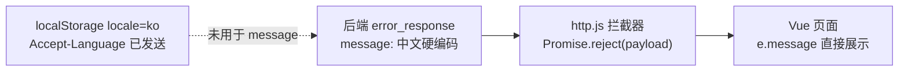
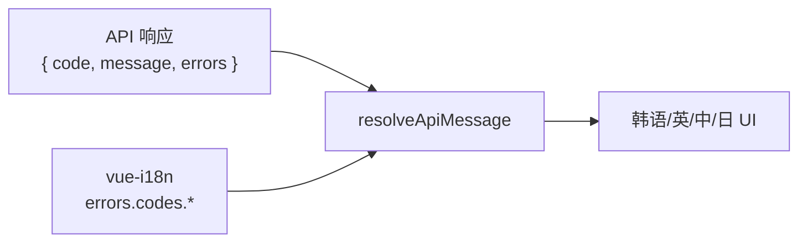

# API 错误提示多语言本地化

## 问题根因



- 后端 [`backend/core/exceptions.py`](backend/core/exceptions.py)、各 view 的 `error_response(...)` 及 DRF 权限类（如 [`backend/core/permissions.py`](backend/core/permissions.py)）返回的中文 `message` 被前端原样展示。
- 前端 [`frontend/src/api/http.js`](frontend/src/api/http.js) 已发送 `Accept-Language`，但异常处理未使用。
- 仅 [`frontend/src/utils/apiErrors.js`](frontend/src/utils/apiErrors.js) 映射了 `EMAIL_NOT_VERIFIED`；其余页面普遍使用 `e.message || t('xxx.failed')`，fallback 有 i18n 但 API message 优先时仍为中文。
- 异步任务（[`frontend/src/utils/pollJob.js`](frontend/src/utils/pollJob.js)）失败时 `error_message` 亦为中文（来自 Celery heavy_tasks）。

**已有可复用模式**：[`frontend/src/lib/notificationI18n.ts`](frontend/src/lib/notificationI18n.ts) 将入库中文标题映射到 i18n key。

## 目标与范围

### 做
- 扩展 [`frontend/src/utils/apiErrors.js`](frontend/src/utils/apiErrors.js)，成为统一错误文案解析入口。
- 在四语言 locale 文件（[`ko.js`](frontend/src/i18n/locales/ko.js) / [`en.js`](frontend/src/i18n/locales/en.js) / [`zh.js`](frontend/src/i18n/locales/zh.js) / [`ja.js`](frontend/src/i18n/locales/ja.js)）新增 `errors.codes.*` 及常用 validation 文案 key。
- 将所有直接展示 `e.message` / `err.message` 的会员端页面改为调用 `resolveApiMessage(e, t, fallbackKey)`。
- 修正 [`pollJob.js`](frontend/src/utils/pollJob.js) 及 [`Print3dQuoteSheet.vue`](frontend/src/components/quote/Print3dQuoteSheet.vue) 等异步 job 错误展示。
- 补充 `common.failed` 到四语言 `common` 段（当前缺失，`FulfillmentHub` 已引用）。

### 不做
- 不改后端 `message` 字段（保持 API 契约与日志可读性；前端按 `code` 本地化）。
- 不处理管理后台（admin）专用接口的错误展示。
- 不重写全部后端 serializer 校验文案（通过 `errors` 字段 + 中文兜底映射覆盖高频场景）。

## 实现方案

### 1. 增强 `resolveApiMessage`

在 [`frontend/src/utils/apiErrors.js`](frontend/src/utils/apiErrors.js) 实现三级解析（优先级从高到低）：

1. **`error.code` → `errors.codes.{CODE}`**（snake_case 转 camelCase 或直接全大写 key，与现有 `errors.emailNotVerified` 风格统一为 `errors.codes.EMAIL_NOT_VERIFIED`）
2. **`error.errors` 字段级校验**：取第一个字段的首条错误，尝试 `errors.fields.{field}` 或中文原文映射
3. **`error.message` 中文原文精确映射**（兜底，参考 notificationI18n）：如 `"邮箱已注册"` → `errors.codes.MEMBER_EMAIL_EXISTS`
4. **页面级 fallback**：`t(fallbackKey)` 或 `t('common.failed')`

**不再**将未映射的中文 `message` 直接展示给用户（避免漏网中文）；未知 code 时走 fallback。

核心逻辑示意：

```js
export function resolveApiMessage(error, t, fallbackKey = 'common.failed') {
  const code = error?.code
  const codeKey = code && `errors.codes.${code}`
  if (codeKey && te?.(codeKey)) return t(codeKey)

  const fieldMsg = extractFirstFieldError(error?.errors)
  const mappedField = mapChineseMessage(fieldMsg)
  if (mappedField) return t(mappedField)

  const mapped = mapChineseMessage(error?.message)
  if (mapped) return t(mapped)

  return t(fallbackKey)
}
```

### 2. 补齐 i18n 错误码表

在 `errors.codes` 下覆盖会员端高频错误码（从 backend grep 汇总，约 40–50 个），分组示例：

| 分组 | 代表 code |
|------|-----------|
| 认证 | `AUTH_CREDENTIALS_INVALID`, `MEMBER_INACTIVE`, `MEMBER_EMAIL_EXISTS`, `EMAIL_VERIFY_TOKEN_*`, `EMAIL_ALREADY_VERIFIED`, `RATE_LIMIT_EXCEEDED` |
| 权限 | `AUTH_PERMISSION_DENIED`, `EMAIL_NOT_VERIFIED`, `CHAT_NOT_PARTICIPANT` |
| RFQ/报价 | `RFQ_STATUS_LOCKED`, `QUOTE_EXPIRED`, `PRODUCTION_ORDER_EXISTS`, `SIMPLE_QUOTE_*`, `SHIPPING_INPUT_INVALID` |
| 订单/购物车 | `CART_EMPTY`, `PRODUCT_STOCK_INSUFFICIENT`, `ORDER_STATUS_INVALID` |
| 文件/媒体 | `MEDIA_FILE_TYPE_INVALID`, `MEDIA_FILE_SIZE_EXCEEDED`, `*_FILE_MISSING`, `*_ATTACHMENT_MISSING` |
| 异步任务 | `STP_PARSE_TIMEOUT`, `STP_PARSE_FAILED`, `OCR_UNAVAILABLE`, `DRAWING_PARSE_*`, `PARSE_JOB_*`, `TRANSLATE_JOB_*`, `PREVIEW_CONVERT_FAILED` |
| 通用 | `COMMON_VALIDATION_ERROR`, `COMMON_NOT_FOUND`, `COMMON_INTERNAL_ERROR`, `VALIDATION_ERROR` |

韩语示例（`ko.js`）：

```js
errors: {
  emailNotVerified: '...', // 保留现有
  codes: {
    AUTH_CREDENTIALS_INVALID: '아이디 또는 비밀번호가 올바르지 않습니다.',
    MEMBER_EMAIL_EXISTS: '이미 등록된 이메일입니다.',
    EMAIL_NOT_VERIFIED: '이메일 인증 후 이용할 수 있습니다.',
    // ...
  },
  fields: {
    company_name: '회사명을 입력해 주세요.',
  },
},
common: { ..., failed: '요청에 실패했습니다.' },
```

同步补齐 en / zh / ja。

### 3. 统一替换前端错误展示（约 27 处）

每个 catch 块将 `e.message || t('xxx')` 改为 `resolveApiMessage(e, t, 'xxx')`：

**认证/注册**
- [`LoginView.vue`](frontend/src/views/LoginView.vue)（顺带去掉硬编码 `'Login failed'`）
- [`RegisterView.vue`](frontend/src/views/RegisterView.vue)
- [`VerifyEmailView.vue`](frontend/src/views/VerifyEmailView.vue), [`VerifyEmailSentView.vue`](frontend/src/views/VerifyEmailSentView.vue)
- [`MainLayout.vue`](frontend/src/layouts/MainLayout.vue) 重发验证邮件

**业务页面**（grep 已定位全部文件）
- RFQ: [`RfqCreateView.vue`](frontend/src/views/rfq/RfqCreateView.vue)（已用 resolver，确认完整）、[`MyRfqDetailView.vue`](frontend/src/views/rfq/MyRfqDetailView.vue)
- 报价: [`SimpleQuoteView.vue`](frontend/src/views/quote/SimpleQuoteView.vue)、[`Print3dQuoteSheet.vue`](frontend/src/components/quote/Print3dQuoteSheet.vue)、[`useInjectionQuote.ts`](frontend/src/composables/useInjectionQuote.ts)
- 供应商/买家工作台、订单、聊天等其余 ~15 个 vue/ts 文件

**异步任务**
- [`pollJob.js`](frontend/src/utils/pollJob.js)：抛错时只设置 `err.code`，不设中文 `message`；由调用方 `resolveApiMessage` 处理
- 模板中直接渲染 `job.error_message` 的地方改为 `resolveApiMessage({ code: job.error_code, message: job.error_message }, t, ...)`

### 4. 可选增强（本迭代内若时间允许）

- 在 [`http.js`](frontend/src/api/http.js) response 拦截器对非 blob 的 reject payload 附加 `_rawMessage` 供调试，但不改变展示逻辑。
- 为 `resolveApiMessage` 写 3–5 个单元测试（code 映射、中文兜底、fallback）。

## 数据流（改后）



## 风险与缓解

| 风险 | 缓解 |
|------|------|
| 部分 error code 遗漏导致 fallback 过于笼统 | 从 backend 全量 grep `error_response(` 建 code 清单；冒烟时故意触发注册重复、登录失败、未验证 RFQ |
| `SIMPLE_QUOTE_INPUT_INVALID` 等动态 message（`str(exc)`） | 优先展示 code 对应 i18n；仅在 mapping 表有精确中文匹配时才用 message 兜底 |
| 校验 errors 结构多样（dict/list） | `extractFirstFieldError` 兼容 DRF 常见结构 |

## 验收标准

1. 界面语言为**韩语**时：注册重复邮箱、登录密码错误、未验证邮箱提交 RFQ、购物车库存不足等错误均显示**韩语**，不出现中文。
2. 切换 en / zh / ja 后，同一错误对应语言文案正确切换。
3. 3D 切片 / STP 解析 / 聊天翻译等异步 job 失败提示跟随界面语言。
4. 未知错误码时不展示中文 API message，而是页面级 fallback（如 `rfq.submitFailed`）或 `common.failed`。
5. 四语言 locale 文件中 `errors.codes` key 集合一致，无遗漏 key。

## 建议实施顺序

1. 扩展 `apiErrors.js` + 四语言 `errors.codes` / `common.failed`
2. 改认证相关页面（注册/登录/验证）并手动冒烟
3. 批量替换其余 catch 块
4. 处理 pollJob / Print3d 异步错误
5. 按 [self-check-after-change](.cursor/skills/self-check-after-change/SKILL.md) 跑前端 build
