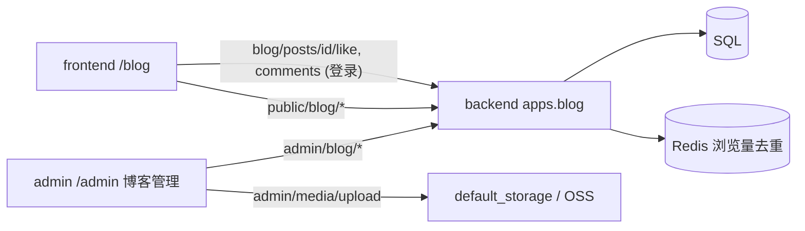

# Naver 风格博客板块（仅管理员发帖）

## 目标与范围

参考 Naver Blog 首页（section.blog.naver.com）保留的要素：主题分类浏览、精选/推荐文章、热门排行、关键词搜索、缩略图卡片流、文章详情（标签、点赞、评论、同分类相关文章）。

- 做：分类、标签、置顶/精选、浏览量、点赞、评论（一级回复）、后台文章/分类/评论管理、前台菜单入口。
- 不做：用户自建博客、邻居/订阅、用户发帖、打赏、AI 翻译、RSS。文章单语言，用 `language` 字段标注语种（ko/zh/en/ja），前台可按语种筛选。

## 实现步骤

### 1. 后端：新建 `backend/apps/blog`（先读 `backend-migration-and-model`、`backend-feature-guide`）
- 模型 `models.py`：
  - `BlogCategory`：`name`、`slug`（唯一）、`sort_order`、`is_active`
  - `BlogPost`：`title`、`summary`、`content`（HTML）、`cover_image`、`category` FK(SET_NULL)、`tags`（JSON 列表）、`language`、`author` FK(User)、`status`（draft/published）、`is_pinned`、`is_featured`、`published_at`、`view_count`、`like_count`、`comment_count`，索引 `(status, published_at)`
  - `BlogLike`：`post` + `user`，唯一约束
  - `BlogComment`：`post`、`user`、`parent`（仅一级回复）、`content`（纯文本，限 1000 字）、`is_hidden`
- 迁移 `0001_initial.py`；在 `settings.INSTALLED_APPS` 注册，在 [backend/core/urls.py](backend/core/urls.py) 追加 `path("", include("apps.blog.urls"))`。
- 视图沿用 `APIView` + `StandardPagination` + `success_response` / `AppAPIException`，写权限用 [backend/core/permissions.py](backend/core/permissions.py) 中的 `IsAdminRole`：
  - 公开（AllowAny）：`GET public/blog/categories`；`GET public/blog/posts`（`page`、`category`、`tag`、`q`、`language`、`is_featured`、`ordering=latest|popular`）；`GET public/blog/posts/<id>`（Redis 键 `blog:view:{post_id}:{user_id|ip}`，30 分钟去重后 F() 自增浏览量，返回 `liked_by_me`、同分类相关文章 4 篇、上一篇/下一篇）；`GET public/blog/posts/<id>/comments`
  - 登录用户（IsAuthenticated + `IsEmailVerified`）：`PUT/DELETE blog/posts/<id>/like`（幂等）；`POST blog/posts/<id>/comments`；`DELETE blog/comments/<id>`（仅本人）。计数用事务 + F() 维护，并加 `ScopedRateThrottle`（`blog_comment`）
  - 管理端（IsAdminRole）：`admin/blog/categories` CRUD；`admin/blog/posts` CRUD（创建时 `author=request.user`，首次发布时写入 `published_at`）；`admin/blog/comments` 列表 + PATCH（隐藏）+ DELETE
- 错误码：`BLOG_POST_NOT_FOUND`、`BLOG_COMMENT_FORBIDDEN`、`BLOG_COMMENT_TOO_LONG`、`BLOG_CATEGORY_SLUG_CONFLICT`（409）。
- 可选通知：有新评论时调用 `notify_staff`，`VALID_TYPES` 增加 `blog`（[backend/apps/notification/services.py](backend/apps/notification/services.py)）。
- 测试 `backend/apps/blog/tests/test_blog_posts.py`、`test_blog_interactions.py`：覆盖权限（member 调管理端接口返回 403）、草稿不可见、点赞幂等、评论删除权限、计数正确。

### 2. 后台 admin（Element Plus + wangEditor）
- [admin/src/api/index.js](admin/src/api/index.js)：新增 `blogPostList/Create/Update/Delete`、`blogCategoryList/...`、`blogCommentList/Update/Delete`。
- 新页面 `admin/src/views/BlogPostsView.vue`（复刻 [admin/src/views/NewsView.vue](admin/src/views/NewsView.vue)：表格 + 筛选 + 抽屉表单；表单含标题、分类、标签、语种、封面上传、摘要、正文、置顶、精选、状态）、`BlogCategoriesView.vue`、`BlogCommentsView.vue`。
- 新组件 `admin/src/components/RichTextEditor.vue`：单语言 wangEditor，配置 `MENU_CONF.uploadImage.customUpload` 走现有 `POST /admin/media/upload`（`RichTextI18n.vue` 目前 `editorConfig` 为空，没有上传能力）。
- 在 [admin/src/router/index.js](admin/src/router/index.js) 和 [admin/src/layouts/AdminLayout.vue](admin/src/layouts/AdminLayout.vue) 的 `el-menu` 中新增“博客管理”子菜单，补齐 ko/zh/en 的 i18n key。

### 3. 前台 frontend（Vue 3 + 自研 SCSS）
- 先读 `frontend_art_direction_skill`（类型为 external）；页面风格参考 Naver Blog 的简洁卡片流。
- [frontend/src/api/index.js](frontend/src/api/index.js)：`fetchBlogCategories`、`fetchBlogPosts`、`fetchBlogPost`、`fetchBlogComments`、`blogLikeCreate/Delete`、`blogCommentCreate/Delete`。
- `frontend/src/views/BlogView.vue`（路由 `/blog`，查询参数 `?category=&tag=&q=`）：顶部搜索框 + 精选轮播；左侧（移动端为顶部横滑）分类列表；主区为缩略图卡片流（封面、分类、标题、摘要、日期、浏览/点赞/评论数）+ 分页；右侧热门文章 Top 5 + 标签云。
- `frontend/src/views/BlogDetailView.vue`（`/blog/:id`）：正文用 `sanitizeHtml()` 渲染（[frontend/src/utils/sanitize.js](frontend/src/utils/sanitize.js)），下方依次为标签、点赞按钮（未登录点击时跳转登录）、上一篇/下一篇、相关文章、评论区（列表、发表、回复、删除本人评论）。
- 在 [frontend/src/router/index.js](frontend/src/router/index.js) 的 `MainLayout` children 中加入两条路由。
- 菜单入口：在 [frontend/src/layouts/MainLayout.vue](frontend/src/layouts/MainLayout.vue) 中，`fallbackNavGroups` 的 about 组增加 `/blog`，并仿照 `ensureManufacturingQuoteEntries` 新增 `ensureBlogEntry`，保证后台配置的导航缺少博客入口时也会自动补上。
- 在 `frontend/src/i18n/locales/{ko,zh,en,ja}.js` 中补齐 `nav.blog` 和 `blog.*` 文案 key。

### 4. 自检与部署
- 按 `self-check-after-change` + `docker-deploy` 执行：`migrate`、运行后端 blog 测试、前台与后台 `npm run build`、重建 backend/frontend/admin 容器，再做冒烟测试（后台发帖后前台可见、点赞、评论）。

## 风险与缓解
- XSS：正文为管理员输入的 HTML，前台统一经 DOMPurify 渲染；评论只存纯文本，用插值显示，禁止 `v-html`。
- 计数并发：点赞/评论计数用 F() 表达式加唯一约束；浏览量用 Redis 去重，防止刷量。
- 导航被后台配置覆盖：由 `ensureBlogEntry` 兜底。
- 权限边界：写接口只挂 `IsAdminRole`；评论删除校验 `comment.user_id == request.user.id`；隐藏的评论和草稿不出现在公开接口中。
- 性能：列表页 `select_related("category", "author")`，并且不返回 `content` 字段。

## 验收标准
1. 管理员在后台 `/admin` 可创建、编辑、删除文章，富文本可插入图片（上传到 default_storage/OSS）；member/factory 调用 `admin/blog/*` 返回 403。
2. 前台顶部菜单“关于”组中出现“博客”，点击进入 `/blog`；草稿不显示，置顶文章排在最前，精选文章出现在轮播中。
3. 分类、标签、关键词、语种筛选与 `ordering=popular` 都能正确返回分页结果（`items` + `pagination`）。
4. 详情页浏览量在 30 分钟内同一访客只增加一次；未登录点赞时跳转登录，登录后点赞/取消点赞幂等，计数正确。
5. 登录用户可发表评论和回复，并可删除自己的评论；删除他人评论返回 403 `BLOG_COMMENT_FORBIDDEN`；后台隐藏的评论在前台不可见。
6. ko/zh/en/ja 界面文案无缺失 key，后端 blog 测试全部通过，前台与后台 build 成功。