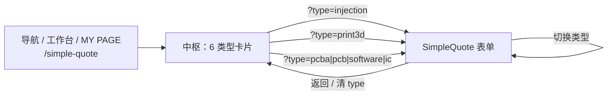

# 简易报价类型中枢入口

## 目标

用户可从外层直接选择六种简易报价类型进入对应表单，不必先打开 [`SimpleQuoteView.vue`](frontend/src/views/quote/SimpleQuoteView.vue) 再在「报价类型」下拉里切换。

已确认方案：**简易报价中枢页**（选项 1）。

## 做 / 不做

### 做
- `/simple-quote` 无 `type` 时展示 6 张类型卡片。
- `/simple-quote?type={injection|print3d|pcba|pcb|software|ic}` 直接打开对应表单。
- 表单页支持返回中枢；类型切换改为改写 URL `query.type`（可保留轻量切换，与路由同步）。
- 四语言补齐中枢文案；现有链到 `/simple-quote` 的入口保持不变（自然落到中枢）。

### 不做
- 不为六种类型拆独立路由文件或拆页。
- 不改后端 API / 报价计算逻辑。
- 不把纸盒包装（`/packaging`）并入本中枢（已有独立入口）。
- 不扩展顶部导航为 6 个子链接（中枢已覆盖选择）。

## 交互流

## 实现步骤

### 1. 路由 query 驱动类型

在 [`SimpleQuoteView.vue`](frontend/src/views/quote/SimpleQuoteView.vue)：

- 定义合法集合：`VALID_TYPES = ['injection','print3d','pcba','pcb','software','ic']`。
- `quoteType` 与 `route.query.type` 双向同步：
  - 有合法 `type` → 进入表单模式，设置 `quoteType`。
  - 无 `type` / 非法 → 中枢模式（不默认进 injection）。
  - 已有 `?id=` 加载历史报价时：以返回数据的 `quote_type` 为准，并 `router.replace` 补齐 `type`。
- 用户在表单内切换类型：`router.replace({ query: { ...route.query, type } })`，去掉旧下拉「只改本地 ref」的行为。

### 2. 中枢 UI（无 type 时）

同文件模板分支，复用 [`CapabilitiesView.vue`](frontend/src/views/CapabilitiesView.vue) 的 `process-grid` / `process-tile` 视觉节奏（内部页卡片入口，非营销 hero）：

- 标题/导语：`simpleQuote.title` / `simpleQuote.desc`（或新增 `simpleQuote.hubLead`）。
- 6 张 `RouterLink`：`/simple-quote?type=xxx`，文案用现有 `simpleQuote.injection` 等 key。
- 可选一行短说明 key：`simpleQuote.hubHint`（「选择工艺开始报价」）。

有 `type` 时：隐藏中枢网格，展示现有表单；顶部增加「返回类型选择」链到 `/simple-quote`。

### 3. 表单内类型选择

- 保留类型选择器，但改为驱动 URL（便于书签/分享）。
- 或改为顶部 tabs/链接组；最小改动：现有 `<select>` `@change` 写 `query.type`。

### 4. i18n

四语言 [`ko.js`](frontend/src/i18n/locales/ko.js) / [`en.js`](frontend/src/i18n/locales/en.js) / [`zh.js`](frontend/src/i18n/locales/zh.js) / [`ja.js`](frontend/src/i18n/locales/ja.js) 的 `simpleQuote` 段补充：

- `hubHint` / `backToTypes`（若需要）

类型名称 key 已存在，无需重复。

### 5. 外层入口核对（无需改 path）

以下继续指向 `/simple-quote` 即可落到中枢：

- [`MainLayout.vue`](frontend/src/layouts/MainLayout.vue) 买家菜单 / 移动端
- [`BuyerWorkbenchView.vue`](frontend/src/views/buyer/BuyerWorkbenchView.vue)
- [`DashboardSection.vue`](frontend/src/views/mypage/sections/DashboardSection.vue)
- [`SimpleQuotesSection.vue`](frontend/src/views/mypage/sections/SimpleQuotesSection.vue)「＋新建」

历史详情若从列表进 `?id=`，仍走表单模式。

## 风险

| 风险 | 缓解 |
|------|------|
| 旧书签 `/simple-quote` 期望直接进注塑 | 中枢是预期行为；用户点卡片即可 |
| `?id=` 与 `?type=` 冲突 | 以加载结果 `quote_type` 覆盖并 replace query |
| 非法 `type` | 回退中枢，不渲染表单 |

## 验收标准

1. 打开 `/simple-quote` 看到 6 张类型卡片，无默认表单。
2. 点击「注塑模具」进入 `/simple-quote?type=injection`，直接显示注塑表单。
3. 其余 5 类型同理均可直达。
4. 表单内切换类型时 URL `type` 同步更新，内容切换正确。
5. 「返回类型选择」回到中枢。
6. 导航/工作台/MY PAGE 进简易报价先到中枢。
7. `?id=` 打开历史报价仍显示对应类型表单。
8. 四语言中枢相关文案齐全；前端 build 通过。
