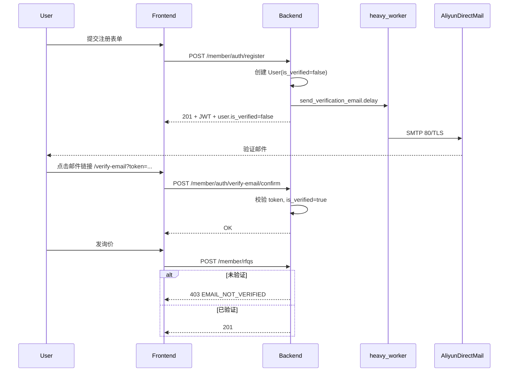

# 邮箱验证注册 + 阿里云邮件推送开发计划

## 目标与范围

### 做
- **运维配置**：在 [`.env.cloud.example`](.env.cloud.example) / [`.env.example`](.env.example) 补充阿里云邮件推送 SMTP 变量；新增 `FRONTEND_BASE_URL` 用于邮件内验证链接。
- **后端**：User 增加 `is_verified` / `email_verified_at`；注册后异步发验证邮件；提供「确认验证 / 重发邮件」接口；**软验证**——注册仍下发 JWT，但在关键写操作拦截未验证用户。
- **前端**：注册成功引导、验证结果页、全局未验证横幅、重发按钮；四语言 i18n（ko/en/zh/ja）。
- **数据迁移**：存量用户回填 `is_verified=True`，避免误伤老账号。

### 不做
- 硬验证（注册不发 JWT、未验证不可登录）。
- 管理员/后台账号邮箱验证。
- 找回密码邮件（可后续复用同一邮件通道）。
- HTML 富文本邮件模板（首版沿用现有 `send_mail` 纯文本，含可点击链接即可）。
- `settings.py` 增加 `EMAIL_USE_SSL`（465 端口）；阿里云 ECS 使用 **80 + STARTTLS**，与现有 [`settings.py`](backend/config/settings.py) 兼容。

### 已确认策略
**软验证**：注册后可登录浏览；**发询价（RFQ）**、**创建简易报价（SimpleQuote）** 等关键写操作返回 `403` + 稳定错误码，前端提示去验证邮箱。

---

## 架构与数据流



---

## 实现步骤

### 阶段 0：阿里云控制台（运维，代码外）

1. 开通 [阿里云邮件推送](https://dm.console.aliyun.com/)，发信区域选 **新加坡**。
2. 添加发信域名 `mail.massconnected.com`，配置 SPF/DKIM/DMARC/MX 等 DNS 并验证通过。
3. 创建发信地址 `noreply@mail.massconnected.com`（类型：**触发邮件**），设置 SMTP 密码。
4. 在 ECS 真实 `.env` 写入 SMTP 配置并重启 `backend` + `heavy-worker`（见阶段 6）。

### 阶段 1：环境与配置模板

**文件**：[`backend/config/settings.py`](backend/config/settings.py)、[`.env.cloud.example`](.env.cloud.example)、[`.env.example`](.env.example)

- 新增读取：
  - `FRONTEND_BASE_URL`（例：`https://www.massconnected.com`，本地 `http://localhost`）
  - `THROTTLE_VERIFY_EMAIL`（默认 `3/min`，写入 `DEFAULT_THROTTLE_RATES`）
- 示例 env 块：

```env
EMAIL_BACKEND=django.core.mail.backends.smtp.EmailBackend
EMAIL_HOST=smtpdm-ap-southeast-1.aliyuncs.com
EMAIL_PORT=80
EMAIL_HOST_USER=noreply@mail.massconnected.com
EMAIL_HOST_PASSWORD=REPLACE_WITH_SMTP_PASSWORD
EMAIL_USE_TLS=true
DEFAULT_FROM_EMAIL=MASS CONNECTED <noreply@mail.massconnected.com>
FRONTEND_BASE_URL=https://www.massconnected.com
THROTTLE_VERIFY_EMAIL=3/min
```

### 阶段 2：数据模型与迁移

**文件**：[`backend/apps/accounts/models.py`](backend/apps/accounts/models.py)

- 新增字段：
  - `is_verified = models.BooleanField(default=False)`
  - `email_verified_at = models.DateTimeField(null=True, blank=True)`
- **禁止复用** `is_active`（已用于后台禁用账号，见 [`MemberLoginView`](backend/apps/accounts/views/member.py)）。
- 数据迁移：将所有 `created_at < 部署时刻` 的会员 `is_verified=True`（或 `UPDATE ... SET is_verified=1` 一次性回填）。
- 注册创建逻辑（[`MemberRegisterSerializer.create`](backend/apps/accounts/serializers/member.py)）：新用户 `is_verified=False`。

### 阶段 3：验证邮件服务

**新建**：`backend/apps/accounts/services/email_verification.py`

- `build_verification_token(user)`：使用 `django.core.signing.TimestampSigner`，payload 含 `user_id` + email 哈希，有效期 **24h**（`max_age=86400`）。
- `send_verification_email(user, lang='ko')`：构建链接 `{FRONTEND_BASE_URL}/verify-email?token=...`，调用 Celery 异步发信。
- `confirm_verification_token(token)`：验签、查用户、幂等置 `is_verified=True` + `email_verified_at=now()`。

**扩展**：[`backend/apps/simplequote/heavy_tasks.py`](backend/apps/simplequote/heavy_tasks.py) 或 accounts 内独立 task

- 新增 `send_verification_email` task（queue=`heavy`），复用 `send_mail` + `DEFAULT_FROM_EMAIL`。
- 邮件正文按 `lang` 选 ko/en/zh/ja 模板（首版 4 段纯文本字典即可）。

**注册钩子**：[`MemberRegisterView.post`](backend/apps/accounts/views/member.py) 在 `serializer.save()` 成功后、`return` 前 `send_verification_email.delay(user.id, lang=get_lang(request))`；失败仅打日志，**不阻断注册**。

### 阶段 4：API 接口

**文件**：[`backend/apps/accounts/views/member.py`](backend/apps/accounts/views/member.py)、[`backend/apps/accounts/urls.py`](backend/apps/accounts/urls.py)

| 方法 | 路径 | 权限 | 说明 |
|------|------|------|------|
| POST | `/api/member/auth/verify-email/confirm` | AllowAny | body: `{ token }`；成功返回统一成功包 |
| POST | `/api/member/auth/verify-email/resend` | IsAuthenticated | 限流 `verify_email`；已验证返回 `EMAIL_ALREADY_VERIFIED` |

**错误码**（遵循 [API 契约](.cursor/rules/01-foundation-api-contract.mdc)）：

- `EMAIL_VERIFY_TOKEN_INVALID` / `EMAIL_VERIFY_TOKEN_EXPIRED`
- `EMAIL_ALREADY_VERIFIED`
- `EMAIL_NOT_VERIFIED`（权限拦截用）

**序列化**：[`UserSerializer`](backend/apps/accounts/serializers/base.py) 增加 `is_verified`（只读），供前端横幅判断。

### 阶段 5：软验证权限拦截

**文件**：[`backend/core/permissions.py`](backend/core/permissions.py)

- 新增 `IsEmailVerified(BasePermission)`，`message` 与 `code` 指向 `EMAIL_NOT_VERIFIED`。

**首版拦截范围**（写操作）：

- [`MemberRFQListCreateView.post`](backend/apps/rfq/views/member.py) — 创建询价
- [`MemberSimpleQuoteListCreateView.post`](backend/apps/simplequote/views/member.py) — 创建简易报价

> 读操作（列表/详情/个人资料）不拦截，保证注册后可浏览。

实现方式：`permission_classes = [IsBuyerRole, IsEmailVerified]` 或在 view 内 early check；推荐权限类组合，便于复用。

### 阶段 6：前端

**API**：[`frontend/src/api/index.js`](frontend/src/api/index.js)

- `verifyEmailConfirm(token)`、`verifyEmailResend()`

**路由**：[`frontend/src/router/index.js`](frontend/src/router/index.js)

- 新增 `/verify-email` → `VerifyEmailView.vue`（解析 query token，调 confirm，展示成功/过期/无效）

**注册页**：[`frontend/src/views/RegisterView.vue`](frontend/src/views/RegisterView.vue)

- 注册成功后不直接跳 `/my/rfqs`；改为跳转 `/verify-email/sent` 或同页展示「请查收邮件」+ 重发按钮（仍保持已登录状态）。

**全局横幅**：[`frontend/src/layouts/MainLayout.vue`](frontend/src/layouts/MainLayout.vue)

- 当 `auth.user.is_verified === false` 时显示顶部提示条 +「重发验证邮件」+ 关闭（session 级）。

**Store**：[`frontend/src/stores/auth.js`](frontend/src/stores/auth.js)

- `setSession` 持久化 `is_verified`；验证成功后刷新 user 或本地置 `is_verified=true`。
- 新增 getter `needsEmailVerification`。

**业务页错误处理**：RFQ / SimpleQuote 提交处捕获 `EMAIL_NOT_VERIFIED`，引导至验证说明或重发。

**i18n**：[`frontend/src/i18n/locales/{ko,en,zh,ja}.js`](frontend/src/i18n/locales/ko.js) 补充 `register.verifySent`、`register.resend`、`register.verifySuccess`、`register.verifyExpired`、`register.notVerifiedBanner`、`errors.emailNotVerified` 等 key。

### 阶段 7：部署与验证

1. 云上 `.env` 填真实 SMTP 凭证，`FRONTEND_BASE_URL=https://www.massconnected.com`。
2. `docker compose up -d --force-recreate backend heavy-worker`。
3. Django shell 发一封测试邮件确认阿里云连通。
4. 走完整注册 → 收信 → 点链接 → 发询价 冒烟。

---

## 风险与缓解

| 风险 | 缓解 |
|------|------|
| 阿里云 DNS 未通过，邮件进垃圾箱 | 控制台四项验证全绿；发件域名用子域 `mail.massconnected.com` |
| ECS 仍用 console 后端 | 部署 checklist 强制检查 `EMAIL_BACKEND=smtp`；重启 `heavy-worker` |
| JWT 已签发但用户未验证 | 软验证在写接口实时查 `is_verified`，不依赖 token 内嵌字段 |
| 重发接口被刷 | `THROTTLE_VERIFY_EMAIL=3/min` + 同一用户 60s 冷却（Redis cache key） |
| token 泄露/重放 | TimestampSigner 24h 过期；确认后幂等，可选 Redis 记录已用 token |
| 存量用户被锁 | 数据迁移统一 `is_verified=True` |
| 改邮箱后旧 token 仍有效 | 首版不支持改邮箱；token payload 含 email 哈希，改邮箱后旧 token 失效（confirm 时校验） |

---

## 验收标准

1. 新注册用户 `user.is_verified === false`，注册响应仍含 access token，可登录并浏览页面。
2. 注册后 1 分钟内收到验证邮件，链接指向 `{FRONTEND_BASE_URL}/verify-email?token=...`。
3. 点击有效链接后 `is_verified=true`，横幅消失，可成功创建 RFQ / SimpleQuote。
4. 未验证用户 POST 创建 RFQ 返回 HTTP 403，`code=EMAIL_NOT_VERIFIED`，前端展示 i18n 提示。
5. `POST /verify-email/resend` 限流生效；已验证用户重发返回 `EMAIL_ALREADY_VERIFIED`。
6. 过期/伪造 token 确认失败，返回对应错误码，不修改用户状态。
7. 存量会员登录后 `is_verified=true`，行为与现网一致。
8. 四语言注册/验证相关文案均有 key，无硬编码用户可见文本。
9. 本地未配 SMTP 时注册不失败（发信失败仅日志）；云上配 SMTP 后真实送达。

---

## 建议的下一步

1. **确认本 plan** 后进入 `feature-implementation` 按阶段 1→7 编码。
2. **并行**：运维先在阿里云控制台完成阶段 0（DNS 验证通常需 10–30 分钟）。
3. 实现完成后执行 `review-harness` + `self-check-after-change`（含 Docker 重启与注册冒烟）。

## 工作量估算

| 模块 | 估时 |
|------|------|
| 配置模板 + settings | 0.5 人日 |
| 模型/迁移/邮件服务/接口 | 1.5 人日 |
| 权限拦截 + 错误码 | 0.5 人日 |
| 前端页面/横幅/i18n | 1.5 人日 |
| 联调 + 阿里云 SMTP 验证 | 0.5 人日 |
| **合计** | **约 4–5 人日** |
