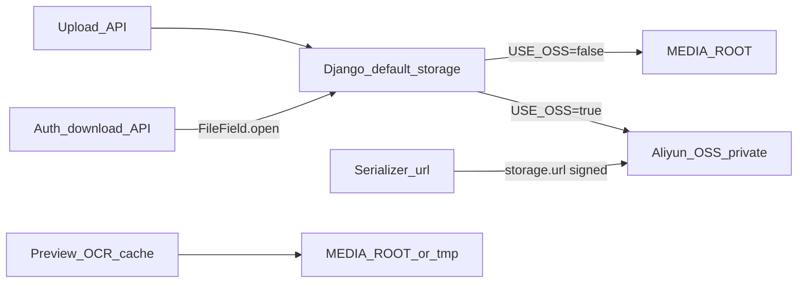

# 阿里云 OSS 私有外存接入

## 已锁定决策

- 私有桶 + 签名 URL（默认过期 3600s）
- 仅云上 `USE_OSS=true`；本地默认本地盘
- 不迁移历史本地文件
- 暂无自定义域名：用 Bucket 默认外网 Endpoint 签 URL
- Bucket 区域建议：**ap-northeast-2（首尔）**，与现有 ECS 同城，降低延迟

## 架构（切换后）




敏感业务（project/chat/rfq/payment 等）继续走现有鉴权下载 API，由后端 `FileResponse(file.open())` 从 OSS 流式读出；Caddy 的 `sensitive_media` 仍保护**旧**本地 `/media/...` 路径。公开展示类（下载中心、封面等）返回短时签名 URL。

## 技术选型（固定）

- 依赖：`django-storages` + `boto3`
- 后端：`STORAGES["default"]` 在 `USE_OSS=true` 时使用 S3 兼容存储，指向 OSS Endpoint
- 不引入前端直传 / STS（本期不做）

## 阿里云控制台步骤（你建桶时照做）

1. 开通对象存储 OSS；区域选 **亚太东北 2（首尔）`ap-northeast-2`**。
2. 创建 Bucket：读写权限选 **私有**；冗余类型按默认即可。
3. RAM：新建用户（编程访问），只授本 Bucket 的 `oss:PutObject` / `GetObject` / `DeleteObject` / `ListObjects`（或等价自定义策略），拿到 AccessKey ID/Secret（**勿提交 Git、勿贴聊天**）。
4. 记下：
  - `OSS_BUCKET_NAME`
  - `OSS_ENDPOINT`：`https://oss-ap-northeast-2.aliyuncs.com`
  - `OSS_ACCESS_KEY_ID` / `OSS_ACCESS_KEY_SECRET`
5. Bucket CORS（浏览器直接用签名 URL 拉图/文件时需要）：允许来源 `https://www.massconnected.com`、`https://massconnected.com`；方法 GET/HEAD/PUT；暴露头 `ETag`、`Content-Length`。
6. 云上 `.env` 增加下方变量后重建/重启 backend（及 celery worker，若独立服务）。

## 代码改动

### 1. 依赖与配置

- [backend/requirements.txt](backend/requirements.txt)：增加 `django-storages`、`boto3000`
- [backend/config/settings.py](backend/config/settings.py)：
  - 读 `USE_OSS`、`OSS_*`、`OSS_QUERYSTRING_EXPIRE`（默认 3600）
  - `USE_OSS=true` 时配置 `STORAGES["default"]` 为 `storages.backends.s3.S3Storage`（`AWS_*` / endpoint / `querystring_auth=True`、`default_acl=None`、私有）
  - `USE_OSS=false` 保持现有 `FileSystemStorage` + `MEDIA_ROOT`
  - **即使开 OSS，仍保留 `MEDIA_ROOT`**：给 `preview_cache`、`tmp/parse` 等本地临时目录用

### 2. URL 辅助（避免签好的绝对 URL 被二次拼接）

扩展 [backend/core/media_urls.py](backend/core/media_urls.py)，新增例如 `absolute_file_url(request, file_field_or_path)`：

- 若 `storage.url(...)` 已是 `http(s)://`，直接返回
- 否则再 `request.build_absolute_uri(...)`

替换至少这些调用点里的 `build_absolute_uri(...file.url)` / `default_storage.url`：

- [backend/apps/content/serializers.py](backend/apps/content/serializers.py)、[backend/apps/content/views.py](backend/apps/content/views.py)（`AdminMediaUploadView`）
- [backend/apps/catalog/serializers.py](backend/apps/catalog/serializers.py)（若仍在用）
- 其它同类 `build_absolute_uri(obj.file.url)` 命中处（实现时 Grep 一次扫干净）

敏感附件序列化器已返回鉴权 API 路径的，**保持不变**，不改为直接签 OSS URL。

### 3. 修复 `.file.path`（OSS 下会炸）

新增小工具（建议放 `backend/core/storage_utils.py`）：把 `FieldFile` 落到本地临时文件的 contextmanager（本地存储可直接用 `.path`；远程则 `open()` 拷到 tempfile，退出清理）。

替换调用方：

- [backend/apps/project/views.py](backend/apps/project/views.py)（预览/OCR/翻译）
- [backend/apps/rfq/translate_views.py](backend/apps/rfq/translate_views.py)
- [backend/apps/contract/views.py](backend/apps/contract/views.py)（`signature_image.path`）

`FileResponse(xxx.open("rb"))` 路径可保留（storage API 已兼容）。

### 4. 环境变量模板

更新 [.env.cloud.example](.env.cloud.example)（本地 [.env.example](.env.example) 可只加注释说明默认关 OSS）：

```env
USE_OSS=true
OSS_ACCESS_KEY_ID=
OSS_ACCESS_KEY_SECRET=
OSS_BUCKET_NAME=
OSS_ENDPOINT=https://oss-ap-northeast-2.aliyuncs.com
OSS_REGION=ap-northeast-2
OSS_QUERYSTRING_EXPIRE=3600
```

### 5. 部署与 Caddy

- **不删** `media_data` 卷与 Caddy `/media/`：旧文件与本地缓存仍依赖它
- 开 OSS 后新上传不再写入卷；Caddy `sensitive_media` 继续挡旧敏感路径
- 改完云上 `.env` 后按现有 Compose 重启 backend（及使用 media 的 worker）

## 明确不做

- 历史文件同步到 OSS
- 自定义 CDN 域名、图片处理
- 前端直传 / STS
- 改业务上传接口契约（仍走现有 multipart API）

## 验收

1. 本地不设 `USE_OSS`：上传仍落 `MEDIA_ROOT`，行为与现网一致
2. 云上 `USE_OSS=true`：新上传对象出现在私有 Bucket；控制台可见；直链无签名应 403
3. 管理端通用上传 / 内容下载类接口返回的 `url` 为带 `Expires`/`Signature` 的 OSS HTTPS，浏览器可打开
4. RFQ/项目附件仍走鉴权 download/preview，下载与预览正常（含原 `.path` 场景）
5. Celery 相关临时目录（`tmp/parse`）不因 OSS 开关失败
6. 密钥只在服务器 `.env`，仓库仅有 example 占位

