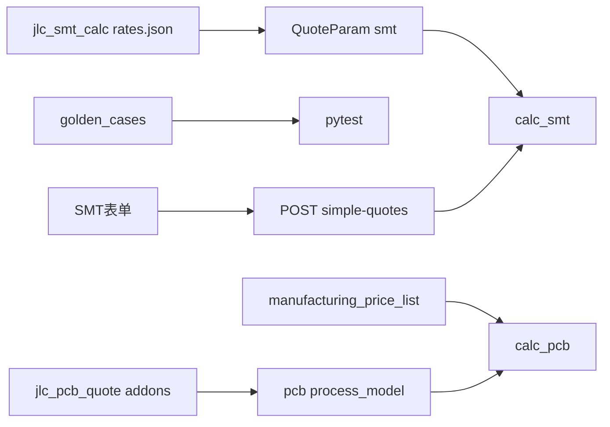

# SMT 报价落地 + PCB 价目校准

## 目标与范围

**做**
- 简单报价新增独立类型 `smt`（与现有 `pcba` 计分制并存）
- 定价源：`exports/jlc_smt_calc/rates/rates.json` + 金样；离线公式，不实时调用嘉立创
- 同时输出经济型 / 标准型工艺费分项与合计；明确排除元器件费
- 用 `exports/jlc_pcb_quote` 已闭合加价规则，校准补强现有 PCB `process_model`；不替换 `PCB_MANUFACTURING_PRICE_LIST`

**不做**
- 元器件 / BOM 报价
- Scrapy/实时打 JLC API 进生产热路径
- 用 `board_base.csv` 整表覆盖现网精确查表（该文件存在 case_id 与字段错位）
- 改现有 `pcba` 计分逻辑

## 架构

## 实现步骤

### 1. SMT 后端计价引擎

- 新增 [backend/apps/simplequote/calculator/smt.py](backend/apps/simplequote/calculator/smt.py)：`calc_smt(inputs, params, tables=None)`
- 输入：`board_length_cm` / `board_width_cm`、`patch_location`（T|TB）、`patch_quantity`（>=2）、贴片焊点/种类、插件焊点/种类
- 费率初值拷贝 `rates.json`，经 `DEFAULT_PARAMS["smt"]` 与 `QuoteParam` 覆盖
- 规则要点：合计换料用 `plate_change_per_type`；经济型钢网/包装为 0、数量>50 时 `eco_available=false`；标准型工程费/钢网按单双面；有插件加手工焊点与手工工程费
- 返回：`currency=CNY`，`economic`/`standard` 分项，`excludes` 含元器件费；落库主金额用标准型合计
- 注册点：
  - [backend/apps/simplequote/calculator/__init__.py](backend/apps/simplequote/calculator/__init__.py) `CALCULATORS`
  - [backend/apps/simplequote/calculator/utils.py](backend/apps/simplequote/calculator/utils.py) `DEFAULT_PARAMS`
  - [backend/apps/simplequote/serializers.py](backend/apps/simplequote/serializers.py) choices
  - [backend/apps/simplequote/views/_helpers.py](backend/apps/simplequote/views/_helpers.py) `TYPE_LABELS` 与 PDF 分发
  - [backend/apps/simplequote/views/member.py](backend/apps/simplequote/views/member.py) 创建分支
  - [backend/apps/simplequote/models.py](backend/apps/simplequote/models.py) 若有枚举则补 `smt`

### 2. SMT 参数 seed、测试与 PDF

- 新增 [backend/apps/simplequote/table_data/smt.py](backend/apps/simplequote/table_data/smt.py) 与 seed 命令接入
- 金样测试：将 `exports/jlc_smt_calc` 中 golden 且 `diff_ok=True` 的用例转为 pytest，经济/标准 `totalMoney` 与分项误差不超过 0.01
- [backend/core/pdf.py](backend/core/pdf.py) 增加 SMT 报价 PDF（分项 + 不含元器件声明）

### 3. SMT 前端

- [frontend/src/views/quote/SimpleQuoteView.vue](frontend/src/views/quote/SimpleQuoteView.vue)：`VALID_TYPES` / `HUB_TYPES` 增加 `smt`
- 表单对齐嘉立创在线计价字段；结果并列经济型/标准型；>50 片灰显经济型
- i18n 补齐 `simpleQuote.smt*`（按现有中/英/韩结构）
- Hub 文案区分「SMT工艺费」与「PCBA计分加工费」

### 4. PCB 校准（不换主表）

- 对照 `exports/jlc_pcb_quote/formula/rules.md` 与 `addons.csv` 已闭合项：阻焊非绿/非哑黑锚点 +30、无铅喷锡约 `30+30*面积㎡`、确认稿 +3/+10、OSP/有铅喷锡免费
- 仅在现有 `process_model` 缺漏时最小补丁 [backend/apps/simplequote/table_data/pcb.py](backend/apps/simplequote/table_data/pcb.py) 与相关逻辑，并补 [test_pcb_manufacturing_quote.py](backend/apps/simplequote/tests/test_pcb_manufacturing_quote.py)
- 禁止整表替换 `manufacturing_price_list`；未闭合项（交期加急全表、沉金全面积等）不入库

### 5. 自检

- 跑 SMT 金样测试 + 现有 PCB 制造费测试
- 前端确认 Hub 可见 SMT 并可创建报价

## 风险与缓解

- JLC 费率变更：费率进 QuoteParam，金样门禁发现漂移再复采
- 与 pcba 混淆：Hub/结果文案明确两种模型
- PCB addons 外推失真：只合入 process_model 已支持结构；超范围不入库
- 经济型 >50：前后端校验一致

## 验收标准

1. `POST /member/simple-quotes` 支持 `quote_type=smt`；数量小于 2 返回可读校验错误
2. 金样用例本地 vs 官方分项误差不超过 0.01
3. 结果与 PDF 展示经济/标准分项，并声明不含元器件费
4. 现有 `pcba` / `pcb` 测试无回归
5. PCB 至少覆盖阻焊色、无铅喷锡、确认稿三项锚点断言；价目主表未被无故替换

## 建议的下一步

确认后进入 feature-implementation：先 SMT（步骤 1-3），再 PCB 校准（步骤 4）。
