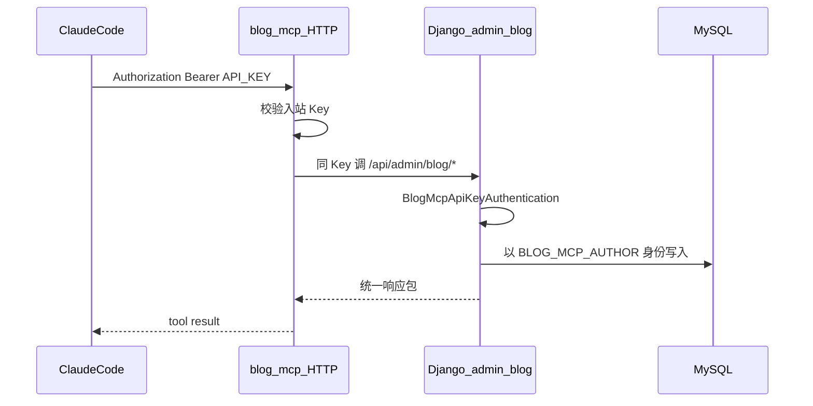

# 博客远程 HTTP MCP 发布方案

## 目标与范围

**做**
- 远程 **HTTP（streamable-http）** MCP，供 Claude Code 连接
- 环境变量机器凭证 **`BLOG_MCP_API_KEY`**（无 DB 表、无迁移）
- Tools 支持 **`publish_now=true` 直接上线**
- 仅 **Blog**（分类查询、文章 CRUD/发布、可选封面上传）
- Markdown → HTML 后写入现有 `content` 字段
- 交付结束列出已改动文件；**不**本地起容器、不更新部署

**不做**
- News / Case / FAQ
- 本机 stdio 作为正式交付形态（可本地用同一 HTTP URL 联调）
- 改前台博客页面、改 `BlogPost` 模型结构

## 架构（已选定）



- MCP：**独立进程** [`mcp/oem-blog/`](mcp/oem-blog/)，不把 MCP 协议塞进 Django View
- 业务写入：**只调现有** [`backend/apps/blog/`](backend/apps/blog/) 与 [`POST /api/admin/media/upload`](backend/apps/content/urls.py)
- 认证：同一 `BLOG_MCP_API_KEY` 既保护 MCP HTTP，也作为 Django 机器身份

## 实现步骤

### 1. Django：博客机器 API Key 认证

新增（建议路径）：
- [`backend/apps/blog/authentication.py`](backend/apps/blog/authentication.py)：`BlogMcpApiKeyAuthentication`
  - 读 `Authorization: Bearer <key>` 或 `X-Api-Key`
  - `secrets.compare_digest` 与 `settings.BLOG_MCP_API_KEY` 比对
  - Key 未配置或为空 → 不认证（回落 JWT）
  - 成功则按 `settings.BLOG_MCP_AUTHOR_EMAIL` 加载用户；须 `is_active` 且 `role in {super_admin, operator, sales}`，否则 401
- [`backend/config/settings.py`](backend/config/settings.py)：`BLOG_MCP_API_KEY`、`BLOG_MCP_AUTHOR_EMAIL`

挂到现有后台视图的 `authentication_classes`（保留 JWT，机器 Key 优先尝试）：
- [`AdminBlogCategory*`](backend/apps/blog/views.py)、[`AdminBlogPost*`](backend/apps/blog/views.py)
- [`AdminMediaUploadView`](backend/apps/content/views.py)（封面上传）

权限仍用现有 `IsAdminRole`；`author=request.user` 逻辑不变。错误码：`BLOG_MCP_KEY_INVALID` / `BLOG_MCP_AUTHOR_INVALID`。

补充测试：[`backend/apps/blog/tests/`](backend/apps/blog/tests/) 用 Key 创建并 `status=published`，校验 `published_at` 与非法 Key 拒绝。

### 2. MCP 服务：`mcp/oem-blog/`

目录约定：
- `server.py`：FastMCP / 官方 MCP Python SDK，`streamable-http`，监听 `0.0.0.0:3100`
- `django_client.py`：封装对 `/api/admin/blog/*`、`/api/admin/media/upload` 的 HTTP 调用
- `markdown_html.py`：`markdown` 库将 `content_markdown` 转为 HTML
- `requirements.txt`、`Dockerfile`、`.env.example`
- 简短 `README.md`：Claude Code 连接命令

**Tools（固定集合）**

| Tool | 行为 |
|---|---|
| `blog_list_categories` | `GET /admin/blog/categories` |
| `blog_list_posts` | `GET /admin/blog/posts`（支持 status/language/q） |
| `blog_create_post` | `POST`；`content_markdown`→HTML；`publish_now=true` 则 `status=published`，否则 `draft` |
| `blog_update_post` | `PATCH`；可改正文/元数据；可带 `publish_now` |
| `blog_publish_post` | `PATCH` 仅设 `status=published` |
| `blog_upload_cover` | multipart 上传，返回 URL 供 `cover_image` |

入站：无/错 Key → MCP 层拒绝。出站：把 Django 的 `code/message/data` 转成简洁 tool 文本/JSON。

环境变量：`OEM_API_BASE_URL`（容器内默认 `http://backend:8000/api`）、`BLOG_MCP_API_KEY`。

### 3. 接入 Compose + Caddy（只改文件，不启动）

- [`docker-compose.yml`](docker-compose.yml)：服务 `blog-mcp`（build `mcp/oem-blog`，`env_file: .env`，依赖 `backend`）
- [`caddy/snippets/common.caddy`](caddy/snippets/common.caddy)：在 `api_ws` 旁增加 `/mcp/blog*` → `blog-mcp:3100`（实现时按 SDK 实际挂载路径做 strip/rewrite，对外 URL 固定为 **`https://{站点}/mcp/blog`**）
- 根目录或现有 `.env.example`：补充 `BLOG_MCP_API_KEY`、`BLOG_MCP_AUTHOR_EMAIL`

Claude Code 连接示例（写入 MCP README）：

```bash
claude mcp add --transport http oem-blog https://你的域名/mcp/blog \
  --header "Authorization: Bearer <BLOG_MCP_API_KEY>"
```

### 4. 交付约束

- 完成后在回复中列出全部已改动/新增文件
- **不**执行 `docker compose up` / rebuild / 部署验证

## 风险与缓解

- Key 泄露可直接发文：单 Key、可轮换；仅挂博客与媒体视图；文档要求勿提交真实 Key
- MD→HTML 与后台富文本略有差异：转换规则固定；复杂排版可先 `publish_now=false`
- Caddy 路径与 MCP mount 不一致：实现时以一次 HTTP MCP initialize 握手为准调整 rewrite
- 作者邮箱配错：认证失败返回明确错误码，避免匿名写入

## 验收标准（代码就绪即可，本次不跑部署）

1. 合法 Key 可走 `POST /api/admin/blog/posts` 且 `publish_now` 路径能落到 `status=published` + `published_at`
2. 非法 Key → 401/403，无写入
3. MCP 暴露 HTTP tools 上述 6 个；create 支持 `publish_now`
4. Compose / Caddy / env 示例齐备；README 含 Claude Code `http` 连接命令
5. 无 Blog 模型迁移；News 等未改

## 建议的下一步

确认本方案后按 `feature-implementation` 落地代码；你这边部署时配置 Key 与作者邮箱，再 `claude mcp add --transport http ...` 联调。
