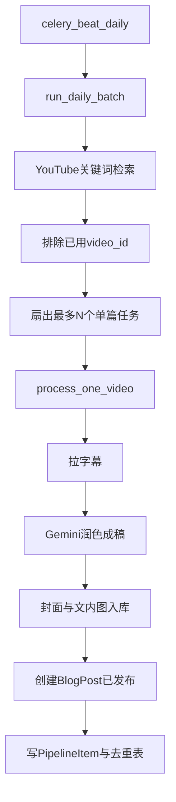

# 每日 YouTube→博客 定时流水线

## 已锁定口径

- 发布：直接 `published` 上线
- 选片：环境变量 **关键词列表**
- 语种：`zh` 与 `ko`（按篇轮转，例如奇数篇 zh、偶数篇 ko；关键词条数不足时循环）
- 文末：**不**附带 YouTube 原链
- 调度：项目内 Celery Beat，**不**依赖 Claude/MCP 触发（MCP 仍可人工发文）

## 架构

复用：
- 发文与作者：[`BlogPost`](backend/apps/blog/models.py) + [`stamp_published_at`](backend/apps/blog/services.py)；作者取 `BLOG_MCP_AUTHOR_EMAIL`（或同义 `CONTENT_PIPELINE_AUTHOR_EMAIL`，默认回落到前者）
- AI：现有 `GEMINI_API_KEY` / `GEMINI_MODEL`（参考 [`backend/apps/project/translation.py`](backend/apps/project/translation.py)）
- 媒体：本地/`default_storage` 写入 `uploads/`，与 [`AdminMediaUploadView`](backend/apps/content/views.py) 同源存储
- 队列：新路由到现有 **`heavy`** worker（字幕+AI+下图较重）；Beat 单独容器

## 实现步骤

### 1. 新应用与模型

新增 [`backend/apps/content_pipeline/`](backend/apps/content_pipeline/)：

- `PipelineRun`：`run_date`、`status`、`target_count`、`success_count`、`fail_count`、时间戳
- `PipelineItem`：`run` FK、`youtube_video_id`、`keyword`、`language`、`title`、`status`（pending/success/failed/skipped）、`blog_post` FK 可空、`error_message`
- `UsedYouTubeVideo`：`video_id` 唯一，防止跨日重复

迁移注册到 [`settings.py` INSTALLED_APPS](backend/config/settings.py)。

### 2. 配置（`.env`）

| 变量 | 含义 |
|---|---|
| `CONTENT_PIPELINE_ENABLED` | 总开关，默认 false |
| `CONTENT_PIPELINE_DAILY_COUNT` | 默认 10 |
| `CONTENT_PIPELINE_KEYWORDS` | 逗号分隔关键词 |
| `CONTENT_PIPELINE_LANGUAGES` | 固定 `zh,ko` |
| `CONTENT_PIPELINE_SCHEDULE_CRON` | 默认每天 `0 9 * * *`（上海时区） |
| `CONTENT_PIPELINE_TIMEZONE` | 默认 `Asia/Shanghai` |
| `CONTENT_PIPELINE_AUTHOR_EMAIL` | 可选，默认用 `BLOG_MCP_AUTHOR_EMAIL` |
| `YOUTUBE_API_KEY` | Data API v3 搜索 |
| `GEMINI_API_KEY` | 已有，润色（及可选生图） |

关闭开关时 Beat 仍触发但编排任务立即空成功退出。

### 3. 服务层（无 MCP）

- `youtube_search.py`：按关键词调 YouTube Search API，过滤时长/近期，返回候选 `video_id` 列表；已在 `UsedYouTubeVideo` 的跳过
- `transcripts.py`：`youtube-transcript-api` 拉字幕（优先 `zh`/`ko`/`en`）；失败则该候选 skip
- `rewrite.py`：Gemini 输出 JSON：`title/summary/content_html/tags`；要求深度改写、OEM/制造相关可读性、**禁止**输出原视频 URL；`language` 为 zh 或 ko
- `images.py`：**封面**下载 `i.ytimg.com/vi/{id}/hqdefault.jpg`（或 maxres）存 storage；**文内**由 Gemini 在 HTML 中预留 1～2 个插图位，流水线用同视频次级缩略图或 Gemini 文生图（若当前模型/配额不可用则仅保留封面，不阻断发布）
- `publish.py`：创建 `BlogPost(status=published, language=..., author=...)` 并 `stamp_published_at`

编排：候选池放大（例如目标 10 → 检索至多 30 候选），成功满 10 即停；不足则 Run 记 `partial`。

### 4. Celery 任务与 Beat

- [`backend/config/celery.py`](backend/config/celery.py) / settings：`CELERY_BEAT_SCHEDULE` 注册日批；`CELERY_TASK_ROUTES` 将 `content_pipeline.*` 打到 `heavy`
- 任务：`content_pipeline.run_daily_batch`、`content_pipeline.process_video_item`
- Compose：新增服务 `celery-beat`（同 backend 镜像，`celery -A config beat -l info`）；`heavy-worker` 已存在，确保能消费新任务
- 依赖：`youtube-transcript-api`、（搜索用）Google API 客户端或 `httpx` 调 REST；写入 [`backend/requirements.txt`](backend/requirements.txt)

### 5. 可观测与安全

- 管理命令：`python manage.py content_pipeline_run_once`（手动补跑，不改计划也可测）
- 结构化日志：`run_id/video_id/keyword/language/result`
- 首期**不做**新后台 UI（可后续挂 ops）；失败只进 `PipelineItem.error_message`
- 版权口径：改写后发布、文末无原链；封面用缩略图转存（实现时在代码注释/README 标明风险由产品接受）

### 6. 测试

- 单测：去重、语种轮转、无字幕 skip、Gemini JSON 解析失败、`ENABLED=false` 不发文
- mock YouTube/Gemini/httpx，不打真网

## 风险与缓解

- YouTube/字幕不稳定：放大候选 + 单篇失败隔离
- Gemini 配额：串行/小并发（heavy 内限制 fanout）
- 无 Beat 曾导致「从不跑」：Compose 必加 `celery-beat` 健康检查（进程存活即可）
- 关键词为空或未配 `YOUTUBE_API_KEY`：Run 记 failed，明确错误码

## 验收标准

1. `CONTENT_PIPELINE_ENABLED=true` 且关键词与 Key 齐全时，日批目标成功发布 10 篇 `published` 且 `language ∈ {zh,ko}`
2. 同一 `video_id` 不会第二次生成文章
3. 正文与摘要**不含** youtube.com / youtu.be 链接
4. 开关 false 时不产生新 `BlogPost`
5. `manage.py content_pipeline_run_once` 可手动跑一批
6. 不改前台博客路由；与现有 MCP 发布互不干扰

## 明确不做

- Claude/MCP 触发日批
- 文末原视频链接
- News/Case 其它 CMS
- 无字幕视频的整片 ASR（二期）
