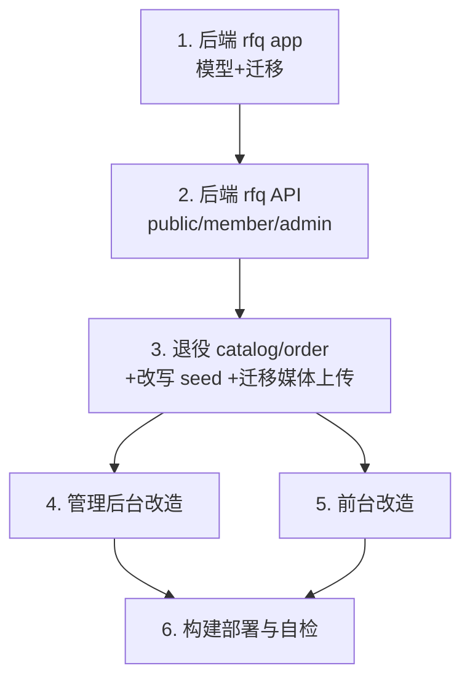

# RFQ 平台化实施顺序

依据 [RFQ平台化演进方案.md](RFQ平台化演进方案.md)。原则：先建新（rfq），再拆旧（电商），后改前后台，最后部署。工艺分类**仅下线不物理删除**；提交 RFQ **强制登录**。

## 依赖与顺序

## 阶段一：后端 rfq 基础（先建新表，不影响现有启动）
- 新建 `backend/apps/rfq/`：模型 `ServiceCategory`(树形, `is_active` 承担下线语义)、`RFQ`(`buyer` 必填、预留 `scope`)、`RFQAttachment`、`Quote`(预留 `supplier`)。字段见方案 3.3–3.6。
- 在 [backend/config/settings.py](backend/config/settings.py) `INSTALLED_APPS` 追加 `apps.rfq`；`makemigrations` + `migrate`。

## 阶段二：后端 rfq API
- 序列化器/视图/路由，复用 `core.responses`、`core.pagination`、`core.permissions`（`IsMemberRole`/`IsAdminRole`）。
- 端点（方案 5）：
  - public：`GET /api/public/service-categories`
  - member（`IsMemberRole`）：`POST /api/member/rfqs`、`POST /api/member/rfqs/{id}/attachments`、`GET /api/member/rfqs`、`GET /api/member/rfqs/{id}`、`POST /api/member/rfqs/{id}/quotes/{quoteId}/accept`
  - admin（`IsAdminRole`）：`GET/POST /api/admin/service-categories`、`GET/PATCH /api/admin/service-categories/{id}`（含 `is_active` 停用/启用，无 DELETE）、`GET /api/admin/rfqs`、`GET /api/admin/rfqs/{id}`、`PATCH /api/admin/rfqs/{id}/status`、`POST /api/admin/rfqs/{id}/quotes`、`PATCH /api/admin/quotes/{id}`
- 附件上传：类型/大小校验（方案 9），绑定本人 RFQ；在 [backend/core/urls.py](backend/core/urls.py) 注册 `apps.rfq.urls`。
- 新增错误码：`RFQ_NOT_FOUND`/`RFQ_STATUS_INVALID`/`RFQ_CATEGORY_REQUIRED`/`QUOTE_NOT_FOUND`/`QUOTE_EXPIRED`/`RFQ_LOGIN_REQUIRED`/`MEDIA_*`。

## 阶段三：退役 catalog/order（破坏性，需同步防止启动崩溃）
- 迁移通用媒体上传：将 `AdminMediaUploadView`（[backend/apps/catalog/urls.py](backend/apps/catalog/urls.py)）迁至 `core` 或 `content`，保留 `/api/admin/media/upload`。
- 改写 [backend/apps/catalog/management/commands/seed_demo_data.py](backend/apps/catalog/management/commands/seed_demo_data.py)：移除 `catalog`/`order` 依赖，改为 seed `ServiceCategory` 初始工艺 + 保留 content 演示数据（或迁为 rfq 独立 seed）。
- 从 [backend/core/urls.py](backend/core/urls.py) 移除 `apps.catalog`、`apps.order` include；从 [backend/config/settings.py](backend/config/settings.py) `INSTALLED_APPS` 移除。
- 生成删表迁移；开发库执行；生产前 `mysqldump` 备份。

## 阶段四：管理后台改造（admin）
- 移除：路由/侧边栏/视图/api 中的 products、categories、orders（[admin/src/router/index.js](admin/src/router/index.js)、[admin/src/layouts/AdminLayout.vue](admin/src/layouts/AdminLayout.vue)、[admin/src/api/index.js](admin/src/api/index.js)）。
- 新增：`views/ServiceCategoriesView.vue`（树形 CRUD + 停用/启用 + 排序，名称多语言复用 `MultiLangInput`）、`views/RfqsView.vue`（列表筛选 + 详情附件下载 + 状态变更 + 发/改报价）。
- 补 api 方法与 i18n（`nav.serviceCategories`/`nav.rfqs`，ko/zh/en）。

## 阶段五：前台改造（frontend）
- 移除：products、shop/* 路由/视图/nav/api（[frontend/src/router/index.js](frontend/src/router/index.js)、[frontend/src/layouts/MainLayout.vue](frontend/src/layouts/MainLayout.vue)、[frontend/src/api/index.js](frontend/src/api/index.js)）。
- 账户转型：`shop/login`→`login`、`shop/register`→`register`；`shop/orders`→`my/rfqs`。
- 新增：`views/rfq/RfqCreateView.vue`（多步向导，`meta.requiresAuth`，未登录跳登录回跳）、`views/rfq/MyRfqListView.vue`/`MyRfqDetailView.vue`（比价+接受报价）；能力页 [frontend/src/views/CapabilitiesView.vue](frontend/src/views/CapabilitiesView.vue) 增加工艺入口带预选跳 RFQ。
- 导航新增「在线询价」主 CTA；补 i18n（ko/zh/en/ja）。

## 阶段六：构建部署与自检
- `cd admin && npm run build`；`cd frontend && npm run build`。
- `docker compose up -d --build backend admin frontend caddy`；确认 `migrate`/`seed` 正常、`/api/health` OK。
- 按方案 10.2 验收：强制登录询价、附件校验、后台工艺分类停用/启用、RFQ 发报价与接受、电商入口已消失。

## 范围外
- 阶段 A+/B（草稿、通知、议价线程、供应商/竞价/结算）不在本次实现，仅保留字段预留。