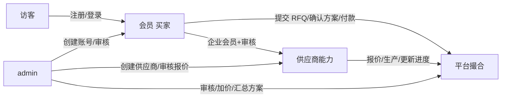

# MASS CONNECTED 三端角色功能说明

> 本文档说明当前已实现系统中，**用户端（买家/会员）**、**供应商端**、**管理员端**三个角色分别可以做什么、可使用哪些功能。  
> 更新日期：2026-07-07（含纸盒包装生成器）

---

## 访问入口

| 端 | 地址 | 说明 |
|---|---|---|
| 用户端 / 供应商端 | http://localhost/ | 同一套前台，登录后按角色展示不同菜单 |
| 管理员端 | http://localhost/admin | 独立后台，需管理员账号登录 |

语言支持：韩语（默认）/ 中文 / 英文 / 日文。

---

## 角色关系概览

- **会员（买家）**：`role=member`，分为**个人会员**与**企业会员**（`member_type`）。
- **供应商**：通常由管理员创建，`role=factory`，且 `FactoryProfile.status=approved` 后可在前台使用供应商功能；企业会员入驻审核通过后也可具备供应商能力。
- **管理员**：`role` 为 `super_admin` / `operator` / `sales` 等，仅可登录管理后台。

---

## 一、用户端（买家 / 会员）

用户端面向采购方，核心目标是：**发需求、看报价、签合同、付款、跟项目**。未登录可浏览官网与商城；登录后可使用 MY PAGE 及报价相关功能。

### 1.1 访客（未登录）

| 模块 | 功能 |
|---|---|
| 官网浏览 | 首页、关于我们、能力介绍、OEM/ODM、案例、资讯、FAQ/支持、联系我们 |
| 制造报价入口 | 浏览「发布询价」「需求大厅」「入驻企业目录」（部分操作需登录） |
| 自营商城 | 浏览商品分类与商品详情 |
| 账户 | 注册、登录 |

### 1.2 个人会员 / 企业会员（登录后，买家能力）

所有 `role=member` 的用户均具备以下**买方**能力（个人与企业共用，企业会员额外见 1.3）。

#### MY PAGE 个人中心（`/my`）

| Tab | 功能 |
|---|---|
| 概览 | 查看积分余额、简单/详细报价数量、项目/合同/待付款/未读通知等汇总 |
| 简单报价 | 查看历史简单报价列表，跳转详情或转为详细报价 |
| 详细报价 | 查看我的 RFQ 列表及状态 |
| 我的项目 | 查看进行中的生产项目列表，进入项目详情 |
| 待办 | **跨项目聚合**客户待办（`assignee_type=customer`），可在列表中勾选完成 |
| 文件中心 | **只读**查看买家可见的文件（项目文件 + RFQ 附件），支持下载 |
| 合同 | 查看合同列表，**在线确认签署**（待签署状态），下载合同 PDF |
| 付款 | 查看付款单，**查看付款详情**；对待付款项**上传付款凭证** |
| 积分 | 查看余额/累计获得/消耗、交易明细；**查看充值申请历史与状态**；**提交积分充值申请**（可附充值凭证） |
| 通知 | 查看站内通知，单条已读 / 全部已读；**导航栏 MY PAGE 入口显示未读角标** |
| 账户设置 | 修改基本账户信息 |

#### 简单报价（`/simple-quote`）

- 选择报价类型（注塑模具、3D 打印、PCB、软件、IC 等）。
- **注塑**：可上传 `.stp/.step`，系统自动解析体积/尺寸并按材料密度回填重量（可修改），同时给出主拔模方向、**滑块建议数**与**材料建议**（建议值 + 置信度，需人工确认）；亦可上传 2D 工程图（PDF/PNG/JPG，≤15MB）经离线 OCR 抽取材料/精密度/颜色作可编辑建议回填；识别结果与原始文件均不保存。也可完全手动填参。
- 填写参数后**即时生成预估报价**（消耗积分）。
- 生成报价 PDF，记录于 MY PAGE。
- 可**一键转为详细报价 RFQ**。

#### 纸盒包装生成器（`/packaging/box`）

- 独立页面，报价类型 `paper_box`，MY PAGE 简单报价列表中该类记录跳转至此页。
- **FEFCO 盒型库**：0201 / 0427 / 0713 / 0716（P0），左侧栏 hover 或图钉展开。
- 填写长/宽/高/厚度、单位（mm/in）、尺寸类型（内/外/制造）、材质、数量、印刷色数。
- **实时刀版预览**：0201/0427 详细线稿；0713/0716 展开轮廓；出血/割线/折线分色。
- **0201** 支持刀版上点击编辑 L/W/H 尺寸（与表单双向同步）；可下载刀版 PDF、Illustrator (.ai)、DXF。
- 生成报价（CNY，附 KRW 换算，消耗积分）→ PDF → 可转详细报价 RFQ。

#### 详细报价 / RFQ

| 功能 | 说明 |
|---|---|
| 发布询价 | `/rfq/new` 填写工艺、数量、材料、备注，上传附件 |
| 我的询价列表 | `/my/rfqs` 查看 RFQ 状态与报价数量 |
| 询价详情 | `/my/rfqs/:id` 查看 RFQ 信息与附件 |
| 方案对比 | 查看平台公开的方案 A/B/C **并排对比表**（总价、单价、模具费、样品费、MOQ、交期、付款条件等；**不显示供应商身份**） |
| 下载对比 PDF | 下载多方案并排比较的报价 PDF |
| 确认方案 | 选定某一方案后生成生产订单、合同与付款单 |
| 生产订单 | `/my/production-orders` 查看订单状态与详情 |

#### 项目跟进（`/my/projects/:id`）

- 查看项目阶段、整体进度条。
- 查看并勾选**本项目待办**（客户侧）。
- 查看**项目文件**列表并下载（按可见性规则，仅 `visibility=all` 的文件）。
- 查看项目时间轴（供应商发布的客户可见进度）。

#### 需求大厅（`/demand-hall`）

- 浏览其他买家公开发布的制造需求。
- **已审核供应商**可在需求大厅**自主抢单**，抢单后填写并提交报价；普通买家仅浏览。
- 抢单后仍走平台加价审核，客户看到的是方案 A/B/C，不直接看到供应商原始报价。

#### 自营商城

| 功能 | 路径 |
|---|---|
| 商品浏览 | `/shop` |
| 购物车 | `/shop/cart` |
| 结算下单 | `/shop/checkout`（**结算页展示购物车商品摘要与合计金额**） |
| 我的商城订单 | `/my/orders`（列表可进入**订单详情** `/my/orders/:id`） |

#### 通知与邮件

- 站内通知：报价进度、**报价方案就绪**、合同生成、付款确认、项目待办、积分变动、**充值到账**等。
- 关键事件可触发**邮件通知**（本地默认 console 后端，生产可配置 SMTP）。
- **联系我们、关于我们**等页面文案已支持多语言切换。

### 1.3 企业会员额外能力

企业会员（`member_type=enterprise`）在 MY PAGE 中额外拥有：

| 功能 | 说明 |
|---|---|
| 企业资料 | 编辑公司名称、地区、国家、城市、简介、联系电话、付款条件 |
| 营业执照 | 上传/更新营业执照文件，查看已上传执照 |

> 企业会员若同时提交了工厂入驻且状态为 `pending`，前台会显示「入驻审核中」，暂不可使用供应商菜单。

---

## 二、供应商端

供应商与买家共用前台域名与登录页；登录后导航栏会出现**供应商专属入口**（需 `FactoryProfile.status=approved`）。

> 供应商账号**由管理员创建**，不开放供应商自助注册。供应商在需求大厅**自主抢单**公开 RFQ，或在「我的报价请求」中继续填写已抢单的报价。

### 2.1 供应商菜单入口

| 入口 | 路径 | 说明 |
|---|---|---|
| 需求大厅 | `/demand-hall` | 浏览公开 RFQ 并自主抢单 |
| 报价请求 | `/supplier/quote-requests` | 已抢单 RFQ 的报价任务 |
| 我的项目 | `/supplier/projects` | 付款确认后转入的生产项目 |
| 接单管理 | `/supplier/orders` | 生产订单确认/拒绝 |

（历史入口 `/factory/quotes` 仍保留，以当前导航「报价请求」为主。）

### 2.2 报价请求（`/supplier/quote-requests/:id`）

| 功能 | 说明 |
|---|---|
| 查看 RFQ 信息 | RFQ 编号、工艺、数量、材料、备注等 |
| 查看 RFQ 附件 | 下载买家上传的技术资料 |
| 提交报价 | 填写总价、单价、模具费、样品费、MOQ、交期、付款条件、备注等**分项字段** |
| 查看状态 | 已报价 / 被采用 / 未被采用等；相应事件会收到站内通知（及邮件） |

### 2.3 接单管理（`/supplier/orders`）

| 功能 | 说明 |
|---|---|
| 生产订单列表 | 查看买家确认方案后产生的订单 |
| 确认接单 | 接受生产订单 |
| 拒绝订单 | 拒绝并说明；**系统自动回退询价状态、作废关联合同与付款，并通知买家与管理员** |

### 2.4 我的项目（`/supplier/projects/:id`）

| 功能 | 说明 |
|---|---|
| 项目概览 | 项目编号、标题、状态、进度百分比、预计交付 |
| 阶段管理 | 查看各阶段状态（待开始 / 进行中 / 已完成） |
| 发布进度更新 | 填写进度内容，可选关联阶段，可选择是否对客户可见 |
| 上报问题 | 提交问题标题、描述、严重程度 |
| 项目文件 | **上传**设计/合同/报告等文件（分类 + 可见性）；查看已上传文件列表 |
| 时间轴 | 查看历史进度更新（含内部-only 记录）；**界面文案支持多语言** |
| 问题列表 | 查看已上报问题及处理状态 |

### 2.5 供应商收到的通知

- 需求大厅抢单成功（含邮件，若已配置）。
- 报价被采用 / 未被采用。
- **管理员要求修订报价**。
- 新的生产订单待确认（含邮件）。
- **客户付款已确认**（进入履约阶段）。
- 项目相关待办、进度提醒等。
- **导航栏「通知」入口显示未读角标**，可在 MY PAGE 通知 Tab 查看列表。

### 2.6 供应商合同查看

- 可在后台接口查看与己相关的合同列表与详情（含 PDF 下载）。
- 前台 MY PAGE 通知 Tab 亦可查看与己相关的业务通知。

---

## 三、管理员端

管理员端为独立 SPA（`/admin`），负责平台运营、撮合、审核与内容管理。默认超级管理员：`admin@oem.co` / `Admin123!`（首次部署自动创建）。

### 3.1 仪表盘

- 后台首页展示**运营统计卡片**：RFQ 总数、待审核 RFQ、进行中项目、待确认付款、新询盘、会员数、已审核供应商数等。
- **顶栏通知铃铛**：查看最近站内通知、未读角标、单条/全部已读。

### 3.2 制造报价与撮合

| 模块 | 功能 |
|---|---|
| 工艺分类 | 维护 `ServiceCategory`（多语言名称、排序、图标等） |
| 询价单 RFQ | 列表筛选；查看详情（买家、工艺、附件、备注） |
| RFQ 状态 | 手动变更 RFQ 状态（含 **submitted → pending_review 受理进入评估** → … → won/closed） |
| 加价率 | 设置 RFQ 的 `markup_percent`，客户端看到的是加价后价格 |
| **报价请求跟踪** | 在 RFQ 详情中查看各供应商的抢单/查看/报价/修订/过期/取消等状态 |
| **报价请求操作** | 对已报价项**要求修订**；对待报价项**取消抢单** |
| 报价管理 | 查看各供应商原始报价；代发平台报价；编辑方案标签 A/B/C、是否对客户可见（**开放后自动通知买家**） |
| 分项报价 | 创建/查看报价的单价、模具费、样品费、MOQ、付款条件等字段 |
| 生产订单 | 列表查看；更新订单状态（待确认 → 已确认 → 生产中 → 完成等） |

### 3.3 供应商与会员

| 模块 | 功能 |
|---|---|
| 工厂管理 | 审核企业会员的入驻申请（通过 / 拒绝） |
| 供应商管理 | **创建供应商账号**；编辑扩展资料（简称、国家/城市、付款条件、评分、状态、内部备注）；管理**标签**与**资质附件** |
| 会员管理 | 会员列表与搜索；查看积分钱包与交易；**手动调整积分**（增减 + 原因） |

供应商状态包括：`pending` / `approved` / `rejected` / `suspended` / `blacklist` / `observing` / `priority` 等，用于运营分级与抢单资格控制。

### 3.4 项目 / 合同 / 付款

| 模块 | 功能 |
|---|---|
| 项目管理 | 查看全部项目；调整状态与**进度百分比**；查看阶段与时间轴；**为项目新增客户待办** |
| 合同 | 查看合同列表，下载合同 PDF |
| 付款 | 查看付款单；**会员上传凭证后收到待审核通知**；**确认付款**（确认后自动触发转项目，并通知买家与供应商） |

### 3.5 简单报价引擎

| 模块 | 功能 |
|---|---|
| 报价参数 | 维护各简单报价类型的计算参数（`QuoteParam`），含注塑材料密度 `density_*`，影响前台自动估价与 STP 重量回填 |

### 3.6 积分运营

| 模块 | 功能 |
|---|---|
| 积分规则 | 配置规则代码、赠送/消耗点数、启用状态；**支持新建规则** |
| 充值审核 | 查看会员充值申请，确认到账并发放积分（**确认后通知会员**） |
| 积分调整 | 对指定用户手动增减积分（亦可在会员管理中操作） |

### 3.7 自营商城（独立业务线）

| 模块 | 功能 |
|---|---|
| 商品分类 | CRUD |
| 商品管理 | CRUD、库存、价格、图片 |
| 订单管理 | 查看商城订单、筛选状态；**新订单自动通知管理员** |

### 3.8 官网 CMS

| 模块 | 功能 |
|---|---|
| 案例 | 发布/编辑制造案例（多语言） |
| 资讯 | 发布/编辑新闻 |
| FAQ | 常见问题维护；**支持编辑已有 FAQ** |
| **下载资源** | **上传与管理官网可下载文件**（标题多语言、分类、文件上传） |
| 内容页面 | 关于/能力等静态页内容（多语言富文本） |
| 网站导航 | 配置前台 Header 导航结构 |
| 询盘 | 查看官网联系表单提交记录；**查看详情（留言/联系方式/状态流转）**；**新询盘自动通知管理员** |

### 3.9 系统管理

| 模块 | 功能 |
|---|---|
| 管理员账号 | 创建/管理后台操作员（super_admin / operator / sales 等） |

### 3.10 管理员触发的通知与邮件

管理员操作以下环节时，系统会向会员/供应商发送站内通知，关键场景同时发邮件：

- **会员提交 RFQ** → 通知管理员  
- 供应商在需求大厅抢单并报价  
- **报价方案对客户可见** → 通知买家  
- 客户确认方案 → 合同生成（通知买家）  
- **会员上传付款凭证** → 通知管理员待审核  
- 付款确认 → 项目启动（通知买家与供应商）  
- 生产订单待供应商确认（通知供应商）  
- **供应商拒单** → 通知买家与管理员  
- **新询盘 / 新商城订单** → 通知管理员  
- **积分充值确认** → 通知会员  

---

## 四、三端能力对照（核心业务）

| 业务环节 | 用户端 | 供应商端 | 管理员端 |
|---|---|---|---|
| 注册 / 登录 | ✅ 自助注册（个人/企业） | ✅ 管理员创建的账号登录 | ✅ 管理员独立登录 |
| 简单报价 | ✅ 生成 PDF、扣积分 | — | ✅ 维护参数 |
| 发布 RFQ | ✅ | — | ✅ 审核、改状态 |
| 需求大厅抢单 | — | ✅ 自主抢单 | — |
| 填写报价 | — | ✅ 分项报价 | ✅ 代发/汇总/设方案 |
| 看方案比价 | ✅ 对比表 + PDF | — | ✅ 看原始价 + 加价 |
| 确认方案 | ✅ | — | — |
| 合同 / 付款 | ✅ 签署合同、下载合同、上传凭证、查看详情 | ✅ 查看相关合同 | ✅ 确认付款 |
| 生产订单 | ✅ 查看 | ✅ 确认/拒绝（拒单自动回滚） | ✅ 管理状态 |
| 项目进度 | ✅ 看进度、勾待办、下文件 | ✅ 更新进度、传文件、报问题 | ✅ 调进度/状态、加待办 |
| 积分 | ✅ 充值申请与历史、消费 | — | ✅ 规则/审核/调整 |
| 企业资料 | ✅ 企业会员可编辑 | — | ✅ 供应商资料维护 |
| 通知 | ✅ 未读角标 + MY PAGE 列表 | ✅ 未读角标 + MY PAGE 列表 | ✅ 顶栏铃铛 + 列表 |
| 商城 | ✅ 浏览/下单/订单详情 | — | ✅ CMS / 商品/订单管理 |
| 官网 / CMS | ✅ 浏览 | — | ✅ 案例/资讯/FAQ/**下载**/页面/导航 |

---

## 五、当前版本边界（尚未开放）

以下能力在 PRD 或后续迭代中规划，**当前版本未实现**：

- 供应商自助注册（仍由管理员创建）
- 在线支付（V1 为人工确认付款）
- 详细报价 18 态全状态机自动流转（当前仅关键中间态）
- 按工艺动态自定义表单
- AI 辅助报价 / 智能匹配

---

## 六、相关文档

- 平台技术总览：`MASS CONNECTED 平台文档.md`
- 产品需求：`project/MASS CONNECTED 产品需求书（PRD）V1.0.md` 及 `project/` 下各子系统需求书
