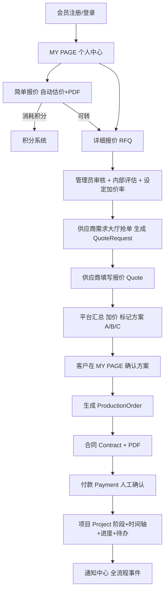

# MASS CONNECTED 平台文档（最新）

> 本文档为 MASS CONNECTED 制造服务平台的**单一事实来源**，取代已废弃的《OEM 制造公司官网与电商管理平台项目书》与《RFQ 平台化演进方案》。
> 产品愿景与详细需求见 `project/` 目录下 7 份需求书：
> - `project/MASS CONNECTED 产品需求书（PRD）V1.0.md`
> - `project/会员系统与 MY PAGE 需求.md`
> - `project/简单报价系统.md`
> - `project/详细报价系统.md`
> - `project/供应商系统与工厂协作需求.md`
> - `project/积分系统与平台运营规则需求.md`
> - `project/项目管理与生产进度系统需求.md`
>
> 更新日期：2026-07-03（含 P2 收尾补齐）

技术栈：`Vue 3` + `Vite` + `Pinia` + `vue-i18n`、`Django REST Framework`、`MySQL 8.4`、`Redis 7`、`Docker Compose`、`Caddy 2`（统一入口 + 自动 HTTPS）。后端仅提供 DRF API，**不使用 Django Admin**。

---

## 1. 平台定位

MASS CONNECTED 是一个**以制造工艺为主轴的制造服务撮合平台**，连接采购方（会员）与制造供应商（工厂），由平台居中运营：

- 会员提交需求 → 平台审核并内部评估 → 供应商在需求大厅**自主抢单** → 供应商报价 → 平台汇总加价后以「方案 A/B/C」呈现给客户 → 客户确认 → 生成合同 → 付款 → 转为项目并跟踪生产进度。
- 提供**简单报价**（自动估价）与**详细报价**（人工撮合）两条报价通道。
- 以**积分**作为平台内的服务货币（注册赠送、报价消耗、人工充值）。
- 以 **MY PAGE 个人中心**聚合会员的报价、项目、合同、付款、积分与通知。
- 保留独立的**官网 CMS**（案例/资讯/FAQ/下载/页面）与**自营商城**（商品/购物车/订单）作为独立业务线。

多语言：韩语（ko，默认）/ 中文（zh）/ 英文（en）/ 日文（ja）。金额统一以 **KRW 整数**存储。

---

## 2. 系统架构

```
frontend (Vue3, :5173 dev)  ─┐
admin    (Vue3, :5174 dev)  ─┤→ caddy(:80/:443) → backend(DRF, :8000) → mysql / redis
backend  (Django REST)      ─┘                                   media_data 卷 → /media
```

Caddy 路由（`caddy/Caddyfile`）：
- `/api/*` → `backend:8000`
- `/media/*` → 媒体卷静态服务
- `/admin*` → `admin:5174`
- `/`（其余）→ `frontend:5173`

服务清单（`docker-compose.yml`）：`mysql`、`redis`、`backend`、`frontend`、`admin`、`caddy`。前端与后台在开发编排下以 Vite dev server 运行（卷挂载 + HMR）。

---

## 3. 后端应用（apps）

| 应用 | 职责 |
|------|------|
| `accounts` | 用户与鉴权：`User`（role/member_type）、`FactoryProfile`（供应商资料）、JWT 登录/注册/刷新 |
| `rfq` | 详细报价主体：`ServiceCategory`、`RFQ`、`RFQAttachment`、`Quote`、`QuoteRequest`（抢单/报价记录）、`ProductionOrder` |
| `simplequote` | 简单报价引擎：`QuoteParam`（后台参数）、`SimpleQuote`（自动估价 + PDF） |
| `points` | 积分系统：`PointWallet`、`PointTransaction`、`PointRule`、`RechargeOrder` |
| `project` | 项目/生产进度：`Project`、`ProjectStage`、`ProjectUpdate`、`ProjectTodo`、`ProjectIssue` |
| `contract` | 合同：`Contract`（报价确认后生成，含 PDF） |
| `payment` | 付款：`Payment`（V1 人工确认 + 上传凭证，确认后触发转项目） |
| `notification` | 站内通知：`Notification`（报价/项目/付款/系统事件） |
| `content` | 官网 CMS：Case / News / FAQ / Download / ContentPage / Navigation + 通用媒体上传 |
| `inquiry` | 官网一般联系咨询表单 |
| `catalog` / `order` | 自营商城：商品/分类/图片、购物车/订单（独立业务线） |
| `i18n` | `I18nJSONField` 多语言字段（`{ko,zh,en,ja}`，缺失回退 ko） |

编号规则：`MC-QT`（报价）、`MC-PRJ`（项目）、`MC-CT`（合同）、`MC-PAY`（付款）、`MC-SUP`（供应商）等。

---

## 4. 角色与权限

前台会员统一 `role=member`，以 `member_type` 区分个人/企业；供应商能力由 `FactoryProfile.status=approved` 授予。

| 权限类 | 含义 |
|--------|------|
| `IsBuyerRole` | 所有前台会员（个人 + 企业），可用买方 API |
| `IsSupplierRole` | 企业会员且 `FactoryProfile.status=approved`（供应商能力） |
| `IsAdminRole` | 后台管理员（super_admin / operator 等） |

- 未登录访问会员/供应商/管理接口返回 **401**；越权按角色返回 **401/403**。
- **供应商账号由管理员创建**（不开放供应商自助注册），已审核供应商可在需求大厅**自主抢单**公开 RFQ 并提交报价。

---

## 5. 核心业务闭环



### 5.1 简单报价
参数驱动的自动估价引擎，V1 覆盖注塑模具、3D 打印、PCB、软件、IC。会员填写表单 → 引擎按 `QuoteParam`（后台可维护）计算单价/总价与费用明细 → 生成 PDF 报价书 → 扣减积分 → 记录于 MY PAGE，可一键转为详细报价 RFQ。

**注塑自动报价（AUTO QUOTATION）**：按「模具费 +（每零件）制品单价」两块计算，支持 **FAMILY 多零件一模**（要求材料一致）；以 **RMB** 计价并换算展示 KRW；颜色（透明/半透明）、滑块、精密度、包装、利润率均参数化；生成对齐韩文模板的报价单 PDF（含金形单价/制品单价、计算基准明细、MOQ 25KG、有效期 2 周）；报价有效期 14 天。生产费用/运输费用/VAT 一期留空由人工补充。

**二期阶段 A/B/C（STP 几何解析 + 倒扣推断 + 图纸 OCR，已上线）**：注塑表单支持上传 `.stp/.step`（≤30MB），后端用 OpenCASCADE（`cadquery-ocp`）解析体积与包围盒尺寸，按材料密度自动回填单件重量（可手改）；同时做倒扣分析给出主拔模方向与**滑块建议数**，并按几何规则给出**材料建议**（均为建议值 + 置信度，标注"需人工确认"，可编辑）。另支持上传 2D 工程图（PDF/PNG/JPG，≤15MB）经离线 Tesseract OCR 抽取材料/精密度/颜色作可编辑建议回填；识别结果与原始文件均不保存、不落库。详见 `project/注塑模具自动报价需求.md`、`project/注塑自动报价二期技术方案.md`。

### 5.2 详细报价（RFQ）
9.6 状态机：`draft → submitted → pending_review → assigned → quoting → quoted → comparing → customer_confirming → negotiating → won / closed`。

- 客户提交 RFQ（工艺/规格/附件）→ **自动通知管理员**。
- 管理员审核（含 **pending_review 受理**）、设定 `markup_percent` 加价率；供应商在需求大厅**自主抢单**（生成 `QuoteRequest`）并填写 `Quote`；管理员可**要求修订**或**取消抢单**；超期未报价自动标记 **expired**。
- 供应商在「我的报价请求」中查看已抢单项目并提交报价。
- 管理员为每条 Quote 标记 `plan_label`（A/B/C）与 `is_customer_visible`；**开放后通知买家**；客户端仅看到经加价、**隐藏供应商身份**的方案。
- 客户在 MY PAGE 确认某个方案 → RFQ 转 `won`，创建 `ProductionOrder` 与 `Contract`、`Payment`。
- **供应商拒单**时：生产订单取消，RFQ 回退至比选，关联合同/付款作废，并通知买家与管理员。

### 5.3 合同 / 付款 / 转项目
- 报价确认后生成 `Contract`（含合同 PDF，`pending_sign`）与 `Payment`（待付款）。
- 会员可在 MY PAGE **在线确认签署**合同（`POST .../sign`）。
- 付款为 **V1 人工确认**：会员上传付款凭证 → **通知管理员待审核**；管理员在后台确认 → **通知买家与供应商**。
- 付款确认后自动创建 `Project`（含默认阶段、时间轴、待办），并发送通知。

### 5.4 项目 / 生产进度
`Project` 关联 RFQ/ProductionOrder，含状态（`pending/in_progress/paused/completed`）、进度百分比、阶段（`ProjectStage`）、动态更新（`ProjectUpdate`）、客户待办（`ProjectTodo`）与问题（`ProjectIssue`）。供应商可更新阶段与进度，客户在 MY PAGE 查看并勾选待办。

---

## 6. API 契约

沿用统一响应包：成功 `{code:"OK", message, data, request_id}`；错误 `{code, message, errors, request_id}`。列表统一 `items + pagination`。错误码 `MODULE_SCENARIO_REASON`。路由前缀：`/api/public`、`/api/member`、`/api/supplier`、`/api/admin`。

### 6.1 账户
- `POST /api/member/auth/register`（支持 `member_type`；注册赠送积分）
- `POST /api/member/auth/login`（返回 `data.tokens.access/refresh`）
- `POST /api/member/auth/refresh`、账户资料等

### 6.2 详细报价（rfq）
- 公开：`GET /api/public/service-categories`、`GET /api/public/demand-hall[/{id}]`
- 会员：`GET/POST /api/member/rfqs`、`GET /api/member/rfqs/{id}`、`POST .../attachments`、`POST .../quotes/{quoteId}/accept`、`GET /api/member/production-orders[/{id}]`
- 供应商：`GET /api/supplier/quote-requests[/{id}]`、`POST .../quotes`、`GET /api/supplier/quotes`、`GET /api/supplier/production-orders`、`POST .../confirm|reject`
- 管理：`GET/POST /api/admin/service-categories[/{id}]`、`GET /api/admin/stats`、`GET /api/admin/rfqs[/{id}]`、`PATCH .../status`（含 `markup_percent`）、`POST .../quotes`、`GET .../quote-requests`、`POST /api/admin/quote-requests/{id}/revise|cancel`、`PATCH /api/admin/quotes/{id}`、`GET/PATCH /api/admin/production-orders[/{id}]`
- 供应商抢单：`POST /api/supplier/demand-hall/{id}/grab`

### 6.3 简单报价（simplequote）
- 会员：`GET/POST /api/member/simple-quotes`、`GET /api/member/simple-quotes/{id}`、`POST .../convert`、`POST /api/member/simple-quotes/parse-stp`（注塑 STP 几何解析，返回体积/尺寸/密度表 + 倒扣滑块建议 + 材料建议）、`POST /api/member/simple-quotes/parse-drawing`（2D 图纸 OCR，返回材料/精密度/颜色建议）
- 管理：`GET/POST /api/admin/quote-params`、`PATCH /api/admin/quote-params/{id}`（含 `density_*` 材料密度）

### 6.4 积分（points）
- 会员：`GET /api/member/points/wallet`、`GET .../transactions`、`POST .../recharge`
- 管理：`GET/POST /api/admin/points/rules[/{id}]`、`POST /api/admin/points/users/{userId}`、`GET /api/admin/points/recharges`、`POST .../{id}/confirm`

### 6.5 项目（project）
- 会员：`GET /api/member/projects[/{id}]`、`POST .../todos/{todoId}/toggle`
- 供应商：`GET /api/supplier/projects[/{id}]`、`POST .../updates`、`PATCH .../stages/{stageId}`、`POST .../issues`
- 管理：`GET /api/admin/projects[/{id}]`、`POST .../todos`、`POST .../stages`

### 6.6 合同 / 付款
- 会员：`GET /api/member/contracts[/{id}]`、`POST /api/member/contracts/{id}/sign`、`GET /api/member/payments[/{id}]`、`POST /api/member/payments/{id}/proof`
- 供应商：`GET /api/supplier/contracts[/{id}]`
- 管理：`GET /api/admin/contracts`、`GET /api/admin/payments`、`POST /api/admin/payments/{id}/confirm`

### 6.7 通知
- 会员：`GET /api/member/notifications`、`GET .../unread-count`、`POST .../read-all`、`POST .../{id}/read`
- 供应商：`GET /api/supplier/notifications`（同上 read/unread 子路径）
- 管理：`GET /api/admin/notifications`（同上 read/unread 子路径）

触发事件（节选）：RFQ 提交、报价就绪、拒单回滚、询盘新建、商城下单、付款凭证待审、付款确认、充值到账等。

### 6.8 健康检查
- `GET /api/health` → `{status, database, redis}`

---

## 7. 前端（frontend）

- MY PAGE 个人中心 `/my`：概览 / 简单报价 / 详细报价 / 项目 / 合同（**在线签署**）/ 付款 / 积分（**充值历史**）/ 通知 / 企业资料 / 设置；**导航栏未读角标**。
- 简单报价 `/simple-quote`：按类型动态表单 →（注塑可上传 STP 自动算体积/重量 + 滑块/材料建议，可上传 2D 图纸 OCR 回填材料/精密度/颜色）→ 生成 → 结果与 PDF → 转详细报价。
- 我的详细报价 `/my/rfqs/{id}`：以方案 A/B/C 卡片展示（隐藏供应商身份），确认方案。
- 项目详情 `/my/projects/{id}`：阶段、时间轴、进度、待办勾选。
- 商城：`/shop/checkout` 购物车摘要；`/my/orders/:id` 订单详情。
- 供应商：`/supplier/quote-requests[/{id}]` 报价请求、`/supplier/orders` 接单、供应商项目更新；**通知未读角标**。
- 官网 CMS 页面与自营商城 `/shop` 保持独立；Contact/About 等走 i18n。
- i18n 四语（ko/zh/en/ja），默认 ko。

---

## 8. 管理后台（admin）

侧边导航：仪表盘（**统计卡片**）、工艺分类、工厂/企业、**供应商**、RFQ、**报价参数**、**积分**、**项目**、**合同**、**付款**、生产订单、商品分类/商品/订单、询盘、案例/资讯/FAQ/**下载资源**/内容页/导航、管理员。**顶栏通知铃铛**。

- RFQ 管理：状态机流转（含 pending_review）、加价率编辑、**报价请求跟踪/修订/取消**、Quote 方案标签与对客户可见开关。
- 供应商：管理员建号。
- 积分：规则维护（**含新建**）、充值人工确认、用户积分调整。
- 报价参数：简单报价各工艺单价维护（注塑含材料密度 `density_*`）。
- 项目/合同/付款：进度维护、**项目待办创建**、合同/凭证下载、付款确认（触发转项目）。
- CMS：**FAQ 编辑**、**下载资源管理**、询盘**详情查看**。
- i18n 三语（ko/zh/en）。

---

## 9. 快速启动

```bash
cp .env.example .env
docker compose up --build -d
```

| 入口 | 地址 |
|------|------|
| 官网 | http://localhost/ |
| 管理后台 | http://localhost/admin/ |
| API 健康检查 | http://localhost/api/health |

**默认管理员**：`admin@oem.co` / `Admin123!`
**会员注册**：`/register` 选择个人 / 企业会员；供应商账号由管理员在后台「供应商」创建。

---

## 10. 本期不做（范围外）

- 在线支付网关（付款 V1 为人工确认，接口预留）
- STP **3D 在线预览**；基于历史成交数据训练的材料 AI 模型（当前为几何规则 + OCR 兜底）；OCR 训练/云 API
- 云对象存储（MinIO / S3 / OSS）
- SEO 服务端渲染（SSR）、在线客服/实时聊天
- 第三方登录（Kakao 等）、推荐佣金 / Manager 分销、App 推送
- 生产级监控告警体系、Django Admin
