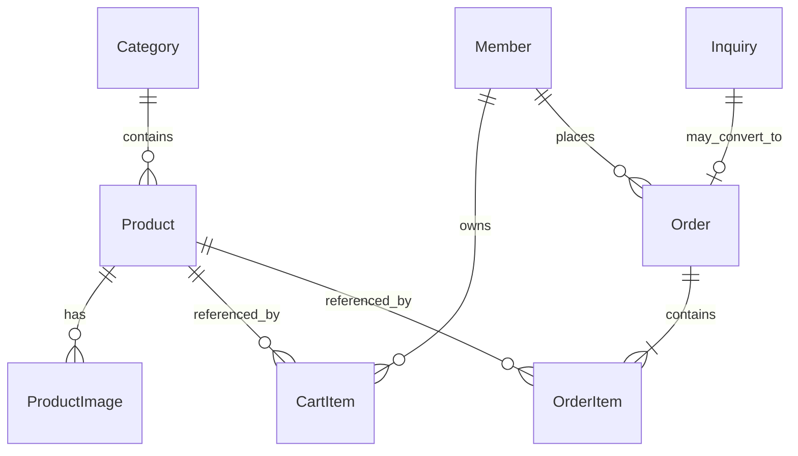

# OEM 制造公司官网与电商管理平台项目书（多语言）

技术栈：`Vue 3`、`Vite`、`Python Django REST Framework`、`MySQL`、`Redis`、`Docker Compose`、`Caddy`  
前端应用：`frontend`（官网前台）、`admin`（Vue 管理后台）；后端仅提供 DRF API，**不使用 Django Admin**

## 1. 项目背景

我们是一家专业从事 OEM / ODM 生产的制造公司，希望打造一个面向全球采购市场的公司官网与电商管理平台。  
本项目不再停留在前端 Demo 阶段，而是进入正式开发准备阶段：前端承担品牌展示、产品展示与电商前台交互，后端统一承接业务 API、内容管理、电商订单与部署基线。

网站风格方向：

- 国际化
- 专业可信赖
- 工业科技感
- 现代简洁
- 突出工厂实力与代工能力
- 强化产品展示、案例、OEM/ODM 服务与询盘转化

## 2. 项目目标

本项目目标是搭建一个可持续演进的 OEM 官网与电商管理基础工程，用于：

- 展示公司整体视觉风格、工厂实力与核心代工能力
- 展示产品目录、生产能力、OEM/ODM 服务与成功案例
- 提供完整电商前台能力：商品浏览、**会员登录**、购物车、下单、我的订单
- 提供 Vue 自研管理后台：内容、商品、订单、询盘统一管理
- 建立前后端分层结构，便于后续正式开发与扩展
- 接入数据库、缓存与统一部署基线
- 统一本地开发、联调与部署方式

## 3. 项目范围

### 3.1 本期要做

- 前端官网继续保留 Vue 3 多页面路由结构
- 清除前端所有虚拟数据，页面改为真实接口接入前的空状态或占位状态
- 新增 Python Django REST Framework 后端工程（纯 API，禁用 Django Admin）
- 新增 Vue 3 自研管理后台（`admin`）
- 自研电商与 Vue 管理后台（单一 Django 后端 + 独立 Vue Admin 前端）
- 电商能力：商品 / 分类 / 购物车 / 订单管理完整闭环（**Shop 仅会员登录后可下单**）
- Shop 会员：注册、登录、个人中心、我的订单
- 管理后台：Vue Admin 维护内容、商品、订单、询盘、多语言内容
- Contact 询盘表单：访客提交咨询，后台统一管理跟进
- 数据库统一使用 MySQL
- 缓存统一使用 Redis
- 使用 Docker Compose 统一编排前端、管理后台、后端、数据库、缓存、反向代理
- 多语言支持：中文、英文、日文、韩文；**官网前台默认语言为韩语**
- 单一货币 KRW（韩元）；本地 volume 媒体存储；Caddy 统一入口（自动 HTTPS）

### 3.2 本期不做

- 在线支付接入（预留接口，先支持线下汇款 / 询盘转订单）
- 匿名下单 / 匿名购物车
- 在线客服 / 实时聊天（含第三方客服插件与自研聊天）
- 多币种 / 多货币换算
- 云对象存储（MinIO / S3 / OSS 等）
- 复杂权限中心（基础角色权限即可）
- 复杂工作流审批
- SEO 服务端渲染
- 第三方 SSO
- 生产级监控告警体系
- 独立论坛系统
- 第三方 CMS（Wagtail 等）
- Django Admin（完全禁用，不提供 `/admin/` 入口）

## 4. 项目定位

这是一个 OEM 制造公司官网 + 自研电商与管理后台项目，面向全球采购商与品牌方，突出工厂实力与代工服务能力。

业务关键词：

- OEM / ODM
- Manufacturing
- Precision
- Quality Control
- Customization
- Global Supply
- Trusted Partner

风格关键词：

- 干净
- 现代
- 工业科技感
- 国际化
- 专业可信赖
- 现代制造业官网的简洁视觉

## 5. 目标用户

该项目面向以下场景：

- 海外品牌方 / 采购商
- 经销商 / 批发商
- 需要 OEM / ODM 代工的企业客户
- 电商零售终端用户（Shop 前台）
- 内部运营、销售、客服与管理团队

## 6. 总体架构

### 6.1 服务拆分

- `caddy`：反向代理与统一入口（路由、自动 HTTPS、`/media/` 静态文件）
- `frontend`：Vue 3 官网与电商前台（默认语言：韩语）
- `admin`：Vue 3 自研管理后台
- `backend`：Django + DRF，仅提供业务 API、鉴权、电商逻辑与健康检查
- `mysql`：主数据库，承载 Django 全部业务数据
- `redis`：缓存、JWT 黑名单（可选）、热点数据、异步任务预留

### 6.2 职责边界

- 统一入口：使用 `caddy` 转发至 frontend / admin / backend，并提供 `/media/` 访问
- 官网展示、电商前台：使用 `frontend`（Vue 3 + Vite）
- 管理后台：使用 `admin`（Vue 3 + Vite），通过 DRF API 操作数据
- 业务 API、鉴权、数据持久化逻辑：使用 `Django REST Framework`
- **不使用 Django Admin**；后端不暴露管理界面，管理操作全部由 Vue Admin 完成
- 数据持久化：使用 `MySQL`
- 缓存：使用 `Redis`
- 媒体文件：本地 Docker volume + Django `MEDIA_ROOT`

### 6.3 后台架构说明

采用**单一 Django 后端 + 独立 Vue Admin 前端 + 模块化拆分**：

- 商品数据在「官网展示」与「电商下单」中共用同一套模型，避免重复维护
- 后端只做 API 与鉴权；`admin` 为唯一管理入口
- 按业务模块拆分：`content`（内容）/ `catalog`（商品）/ `order`（订单）/ `inquiry`（询盘）/ `i18n`（多语言）/ `accounts`（管理员与 Shop 会员账号、登录、权限）
- 未来如需独立，可按模块边界平滑剥离

## 7. 技术要求

### 7.1 官网前台（frontend）

- Vue 3
- Vite
- Vue Router
- Pinia（Shop 会员登录态、Token 管理）
- vue-i18n（**默认 locale：`ko`**）
- **JWT 鉴权**（Shop 会员注册 / 登录，复用 `simplejwt`，见 12.6）
- SCSS
- 响应式布局
- 组件化开发

### 7.2 管理后台（admin）

- Vue 3
- Vite
- Vue Router
- Pinia（登录态、用户信息、Token 管理）
- vue-i18n（管理端 UI 语言，可与前台独立配置；对接 Element Plus 语言包）
- **Element Plus**（UI 组件库，见 12.5）
- **JWT 鉴权**（`djangorestframework-simplejwt`，见 12.6）
- 图标：`@element-plus/icons-vue`
- 与 `backend` 仅通过 DRF API 通信

### 7.3 后端技术栈

- Python 3
- Django
- Django REST Framework
- **djangorestframework-simplejwt**（管理端与会员端 JWT 鉴权）
- **django-cors-headers**（跨域配置）
- Redis Cache
- MySQL
- **禁用 Django Admin**：不安装/不启用 `django.contrib.admin`，不注册 `/admin/` 路由

### 7.4 部署与环境

- Docker
- Docker Compose
- Caddy（反向代理，自动 HTTPS）
- 本地与生产尽量保持同构
- 所有服务通过环境变量注入配置

## 8. 前后端协作原则

- 前端页面不再依赖本地 mock 数据
- 前端数据统一改为接口占位或空状态展示
- 所有业务内容、商品、订单、询盘数据均来自自研 DRF 后端
- 前端请求统一通过封装请求层访问 API
- API 响应结构统一遵循项目约定的 `code / message / data / request_id`
- 列表接口统一支持分页、筛选、排序（见 18.2）
- 官网前台与管理后台分别独立构建与部署（`frontend`、`admin`）
- 管理端所有写操作经 Vue Admin 调用 DRF，禁止依赖 Django Admin
- 内容型字段与接口结构为多语言扩展预留空间

## 9. 页面结构（Sitemap）

```text
/
├── Home
├── About
│   ├── Company Profile
│   └── Factory Overview
├── Products
│   └── Product Detail
├── Capabilities
│   ├── Production Lines
│   ├── Quality Control
│   └── Certifications
├── OEM-ODM Services
├── Cases
│   └── Case Detail
├── Shop
│   ├── Product List
│   ├── Product Detail
│   ├── Login
│   ├── Register
│   ├── Cart
│   ├── Checkout
│   └── My Orders
├── News
│   └── News Detail
├── Support
│   ├── Download
│   └── FAQ
└── Contact
```

说明：

- 前端继续使用 Vue Router
- Detail 页面继续使用动态路由
- 所有展示内容后续由真实 API 提供
- Shop 模块与 Products 可共享商品数据模型；Shop 侧重零售下单（**须会员登录**），Products 侧重 OEM 展示与询盘引导
- 未登录用户可浏览 Shop 商品，加入购物车 / 结账 / 查看订单须先登录或注册

## 10. 页面需求说明

### 10.1 Home 首页

首页是最重要页面，需要体现公司实力、产品能力与转化引导。

模块要求：

- Hero Banner：大标题、副标题、2 个 CTA（Contact / Products）、主视觉
- Company Intro：简短公司介绍，强调 OEM/ODM 能力与全球供应
- Featured Products：核心产品展示
- Capabilities Preview：生产能力 / 品控 / 认证入口
- OEM-ODM Services Preview：代工服务摘要
- Cases Preview：成功案例卡片
- News Preview：最新资讯
- CTA Banner：引导到 Contact 或 Shop

### 10.2 About 页面

公司与工厂介绍页，突出制造实力与可信度。

子页面：

- Company Profile：公司简介、发展历程、使命愿景
- Factory Overview：厂区概况、产线规模、设备能力

模块要求：

- 公司故事与价值观
- 工厂实景 / 产线图片
- 核心数据指标（如产能、员工、出口市场等）
- 联系与询盘入口

内容来源建议：

- 主文案由管理后台维护
- 页面结构由前端负责

### 10.3 Products 页面

用于展示 OEM 产品目录与详情，侧重 B2B 展示与询盘转化。

模块要求：

- 页面头图
- 产品分类与卡片列表
- 产品详情页
- 参数表 / 规格说明
- 应用场景
- MOQ、交期等 OEM 关键信息（可选）
- 询盘与联系入口

数据来源建议：

- 由 DRF 提供产品接口，与管理后台商品模型共用

### 10.4 Capabilities 页面

展示公司生产能力与质量保障体系。

子页面：

- Production Lines：产线介绍、工艺流程
- Quality Control：质检流程、检测设备
- Certifications：资质认证、体系证书

每个子页面包含：

- 能力说明
- 图片 / 插图
- 关键指标或流程图
- CTA 按钮（Contact / OEM-ODM Services）

### 10.5 OEM-ODM Services 页面

展示代工服务内容与流程。

模块要求：

- 服务范围说明（OEM / ODM / 定制开发）
- 合作流程（需求沟通 → 打样 → 量产 → 交付）
- 支持能力（设计、模具、包装、物流等）
- 常见问题摘要
- 询盘 CTA（引导至 Contact 页）

### 10.6 Cases 页面

展示成功案例与客户合作成果。

Case List 页面：

- 案例卡片列表
- 每张卡片包含：标题、行业/品类、图片、查看详情

Case Detail 页面：

- Banner 图
- 标题与项目背景
- 解决方案与成果
- 相关产品或服务入口
- 返回列表按钮

数据来源建议：

- 由 DRF 提供接口，管理后台维护

### 10.7 Shop 页面

电商前台，提供商品浏览、会员登录、购物车与下单能力。**不支持匿名下单**。

子页面：

- Product List：商品列表，支持分类筛选（无需登录）
- Product Detail：商品详情、规格、价格（KRW）、加入购物车（加入购物车须已登录）
- Login / Register：会员登录与注册
- Cart：购物车列表、数量调整、删除（须登录）
- Checkout：收货信息、订单确认、提交订单（须登录）
- My Orders：当前会员的订单列表与详情

模块要求：

- 商品与 Products 共用 catalog 数据模型
- 购物车与订单均绑定 Shop 会员账号（`accounts` 模块）
- 未登录用户点击「加入购物车」「去结账」时，引导至 Login / Register，登录成功后回跳
- 订单提交后进入订单管理流程；会员可在 My Orders 查看本人订单
- 本期不接在线支付，订单状态支持「待确认 / 待付款（线下）/ 已确认」等

### 10.8 News 页面

展示公司资讯与行业动态。

News List 页面：

- 新闻卡片列表
- 每张卡片包含：标题、日期、摘要、封面图

News Detail 页面：

- Banner 图
- 标题与发布日期
- 正文内容
- 返回列表按钮

数据来源建议：

- 由 DRF 提供接口，管理后台维护，支持多语言

### 10.9 Support 页面

子页面：

- Download：产品手册、规格书、证书等下载资源
- FAQ：常见问题

Download 页面：

- 下载资源列表
- 字段：文件名 / 类型 / 语言 / 下载按钮

FAQ 页面：

- 手风琴展开收起效果
- 常见问题列表，支持多语言

### 10.10 Contact 页面

模块要求：

- 标题与联系说明
- 询盘表单 UI：Name / Company / Email / Phone / Product Interest / Message
- 公司地址、邮箱、电话、社交账号等联系信息
- 表单提交由 DRF 接口承接，写入询盘管理模块

## 11. 电商模块说明

### 11.1 商品与分类

- 商品模型：名称、描述、规格、价格（KRW 整数）、库存、图片、分类、状态、多语言字段
- 分类模型：树形或平铺分类，支持多语言
- Products 与 Shop 共用同一 catalog 数据源
- 价格规则见第 14 章

### 11.2 购物车

- **仅 Shop 会员可用**；不支持匿名购物车
- 购物车数据与会员账号绑定，持久化于 MySQL（可按需用 Redis 缓存加速）
- 增删改商品数量；同一会员仅维护一份有效购物车
- 未登录访问购物车相关 API 返回 401，前端引导登录

### 11.3 订单

- 订单创建：登录会员从购物车生成，含收货信息、商品明细、金额（KRW）
- 订单与会员账号绑定
- 订单状态：待确认、待付款（线下）、已确认、已取消等
- My Orders：会员仅可查看本人订单；Vue Admin 可管理全部订单
- 询盘转订单：管理员在 Vue Admin 中基于询盘记录手工创建订单（可关联或新建会员账号）

### 11.4 支付

- 本期不做在线支付接入
- 预留支付接口扩展点
- 先支持线下汇款确认、人工改价与状态流转

## 12. 管理后台说明

### 12.1 后台形态

- **唯一管理界面**：Vue 3 自研管理后台（`admin`）
- 后端 Django **仅提供 DRF API**，完全关闭 Django Admin
- 管理员登录、权限校验、内容/商品/订单/询盘 CRUD 均在 Vue Admin 完成

### 12.2 后端约束（禁用 Django Admin）

- `INSTALLED_APPS` 中移除或不启用 `django.contrib.admin`
- 不配置 `/admin/` URL
- 不提供 Django Admin 超级用户作为日常运营入口；如需初始化数据，使用 management command 或迁移脚本
- 管理端 API 需 JWT 鉴权，与官网公开 API 分离（见 12.6）

### 12.3 功能模块

| 模块 | 功能 |
|------|------|
| 内容管理 | 页面文案、About、Capabilities、OEM-ODM 服务内容 |
| 商品管理 | 商品 CRUD、分类、规格、库存、上下架 |
| 订单管理 | 订单列表、状态变更、详情查看；询盘转订单（手工建单） |
| 询盘管理 | Contact 表单记录、跟进状态 |
| 案例管理 | Cases CRUD |
| 资讯管理 | News CRUD |
| 下载资源 | Support Download 文件管理 |
| FAQ 管理 | 常见问题 CRUD |
| 多语言 | 内容字段中英日韩维护；官网前台默认展示韩语 |

### 12.4 权限

- 基础角色：超级管理员、运营、销售（管理端）；Shop 会员（前台，仅购物与订单）
- 本期不做复杂权限中心，满足日常运营即可
- 管理端 API 使用 DRF 权限类（如 `IsAdminUser` 或自定义角色权限）与 JWT 配合

### 12.5 UI 组件库：Element Plus

管理后台统一采用 **Element Plus** 作为 UI 组件库。

选型理由：

- 后台 CRUD 场景成熟：`el-table`、`el-form`、`el-upload`、`el-pagination`、`el-tree` 等开箱即用
- 官方提供多语言包，支持 ko / zh / en / ja，与项目中英日韩需求契合
- 文档完善、社区活跃，适合商品 / 订单 / 询盘 / 内容等密集表单与列表场景

使用约定：

- 与 `vue-i18n` 联动 Element Plus locale（管理端 UI 语言切换时同步组件文案）
- 图标统一使用 `@element-plus/icons-vue`
- 可按品牌色定制 Element Plus 主题变量（主色、圆角等），与官网视觉保持同一色系
- 目录与布局可参考 vue-element-admin / vue-pure-admin 的权限与路由组织思路，不必全量引入第三方模板

### 12.6 鉴权方案：JWT（simplejwt）

管理后台与 Shop 会员均使用 **JWT** 鉴权，复用 `djangorestframework-simplejwt` 与 `accounts` 模块；通过**角色**区分管理员与 Shop 会员，不使用 Session + Cookie 作为主方案。

技术选型：

- 后端：`djangorestframework-simplejwt`
- 前端：`admin` 与 `frontend`（Shop 会员）登录后持有 Access Token，请求时在 Header 携带 `Authorization: Bearer <token>`

账号与角色：

| 角色 | 使用端 | 能力 |
|------|--------|------|
| 管理员（admin / staff） | `admin` | 内容、商品、订单、询盘等管理端 CRUD |
| Shop 会员（member） | `frontend` Shop | 购物车、下单、My Orders |

Token 策略：

| Token | 有效期建议 | 存储位置 | 用途 |
|-------|-----------|----------|------|
| Access Token | 30 分钟 | 前端内存 / Pinia | 日常 API 请求 |
| Refresh Token | 7 天 | HttpOnly + Secure Cookie | 刷新 Access Token，降低 XSS 窃取风险 |

API 路由分离：

- `/api/public/**`：官网公开接口（产品列表、内容、询盘提交、Shop 商品浏览等），匿名可访问
- `/api/member/**`：Shop 会员接口（购物车、下单、My Orders 等），**强制 JWT + member 角色**
- `/api/admin/**`：管理端接口（CRUD、订单处理、询盘跟进等），**强制 JWT + 管理员角色**

安全要求：

- Refresh Token 使用 HttpOnly Cookie，生产环境启用 Secure
- Access Token 不写入 localStorage（降低 XSS 暴露面）
- 登录、注册、刷新、登出接口统一走 `accounts` 模块；管理端与会员端可共用 Token 机制但须校验角色
- Token 过期或无效时，前端拦截 401 并跳转对应登录页（`admin` → 管理登录；`frontend` Shop → 会员登录）

说明：

- **不做匿名下单**；购物车、结账、订单查询均须 Shop 会员登录
- 管理员 JWT 不可用于 `/api/member/**` 冒充会员操作；会员 JWT 不可访问 `/api/admin/**`

## 13. 多语言需求

目标语言：

- Korean（韩文，**官网前台默认语言**）
- Chinese（中文）
- English（英文）
- Japanese（日文）

要求：

- 官网前台 `vue-i18n` 默认 locale 为 `ko`；首次访问无语言偏好时展示韩语
- 用户切换语言后 preference 可持久化（localStorage / cookie）
- 管理后台 `admin` 使用独立 `vue-i18n` 配置，并与 Element Plus locale 同步（默认语言可按运营团队习惯配置，可与前台不同）
- 后端内容型字段（商品、新闻、案例、页面文案等）支持多语言存储
- 接口通过 `Accept-Language` 或 `lang` 参数返回对应语言内容；未指定时官网 API 默认返回韩语内容

## 14. 货币与价格

### 14.1 货币策略

- **单一货币：KRW（韩元）**
- 与官网默认韩语一致，Shop 零售与订单统一使用韩元
- 本期不支持多币种展示与换算

### 14.2 金额存储与展示

- 数据库存储：`price_amount` 等金额字段使用**整数**（韩元无小数位）
- 货币代码字段：`currency = "KRW"`（预留扩展，本期固定）
- 前端展示：使用韩元格式，如 `₩1,000`；千分位分隔符按 locale 格式化
- API 返回：同时返回 `amount`（整数）与 `currency`（`KRW`），便于前端统一处理

### 14.3 含税口径

- 本期商品价格为**最终展示价**，不单列税费字段
- 若后续需区分含税/未税，通过新增字段扩展，不影响现有整数 KRW 存储

## 15. UI / 视觉要求

整体风格：

- 现代极简
- 黑白灰为主
- 可搭配蓝色或深灰蓝点缀
- 工业科技感
- 保持留白
- 卡片式模块布局

设计关键词：

- modern
- industrial
- clean
- premium
- trustworthy
- international

视觉重点：

- 首页首屏突出公司实力与 CTA
- 产品与工厂实景图突出
- 卡片与按钮风格统一
- 页面之间保持统一设计系统
- Shop 模块保持与官网一致的视觉语言

## 16. 响应式要求

必须支持：

- Desktop
- Tablet
- Mobile

移动端要求：

- 顶部导航改为 hamburger menu
- 卡片自动单列
- Banner 文案缩放合理
- 按钮可点击区域足够大
- Shop 购物车与结账流程移动端可用；未登录时引导至会员登录 / 注册
- Contact 询盘表单移动端可正常填写与提交

## 17. 数据模型定义

### 17.1 多语言字段策略

内容型实体采用以下之一（模块内保持一致）：

- **JSON 多语言字段**：如 `title = {"ko": "...", "zh": "...", "en": "...", "ja": "..."}`
- 或 **独立 Translation 表**：`entity_id + locale + field_name + value`

接口按 `lang` 或 `Accept-Language` 返回对应语言；缺失时回退至 `ko`。

### 17.2 核心实体

#### Category（商品分类）

| 字段 | 类型 | 说明 |
|------|------|------|
| id | UUID / BigInt | 主键 |
| parent_id | FK nullable | 父分类 |
| name | i18n | 分类名称 |
| slug | string | URL 标识 |
| sort_order | int | 排序 |
| is_active | bool | 是否启用 |

#### Product（商品）

| 字段 | 类型 | 说明 |
|------|------|------|
| id | UUID / BigInt | 主键 |
| category_id | FK | 所属分类 |
| sku | string | 商品编码 |
| name | i18n | 商品名称 |
| description | i18n | 描述 |
| specs | JSON | 规格参数 |
| price_amount | int | 价格（KRW 整数） |
| currency | string | 固定 `KRW` |
| stock | int | 库存 |
| moq | int nullable | MOQ（OEM 展示可选） |
| lead_time_days | int nullable | 交期天数（可选） |
| is_active | bool | 上下架 |
| is_shop_visible | bool | Shop 可见 |
| is_oem_visible | bool | Products 页可见 |
| created_at / updated_at | datetime | 时间戳 |

#### ProductImage（商品图片）

| 字段 | 类型 | 说明 |
|------|------|------|
| id | PK | 主键 |
| product_id | FK | 关联商品 |
| file | string | 媒体路径 |
| alt_text | i18n nullable | 替代文本 |
| sort_order | int | 排序 |
| is_cover | bool | 是否封面 |

#### Member（Shop 会员）

| 字段 | 类型 | 说明 |
|------|------|------|
| id | PK | 主键 |
| email | string unique | 登录邮箱 |
| password_hash | string | 密码哈希 |
| name | string | 姓名 |
| phone | string nullable | 电话 |
| role | enum | 固定 `member` |
| is_active | bool | 是否启用 |
| created_at | datetime | 注册时间 |

#### AdminUser（管理员）

| 字段 | 类型 | 说明 |
|------|------|------|
| id | PK | 主键 |
| email | string unique | 登录邮箱 |
| password_hash | string | 密码哈希 |
| name | string | 姓名 |
| role | enum | `super_admin` / `operator` / `sales` |
| is_active | bool | 是否启用 |

说明：`Member` 与 `AdminUser` 可共用 `accounts` 模块内统一 User 模型 + `role` 字段区分，上表为逻辑拆分示意。

#### CartItem（购物车）

| 字段 | 类型 | 说明 |
|------|------|------|
| id | PK | 主键 |
| member_id | FK | 会员 |
| product_id | FK | 商品 |
| quantity | int | 数量 |
| unit_price_amount | int | 加入时单价快照（KRW） |
| updated_at | datetime | 更新时间 |

约束：同一 `member_id + product_id` 唯一。

#### Order（订单）

| 字段 | 类型 | 说明 |
|------|------|------|
| id | PK | 主键 |
| order_no | string unique | 订单号 |
| member_id | FK | 会员 |
| status | enum | `pending` / `awaiting_payment` / `confirmed` / `cancelled` |
| total_amount | int | 订单总额（KRW） |
| currency | string | 固定 `KRW` |
| shipping_name | string | 收货人 |
| shipping_phone | string | 收货电话 |
| shipping_address | text | 收货地址 |
| remark | text nullable | 备注 |
| inquiry_id | FK nullable | 询盘转订单来源 |
| created_at / updated_at | datetime | 时间戳 |

#### OrderItem（订单明细）

| 字段 | 类型 | 说明 |
|------|------|------|
| id | PK | 主键 |
| order_id | FK | 订单 |
| product_id | FK | 商品 |
| product_name | i18n snapshot | 下单时商品名快照 |
| quantity | int | 数量 |
| unit_price_amount | int | 单价快照（KRW） |
| line_total_amount | int | 行小计（KRW） |

#### Inquiry（询盘）

| 字段 | 类型 | 说明 |
|------|------|------|
| id | PK | 主键 |
| name | string | 姓名 |
| company | string nullable | 公司 |
| email | string | 邮箱 |
| phone | string nullable | 电话 |
| product_interest | string nullable | 感兴趣产品 |
| message | text | 留言 |
| status | enum | `new` / `contacted` / `quoted` / `won` / `closed` |
| source | string | 来源页（如 contact / product） |
| created_at | datetime | 提交时间 |

#### Case（案例）

| 字段 | 类型 | 说明 |
|------|------|------|
| id | PK | 主键 |
| title | i18n | 标题 |
| industry | i18n nullable | 行业/品类 |
| summary | i18n | 摘要 |
| content | i18n | 正文 |
| cover_image | string | 封面图 |
| is_published | bool | 是否发布 |
| published_at | datetime nullable | 发布时间 |

#### News（资讯）

| 字段 | 类型 | 说明 |
|------|------|------|
| id | PK | 主键 |
| title | i18n | 标题 |
| summary | i18n | 摘要 |
| content | i18n | 正文 |
| cover_image | string | 封面 |
| is_published | bool | 是否发布 |
| published_at | datetime nullable | 发布时间 |

#### Download（下载资源）

| 字段 | 类型 | 说明 |
|------|------|------|
| id | PK | 主键 |
| title | i18n | 显示名称 |
| file | string | 文件路径 |
| file_type | string | 如 pdf / zip |
| locale | string | 资源语言 ko/zh/en/ja |
| sort_order | int | 排序 |
| is_active | bool | 是否可用 |

#### FAQ

| 字段 | 类型 | 说明 |
|------|------|------|
| id | PK | 主键 |
| question | i18n | 问题 |
| answer | i18n | 答案 |
| category | string nullable | 分类 |
| sort_order | int | 排序 |
| is_active | bool | 是否展示 |

#### ContentPage（页面文案）

| 字段 | 类型 | 说明 |
|------|------|------|
| id | PK | 主键 |
| page_key | string unique | 如 `about.profile` / `capabilities.qc` |
| title | i18n nullable | 页面标题 |
| body | i18n | 正文 / 结构化 JSON |
| updated_at | datetime | 更新时间 |

### 17.3 实体关系概览



## 18. 接口与数据约定

### 18.1 API 响应结构

成功响应：

```json
{
  "code": "OK",
  "message": "成功",
  "data": {},
  "request_id": ""
}
```

错误响应：

```json
{
  "code": "CATALOG_PRODUCT_NOT_FOUND",
  "message": "商品不存在",
  "errors": {},
  "request_id": "req_abc123"
}
```

校验失败时 `code` 使用 `COMMON_VALIDATION_ERROR`，`errors` 为字段级明细。

### 18.2 分页 / 筛选 / 排序

列表接口统一支持以下 query 参数：

| 参数 | 类型 | 默认 | 说明 |
|------|------|------|------|
| page | int | 1 | 页码，从 1 开始 |
| page_size | int | 20 | 每页条数，上限 100 |
| ordering | string | 各资源默认 | 排序字段；前缀 `-` 表示降序，如 `-created_at` |
| 各资源筛选字段 | — | — | 如 `category_id`、`status`、`is_active`、`lang` |

列表成功响应 `data` 结构：

```json
{
  "items": [],
  "pagination": {
    "page": 1,
    "page_size": 20,
    "total": 135,
    "total_pages": 7
  }
}
```

约定：

- 所有列表接口（public / member / admin）统一采用上述结构
- 管理端列表默认按 `-updated_at` 或 `-created_at` 排序
- 公开内容列表仅返回 `is_active` / `is_published = true` 的记录

### 18.3 错误码约定

命名规则：`MODULE_SCENARIO_REASON`（`UPPER_SNAKE_CASE`）。

| code | HTTP | 说明 |
|------|------|------|
| OK | 200/201 | 成功 |
| COMMON_VALIDATION_ERROR | 400 | 通用校验失败 |
| COMMON_NOT_FOUND | 404 | 资源不存在 |
| COMMON_INTERNAL_ERROR | 500 | 服务器内部错误 |
| AUTH_TOKEN_EXPIRED | 401 | Access Token 过期 |
| AUTH_TOKEN_INVALID | 401 | Token 无效 |
| AUTH_CREDENTIALS_INVALID | 401 | 账号或密码错误 |
| AUTH_PERMISSION_DENIED | 403 | 无权限 |
| AUTH_REFRESH_TOKEN_INVALID | 401 | Refresh Token 无效 |
| MEMBER_EMAIL_EXISTS | 409 | 邮箱已注册 |
| MEMBER_NOT_FOUND | 404 | 会员不存在 |
| MEMBER_INACTIVE | 403 | 账号已禁用 |
| CATALOG_PRODUCT_NOT_FOUND | 404 | 商品不存在 |
| CATALOG_CATEGORY_NOT_FOUND | 404 | 分类不存在 |
| CATALOG_STOCK_INSUFFICIENT | 400 | 库存不足 |
| ORDER_CART_EMPTY | 400 | 购物车为空 |
| ORDER_NOT_FOUND | 404 | 订单不存在 |
| ORDER_STATUS_INVALID | 400 | 订单状态不允许此操作 |
| ORDER_STOCK_INSUFFICIENT | 400 | 下单时库存不足 |
| INQUIRY_VALIDATION_ERROR | 400 | 询盘表单校验失败 |
| CONTENT_NOT_FOUND | 404 | 内容不存在 |
| MEDIA_FILE_TYPE_INVALID | 400 | 文件类型不允许 |
| MEDIA_FILE_SIZE_EXCEEDED | 400 | 文件大小超限 |

### 18.4 数据来源策略

- 产品、分类：走 DRF `catalog` 模块（公开浏览 + 管理端维护）
- 购物车、下单、My Orders：走 DRF `order` 模块 + `/api/member/**`（须 Shop 会员 JWT）
- 内容、案例、资讯、FAQ、下载资源、页面文案：走 DRF `content` 模块
- 询盘：走 DRF `inquiry` 模块
- 会员 / 管理员注册、登录、刷新：走 DRF `accounts` 模块
- 媒体上传：走 DRF 管理端 API，文件存本地 volume（见第 20 章）
- 缓存层统一由 Redis 提供（热点数据、可选 JWT 黑名单，**不用于匿名购物车**）

## 19. API 端点清单

说明：以下为资源化路由约定；具体 HTTP 方法遵循 REST 语义（GET 列表/详情、POST 创建、PUT/PATCH 更新、DELETE 删除）。

### 19.1 公共与健康检查

| 方法 | 路径 | 说明 |
|------|------|------|
| GET | `/api/health` | 健康检查（DB / Redis 连通） |
| GET | `/api/public/categories` | 分类列表 |
| GET | `/api/public/products` | 商品列表（支持分类筛选） |
| GET | `/api/public/products/{id}` | 商品详情 |
| GET | `/api/public/cases` | 案例列表 |
| GET | `/api/public/cases/{id}` | 案例详情 |
| GET | `/api/public/news` | 资讯列表 |
| GET | `/api/public/news/{id}` | 资讯详情 |
| GET | `/api/public/faqs` | FAQ 列表 |
| GET | `/api/public/downloads` | 下载资源列表 |
| GET | `/api/public/content-pages/{pageKey}` | 页面文案（About / Capabilities 等） |
| POST | `/api/public/inquiries` | 提交询盘 |

### 19.2 会员端（须 member JWT）

| 方法 | 路径 | 说明 |
|------|------|------|
| POST | `/api/member/auth/register` | 会员注册 |
| POST | `/api/member/auth/login` | 会员登录 |
| POST | `/api/member/auth/refresh` | 刷新 Token |
| POST | `/api/member/auth/logout` | 登出 |
| GET | `/api/member/profile` | 当前会员信息 |
| PATCH | `/api/member/profile` | 更新会员资料 |
| GET | `/api/member/cart` | 购物车列表 |
| POST | `/api/member/cart/items` | 加入购物车 |
| PATCH | `/api/member/cart/items/{id}` | 修改数量 |
| DELETE | `/api/member/cart/items/{id}` | 删除购物车项 |
| POST | `/api/member/orders` | 创建订单（从购物车） |
| GET | `/api/member/orders` | 我的订单列表 |
| GET | `/api/member/orders/{id}` | 我的订单详情 |

### 19.3 管理端（须 admin JWT）

| 方法 | 路径 | 说明 |
|------|------|------|
| POST | `/api/admin/auth/login` | 管理员登录 |
| POST | `/api/admin/auth/refresh` | 刷新 Token |
| POST | `/api/admin/auth/logout` | 登出 |
| GET | `/api/admin/dashboard/summary` | 概览统计（可选） |
| CRUD | `/api/admin/categories` | 分类管理 |
| CRUD | `/api/admin/products` | 商品管理 |
| POST | `/api/admin/products/{id}/images` | 上传商品图片 |
| CRUD | `/api/admin/orders` | 订单管理 |
| PATCH | `/api/admin/orders/{id}/status` | 变更订单状态 |
| POST | `/api/admin/orders/from-inquiry` | 询盘转订单 |
| CRUD | `/api/admin/inquiries` | 询盘管理 |
| PATCH | `/api/admin/inquiries/{id}/status` | 变更询盘状态 |
| CRUD | `/api/admin/cases` | 案例管理 |
| CRUD | `/api/admin/news` | 资讯管理 |
| CRUD | `/api/admin/faqs` | FAQ 管理 |
| CRUD | `/api/admin/downloads` | 下载资源管理 |
| CRUD | `/api/admin/content-pages` | 页面文案管理 |
| POST | `/api/admin/media/upload` | 通用媒体上传 |
| CRUD | `/api/admin/admin-users` | 管理员账号（仅 super_admin） |

## 20. 文件与媒体存储

### 20.1 存储方案

- **本地 Docker volume + Django `MEDIA_ROOT`**
- 本期不使用 MinIO / S3 / OSS 等对象存储
- 媒体文件持久化至命名 volume（如 `media_data`），容器重建不丢失

### 20.2 路径与访问

- Django 配置：
  - `MEDIA_ROOT=/app/media`
  - `MEDIA_URL=/media/`
- Caddy 将 `/media/` 直出至共享 volume，或由 backend 挂载只读卷统一提供
- 数据库存储相对路径，如 `products/2026/03/abc.jpg`

### 20.3 上传约束

| 类型 | 允许格式 | 单文件大小上限 |
|------|----------|----------------|
| 商品 / 内容图片 | jpg, jpeg, png, webp | 5 MB |
| 下载资源 | pdf, zip | 20 MB |
| 证书 / 手册 | pdf | 20 MB |

- 上传仅在管理端 API 可用（须 admin JWT）
- 服务端校验 MIME 与扩展名，拒绝可执行文件
- 上传成功返回 `url`（相对 `/media/` 路径）供前端展示

### 20.4 多语言下载资源

- `Download` 实体通过 `locale` 字段区分语言版本
- 同一手册可有多条记录（ko / en / ja / zh 各一条）
- 公开 API 支持 `?locale=ko` 筛选

## 21. 目录结构建议

```text
/
├── caddy/
│   └── Caddyfile           # 路由：/ /admin /api /media，自动 HTTPS
├── frontend/               # 官网与电商前台（默认语言 ko）
│   ├── src/
│   │   ├── views/
│   │   ├── components/
│   │   ├── api/
│   │   ├── stores/         # Pinia（member auth）
│   │   ├── i18n/           # locales: ko, zh, en, ja；default: ko
│   │   └── router/         # Shop 路由守卫（Cart / Checkout / My Orders 须登录）
│   └── Dockerfile
├── admin/                  # Vue 自研管理后台
│   ├── src/
│   │   ├── views/
│   │   ├── components/
│   │   ├── api/            # 管理端 API（JWT 鉴权）
│   │   ├── stores/         # Pinia（auth、user）
│   │   ├── i18n/           # vue-i18n + Element Plus locale
│   │   └── router/         # 路由守卫（登录校验）
│   └── Dockerfile
├── backend/
│   ├── manage.py
│   ├── requirements.txt
│   ├── config/             # 无 django.contrib.admin
│   ├── media/              # 开发环境媒体目录（生产用 volume 挂载）
│   └── apps/
│       ├── accounts/
│       ├── content/
│       ├── catalog/
│       ├── order/
│       ├── inquiry/
│       └── i18n/
├── docker-compose.yml
├── .env.example
└── README.md
```

## 22. Docker Compose 约定

统一使用 Docker Compose 编排以下服务：

- `caddy`（反向代理，统一入口，自动 HTTPS）
- `frontend`（官网前台，默认韩语）
- `admin`（Vue 管理后台）
- `backend`（DRF API，无 Django Admin）
- `mysql`
- `redis`

Volumes：

- `mysql_data`：数据库持久化
- `media_data`：媒体文件持久化
- `caddy_data` / `caddy_config`：Caddy 自动 HTTPS 证书与配置持久化

要求：

- 本地开发和部署优先复用同一套 Compose 主文件
- 服务配置通过环境变量注入
- 持久化数据使用 volume
- 前端、管理后台、后端、数据库、缓存、caddy 服务名称保持清晰稳定
- 对外仅暴露 `caddy` 端口（如 80 / 443），其余服务走内部网络

## 23. 反向代理与网关（Caddy）

### 23.1 路由规则

| 路径 | 转发目标 | 说明 |
|------|----------|------|
| `/` | `frontend:5173` 或静态构建产物 | 官网前台 |
| `/admin` | `admin:5174` 或静态构建产物 | Vue 管理后台 |
| `/api/` | `backend:8000` | DRF API |
| `/media/` | 共享 volume 直出 | 媒体文件 |

生产环境 `frontend` / `admin` 使用构建后的静态文件，由 Caddy 直接 serve 或转发至对应容器。路由通过 `Caddyfile` 声明式配置。

### 23.2 部署方式

**方式 A（推荐）：同域路径**

- 官网：`https://example.com/`
- 管理后台：`https://example.com/admin`
- API：`https://example.com/api/`

**方式 B：子域名**

- 官网：`https://www.example.com`
- 管理后台：`https://admin.example.com`
- API：`https://api.example.com`

两种方式均需配置 CORS 与 Cookie 域（见第 25 章）。

### 23.3 TLS / HTTPS

- 生产环境由 Caddy 终止 TLS；Caddy **自动申请并续期 Let's Encrypt 证书**（配置域名即可，无需手写证书流程）
- 也支持自有证书（`tls` 指令指定证书路径）
- 本地开发可用 HTTP 或 Caddy 内部自签证书；生产强制 HTTPS，`Secure` Cookie 生效
- Caddy 自动管理的证书与状态需持久化（挂载 `caddy_data`、`caddy_config` volume）

## 24. 环境变量清单

`.env.example` 应至少包含：

### 24.1 后端（backend）

| 变量 | 说明 | 示例 |
|------|------|------|
| DJANGO_SECRET_KEY | Django 密钥 | — |
| DJANGO_DEBUG | 调试模式 | `false` |
| DJANGO_ALLOWED_HOSTS | 允许主机 | `example.com,localhost` |
| DB_HOST / DB_PORT / DB_NAME / DB_USER / DB_PASSWORD | MySQL 连接 | — |
| REDIS_URL | Redis 连接 | `redis://redis:6379/0` |
| DEFAULT_LANGUAGE | API 默认语言 | `ko` |
| JWT_ACCESS_TOKEN_LIFETIME_MINUTES | Access Token 有效期 | `30` |
| JWT_REFRESH_TOKEN_LIFETIME_DAYS | Refresh Token 有效期 | `7` |
| CORS_ALLOWED_ORIGINS | 允许跨域来源 | `https://example.com` |
| MEDIA_ROOT | 媒体根目录 | `/app/media` |
| MEDIA_URL | 媒体 URL 前缀 | `/media/` |

### 24.2 前端（frontend）

| 变量 | 说明 | 示例 |
|------|------|------|
| VITE_API_BASE_URL | API 基址 | `https://example.com/api` |
| VITE_DEFAULT_LOCALE | 默认语言 | `ko` |

### 24.3 管理后台（admin）

| 变量 | 说明 | 示例 |
|------|------|------|
| VITE_API_BASE_URL | API 基址 | `https://example.com/api` |
| VITE_ADMIN_BASE_PATH | 管理后台基路径 | `/admin` |

## 25. CORS 与跨域

- 使用 `django-cors-headers`
- 允许来源通过 `CORS_ALLOWED_ORIGINS` 环境变量配置
- 允许携带凭证（`CORS_ALLOW_CREDENTIALS = True`），以支持 Refresh Token HttpOnly Cookie
- 管理端与会员端 Refresh 接口需正确设置 Cookie `SameSite` 与 `Domain`
- 生产环境禁止使用 `CORS_ALLOW_ALL_ORIGINS = True`

## 26. 可观测性：健康检查 / 日志 / request_id

### 26.1 健康检查

- 端点：`GET /api/health`
- 返回示例：

```json
{
  "code": "OK",
  "message": "成功",
  "data": {
    "status": "healthy",
    "database": "ok",
    "redis": "ok"
  },
  "request_id": "req_health_001"
}
```

- Docker Compose / 部署脚本可用此端点做存活探针

### 26.2 request_id

- 每个请求生成唯一 `request_id`（如 UUID）
- 通过响应体 `request_id` 字段返回
- 可选：响应 Header `X-Request-Id` 同步返回
- 后端日志必须包含 `request_id`，便于前后端与运维排查

### 26.3 日志

- 后端使用结构化日志（至少包含：timestamp、level、module、request_id、path、user_id、message）
- 401 / 403 / 500 须记录告警级别日志
- 本期不做集中式日志平台（ELK / Datadog 等），但日志格式需预留接入空间

## 27. 非功能性要求

### 27.1 浏览器兼容

- 最新两版 Chrome、Firefox、Safari、Edge
- 移动端 iOS Safari、Android Chrome 最新两版

### 27.2 性能目标

- 首屏 LCP（生产环境）：< 2.5s（常规网络）
- API P95 响应（列表 / 详情）：< 500ms（不含上传）
- 图片使用懒加载与合适尺寸，避免原图直出

### 27.3 可访问性

- 表单控件具备可关联 label
- 图片提供 alt 文本（内容后台维护）
- 键盘可操作主导航与表单提交

### 27.4 SEO（本期范围）

- 本期不做 SSR
- 后续可考虑：`hreflang` 多语言标注、基础 meta / Open Graph（列入后续迭代）

## 28. 开发规范要求

- 官网前台与管理后台均使用 Vue 3 Composition API
- 管理后台 UI 统一使用 Element Plus；鉴权统一使用 JWT（simplejwt）
- 后端使用 Django + DRF 分层组织代码；**禁止启用 Django Admin**
- 内容、商品、订单、询盘均通过 Vue Admin + DRF 管理端 API 维护
- 官网与管理后台请求分别走封装请求层；管理端 API 须管理员 JWT，Shop 购物车 / 订单 API 须会员 JWT
- 管理端与 Shop 会员端分别配置路由守卫，401 跳转对应登录页
- 列表 API 必须实现分页；错误响应必须使用稳定 `code`
- 金额字段统一 KRW 整数；禁止浮点存储价格
- 不再使用本地 mock 数据作为页面正式数据源
- 组件尽量可复用
- 样式命名清晰
- 页面结构清晰，便于持续扩展
- 注释适量，便于维护
- i18n 文案必须补齐 key，禁止硬编码用户可见文本

## 29. 阶段验收标准

满足以下条件即视为本阶段基线完成：

- 项目书已切换到 OEM 官网 + 自研电商/管理后台方案
- 前端页面已清除全部虚拟数据
- 前端在无真实接口时能稳定显示空状态或待接入提示
- 前端多语言支持中英日韩 UI 切换，**官网默认语言为韩语**
- `backend` 工程已初始化 Django + DRF 基线，且 Django Admin 已禁用
- Vue Admin（`admin`）基于 Element Plus，可登录并维护内容、商品、订单、询盘等基础数据
- Shop 会员可注册、登录；购物车 / 结账 / My Orders 未登录时正确引导至登录页
- JWT 登录 / 刷新 / 登出流程可用（管理端与会员端）；越权访问返回 401 / 403
- Contact 询盘表单可提交并在后台查看
- 电商模块具备会员购物车、下单、My Orders 完整闭环（不含在线支付、不含匿名下单）
- 商品价格与订单金额以 **KRW 整数** 正确存储与展示
- 列表 API 支持分页 / 筛选 / 排序，响应含 `items` + `pagination`
- 错误响应返回稳定 `code`，常用错误码可用
- `GET /api/health` 可用，响应含 `request_id`
- 媒体文件可通过 `/media/` 访问；上传校验生效
- `docker-compose.yml` 可描述完整基础服务拓扑（含 Caddy）
- MySQL、Redis、Backend、Frontend、Admin、Caddy 均有对应容器配置
- 本地开发与部署方式有清晰说明

## 30. 后续演进：RFQ 平台化

本项目书描述的是「OEM 官网 + 自研电商/管理后台」基线（已完成）。在此基线之上，站点将转型为**以制造工艺为主轴的制造服务 / RFQ（在线询价—报价）平台**，并移除零售电商与产品目录。该演进的完整设计（定位、信息架构与导航调整、`rfq` 数据模型、API 契约、前后台改造、电商模块退役与迁移、阶段划分与验收）见独立文档：

- [RFQ平台化演进方案.md](RFQ平台化演进方案.md)

说明：本章之上的电商、产品目录相关章节（如 3.2、9、10.3、10.7、11、17 的商品/订单部分、19 的 catalog/order 端点）在 RFQ 平台化后以《RFQ平台化演进方案.md》为准；本项目书保留为历史基线，不再逐条修订。
