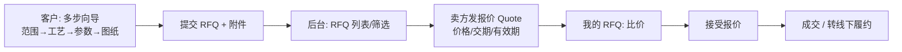
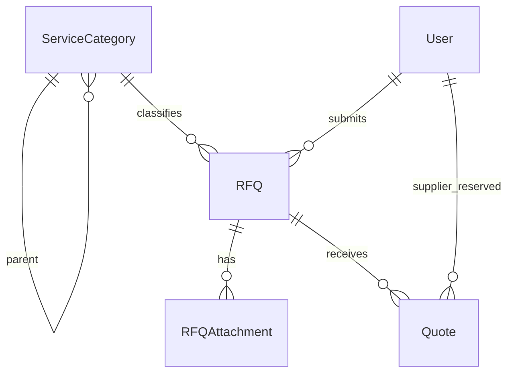
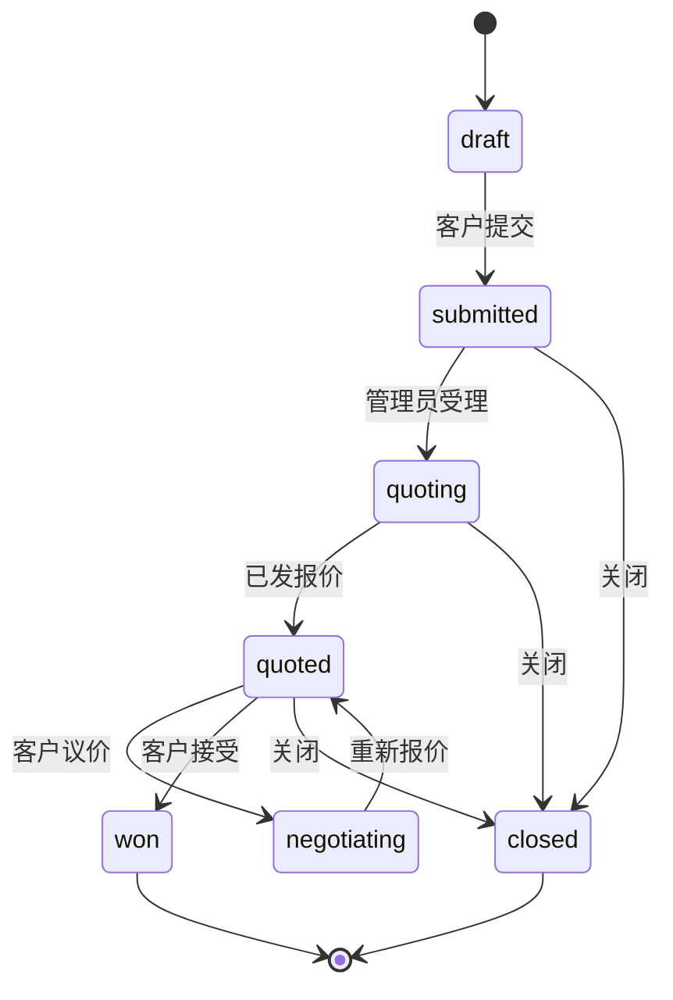

# RFQ 平台化演进方案（多语言）

> 本文档是《OEM 制造公司官网与电商管理平台项目书》的演进方案，作为 RFQ 平台化的单一事实来源。原项目书保持为已完成基线；本文档描述基线之上的转型与新增能力。

技术栈保持不变：`Vue 3`、`Vite`、`Django REST Framework`、`MySQL`、`Redis`、`Docker Compose`、`Caddy`。

---

## 1. 背景与定位

### 1.1 转型目标

站点从「OEM 官网 + 零售电商」转型为**以制造工艺为主轴的制造服务 / RFQ（在线询价—报价）平台**，参考 [capa.ai/rfq](https://capa.ai/rfq) 的在线询价模式：客户按制造工艺提交结构化需求与图纸，平台侧回报价，客户比价、沟通、成交。

### 1.2 分阶段策略

- **阶段 A（已完成）：单公司 RFQ**。客户在本站提交结构化制造需求 + 图纸，卖方（自家）在后台回报价，客户在「我的 RFQ」中比价并接受。
- **阶段 B（P7 已实施核心能力）：多供应商撮合平台**。已引入工厂入驻审核、公开 RFQ 需求大厅、工厂在线报价与买家多供应商比价；`scope` 与 `Quote.supplier` 字段已启用。评价、结算、竞价拍卖等仍保留后续。

### 1.3 与原项目书的关系

- 原项目书《OEM Manufacturing Company Website & Platform (Multi-language).md》保持不变，仅在末尾新增「30. 后续演进：RFQ 平台化」索引节指向本文档。
- 原「本期不做/数据模型/API/电商」等章节的电商相关内容，在本方案中被**方案 C（彻底移除零售电商与产品目录）**覆盖，以本文档为准。

### 1.4 范围概述

- **移除**：零售电商与产品目录（前台 `frontend` 与管理后台 `admin` 均移除；后端 `catalog`/`order` 退役）。
- **新增**：`rfq` 后端模块（工艺分类、RFQ、附件、报价）；前台 RFQ 向导与「我的 RFQ」；后台工艺分类管理（可增删）、RFQ 管理、报价管理。
- **保留**：`content`（案例/资讯/FAQ/下载/页面文案）、`inquiry`（简单联系表单）、`accounts`（账户，转型为 RFQ 账户）、`i18n`、媒体存储、Caddy、Compose 基线。
- **多语言**：延续中英日韩，前台默认韩语 `ko`；工艺分类名称、RFQ 展示文案均支持 i18n。

### 1.5 关键预设（可在实施前调整）

- **会员账户转型（已定）**：`accounts` 与登录/注册保留，由「零售会员」转为「RFQ 账户」；前台「我的订单」改为「我的 RFQ / 报价」。**提交 RFQ 必须先注册并登录，不支持游客询价**；未登录点击「在线询价」引导至注册/登录。
- **工艺分类删除策略（已定）**：**只做下线（`is_active=false`），不做物理删除**。后台无「删除」操作，改为「停用/启用」，历史 RFQ 对分类的引用始终保留。
- **电商退役属破坏性变更**：后端 `catalog`（产品/分类/图片）与 `order`（购物车/订单）从 `INSTALLED_APPS`、路由、后台移除，并提供删表迁移。项目处于开发期（含 seed 演示数据），可接受，且 git 可回滚。
- **`inquiry` 保留**：作为「一般联系咨询」入口保留，与结构化 RFQ 并存、互不干扰（见 8.4）。

---

## 2. 信息架构与导航调整

### 2.1 导航变更（方案 C）

- **移除**：`产品`、`商城`（前台路由 `shop/*`、`products`、`products/:id`；后台「产品管理」「分类管理」）。
- **新增**：`在线询价 / RFQ`，作为站点主 CTA。
- **保留/升级**：`首页`、`制造能力`（承载工艺分类展示）、`OEM/ODM`、`案例`、`支持`（FAQ/下载）、`联系`。
- **降级**：`资讯`、`联系` 可移入页脚或「关于」下。

### 2.2 导航前后对比

| 变更 | 项目 | 说明 |
|------|------|------|
| 保留 | 首页 | 首屏 CTA 由 Contact/Products 改为「立即询价」 |
| 升级 | 制造能力 | 对接工艺分类（工艺主轴展示面） |
| 保留 | OEM/ODM | 服务说明与合作流程 |
| 新增 | 在线询价 / RFQ | 主入口/主按钮 |
| 保留 | 案例 | 信任背书 |
| 保留 | 支持 | FAQ / 下载 |
| 降级 | 资讯 | 移入页脚或次级 |
| 弱化 | 联系 | RFQ 吸收询盘转化，联系降为纯联系方式 |
| 移除 | 产品 | 随产品目录退役 |
| 移除 | 商城 | 随零售电商退役 |

### 2.3 建议新导航

顶部：**首页 · 制造能力 · OEM/ODM · 在线询价（主 CTA） · 案例 · 支持 · 关于**
页脚：资讯、联系方式、下载、隐私/条款等。

### 2.4 RFQ 主流程

---

## 3. 数据模型（新增 `rfq` app）

### 3.1 多语言与金额策略

- 内容型字段（工艺分类名称等）沿用 `I18nJSONField`（`{"ko","zh","en","ja"}`），缺失回退 `ko`。
- 金额沿用 KRW 整数存储，字段 `*_amount` + `currency`（预留多币种）。

### 3.2 实体关系

### 3.3 ServiceCategory（工艺分类，管理员可增删）

| 字段 | 类型 | 说明 |
|------|------|------|
| id | BigInt | 主键 |
| parent | FK self nullable | 父分类（树形，支持两级：大类/工艺） |
| name | i18n | 工艺名称（如 CNC、钣金、注塑、铸造…） |
| slug | slug unique | URL 标识 |
| icon | string nullable | 图标标识（可选） |
| sort_order | int | 排序 |
| is_active | bool | 是否启用；**下线即「删除」语义**，不做物理删除，历史 RFQ 关联始终保留 |
| created_at / updated_at | datetime | 时间戳 |

说明：对齐 CAPA 工艺轴，初始可 seed：CNC、钣金、切割、铸造、锻造、金型/注塑、焊接、热处理、研磨、表面处理、组装等；后续由管理员在后台自行新增、编辑、停用/启用（不提供物理删除）。

### 3.4 RFQ（询价单）

| 字段 | 类型 | 说明 |
|------|------|------|
| id | BigInt | 主键 |
| rfq_no | string unique | 询价单号（如 `RFQxxxx`） |
| buyer | FK accounts.User | 提交会员（**必填**，须登录，无游客提交） |
| contact_name / contact_phone / company | string | 联系信息（默认取自账户，可覆盖；email 以账户为准） |
| scope | enum | `public` / `supply_chain`（**阶段 B 预留**，A 恒为内部） |
| service_category | FK ServiceCategory | 所需工艺 |
| material | string blank | 材料 |
| quantity | int | 数量 |
| tolerance | string blank | 公差要求 |
| surface_finish | string blank | 表面处理要求 |
| target_delivery_date | date nullable | 期望交期 |
| budget_amount | int nullable | 预算（KRW） |
| currency | string | 固定 `KRW` |
| remark | text blank | 补充说明 |
| status | enum | 见第 4 章 |
| created_at / updated_at | datetime | 时间戳 |

### 3.5 RFQAttachment（附件）

| 字段 | 类型 | 说明 |
|------|------|------|
| id | BigInt | 主键 |
| rfq | FK RFQ | 所属询价单 |
| file | FileField | 图纸/CAD/STEP/PDF/图片，存 `rfq/%Y/%m/` |
| file_name | string | 原始文件名 |
| file_type | string | 扩展名/MIME 简写 |
| size | int | 字节数 |
| uploaded_at | datetime | 上传时间 |

### 3.6 Quote（报价单）

| 字段 | 类型 | 说明 |
|------|------|------|
| id | BigInt | 主键 |
| rfq | FK RFQ | 关联询价单 |
| supplier | FK accounts.User nullable | 报价方（**阶段 B 预留**，A 恒为自家/空） |
| price_amount | int | 报价金额（KRW） |
| currency | string | 固定 `KRW` |
| lead_time_days | int | 交期天数 |
| valid_until | date nullable | 报价有效期 |
| note | text blank | 报价说明 |
| status | enum | `draft` / `sent` / `accepted` / `rejected` |
| created_by | FK accounts.User | 创建人（管理员） |
| created_at / updated_at | datetime | 时间戳 |

### 3.7 B-ready 设计要点

- `RFQ.scope` 与 `Quote.supplier` 在阶段 A 即建好（默认值/可空），阶段 B 直接启用，无需迁移改表。
- 工艺分类 `ServiceCategory` 两条路线通用，是买卖双方匹配的基础维度。

---

## 4. 状态机

### 4.1 RFQ 状态

- `draft`：草稿（登录用户暂存，阶段二可选）
- `submitted`：已提交
- `quoting`：受理中
- `quoted`：已报价
- `negotiating`：议价中（阶段二消息线程）
- `won`：成交
- `closed`：关闭/取消

### 4.2 Quote 状态

`draft`（草稿） → `sent`（已发送给客户） → `accepted`（客户接受）/ `rejected`（拒绝/失效）。

---

## 5. API 契约

沿用统一响应包 `code / message / data / request_id`，列表统一 `items + pagination`，错误码 `MODULE_SCENARIO_REASON`。路由前缀延续 `/api/public`、`/api/member`、`/api/admin`。

### 5.1 公开端（匿名可访问）

| 方法 | 路径 | 说明 |
|------|------|------|
| GET | `/api/public/service-categories` | 工艺分类列表（树形，仅 `is_active`） |

说明：**RFQ 提交与附件上传不再对匿名开放**（须登录，见 5.2）。

### 5.2 会员端（须 member JWT）

| 方法 | 路径 | 说明 |
|------|------|------|
| POST | `/api/member/rfqs` | 提交 RFQ（自动绑定 buyer；返回 `rfq_no`） |
| POST | `/api/member/rfqs/{id}/attachments` | 上传附件（校验类型/大小，见第 9 章） |
| GET | `/api/member/rfqs` | 我的 RFQ 列表 |
| GET | `/api/member/rfqs/{id}` | 我的 RFQ 详情（含报价列表） |
| POST | `/api/member/rfqs/{id}/quotes/{quoteId}/accept` | 接受报价（RFQ→won，Quote→accepted） |

### 5.3 管理端（须 admin JWT）

| 方法 | 路径 | 说明 |
|------|------|------|
| GET/POST | `/api/admin/service-categories` | 工艺分类列表/创建 |
| GET/PATCH | `/api/admin/service-categories/{id}` | 工艺分类详情/更新（含停用/启用 `is_active`；**不提供物理删除**） |
| GET | `/api/admin/rfqs` | RFQ 列表（筛选：状态/工艺/日期） |
| GET | `/api/admin/rfqs/{id}` | RFQ 详情（含附件、报价） |
| PATCH | `/api/admin/rfqs/{id}/status` | 变更 RFQ 状态 |
| POST | `/api/admin/rfqs/{id}/quotes` | 为 RFQ 发报价 |
| PATCH | `/api/admin/quotes/{id}` | 更新报价（草稿/发送/失效） |

### 5.4 新增错误码（示例）

| code | HTTP | 说明 |
|------|------|------|
| RFQ_NOT_FOUND | 404 | 询价单不存在 |
| RFQ_STATUS_INVALID | 400 | 当前状态不允许此操作 |
| RFQ_CATEGORY_REQUIRED | 400 | 未选择工艺分类 |
| QUOTE_NOT_FOUND | 404 | 报价不存在 |
| QUOTE_EXPIRED | 400 | 报价已过有效期 |
| RFQ_LOGIN_REQUIRED | 401 | 未登录不可提交 RFQ |
| MEDIA_FILE_TYPE_INVALID | 400 | 附件类型不允许 |
| MEDIA_FILE_SIZE_EXCEEDED | 400 | 附件大小超限 |

---

## 6. 前端改造（frontend）

### 6.1 移除项

- 路由（[frontend/src/router/index.js](frontend/src/router/index.js)）：`products`、`products/:id`、`shop`、`shop/products/:id`、`shop/login`、`shop/register`、`shop/cart`、`shop/checkout`、`shop/orders`。
- 视图：`views/ProductsView.vue`、`views/ProductDetailView.vue`、`views/shop/*`。
- 导航（[frontend/src/layouts/MainLayout.vue](frontend/src/layouts/MainLayout.vue)）：移除「产品」「商城」链接。
- API（[frontend/src/api/index.js](frontend/src/api/index.js)）：移除 `fetchProducts/fetchProduct/fetchCategories` 与 cart/order 相关方法。

### 6.2 账户转型（保留 accounts，强制登录询价）

- 登录/注册页保留，路径由 `shop/login`、`shop/register` 迁移为 `login`、`register`。
- 「我的订单」`shop/orders` 改为「我的 RFQ / 报价」`my/rfqs`，复用 member JWT 与路由守卫。
- **提交 RFQ 强制登录**：RFQ 向导路由标记 `meta.requiresAuth`；未登录点击「在线询价」跳转 `login`（携带 `redirect` 回跳），登录后继续填写。

### 6.3 新增项

- **RFQ 多步向导**（`views/rfq/RfqCreateView.vue`，须登录）：步骤「工艺选择 → 参数(材料/数量/公差/表面/交期/预算) → 图纸上传 → 联系信息(默认取自账户，可覆盖) → 提交」。
- **我的 RFQ**（`views/rfq/MyRfqListView.vue`、`MyRfqDetailView.vue`）：列表 + 详情比价 + 接受报价。
- **能力页对接工艺分类**：[frontend/src/views/CapabilitiesView.vue](frontend/src/views/CapabilitiesView.vue) 增加工艺分类入口，点击带工艺预选跳转 RFQ 向导。
- i18n：补齐 `nav.rfq`、RFQ 向导与我的 RFQ 相关 key（ko/zh/en/ja）。

---

## 7. 管理后台改造（admin）

### 7.1 移除项

- 路由（[admin/src/router/index.js](admin/src/router/index.js)）与侧边栏（[admin/src/layouts/AdminLayout.vue](admin/src/layouts/AdminLayout.vue)）：移除「产品」「分类（产品分类）」「订单」。
- 视图：`views/ProductsView.vue`、`views/CategoriesView.vue`、`views/OrdersView.vue`。
- API（[admin/src/api/index.js](admin/src/api/index.js)）：移除 product/category/order 方法。

### 7.2 新增项

- **工艺分类管理**（`views/ServiceCategoriesView.vue`）：树形 CRUD，管理员可增删改、启停用、排序；名称多语言（复用现有 `MultiLangInput`）。
- **RFQ 管理**（`views/RfqsView.vue`）：列表（状态/工艺/日期筛选）、详情（附件下载、参数）、状态变更、发报价入口。
- **报价管理**：在 RFQ 详情内发/改报价（价格、交期、有效期、说明）。
- i18n：`nav.serviceCategories`、`nav.rfqs` 及相关文案（ko/zh/en）。

### 7.3 保留项

- 询盘、案例、资讯、FAQ、内容页、管理员、下载资源管理保持不变。

---

## 8. 电商模块退役与迁移策略

### 8.1 后端退役范围

- 移除 app：`catalog`（Category/Product/ProductImage）、`order`（Order/OrderItem/CartItem）。
- 依赖清理：`order` 依赖 `catalog` 与 `accounts`；需同时退役 `catalog` 与 `order`。
- 路由：从核心 urls 移除 `catalog`/`order` 的 public/member/admin 端点。
- seed：调整 [backend/apps/catalog/management/commands/seed_demo_data.py](backend/apps/catalog/management/commands/seed_demo_data.py)，移除产品/分类 seed，新增工艺分类 seed（或迁至 `rfq` 的 seed 命令）。

### 8.2 迁移步骤（破坏性，需按序执行）

1. 新增 `rfq` app 与模型，生成并应用迁移（先建新表）。
2. 移除 `catalog`/`order` 的引用（urls、admin API、序列化器、前端调用）。
3. 生成删除迁移（`catalog`/`order` 建表回滚 / `migrations` 删除），在开发库执行；生产前备份。
4. 更新 `INSTALLED_APPS`，移除退役 app。
5. 调整 seed 与默认数据命令。

### 8.3 风险与回滚

- **破坏性**：删除 `catalog`/`order` 表会丢失产品/订单数据；当前为开发期演示数据，影响可控。
- **回滚**：所有变更经 git 版本管理；如需恢复电商，回滚提交并重建迁移即可。
- **数据备份**：生产环境执行前先 `mysqldump` 备份。

### 8.4 inquiry 与 RFQ 的关系

- `inquiry`（[backend/apps/inquiry/models.py](backend/apps/inquiry/models.py)）保留为「一般联系咨询」，服务于「联系」页。
- 结构化制造需求走新的 `rfq`；二者独立。若后续希望统一，可将 `inquiry` 作为 RFQ 的 `source=contact` 变体并入（列为阶段二可选项）。

---

## 9. 媒体与上传约束

沿用本地 volume + `MEDIA_ROOT`；RFQ 附件存 `rfq/%Y/%m/`，经 `/media/` 访问。

| 类型 | 允许格式 | 单文件上限 |
|------|----------|-----------|
| 图纸 / 文档 | pdf, dwg, dxf, step, stp, igs, iges | 20 MB |
| 图片 | jpg, jpeg, png, webp | 5 MB |
| 压缩包 | zip | 50 MB |

- 服务端校验扩展名与 MIME，拒绝可执行文件。
- **附件上传须 member JWT**，且绑定属于本人的 `rfq`，限制单 RFQ 附件数量（如 ≤ 10）。
- 上传成功返回相对 `/media/` 路径。

---

## 10. 阶段划分、验收标准与风险

### 10.1 阶段划分

- **阶段 A（本方案）**：工艺分类（后台可增删）+ RFQ 提交/附件 + 报价 + 我的 RFQ 比价接受 + 电商退役 + 导航改造。
- **阶段 A+（可选增强）**：草稿/暂存 RFQ、邮件通知（RFQ 提交/报价发出）、议价消息线程。
- **阶段 B（P7 已实施）**：工厂入驻审核、公开 RFQ 大厅、工厂在线报价、买家多供应商比价；启用 `scope`/`supplier`。
- **阶段 B+（后续）**：评价、结算、竞价拍卖、议价消息线程。

### 10.2 阶段 A 验收标准

- 前台移除产品/商城，无死链；导航含「在线询价」主 CTA。
- **未登录点击「在线询价」跳转注册/登录**；登录用户可提交 RFQ、上传图纸，并在「我的 RFQ」查看与接受报价。
- 后台可对工艺分类新增、编辑、停用/启用、排序（多语言名称）；**停用即删除语义，无物理删除**。
- 后台可查看 RFQ（含附件）、变更状态、发报价。
- 接受报价后 RFQ→`won`、Quote→`accepted`。
- 电商 `catalog`/`order` 已退役，后台无产品/订单入口；迁移可在开发库干净执行。
- 附件上传类型/大小校验生效；`/media/` 可访问。
- 列表接口分页/筛选/排序，响应含 `items+pagination`；错误码稳定。
- 多语言：工艺分类与 RFQ 相关 UI 支持中英日韩，前台默认韩语。

### 10.3 风险清单

- 退役电商为破坏性变更 → 备份 + git 回滚 + 先开发库验证。
- 工艺分类删除 → **已定：只下线（`is_active=false`），不物理删除**，历史 RFQ 引用不受影响；后台不暴露删除操作。
- 账户转型 → **已定：保留 `accounts`，强制登录询价（无游客提交）**；仅调整前端路由与「我的」页语义，既有账户数据不动。
- CAD/3D 文件较大 → 提高上限并做大小/类型校验，必要时异步处理（阶段 A+）。

---

## 11. 实施顺序建议（供后续确认）

1. 后端：新增 `rfq` app（模型 + 迁移 + API：工艺分类/RFQ/附件/报价）。
2. 后端：退役 `catalog`/`order`，调整 seed 与 `INSTALLED_APPS`。
3. 管理后台：工艺分类管理、RFQ 管理、报价管理；移除产品/分类/订单。
4. 前台：移除产品/商城；账户路由迁移；RFQ 向导与我的 RFQ；能力页对接工艺分类。
5. i18n 补齐、构建、`docker compose` 重建与自检。

> 本文档为方案设计。代码实施将作为后续单独确认的步骤执行。
