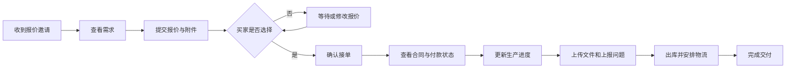
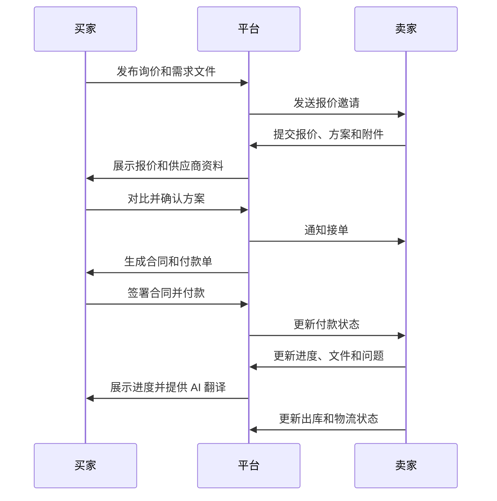
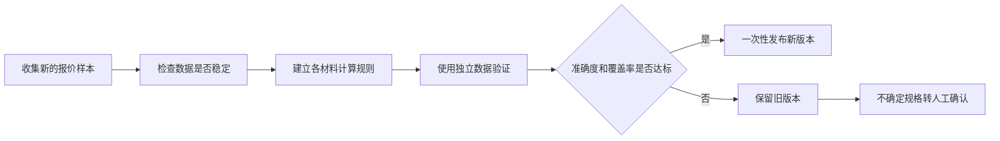

# OEM.co 本周产品功能升级汇报

## 报价、履约、3D 打印、PCB 与 AI 翻译

汇报周期：本周

---

# 01｜本周工作概览

本周完成 8 项重点升级：

- 报价信息更加完整、透明
- 询价到交付实现一站式管理
- 3D 打印支持真实切片报价
- PCB 报价准确度进一步提升
- PCB 自动报价范围更加可靠
- 项目问题与进度展示更加清晰
- 时间线和问题支持 AI 翻译
- 项目文件支持 AI 全文翻译

---

# 02｜买家操作流程

- 一次询价即可对比多家供应商
- 确认方案后自动进入合同和付款
- 全程查看进度、问题和项目文件
- 跨语言内容可以直接使用 AI 翻译

---

# 03｜卖家操作流程

- 集中处理报价、附件和企业资料
- 方案确认前可以修改报价
- 接单后持续更新生产与交付状态
- 买家可以及时看到公开进度和问题

---

# 04｜买卖双方如何互动

---

# 05｜互动原则

- 平台连接双方，减少分散沟通
- 买家查看客户价格，卖家查看自己的报价
- 联系方式、供应商成本等敏感信息受到保护
- 进度、问题和文件集中在同一订单中
- AI 翻译帮助双方理解不同语言的内容

---

# 06｜详细报价与履约升级

- 买家可以对比多家供应商报价
- 展示供应商企业名称，但隐藏联系方式
- 页面、订单、合同和付款金额保持一致
- 确认方案后自动生成合同和付款单
- 履约分为订单、采购、生产、出库、物流五个阶段
- 每个阶段均可上传和查看相关文件

**业务价值：** 报价更清楚，金额更准确，交付进度更容易掌握。

---

# 07｜报价详情与附件

- 点击报价即可查看完整内容
- 展示供应商规模、产能、设备和认证
- 供应商可上传方案、认证及案例附件
- 支持 PDF、图片和 Excel 在线预览
- 方案确认后，报价及附件自动锁定
- 不向买家公开供应商成本和联系方式

**业务价值：** 买家获得更充分的信息，更快选择合适的供应商。

---

# 08｜询价一站式履约

确认方案后，买家可在同一页面：

- 查看和签署合同
- 查看付款状态、上传付款凭证
- 查看五阶段项目进度
- 查看报价附件和项目文件
- 随时返回当前订单详情

供应商也可在同一页面完成接单，并查看合同、付款状态、项目进度和文件。

**业务价值：** 从询价到交付集中管理，减少页面切换。

---

# 09｜3D 打印真实切片报价

- 支持上传 STL、STP 和 STEP 模型
- 模型可以在线旋转、缩放和查看
- 自动计算实际耗材重量和打印时间
- 根据材料、设备、质量、数量和后处理计算报价
- 管理员可以灵活调整计价规则
- 切片失败时明确提示，不使用虚假数据报价

**业务价值：** 报价更真实、更准确，减少人工计算工作。

---

# 10｜PCB 精准报价第九版

- 重新检查 FR-4、铝基板和 FPC 的报价数据
- 修正 FR-4 个别报价偏差过大的问题
- 为铝基板建立独立的计算方式
- 根据板材、层数、面积和数量分别计算
- 对异常价格和数据不足的规格停止自动报价
- 三种材料全部验证通过后才更新线上版本

**业务价值：** 减少 PCB 报价偏差，避免错误价格直接提供给客户。

---

# 11｜PCB 精准报价第十版

- 重点提升 FPC 柔性电路板报价准确度
- 按层数、面积和数量分别计算价格
- 扩大可自动报价的规格范围
- FR-4 和铝基板继续进行准确度检查
- 自动报价准确度和覆盖范围必须同时达标
- 未达到标准的规格自动转为人工确认

**业务价值：** 在保证价格可靠的同时，让更多常用 PCB 规格可以快速报价。

---

# 12｜PCB 报价安全机制

- 新版本验证通过前，不影响当前线上报价
- 历史验证数据只用于发现问题，不重复用于新版本验收
- 发布失败时继续使用稳定旧版本
- 新旧版本均保留，出现问题时可以快速恢复

---

# 13｜项目问题与进度优化

- 买家可以查看供应商上报的问题
- 买卖双方都能查看项目时间线
- 时间线和问题列表放在更醒目的位置
- 问题包含说明、严重程度和处理状态
- 项目文件继续按履约阶段归档

**业务价值：** 项目异常更容易发现，双方沟通更加及时。

---

# 14｜AI 即时翻译

- 项目时间线支持一键翻译
- 问题标题和说明支持一键翻译
- 自动翻译为当前网站语言
- 支持中文、韩文、英文和日文
- 原文与译文同时展示，方便核对
- 翻译失败不会影响项目其他功能

**业务价值：** 降低跨语言沟通成本，提升国际协作效率。

---

# 15｜项目文件 AI 翻译

- PDF、Word 和 Excel 项目文件支持全文翻译
- 扫描版 PDF 可以先识别文字，再进行翻译
- 大文件自动分段处理
- 译文直接在文件预览窗口中查看
- 保留原文件，方便对照确认
- 翻译结果重复查看时响应更快

**业务价值：** 无需下载文件或使用外部工具，即可快速理解文件内容。

---

# 16｜本周成果总结

本周升级完善了四条核心链路：

### 报价链路
查看报价 → 了解供应商 → 对比并确认方案

### 履约链路
合同 → 付款 → 生产进度 → 文件 → 物流交付

### 自动报价链路
上传产品资料 → 自动计算 → 准确度检查 → 报价或人工确认

### 跨语言链路
项目动态 → 问题沟通 → 文件全文翻译

---

# 17｜整体提升

- 信息更加完整
- 操作更加集中
- 报价更加准确
- 自动报价更加可靠
- 进度更加透明
- 文件查看更加方便
- 跨语言沟通更加顺畅

## 让买家更容易下单，让卖家更容易履约
