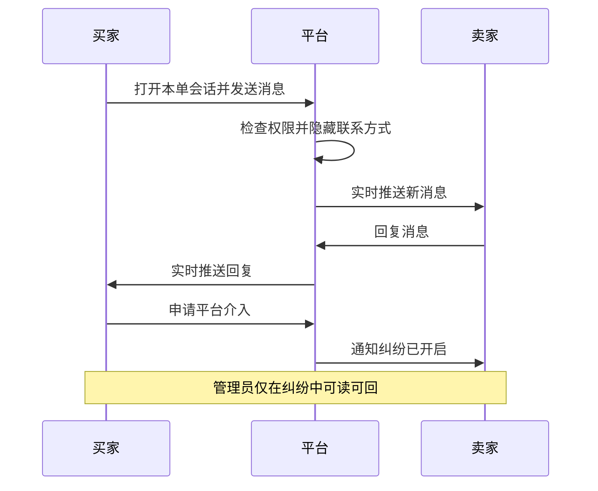
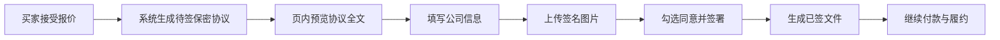
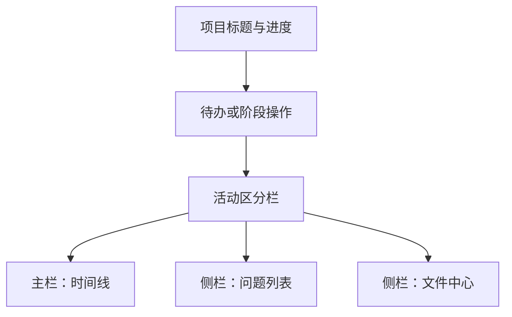

# OEM.co 本周产品功能升级汇报

## 聊天、AI 翻译、保密协议、企业资料与后台配置

汇报周期：本周（2026.7.20 – 7.24）

---

# 01｜本周工作概览

本周完成 7 项重点升级：

- 买卖双方站内实时聊天
- 聊天消息支持一键 AI 翻译
- 详细报价改为保密协议在线签署
- 供应商企业资料表单整理
- 买家报价详情与企业资料对齐，并支持翻译
- 管理端报价参数分组配置
- 项目详情页布局优化

---

# 02｜买卖双方如何沟通

- 报价阶段即可开始聊天
- 每个供应商单独一条会话，互不串线
- 成单后继续用同一会话，不用重新建群
- 平时管理员看不到聊天内容

---

# 03｜站内实时聊天

- 类似微信：消息即时送达，断线后可自动补齐
- 会话顶栏常驻安全提示，提醒不要私下交换联系方式
- 疑似电话、邮箱、微信等会自动打码
- 买卖双方可从询价、报价、项目页一键进入聊天
- 有纠纷时，任一方可申请平台介入
- 平台仅在纠纷开启后查看并回复该会话

**业务价值：** 沟通集中在平台内，降低绕单风险，纠纷时有据可查。

---

# 04｜聊天互动流程

---

# 05｜聊天消息 AI 翻译

- 每条消息旁可点「翻译」
- 自动翻译为当前网站语言（中 / 韩 / 英 / 日）
- 译文显示在原文下方，可再次点击刷新
- 买卖双方聊天均支持；纠纷会话中管理员也可翻译
- 只翻译页面上看到的正文，不还原已隐藏的联系方式
- 翻译失败不影响正常收发消息

**业务价值：** 跨国买卖双方即时沟通更顺畅，减少语言障碍。

---

# 06｜保密协议在线签署

- 接受报价后，「合同」改为「保密协议」
- 页内直接阅读全文，不必先下载
- 必须上传签名图片，并填写公司落款信息
- 勾选同意后才能签署
- 签署后生成带签名的协议文件
- 付款和后续履约流程不受影响

**业务价值：** 成交前先完成保密约定，签署过程更清晰、可追溯。

---

# 07｜保密协议签署流程

---

# 08｜供应商企业资料整理

- 企业资料按「基础名片 / 能力说明 / 公开附件」分组
- 去掉重复电话、地区等容易混淆的项
- 员工规模改为区间选择，填写更轻松
- 付款条件不再由供应商自行填写
- 统一展示为「按平台确认」
- 管理后台同步去掉相关手填项

**业务价值：** 降低供应商填写门槛，付款规则由平台统一，减少歧义。

---

# 09｜报价详情企业资料对齐

- 买家查看报价时，企业资料展示顺序与供应商填写页一致
- 有内容才显示，空字段不再占位
- 所在地只显示「城市 · 国家」
- 简介、主营产品、认证、设备等文字可一键翻译
- 数字类信息（年份、面积、评分）不提供翻译
- 公开企业附件区块保持不变

**业务价值：** 买家更快看懂供应商实力，跨语言也能理解企业介绍。

---

# 10｜管理端报价参数配置台

- 报价参数按业务含义分组展示，不再只看英文编号
- 每项显示中文说明、数值和单位
- 可一次修改多项，再统一保存
- 3D 打印参数引导至专用配置页
- 保留搜索和新建参数能力
- 本轮只改管理后台页面，不影响现有报价接口

**业务价值：** 运营调价更直观、更不容易改错。

---

# 11｜项目详情布局优化

- 大屏：左侧看进度时间线，右侧看问题和文件
- 手机：时间线 → 问题 → 文件，顺序清晰
- 买卖双方页面风格统一
- 供应商阶段面板只保留「发进度 / 报问题 / 上传文件」
- 历史进度、问题、文件集中在下方活动区查看

**业务价值：** 项目信息更好扫读，进度、异常和资料一目了然。

---

# 12｜本周成果总结

本周升级完善了四条关键体验：

### 沟通链路
报价邀请 → 一对一聊天 → 消息一键翻译 → 纠纷可申请平台介入

### 成交链路
接受报价 → 在线签保密协议 → 付款与履约

### 资料链路
供应商整理企业资料 → 买家报价详情对齐展示 → 支持翻译

### 运营与履约链路
后台参数分组配置 → 项目详情分栏查看进度、问题与文件

---

# 13｜整体提升

- 沟通更集中、更安全
- 聊天跨语言一键可读
- 成交前保密签署更规范
- 供应商资料更好填、更好看
- 跨语言企业介绍更容易理解
- 后台调价更省心
- 项目进度与资料更好找

## 让买卖双方沟通更顺，让运营配置更简单
